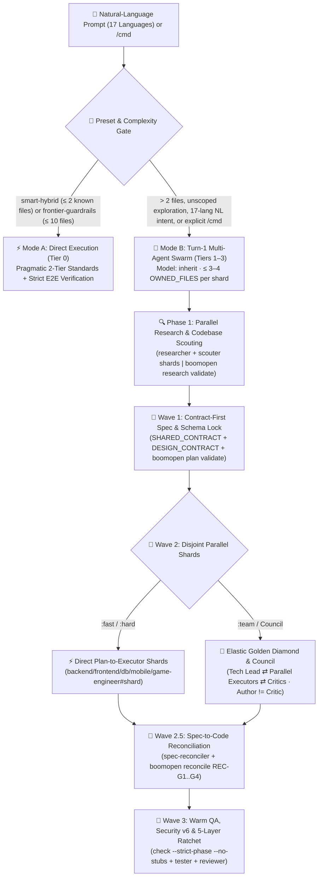

<div align="center">
  <h1>⚡ BoomOpen Workflow Kit Pro v5.5</h1>
  <p><strong>Multi-agent workflow orchestration and deterministic CLI verification gates across Antigravity, Claude Code, OpenAI Codex, Cursor, and GitHub Copilot.</strong></p>

  <p>
    <a href="https://boomopen.com"></a>
    <a href="https://github.com/Kennyboom/BoomOpen-Workflow-Kit-Pro/releases"></a>
    <a href="#platforms"></a>
    <a href="#cli"></a>
    <a href="#skills"></a>
    <a href="https://nodejs.org/">= 18.0.0" /></a>
    <a href="./LICENSE"></a>
  </p>

  <p>
    <b>English</b> •
    <a href="./i18n/README.vi.md">Tiếng Việt</a> •
    <a href="./i18n/README.zh-CN.md">简体中文</a> •
    <a href="./i18n/README.zh-TW.md">繁體中文</a> •
    <a href="./i18n/README.ja.md">日本語</a> •
    <a href="./i18n/README.ko.md">한국어</a> •
    <a href="./i18n/README.es.md">Español</a> •
    <a href="./i18n/README.fr.md">Français</a> •
    <a href="./i18n/README.de.md">Deutsch</a><br/>
    <a href="./i18n/README.pt-BR.md">Português (BR)</a> •
    <a href="./i18n/README.ru.md">Русский</a> •
    <a href="./i18n/README.hi.md">हिन्दी</a> •
    <a href="./i18n/README.ar.md">العربية</a> •
    <a href="./i18n/README.id.md">Bahasa Indonesia</a> •
    <a href="./i18n/README.th.md">ไทย</a> •
    <a href="./i18n/README.tr.md">Türkçe</a> •
    <a href="./i18n/README.it.md">Italiano</a>
  </p>

  <p>
    <a href="https://boomopen.com"><b>🌐 boomopen.com (15 Languages)</b></a> •
    <a href="#trailer"><b>🎬 Launch Trailer</b></a> •
    <a href="#why-boomopen"><b>⚡ Why BoomOpen</b></a> •
    <a href="#architecture"><b>🏗️ Architecture</b></a> •
    <a href="#quickstart"><b>🚀 Quick Start</b></a> •
    <a href="#cli"><b>🛠️ 14 CLI Gates</b></a> •
    <a href="#settings"><b>🎛️ Presets &amp; Settings</b></a> •
    <a href="#commands"><b>🎯 36 Commands</b></a> •
    <a href="#agents"><b>🤖 22 Agents &amp; 18 Teams</b></a> •
    <a href="#skills"><b>📚 1,462 Skills</b></a>
  </p>
</div>

---

<a id="trailer"></a>

## 🎬 Official Launch Trailer & Interactive Web Explorer (`boomopen.com`)

<div align="center">
  <a href="https://github.com/Kennyboom/BoomOpen-Workflow-Kit-Pro/raw/main/assets/media/boomopen_v55_trailer_en.mp4">
    
  </a>
  <p>
    ▶️ <a href="https://github.com/Kennyboom/BoomOpen-Workflow-Kit-Pro/raw/main/assets/media/boomopen_v55_trailer_en.mp4"><b>Stream Full HD 1080p Launch Trailer (MP4 with Studio Voiceover)</b></a> • 🌐 <a href="https://boomopen.com"><b>Explore Live 14-Command CLI Playground &amp; Searchable Catalogs at boomopen.com (15 Languages)</b></a>
  </p>
</div>

---

<a id="why-boomopen"></a>
<a id="-what-is-boomopen-workflow-kit"></a>

## ⚡ Why BoomOpen Workflow Kit?

**The Problem with Raw AI Coding Assistants:** Out of the box, single-agent coding tools degrade once engineering work spans multiple files, domains, or sessions. Sequential file exploration pollutes the primary context window, uncoordinated sub-agents overwrite shared files or leave disconnected "island" modules, generated code ships with silent `TODO` stubs or `any` type escapes, single-model reviews miss their own blind spots (`Author == Critic`), and multi-phase builds drift away from original specifications.

**How BoomOpen Solves It:** BoomOpen installs one unified orchestration and verification harness across **Antigravity (Gemini)**, **Claude Code**, **OpenAI Codex**, **Cursor**, and **GitHub Copilot** with **zero runtime npm dependencies**. With **`smart-hybrid`** enabled by default, `≤ 2`-file edits execute directly with zero overhead, while multi-file builds, deep research, architecture planning, and **`36` slash commands (`93` files)** automatically shard work on Turn 1 across **22 specialist agents** and **18 adversarial 3-role teams** — enforced by **14 local `boomopen` CLI gates** and backed by **`1,462` on-demand skills** (`22` Core + `1,440` deduplicated once in `~/.agents/skills_library`).

### ⚖️ Without BoomOpen vs. With BoomOpen v5.5

| Engineering Failure Mode | Without BoomOpen (Raw AI IDE) | With BoomOpen Workflow Kit Pro v5.5 |
|:-------------------------|:------------------------------|:------------------------------------|
| **Context Window Bloat** | Primary agent reads 15–30 files sequentially before writing a line of code | **Turn-1 Elastic Swarm (`role#shard`)**: Dispatches read-only scouts & domain shards (`≤ 3–4` files/shard) + `0s` Warm Reuse (`send_message`) |
| **Parallel Overwrites & Broken Wiring** | Parallel agents clobber shared files, invent mismatched `/api` routes, or leave dead modules | **Contract-First Locks + Wave 2.5 Reconcile**: Locks Wave 1 `SHARED_CONTRACT` + disjoint `OWNED_FILES`, verified by `boomopen reconcile` (`REC-G1..G4`) |
| **Shallow Research & Vague Plans** | Single-perspective answers ("great idea!"), unchecked claims, free-form prose plans | **Evidence-Gated 6-Block Specs**: Adversarial `:team` Devil's Advocate + `< 50ms` CLI validators (`boomopen research`, `design`, `plan`) |
| **Silent Stubs, `any` & Test Gaming** | Agent declares completion while leaving `// TODO`, explicit `any`, `console.log`, or `.skip` tests | **Pragmatic 2-Tier Static Gate**: `boomopen check --strict-phase --no-stubs` enforces `0` `any`, `0` stubs, and cohesive `400/500`-line files |
| **Multi-Session Drift & Regressions** | Context compaction erases phase constraints, breaking previously passing features | **5-Layer Phase Ratchet & Rollback**: `.boomopen/project-ledger.json` SHA-256 spec-drift guard, `/autopilot`, `/audit`, and atomic `rollback --yes` |
| **Single-Model Blind Spots** | Same model writes and reviews its own code (`Author == Critic`) | **Cross-Engine Conductor (`/conduct`)**: Parallel Multi-Engine Councils & cross-family pipelines across Claude Code, Codex, Antigravity, Cursor & Copilot |
| **5-IDE Config Drift & Dirty Git Tree** | Separate prompt files per IDE, gigabytes of duplicated skills, temporary specs cluttering `git status` | **Unified Sync & Clean Git**: 14 entry files synced in `< 10ms`, 1 shared `~/.agents/skills_library` (`0` idle tokens), and Brain Artifacts routing |

---

<a id="architecture"></a>
<a id="-smart-hybrid-architecture-v55"></a>

## 🏗️ Smart-Hybrid Architecture (v5.5)



---

<a id="pillars"></a>

## 🧠 6 Core Engineering Pillars

1. **🌐 5-IDE Native Compilation & Deduplicated Vault (`platforms/*`)**:
   - Compiles **22 specialist agents** and **93 command/reference files** into native formats per IDE: **Antigravity** (`--as-plugin` bundle + `3` executable `run_workflow` Python scripts: `audit_fanout.py`, `review_fanout.py`, `research_fanout.py`), **Claude Code** (`isolation: worktree` shards, `/plan:hard` colon commands, opt-in `PreToolUse` & `Stop`/`PreCompact` hooks), **OpenAI Codex** (`22` TOML roles with OS `read-only` scout/critic sandboxes + `87` `$boomopen-*` skills), **Cursor** (`.mdc` rules + optional `beforeShellExecution` hook), and **GitHub Copilot** (`.agent.md` prompt agents).
   - Links all `1,440` library skills once into `~/.agents/skills_library` across all 5 IDEs (~80% disk savings, `0` Turn-1 token bloat).
2. **🎯 4-Tier Dynamic Elastic Swarm (`role#shard`) & Scoped Warm Reuse**:
   - Scales automatically from **Tier 0** (`0` sub-agents for `≤ 2` known files) → **Tier 1** (`2–3` shards) → **Tier 2** (`4–6` shards) → **Tier 3** (`7–8+` shards, configurable up to `16`), capping cognitive load at **`≤ 3–4 OWNED_FILES` per sub-agent** and reusing active sessions via `role#shard → conversationId` (`send_message`).
3. **🤝 3-Wave Contract-First Execution + Wave 2.5 Reconciliation (`REC-G1..G4`)**:
   - Wave 1 locks `SHARED_CONTRACT` (API schemas/DTOs) and `DESIGN_CONTRACT` (OKLCH `@theme` CSS + TypeScript props) before Wave 2 dispatches parallel engineers. Wave 2.5 runs `boomopen reconcile` + `spec-reconciler` to catch unwired island files (`REC-G1`), frontend/backend route mismatches (`REC-G2`), skipped `[SC-*]` sub-clauses (`REC-G3`), and missing `.env.example` keys (`REC-G4`), auto-amending delta waves via `boomopen cook amend-plan`.
4. **🏛️ Multi-Session Autopilot (`/autopilot`) & Stateful Multi-Round Audit (`/audit`)**:
   - Compiles multi-doc specs into `.boomopen/project-ledger.json` with SHA-256 drift detection, pre-phase Git checkpoints (`boomopen ledger rollback --yes`), and a strict **5-Layer Phase Quality Ratchet** (`G1 check --strict-phase --no-stubs` → `G2 monotonic test ratchet` → `G3 reconcile --strict` → `G4 Author != Critic review` → `G5 ledger verify`). Post-build, `/audit` runs human-gated multi-round RTM, vertical flow, and Security v6 audits (`.boomopen/audit-ledger.json` + `boomopen audit rollback --yes`).
5. **🎼 Cross-Engine Conductor & Multi-Engine Council (`boomopen conduct`)**:
   - Orchestrates Claude Code, OpenAI Codex, Antigravity, Cursor, and Copilot simultaneously in **6-Task Parallel Councils** (`research`, `brainstorm`, `plan`, `design`, `review`, `debug` → 4-Part `COUNCIL-SYNTHESIS.md`) or **Cross-Family Role Pipelines** where no model grades its own output (`Author != Critic`).
6. **📏 Pragmatic 2-Tier Coding Standards & SPIE v3.0 Root-Cause Debugging**:
   - **Tier 1 (Zero Tolerance)**: Single responsibility, `0` explicit `any`, `0` debug `console.log` in app code, typed `try/catch` boundaries, `SCREAMING_SNAKE_CASE` constants. **Tier 2 (Cohesion First)**: `~200–350` line target (`400` soft / `500` hard split; tests/types/docs exempt). Bugs go through 3 ranked hypotheses and a **5-Whys (SPIE v3.0)** causal trace while routing transient specs to Brain Artifacts (`100%` clean Git working tree).

---

<a id="platforms"></a>
<a id="-supported-ai-platforms"></a>

## 💻 5 Supported AI Coding Platforms

| Platform | Support | Synced Entrypoint(s) | Native Platform Integration |
|:---------|:-------:|:---------------------|:----------------------------|
| **Antigravity (Gemini)** | ✅ v5.5 | `~/.gemini/GEMINI.md` | `invoke_subagent`, `run_workflow` Python fan-out, `/goal` outer loop, `--as-plugin` bundle, opt-in `--with-hooks`, Brain Artifacts |
| **Claude Code** | ✅ v5.5 | `~/.claude/CLAUDE.md` | Parallel `Task`/`Agent` shards (`isolation: worktree`), `/plan:hard` colon commands, opt-in `PreToolUse` & `Stop`/`PreCompact` hooks |
| **OpenAI Codex** | ✅ v5.5 | `~/.codex/AGENTS.md` & `CODEX.md` | `22` TOML roles in `~/.codex/agents/boomopen/` with OS `sandbox_mode = "read-only"` for scouts/reviewers + `87` `$boomopen-*` skills |
| **Cursor** | ✅ v5.5 | `~/.cursor/rules/boomopen-workflow-kit.mdc` | Always-on `.mdc` frontmatter rules, `CURSOR.md`, sub-agent routing & opt-in `.cursor/hooks.json` (`beforeShellExecution`) |
| **GitHub Copilot** | ✅ v5.5 | `~/.copilot/copilot-instructions.md` | VS Code compiled `boomopen-workflow-kit.agent.md` prompt agent, `runSubagent` dispatch & `COPILOT.md` |

---

<a id="quickstart"></a>
<a id="-quick-start--installation"></a>

## 🚀 Quick Start & Installation (Git Only — Zero Runtime Dependencies)

```bash
# 1. Clone the repository (distributed via GitHub only — never published on npm)
git clone https://github.com/Kennyboom/BoomOpen-Workflow-Kit-Pro.git
cd BoomOpen-Workflow-Kit-Pro

# 2. Install for your AI IDE (default preset: smart-hybrid) or across all 5 IDEs at once
npm run install:all                                 # Install & sync all 5 IDEs + shared ~/.agents/skills_library
npm run install:antigravity                         # Google Antigravity 2.0 (or add --as-plugin / --with-hooks)
node cli/install.js install claude --with-hooks     # Claude Code + opt-in PreToolUse & Stop/PreCompact hooks
npm run install:codex                               # OpenAI Codex CLI + OS read-only scout/reviewer sandboxes
npm run install:cursor                              # Cursor (pass --with-hooks for beforeShellExecution guard)
npm run install:copilot                             # GitHub Copilot (VS Code .agent.md + copilot-instructions.md)

# 3. Verify health & optionally link `boomopen` onto your global PATH
npm run doctor
npm link
boomopen settings status
```

> **Safe Non-Destructive Install & Uninstall**: Tracked via SHA-256 manifests (`~/.boomopen/manifests/<tool>.json`). Existing personal rules in `GEMINI.md` / `CLAUDE.md` are preserved outside kit markers and backed up automatically; `boomopen uninstall <tool|--all>` cleanly removes unmodified kit files while leaving your own files intact.

---

<a id="cli"></a>

## 🛠️ 14 Zero-Dependency CLI Subcommands (`boomopen`)

Runs locally in `< 50ms` on Node.js `>= 18` with **zero npm runtime dependencies** and **zero network calls**:

| Subcommand | Key Flags & Syntax | Deterministic Gates & Purpose |
|:-----------|:-------------------|:------------------------------|
| **`install` / `uninstall` / `list`** | `<tool\|--all> [--with-hooks] [--as-plugin]` | SHA-256 manifest installer, shared `~/.agents/skills_library` linker, opt-in safety hooks & clean uninstaller |
| **`doctor`** | `[--source-only]` | Read-only 30-point audit of all 5 IDE bundles, `93` command files, `72` team files, `1,462` skills & synced settings |
| **`settings`** | `status \| preset <name> \| set <k> <v> \| --ui` | Manage 5 presets + `22` config keys (`--project` for `./.boomopen.json`) or launch CSP-hardened Web UI (`127.0.0.1:4567`) |
| **`research`** | `<validate\|brief> <file.md> [--mode brainstorm]` | Enforces **`RES-G1..G4`** (`≥ 4` triangulated sources, contradiction matrix, pre-mortem risks) & compiles `HANDOFF_BRIEF` |
| **`design`** | `<validate\|contract> <DESIGN.md> [--json]` | Enforces **`DESIGN-G1..G4`** (6-Block spec, OKLCH tokens, 5-State UI Matrix, WCAG 2.2 AA) & emits `DESIGN_CONTRACT` |
| **`plan`** | `<validate\|compile> <PLAN.md> [--sync-ledger]` | Enforces **`PLAN-G1..G5`** (acyclic DAG, disjoint `OWNED_FILES ≤ 4`/shard, `SHARED_CONTRACT`) & syncs ledger |
| **`cook`** | `<state\|packets\|verify-wave\|preflight\|amend-plan>` | Enforces **`COOK-G1..G4`**: 5-stage fast-forward state, 5-Field Wave Handoff Packets, git write-lock checks & delta waves |
| **`reconcile`** | `<dir> [--plan <PLAN.md>] [--strict]` | Wave 2.5 **`REC-G1..G4`**: detects unwired island modules, `/api` route drift, skipped `[SC-*]` clauses & `.env.example` gaps |
| **`check`** | `[path] --strict-phase --no-stubs [--ignore <dir>]` | Pragmatic 2-Tier static gate: `400/500`-line budgets, `0` explicit `any`, `0` debug `console.log`, `0` stubs/`TODO`s/`.skip` |
| **`ledger`** | `<init\|from-plan\|status\|next\|verify\|rollback>` | Multi-session `.boomopen/project-ledger.json` DAG state machine, SHA-256 spec-drift guard & atomic `rollback --yes` |
| **`audit`** | `<init\|slice\|record\|approve\|verify-fix\|rollback>` | Stateful multi-round post-completion audit ledger (`.boomopen/audit-ledger.json`), burn-down ratchet & `rollback --yes` |
| **`conduct`** | `<probe\|council\|dispatch\|status> [--dry-run]` | Cross-engine conductor & 6-task parallel Multi-Engine Council (`Author != Critic` across 5 IDEs → `COUNCIL-SYNTHESIS.md`) |

---

<a id="settings"></a>
<a id="-unified-settings--mode-selection-settings"></a>

## 🎛️ Unified Control Center & 5 Presets (`/settings`)

Manage **`20` enum keys + `2` custom line-limit keys** globally (`~/.boomopen/settings.json`) or per repo (`./.boomopen.json`), hot-synced across all 14 IDE entry files in `< 10ms`:

| Preset Profile | Execution Mode (`execution.mode`) | Default `/cmd` | 17-Language NL Routing (`naturalLanguageResearchTrigger`) | Coding Standards | Best Used For |
|:---------------|:----------------------------------|:--------------:|:---------------------------------------------------------:|:----------------:|:--------------|
| **⚡ `smart-hybrid`** *(Default)* | **`auto`** (`≤ 2` files direct; `> 2` files or `/cmd` → Mode B Swarm) | `auto` | **`auto_team`** *(Routes NL research/ideation/review to `:team` & workflows across 17 languages)* | `pragmatic` (`400/500`L) | Default out-of-the-box experience: natural-language intent routing + automatic Turn-1 parallel sharding |
| **🛡️ `frontier-guardrails`** *(Slim Opt-In)* | **`mode_a`** (`≤ 10` files direct; `< 2.5 KB` / `~600`-token entrypoint) | `auto` | **`off`** *(Explicit `/cmd` only — zero NL interception)* | `pragmatic` (`400/500`L) | Ultra-slim `< 2.5 KB` daily direct mode with strict 2-Tier & E2E gates *(`carbon-guardrails` alias supported)* |
| **🚀 `solo-fast`** | **`mode_a`** (`≤ 10` files direct; conservative max `3` shards) | `fast` | `off` | `relaxed` (`600/800`L) | Rapid prototyping, small scripts, urgent hotfixes & minimal token spend |
| **🧠 `deep-architect`** | **`mode_b`** *(Strict Mode B Orchestrator; max `12` shards)* | `hard` | `auto_hard` + `council` research / `cross_family` review | `strict` (`300/400`L) | Complex system architecture, greenfield design & cross-module refactors |
| **🔺 `adversarial-team`** | **`team`** *(Elastic Golden Diamond `:team`; `hyper_swarm` max `12`)* | `team` | **`auto_team`** + `council` research, planning & review | `strict` (`300/400`L) | Mission-critical production releases, security audits & multi-engine consensus |

```bash
# Switch presets or customize keys via Chat (/settings), Local Web UI (--ui), or CLI:
boomopen settings --ui                                      # Launch Local Web Control Center at http://127.0.0.1:4567
boomopen settings preset smart-hybrid                       # Default: Auto Mode A/B + 17-language NL workflow routing
boomopen settings preset frontier-guardrails                # Opt-in: < 2.5 KB slim Mode A (alias: carbon-guardrails)
boomopen settings set engines.reviewer cross_family         # Enforce cross-family Reviewer (Author != Critic)
cd path/to/your/repo && boomopen settings mode team --project # Repo-scoped ./.boomopen.json override
boomopen settings reset                                     # Restore default smart-hybrid configuration
```

---

<a id="commands"></a>
<a id="-slash-commands-reference"></a>

## 🎯 All 36 Slash Commands Reference (`93` Files = `87` Workflows + `6` `_ref/`)

Speak naturally in **any of the 17 supported languages** under `smart-hybrid` or invoke any of the **36 canonical slash commands** explicitly:

| Category | Command | Variants | Purpose & Deterministic Deliverables |
|:---------|:--------|:---------|:-------------------------------------|
| **Orchestration & Autonomy** | **`/cook`** | `:fast`, `:hard`, `:team` | End-to-end feature builder when no plan exists (Scout → Contract Plan → Parallel Shards → Wave 2.5 Reconcile → QA) |
| | **`/code`** | `:fast`, `:hard`, `:team` | Execute an approved `PLAN-{task}.md` directly across Wave 1–3 shards without re-running `/plan` |
| | **`/autopilot`** | `:init`, `:run`, `:audit` | Multi-session spec-to-production orchestrator via `.boomopen/project-ledger.json` & **5-Layer Phase Quality Ratchet** |
| | **`/conduct`** | `:council`, `:pipeline` | Multi-engine parallel council (`COUNCIL-SYNTHESIS.md`) & cross-family role pipeline across 5 IDEs (`--dry-run` ready) |
| | **`/orchestrate`** / **`/auto`** | — | Custom multi-domain swarm coordination (`/orchestrate`) or full end-to-end autonomous execution (`/auto`) |
| **Architecture, Design & Research** | **`/plan`** | `:fast`, `:hard`, `:team` | 5-Gate `PLAN-{task}.md` blueprint locking `SHARED_CONTRACT`, disjoint `OWNED_FILES ≤ 4`/shard & Given/When/Then criteria |
| | **`/architect`** | — | Design-only system blueprint: C4 diagrams, ADRs, DB schemas, API contracts, screen specs & coverage audit (writes zero code) |
| | **`/design`** / **`/ui-ux-pro-max`** | `:fast`, `:hard`, `:team` | 6-Block UI/UX `DESIGN-{task}.md` + `DESIGN_CONTRACT` (`@theme` OKLCH tokens, 5-State UI Matrix, 50+ styles & live HTML preview) |
| | **`/research`** | `:fast`, `:hard`, `:team` | 5-Lens Deep Research (`RESEARCH-{topic}.md`, `RES-G1..G4` ≥ 4-source triangulation, contradiction table & `HANDOFF_BRIEF`) |
| | **`/brainstorm`** / **`/ask`** | `:fast`, `:hard`, `:team` | Anti-sycophancy strategic ideation (`BRAINSTORM-{topic}.md` with pre-mortem & MCDA matrix) & evidence-gated Q&A (`/ask`) |
| **Quality, Audit, Debug & Security** | **`/review`** | `:fast`, `:hard`, `:team` | Multi-lens adversarial code, architecture, security & performance review (`Author != Critic`, 1-click proceed to `/fix`) |
| | **`/audit`** / **`/deep-audit`** | `:run`, `:fix`, `:auto` | Post-build multi-round whole-project audit (`/audit` ledger) & pre-code 10-dimension spec logic audit (`/deep-audit`) |
| | **`/security-audit`** | — | OWASP Top 10 + LLM/Agentic Top 10 scan (`security_scan.py` v6), STRIDE threat modeling, auth & supply-chain report |
| | **`/debug`** / **`/fix`** | `:fast`, `:hard`, `:team` | 3-Hypothesis + **5-Whys (SPIE v3.0)** root-cause trace (`DEBUG-{issue}.md`) & fail-first TDD bug resolution (`/fix`) |
| | **`/test`** / **`/performance`** / **`/refactor`** | `:fast`, `:hard`, `:team` | Zero-test-gaming QA shards (`/test`), Core Web Vitals / DB / bundle tuning (`/performance`), and metric-verified `/refactor` |
| **Git, Release, Docs & Session Ops** | **`/onboard`** / **`/init`** | — | 60-second read-only brownfield `ARCHITECTURE-MAP.md` (`/onboard`, zero `/init` collision) & greenfield bootstrap (`/init`) |
| | **`/pr`** / **`/release`** | —, `:review` | Pre-PR quality & reconcile gate + `gh pr create` / adversarial diff review (`/pr:review`), and parity-gated semantic `/release` |
| | **`/deploy`** / **`/rollback`** | `:check`, `:preview`, `:production`, `:rollback` | Deployment readiness gates, preview/production rollouts (`/deploy`), and severity-graded emergency recovery (`/rollback`) |
| | **`/docs`** / **`/report`** | `:core`, `:business`, `:audit` / `:fast..:team` | Source-grounded `./documents/` suites (`/docs`) and zero-fiction CLI telemetry status reports (`/report`) |
| | **`/settings`** / **`/status`** / **`/next`** | — | Unified Control Center (`/settings`), live ledger/swarm health board (`/status`), and smart next-step navigator (`/next`) |
| | **`/preview`** / **`/save`** / **`/recap`** | — | Local dev-server lifecycle manager (`/preview`), session state persistence (`/save`), and `< 5s` context recovery (`/recap`) |

### 🌙 Overnight Multi-Phase Project Playbook (`/autopilot` & `/goal`)

| Workflow | Target Platform & Runner | Context Continuity | Quality & Spec Guarantees |
|:---------|:-------------------------|:-------------------|:--------------------------|
| **`/autopilot` (+ `--with-hooks`)** | All 5 IDEs (pair with `--with-hooks` on **Claude Code**, **Antigravity** & **Cursor**) | `Stop` & `PreCompact` hooks (`stop-quality-gate.mjs`) + `.boomopen/project-ledger.json` preserve cursor across compactions | Enforces **5-Layer Phase Quality Ratchet** (`G1..G5`), Wave 2.5 `reconcile`, and `boomopen ledger rollback --yes` |
| **`/goal` + `/autopilot` + `/audit`** | **Antigravity 2.0** persistent outer loop for large `docs/` specs | Antigravity's native **`/goal`** runner loops across phases until every ledger phase is `VERIFIED` | Runs every phase through all 5 gates + Wave 2.5 reconciliation, then executes Round 1 of **`/audit`** |

```text
/goal Use /autopilot to read all project documentation in docs/, initialize .boomopen/project-ledger.json, and autonomously implement every phase sequentially (every phase must pass all 5 verification gates and Wave 2.5 reconcile). Once 100% of phases pass, run Round 1 of /audit and stop with a summary report for my review.
```

---

<a id="agents"></a>
<a id="-22-specialist-agents--18-golden-triangle-teams"></a>

## 🤖 22 Specialist Agents & 18 Adversarial 3-Role Teams

Every sub-agent inherits your session model (`Model: "inherit"` — `flash_lite` is strictly forbidden) and pairs into **18 Golden Diamond / Triangle teams** (`Tech Lead` ⇄ `Parallel Shard Executors` ⇄ `Independent Reviewers/Critics`):

| Domain | Specialist Agents (`agents/*.md`, compiled per IDE) | 3-Role Review Teams (`agents/teams/*-team/`, `72` files) |
|:-------|:----------------------------------------------------|:---------------------------------------------------------|
| **Engineering & Execution** | `backend-engineer`, `frontend-engineer`, `mobile-engineer`, `game-engineer`, `database-architect`, `devops-engineer` | `backend-team`, `frontend-team`, `fullstack-team`, `mobile-team`, `game-team`, `database-team`, `devops-team` |
| **Architecture & Product** | `tech-lead`, `planner`, `brainstormer`, `business-analyst`, `project-manager`, `designer` | `planning-team`, `brainstorm-team`, `project-team`, `design-team` |
| **Quality, Reconcile & Security** | `debugger`, `tester`, `reviewer`, `spec-reconciler`, `security-engineer`, `performance-engineer` | `debug-team`, `qa-team`, `security-team`, `performance-team` |
| **Research & Documentation** | `researcher`, `scouter`, `docs-manager`, `reporter` | `research-team`, `docs-team`, `report-team` |

---

<a id="skills"></a>
<a id="-1460-skills-vault-22-core--1440-niche-library-skills"></a>

## 📚 1,462-Skill On-Demand Vault (`22` Core + `1,440` Library Skills)

Indexed across **19 engineering domains** in `matrix-skills/compact-index.json`, deduplicated once into `~/.agents/skills_library`, and loaded via **2-Step O(1) Progressive Resolution** (`skills/` Core check → `compact-index.json` lookup → load matched `SKILL.md` only into the assigned shard, `0` idle tokens):

| Tier / Engineering Domain | Skills | Representative Capabilities & Scaffolds | Loading |
|:--------------------------|:------:|:----------------------------------------|:--------|
| **⚡ Core Workflow & Quality (`skills/`)** | **22** | `clean-code`, `debugger`, `plan-writing`, `brainstorming`, `deep-research`, `design-spec`, `frontend-design`, `frontend-architecture`, `api-patterns`, `database-design`, `tdd-workflow`, `testing-patterns`, `webapp-testing`, `security-auditor` (`security_scan.py` v6), `app-builder` (**15 project templates** incl. **`mcp-server`**, **`ai-agent-worker`**, `nextjs-saas`, `monorepo-turborepo`, `python-fastapi`, `flutter-app`), `skill-seeker` | Ready at Turn 1 |
| **🤖 AI, Agentic SDKs, MCP & Data** | **340+** | FastMCP (`StreamableHTTP`), OpenAI Agents SDK, Claude Agent SDK, Google ADK, Vercel AI SDK, LangGraph, RAG, BigQuery, dbt | On-demand (`compact-index.json`) |
| **🌐 Web, Backend, API & Databases** | **380+** | React 19, Next.js 15 RSC, Tailwind CSS v4, TanStack Start/Router/Query, Hono RPC + Zod OpenAPI, Rust Axum/SQLx, Drizzle, Postgres/RLS | On-demand (`compact-index.json`) |
| **☁️ Cloud, DevOps, QA & Security** | **300+** | Cloudflare Workers/Durable Objects/D1, Docker/K8s, Terraform, Playwright, Vitest + MSW v2, Better Auth (Passkeys), OWASP LLM Top 10 | On-demand (`compact-index.json`) |
| **🎨 UI/UX, Game Engines & Mobile** | **420+** | OKLCH Design Tokens, WCAG 2.2 AA, Motion, Unity 6 DOTS/ECS, Godot 4, Unreal 5, WebGPU/Three.js, Phaser/PixiJS, Tauri v2, SwiftUI, Flutter, React Native | On-demand (`compact-index.json`) |

---

## 📂 Repository Structure

```text
BoomOpen-Workflow-Kit-Pro/
├── agents/                  # 22 Specialist Agents (compiled per IDE) + 18 3-Role Teams (72 files)
├── cli/                     # 14 Zero-Dependency Node.js CLI Subcommands + 33 node:test suites
├── commands/                # 36 Slash Commands across 87 workflow files + 6 _ref/ protocols (93 files)
├── documents/               # Architecture, domain, source-base & Pragmatic 2-Tier coding standards docs
├── i18n/                    # 16 full localized READMEs (17 languages total with root README.md)
├── matrix-skills/           # 19 domain YAML catalogs + O(1) compact-index.json (1,462 indexed skills)
├── platforms/               # 5 IDE bundles, opt-in guard hooks, 3 Antigravity run_workflow/*.py & Codex TOML roles
├── rules/                   # 7 on-demand Mode B rule modules (CORE, PHASES, AGENTS, TEAMS, SKILLS, ERRORS, REFERENCE)
├── scripts/                 # Cross-platform verification & session helpers (checklist.py, verify_all.py, auto_preview.py, session_manager.py)
├── skills/                  # 22 Core Skills + 15 app-builder project templates + Security v6 / UX / Perf audit scripts
├── skills_library/          # 1,440 library skills linked once into shared ~/.agents/skills_library
├── web/                     # 15-language Cosmic WebGL showcase & searchable catalogs powering https://boomopen.com
└── GEMINI.md | CLAUDE.md | CODEX.md | COPILOT.md | CURSOR.md | AGENT.md
```

---

## 📄 License & Security

- **Official Website**: [https://boomopen.com](https://boomopen.com)
- **License**: Kit source code, CLI, rules, agents, and documentation are released under the [MIT License](./LICENSE) (Copyright © 2026 **BoomOpen Labs**). Third-party skills in `skills_library/` retain their original upstream licenses — see [THIRD_PARTY_NOTICES.md](./THIRD_PARTY_NOTICES.md).
- **Security Policy**: See [SECURITY.md](./SECURITY.md) for SHA-256 manifest protections, opt-in hook sandboxing, and vulnerability reporting.
