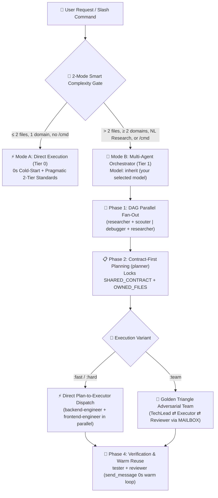

<div align="center">
  <h1>⚡ BoomOpen Workflow Kit v5.5.0</h1>
  <p><strong>Multi-Platform Smart-Hybrid AI Workforce OS — 22 Specialist Agents, 18 Golden Triangle Teams &amp; 1,460+ On-Demand Skills Vault</strong></p>

  <p>
    <a href="https://github.com/Kennyboom/BoomOpen-Workflow-Kit-Pro/releases"></a>
    <a href="#-supported-ai-platforms"></a>
    <a href="#-22-specialist-agents--18-golden-triangle-teams"></a>
    <a href="#-1460-skills-vault-22-core--1440-niche-library-skills"></a>
    <a href="https://nodejs.org/">=18.0.0" /></a>
    <a href="./LICENSE"></a>
  </p>

  <p>
    <b>🇬🇧 English</b> •
    <a href="./i18n/README.vi.md">🇻🇳 Tiếng Việt</a> •
    <a href="./i18n/README.zh-CN.md">🇨🇳 简体中文</a> •
    <a href="./i18n/README.zh-TW.md">🇹🇼 繁體中文</a> •
    <a href="./i18n/README.ja.md">🇯🇵 日本語</a> •
    <a href="./i18n/README.ko.md">🇰🇷 한국어</a> •
    <a href="./i18n/README.es.md">🇪🇸 Español</a> •
    <a href="./i18n/README.fr.md">🇫🇷 Français</a> •
    <a href="./i18n/README.de.md">🇩🇪 Deutsch</a><br/>
    <a href="./i18n/README.pt-BR.md">🇧🇷 Português</a> •
    <a href="./i18n/README.ru.md">🇷🇺 Русский</a> •
    <a href="./i18n/README.hi.md">🇮🇳 हिन्दी</a> •
    <a href="./i18n/README.ar.md">🇸🇦 العربية</a> •
    <a href="./i18n/README.id.md">🇮🇩 Bahasa Indonesia</a> •
    <a href="./i18n/README.th.md">🇹🇭 ไทย</a> •
    <a href="./i18n/README.tr.md">🇹🇷 Türkçe</a> •
    <a href="./i18n/README.it.md">🇮🇹 Italiano</a>
  </p>

  <p>
    <a href="#-official-launch-trailer-full-hd-1080p"><b>🎬 Launch Trailer</b></a> •
    <a href="#-what-is-boomopen-workflow-kit"><b>🌟 Overview</b></a> •
    <a href="#-smart-hybrid-architecture-v55"><b>🏗️ Architecture</b></a> •
    <a href="#-quick-start--installation"><b>🚀 Quick Start</b></a> •
    <a href="#-unified-settings--mode-selection-settings"><b>🎛️ Mode &amp; Settings</b></a> •
    <a href="#-slash-commands-reference"><b>🎯 Slash Commands</b></a> •
    <a href="#-22-specialist-agents--18-golden-triangle-teams"><b>🤖 22 Agents &amp; 18 Teams</b></a> •
    <a href="#-1460-skills-vault-22-core--1440-niche-library-skills"><b>📚 1,460+ Skills Vault</b></a>
  </p>
</div>

---

## 🎬 Official Launch Trailer (Full HD 1080p)

<div align="center">
  <a href="https://github.com/Kennyboom/BoomOpen-Workflow-Kit-Pro/raw/main/assets/media/boomopen_v55_trailer_en.mp4">
    
  </a>
  <p>
    ▶️ <a href="https://github.com/Kennyboom/BoomOpen-Workflow-Kit-Pro/raw/main/assets/media/boomopen_v55_trailer_en.mp4"><b>Click Here to Watch / Stream the Full HD 1080p Launch Trailer (MP4 with Studio Voiceover)</b></a>
  </p>
</div>

---

## 🌟 What is BoomOpen Workflow Kit?

**BoomOpen Workflow Kit v5.5 (Multi-Platform Unified & Smart-Hybrid Edition)** is an open-source multi-agent operating system that transforms a single AI coding assistant into an orchestrated engineering organization of **22 specialist agents**, **18 adversarial Golden Triangle teams**, **33 slash commands (`89` command & reference files)**, **22 Core Skills**, and a **1,440-skill On-Demand Niche Vault (`skills_library/`)**.

Unlike rigid single-prompt templates or heavyweight agent wrappers that add cold-start latency and context bloat to every turn, BoomOpen v5.5 combines a **Proactive Sub-agent First Gate**, **17-Language Natural-Language Workflow Routing**, **4-Tier Dynamic Elastic Swarm Sharding (`role#shard`)**, **Wave 2.5 Spec-to-Code Auto-Reconciliation (`boomopen reconcile`)**, **Stateful Multi-Round Human-Gated Project Audit (`/audit` & `boomopen audit`)**, **Multi-Session Project Autopilot (`/autopilot`)**, and **Cross-Engine Conductor (`/conduct`)** with **O(1) Zero-Bloat Skill Resolution**:
- **🚀 Turn-1 Zero-Tax Parallel Sub-agents, Wave 2.5 Reconciliation & Mode B Orchestration**: Unscoped codebase exploration (`> 2 files`), multi-domain features (`≥ 2 domains`), natural-language workflow intents across **all 17 supported languages** (`Plan`, `Design`, `Research`, `Brainstorm`, `Review`, `Audit`, `Debug`, `Fix`, `Test`, `Cook`, `Code`, `Autopilot`, `Conduct`, `Docs`, `Report`, `Deploy`), or explicit `/cmd` workflows immediately spawn parallel sub-agent shards on Turn 1 using **4-Tier Dynamic Elastic Swarm Sharding (`role#shard`, `<= 3–4 OWNED_FILES`/shard)**, **DAG Parallel Fan-Out**, **Direct Plan-to-Executor Dispatch**, **Contract-First File Locks (`SHARED_CONTRACT` + `OWNED_FILES`)**, **Wave 2.5 Spec-to-Code Auto-Reconciliation (`boomopen reconcile` + `cook amend-plan` catching island shards, route/env parity & `[SC-*]` omissions)**, and **Scoped Warm Sub-agent Reuse (`role#shard -> conversationId` via `send_message`)**.
- **🏛️ Multi-Session Autopilot (`/autopilot`), Multi-Round Whole-Project Audit (`/audit`) & Cross-Engine Council (`/conduct`)**: Ingest multi-document specs into an immutable `.boomopen/project-ledger.json` with SHA-256 drift guards and a 4-Layer Zero-Omission Phase Ratchet (`boomopen check --strict-phase --no-stubs`); run post-completion multi-round whole-project audits (`/audit` & `boomopen audit` -> `.boomopen/audit-ledger.json`) across RTM spec completeness, vertical UI->API->DB continuity, 2-Layer Security/Anti-Leakage (`security_scan.py` v6), and user-approved sharded fixing; or orchestrate Claude Code, OpenAI Codex, Antigravity, Cursor, and Copilot in **Parallel Multi-Engine Councils** and **Role-Division Pipelines (`Author != Critic`)**.
- **⚡ Mode A — Known-Target Micro-Direct**: Simple Q&A, code explanations, and micro-edits where the exact `≤ 2 target files` are already known on Turn 1 execute directly while enforcing **Pragmatic 2-Tier Coding Standards** and **Persistent Testing & Bug Fixing**.
- **📚 Massive 1,460+ Skills Vault with Zero Context Bloat**: Pre-compiled into `matrix-skills/compact-index.json` (`1,462` indexed skills) for `O(1)` 2-step lookup — equipping your AI with instant deep mastery across Backend (Cloudflare D1/R2/DO, Hono RPC, Supabase RLS, Drizzle, Rust Axum), Frontend (React 19/Next.js 15, Tailwind v4, TanStack Start), Mobile (Tauri v2, React Native, Flutter), Game Dev (Unity 6 DOTS, Godot 4, WebGPU/Three.js TSL, Colyseus Netcode), AI/ML & Agent SDKs (MCP FastMCP 2025, OpenAI/Claude/Google ADK), Cloud/DevOps (Terraform/OpenTofu), and OWASP LLM 2025 Cybersecurity **without polluting the prompt window**.

---

<a id="-smart-hybrid-architecture-v55"></a>

## 🏗️ Smart-Hybrid Architecture (v5.5)



---

## 🧠 6 Core Pillars of v5.5

1. **🌐 5-Platform Unified Parity (`platforms/*`)**:
   - First-class native installation for **Google Antigravity 2.0 (Gemini)**, **Claude Code**, **OpenAI Codex**, **Cursor**, and **GitHub Copilot** from a single unified architecture.
2. **📏 Pragmatic 2-Tier Coding Standards (Anti-Fragmentation)**:
   - **Tier 1 — Strict Quality & Safety (Zero Tolerance)**: Single Responsibility, **NO explicit `any`**, **NO leftover debug `console.log`** in production apps, mandatory `try/catch` + typed error handling on async/API boundaries, `SCREAMING_SNAKE_CASE` constants, DRY (`≥ 3`), and clean sorted imports.
   - **Tier 2 — Flexible Structural Guidelines (Cohesion First)**: Cohesive files target `~200–350 lines` with a `~400–450 line` soft ceiling (`>500 lines` hard split; tests/types/docs exempt). Functions target `~20–40 lines` (`~40–80 lines` for UI/Handlers) — preventing artificial file shattering.
3. **🎯 4-Tier Dynamic Elastic Swarm Sharding (`role#shard`), Direct Plan Dispatch & Warm Reuse (`send_message`)**:
   - Once `PLAN-{feature}.md` exists, the Orchestrator dispatches tasks **directly** to domain engineer shards (`backend-engineer#shard-1`, `frontend-engineer#shard-2`, `database-architect#shard-1`, etc., each owning `<= 3–4 OWNED_FILES`) without a redundant `tech-lead` middleman hop.
   - Active sub-agents are tracked in a **Scoped Session Registry (`role#shard → conversationId`)** and reused via `send_message` with **0s cold-start latency** and **100% retained file context**.
4. **🤝 Contract-First Parallel Dispatch (`SHARED_CONTRACT` + `OWNED_FILES`)**:
   - Multi-domain plans lock API endpoints, DTO schemas, and disjoint file ownership (`OWNED_FILES` vs. `READ_ONLY_FILES`) before launching parallel engineers, eliminating write collisions and integration mismatches.
5. **🔍 5-Whys (SPIE v3.0) Root-Cause Debugging & Clean Git Tree**:
   - `debugger` traces every bug through 3 ranked hypotheses (`debugger#hyp-1..N`) and a 5-Whys causal chain (`Why 1 Symptom` → `Why 5 Systemic Root Cause`). Transient artifacts (`PLAN`, `DEBUG`, `TEST`, `REVIEW`, `MAILBOX`) route to `<appDataDir>\brain\<conversation-id>\` first so your Git working tree stays 100% clean.
6. **🩺 Built-In 14-Command CLI Suite (`research`, `design`, `plan`, `cook`, `reconcile`, `audit`, `ledger`, `conduct`, `check`, `doctor`, `settings`, `install`, `uninstall`, `list`) & O(1) Skill Index**:
   - `npm run doctor` checks the kit source (all 5 platform bundles, 22 agents, 72 team files across 18 team folders, 89 command files in `commands/**/*.md` including 6 in `_ref/`, and `matrix-skills/compact-index.json` with `1,462` indexed skills) plus every installed platform (entry files, framework folder, skills vault). Deterministic workflow compilers — `boomopen research <validate|brief>`, `boomopen design <validate|contract>`, `boomopen plan <validate|compile>`, `boomopen cook <state|packets|verify-wave|preflight|amend-plan>`, `boomopen reconcile`, and `boomopen audit <init|slice|record|approve|verify-fix|status>` — validate upstream artifacts (`RESEARCH-*`, `BRAINSTORM-*`, `DESIGN-*`, `PLAN-*`), compile `HANDOFF_BRIEF` / `DESIGN_CONTRACT` / `.boomopen/project-ledger.json` / 5-Field Wave Handoff Packets, verify Wave 2.5 cross-shard wiring (`REC-G1..G4`), and drive stateful multi-round whole-project audits (`.boomopen/audit-ledger.json`). `boomopen check <dir> [--strict-phase --no-stubs]` audits file length, explicit `any`, leftover `console.log`, deferred `TODO`/`FIXME` comments, hollow stubs, and test gaming; `boomopen ledger` manages multi-session phase gates; and `boomopen conduct` runs cross-engine dispatch and 6-task Multi-Engine Councils (`research|brainstorm|plan|design|review|debug`).

---

## 💻 Supported AI Platforms

| Platform | Support Level | Global Entrypoint | Framework Install Path |
|----------|:-------------:|-------------------|------------------------|
| **Antigravity (Gemini)** | ✅ Native v5.5 | `~/.gemini/GEMINI.md` | `~/.gemini/config/skills/boomopen-workflow-kit/` |
| **Claude Code** | ✅ Native v5.5 | `~/.claude/CLAUDE.md` | `~/.claude/skills/boomopen-workflow-kit/` |
| **OpenAI Codex** | ✅ Native v5.5 | `~/.codex/CODEX.md` & `AGENTS.md` | `~/.codex/skills/boomopen-workflow-kit/` |
| **Cursor** | ✅ Native v5.5 | `~/.cursor/rules/boomopen-workflow-kit.mdc` | `~/.cursor/skills/boomopen-workflow-kit/` |
| **GitHub Copilot** | ✅ Native v5.5 | `~/.copilot/COPILOT.md` | `~/.copilot/skills/boomopen-workflow-kit/` |

---

## 🚀 Quick Start & Installation

```bash
# 1. Clone the repository
git clone https://github.com/Kennyboom/BoomOpen-Workflow-Kit-Pro.git
cd BoomOpen-Workflow-Kit-Pro

# 2. Install for your AI coding assistant (choose one or --all)
npm run install:antigravity   # Google Antigravity 2.0 (Gemini)
npm run install:claude        # Anthropic Claude Code
npm run install:codex         # OpenAI Codex CLI
npm run install:cursor        # Cursor AI Editor
npm run install:copilot       # GitHub Copilot (VS Code)
npm run install:all           # Install across all 5 platforms

# 3. Verify the installation (read-only)
npm run doctor                # Kit source + every installed platform: entry files, framework, skills vault

# Optional: put `boomopen` on your PATH (links this clone; nothing is downloaded from npm)
npm link
boomopen research validate path/to/RESEARCH.md                  # Validate RESEARCH-* / BRAINSTORM-* (--mode brainstorm) & brief
boomopen design validate path/to/DESIGN.md                      # Validate 6-Block DESIGN-* & compile DESIGN_CONTRACT
boomopen plan validate path/to/PLAN.md                          # Validate PLAN-* & compile .boomopen/project-ledger.json
boomopen cook preflight path/to/PLAN.md                         # Compile 5-Field Wave Handoff Packets & verify wave locks
boomopen reconcile path/to/your/project --plan path/to/PLAN.md  # Wave 2.5 spec-to-code reconciliation (REC-G1..G4)
boomopen audit init --docs docs/prd.md,docs/arch.md             # Initialize stateful multi-round whole-project audit ledger
boomopen check path/to/your/project --strict-phase --no-stubs   # File length, explicit `any`, console.log, zero stubs/TODOs
boomopen ledger status                                          # Inspect multi-session .boomopen/project-ledger.json
boomopen conduct probe                                          # Detect installed AI CLI engines for /conduct
```

> The kit is **not published on npm** — install it only from this repository. Contributors: `npm test` runs the CLI test suites in a sandboxed home folder.

```bash
# Remove the kit again (your own files are kept)
node cli/install.js uninstall <tool>   # or: boomopen uninstall <tool>
```

---

<a id="-unified-settings--mode-selection-settings"></a>

## 🎛️ Unified Settings & Mode Selection (`/settings`)

BoomOpen v5.5 includes a **Zero-Latency Unified Control Center** managing **20 configurable enum settings keys + 2 custom line-limit keys** (`execution.mode`, `execution.swarmScaling`, `execution.maxParallelSubagents`, `workflows.*`, `models.subagentPolicy`, `engines.{researcher,planner,coder,debugger,reviewer,councilMembers}`, `codingStandards.*`, etc.) across all **5 platforms** in `< 10ms` with **0ms Turn-1 latency** (via AOT `<!-- BOOMOPEN-SETTINGS-START -->` injection into `GEMINI.md`, `CLAUDE.md`, `CODEX.md`, `CURSOR.md`, and `COPILOT.md`).

### 1️⃣ Four One-Click Preset Profiles & Execution Modes

| Preset Profile | Execution Mode (`execution.mode`) | Default `/cmd` Variant | Natural-Language Research (`naturalLanguageResearchTrigger`) | Coding Standards | Best Used For |
|:---------------|:----------------------------------|:----------------------:|:------------------------------------------------------------:|:----------------:|:--------------|
| **⚡ `smart-hybrid`** *(Default Recommended)* | **`auto`** (`≤ 2 files` → Mode A Direct; `> 2 files` or `/cmd` → Mode B) | `auto` | **`auto_team`** *(Auto-routes NL research to `/research:team` and ideation to `/brainstorm:team` Golden Triangle)* | `pragmatic` (`400/500` lines) | Daily full-stack engineering — fast on small tasks, deep on complex architectures |
| **🚀 `solo-fast`** | **`mode_a`** *(Force Direct Solo Execution, 0s sub-agent latency)* | `fast` | `off` *(Direct chat reply unless `/brainstorm` is typed)* | `relaxed` (`600/800` lines) | Urgent hotfixes, rapid prototyping, scripts & minimal token usage |
| **🧠 `deep-architect`** | **`mode_b`** *(Force Strict Multi-Agent Orchestrator on every task)* | `hard` | `auto_hard` *(Auto-routes NL research to `/research:hard` and ideation to `/brainstorm:hard`)* | `strict` (`300/400` lines) | Complex system architecture, greenfield design & multi-domain refactors |
| **🔺 `adversarial-team`** | **`team`** *(Force 3-Agent Golden Triangle `:team` on all workflows)* | `team` | **`auto_team`** *(3-Agent adversarial ideation & review)* | `strict` (`300/400` lines) | Mission-critical production code, security audits & zero-defect releases |

### 2️⃣ Three Ways to Switch Modes & Customize Settings

- **💬 Surface 1 — In-Chat `/settings` Command (Interactive UI Widget or One-Liner)**:
  ```text
  /settings                                     # Open interactive clickable menu (via native ask_question UI)
  /settings preset smart-hybrid                 # Switch to Smart-Hybrid default (Recommended)
  /settings preset solo-fast                    # Switch to Mode A Solo Fast mode
  /settings preset deep-architect               # Switch to Mode B Multi-Agent Architect mode
  /settings preset adversarial-team             # Switch to Golden Triangle 3-Agent Team mode
  /settings mode auto | mode_a | mode_b | team  # Directly override execution.mode
  /settings set workflows.naturalLanguageResearchTrigger auto_team
  /settings ui                                  # Launch the Local Web Control Center in your browser
  ```
- **🌐 Surface 2 — Local Web Control Center Dashboard (`--ui` at `http://127.0.0.1:4567`)**:
  ```bash
  boomopen settings --ui
  # Or without npm link, from the installed copy (Claude Code shown; use your tool's folder):
  node ~/.claude/skills/boomopen-workflow-kit/cli/install.js settings --ui
  ```
- **⌨️ Surface 3 — Terminal CLI (Global `~/.boomopen/settings.json` & Project `./.boomopen.json`)**:
  ```bash
  boomopen settings status                                  # View the active settings & platform sync status
  boomopen settings preset adversarial-team                 # Apply a preset globally & re-sync every installed tool
  cd path/to/your/project
  boomopen settings set execution.mode mode_a --project     # Writes ./.boomopen.json in the CURRENT folder only
  boomopen settings reset                                   # Restore the recommended defaults
  boomopen settings help                                    # All subcommands and keys
  ```
  `--project` always writes `./.boomopen.json` in the folder you run it from, so run it inside your project (not inside the kit clone). Without `npm link`, replace `boomopen` with `node /path/to/BoomOpen-Workflow-Kit-Pro/cli/install.js`.

---

## 🎯 Slash Commands Reference

| Command | Variants | Primary Purpose |
|---------|----------|-----------------|
| **`/cook`** | `:fast`, `:hard`, `:team` | End-to-end feature development (Research/Scout → Plan → Parallel Code → Test → Review) |
| **`/code`** | `:fast`, `:hard`, `:team` | Execute implementation directly from an existing `PLAN-{feature}.md` |
| **`/plan`** | `:fast`, `:hard`, `:team` | Create implementation blueprints with `SHARED_CONTRACT`, `OWNED_FILES` & Given/When/Then criteria |
| **`/fix`** | `:fast`, `:hard`, `:team` | Root-cause bug resolution with mandatory regression test verification |
| **`/debug`** | `:fast`, `:hard`, `:team` | 3-Hypothesis + **5-Whys (SPIE v3.0)** causal root-cause investigation (`DEBUG-{issue}.md`) |
| **`/test`** | `:fast`, `:hard`, `:team` | DAG Parallel Fan-Out test suite execution + uncovered edge-case scouting (`tester` + `scouter`) |
| **`/review`** | `:fast`, `:hard`, `:team` | 4-way parallel audit (Architecture, Code Quality, Security OWASP, Performance) |
| **`/audit`** | `:run`, `:fix`, `:auto` | Stateful multi-round whole-project post-completion audit (RTM spec coverage, vertical flow, 2-Layer Security/Anti-Leakage & user-approved sharded fixing via `boomopen audit`) |
| **`/design`** | `:fast`, `:hard`, `:team` | System architecture, database schema, and UI/UX specification (`DESIGN.md`) |
| **`/docs`** | `:core`, `:business`, `:audit` | Generate or synchronize structured 2-tier architecture & business documentation (`./documents/`) |
| **`/deploy`** | `:check`, `:preview`, `:production`, `:rollback` | Pre-deployment readiness gates, preview environments, production rollout & safe rollback |
| **`/research`** | `:fast`, `:hard`, `:team` | Autonomous Deep-Research Engine (4-Source Triangulation, 3-Wave `search_web` & 3-Vector Golden Triangle) |
| **`/brainstorm`** | `:fast`, `:hard`, `:team` | Socratic requirements discovery, trade-off analysis & ideation |
| **`/report`** | `:fast`, `:hard`, `:team` | Executive & technical synthesis reports with metrics and diagrams |
| **`/autopilot`** | `:init`, `:run`, `:audit` | Multi-session autonomous project orchestrator with `.boomopen/project-ledger.json` & 4-Layer Phase Ratchet |
| **`/conduct`** | `:council`, `:pipeline` | Cross-engine conductor & parallel multi-engine council (`boomopen conduct`) with 4-Part Consensus Synthesis |
| **`/orchestrate`** | — | Custom multi-agent pipeline orchestration across multiple domains & shards |
| **`/settings`** | `preset`, `mode`, `set`, `ui` | Unified Control Center: configure 20 enum + 2 line-limit settings, 4 presets, or open Web UI (`--ui`) |
| **`/save` / `/recap`** | — | Persist session state (`SESSION-HANDOVER.md`) and restore full context in `< 5s` |

---

## 🤖 22 Specialist Agents & 18 Golden Triangle Teams

| Category | Specialist Agents (`agents/*.md`) | Golden Triangle Teams (`agents/teams/*-team/`) |
|----------|-----------------------------------|------------------------------------------------|
| **Engineering & Execution** | `backend-engineer`, `frontend-engineer`, `mobile-engineer`, `game-engineer`, `database-architect`, `devops-engineer` | `backend-team`, `frontend-team`, `fullstack-team`, `mobile-team`, `game-team`, `database-team`, `devops-team` |
| **Architecture & Planning** | `tech-lead`, `planner`, `brainstormer`, `business-analyst`, `project-manager`, `designer` | `planning-team`, `brainstorm-team`, `project-team`, `design-team` |
| **Quality, Security & Debug** | `debugger`, `tester`, `reviewer`, `spec-reconciler`, `security-engineer`, `performance-engineer` | `debug-team`, `qa-team`, `security-team`, `performance-team` |
| **Research & Knowledge** | `researcher`, `scouter`, `docs-manager`, `reporter` | `research-team`, `docs-team`, `report-team` |

---

## 📚 1,460+ Skills Vault (22 Core + 1,440 Niche Library Skills)

BoomOpen ships with one of the largest curated engineering skill ecosystems in open source (`1,462` indexed skills across 19 domains) — engineered for **0-token idle overhead** via **2-Step O(1) Progressive Skill Resolution** (`<skills>` Core check → `matrix-skills/compact-index.json` lookup → load exact `SKILL.md` on demand):

| Skill Tier / Domain | Count | Representative 2026 Flagship Skills & Capabilities | Loading Mechanism |
|:--------------------|:-----:|:---------------------------------------------------|:------------------|
| **⚡ Tier 1: Core Skills (`skills/`)** | **22** | `clean-code`, `debugger`, `plan-writing`, `brainstorming`, `frontend-design`, `frontend-architecture`, `design-spec`, `api-patterns`, `database-design`, `testing-patterns`, `skill-seeker` | Pre-indexed in `<skills>` for instant Turn-1 access |
| **🎨 UI/UX Craft, Motion & Design Systems** | **42** | Anti-AI-Slop Visual Craft, OKLCH Perceptual Palettes & Bento Grids, Motion v12 + CSS View Transitions & Scroll-Driven Animations, AI-Native Generative UI UX, Headless Primitives (`cmdk`/`vaul`/`sonner`), Figma MCP + W3C DTCG Tokens, WCAG 2.2 AA/AAA, iOS 18 HIG & Material 3 Expressive | On-demand via `compact-index.json` (`matrix-skills/design.yaml`) |
| **🌐 Web, Backend & Edge Data Stack** | **390+** | React 19 & Next.js 15 RSC, Tailwind v4 + `shadcn/ui`, TanStack Start/Router/Query, SaaS Dashboards & TanStack Table v8, Hono RPC + Zod OpenAPI, Rust Axum/Tokio/SQLx, Supabase RLS/Realtime, Drizzle + Neon/Turso | On-demand via `compact-index.json` (`skills_library/`) |
| **🤖 AI, Agentic SDKs, MCP & Data** | **320+** | MCP FastMCP 2025 (`StreamableHTTP`), OpenAI Agents SDK, Claude Agent SDK, Google ADK (Gemini), Vercel AI SDK v4 & Mastra, AI IDE Plugin Authoring, RAG, BigQuery, dbt | On-demand via `compact-index.json` (`skills_library/`) |
| **☁️ Cloud, DevOps, Testing & Security** | **300+** | Cloudflare Workers/D1/R2/Durable Objects, Terraform/OpenTofu, Docker/K8s GitOps, Vitest + MSW v2 testing, Better Auth (Passkeys/2FA), OWASP Top 10 for LLM & Agentic Apps 2025 | On-demand via `compact-index.json` (`skills_library/`) |
| **🎮 Game Engines, 3D Web & Mobile** | **410+** | Unity 6 DOTS/ECS & `.asmdef`, Godot 4 GDScript/Shaders, WebGPU/WGSL & Three.js TSL, React Three Fiber + Rapier 3D, Colyseus Multiplayer Netcode, PixiJS v8/Phaser, Tauri v2 (Rust Desktop/Mobile), SwiftUI, Kotlin, React Native, Flutter | On-demand via `compact-index.json` (`skills_library/`) |

---

## 📂 Repository Structure

```text
BoomOpen-Workflow-Kit-Pro/
├── agents/                  # 22 Specialist Agent definitions + 18 Golden Triangle Teams (54 role files + 18 _team.md, 72 files)
├── cli/                     # 14-Command CLI Suite: install.js, doctor.js, checker.js, settings.js, research.js, design.js, plan.js, cook.js, reconcile.js, audit.js, ledger.js & conductor.js
├── commands/                # 83 Slash Command workflows (33 commands: :fast, :hard, :team, :run/:fix/:auto, :init/:run/:audit, :council/:pipeline) + 6 _ref/ protocols (89 files)
├── documents/               # 2-Tier Architecture, Domain, Source-Base & Coding Standards documentation
├── i18n/                    # 16 full-length localized READMEs (vi, zh-CN, zh-TW, ja, ko, es, fr, de, pt-BR, ru, hi, ar, id, th, tr, it)
├── matrix-skills/           # Domain YAML skill matrices + pre-compiled compact-index.json (1,462 indexed skills)
├── platforms/               # Unified 5-platform templates (antigravity/, claude/, codex/, copilot/, cursor/)
├── rules/                   # On-demand Mode B rules (CORE, PHASES, AGENTS, TEAMS, SKILLS, ERRORS, REFERENCE)
├── scripts/                 # Python automation & verification runners (checklist.py, verify_all.py, etc.)
├── skills/                  # 22 Core Skills (clean-code, debugger, plan-writing, frontend-design, etc.)
├── skills_library/          # 1,440 dormant niche skills loaded on-demand via 2-step lookup
└── GEMINI.md | CLAUDE.md | CODEX.md | COPILOT.md | CURSOR.md | AGENT.md
```

---

## 📄 License & Security

- **License**: The kit's own code and documents are distributed under the [MIT License](./LICENSE). Copyright © 2026 **BoomOpen Labs**. Third-party skills in `skills_library/` keep their upstream licenses — see [THIRD_PARTY_NOTICES.md](./THIRD_PARTY_NOTICES.md).
- **Security Policy**: Please see [SECURITY.md](./SECURITY.md) for built-in security guardrails and vulnerability reporting guidelines.
