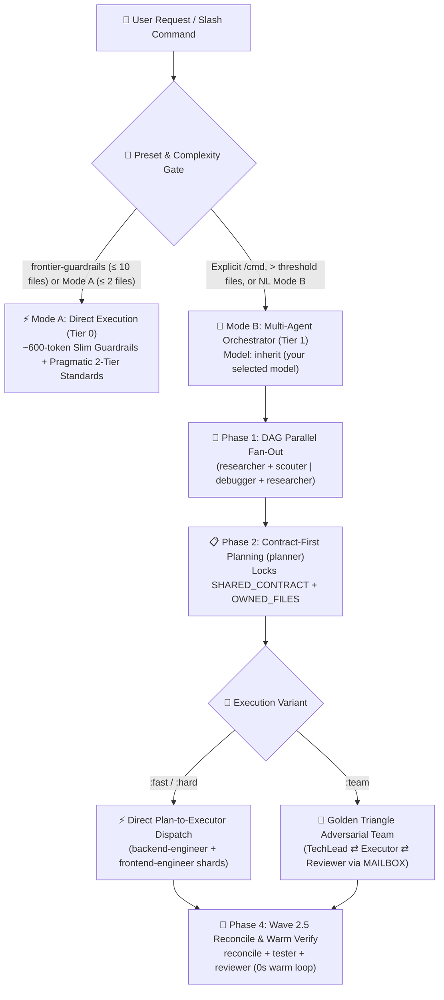

<div align="center">
  <h1>⚡ BoomOpen Workflow Kit v5.5.0</h1>
  <p><strong>Multi-Platform Frontier-Guardrails &amp; Smart-Hybrid AI Workforce OS — 22 Specialist Agents, 18 Golden Triangle Teams, 36 Slash Commands &amp; 1,462 On-Demand Skills</strong></p>

  <p>
    <a href="https://boomopen.com"></a>
    <a href="https://github.com/Kennyboom/BoomOpen-Workflow-Kit-Pro/releases"></a>
    <a href="#-supported-ai-platforms"></a>
    <a href="#-22-specialist-agents--18-golden-triangle-teams"></a>
    <a href="#-1460-skills-vault-22-core--1440-niche-library-skills"></a>
    <a href="https://nodejs.org/">=18.0.0" /></a>
    <a href="./LICENSE"></a>
  </p>

  <p>
    <b>🇬🇧 English</b> •
    <a href="./i18n/README.vi.md">🇻🇳 Tiếng Việt</a> •
    <a href="./i18n/README.zh-CN.md">🇨🇳 简体中文</a> •
    <a href="./i18n/README.zh-TW.md">🇹🇼 繁體中文</a> •
    <a href="./i18n/README.ja.md">🇯🇵 日本語</a> •
    <a href="./i18n/README.ko.md">🇰🇷 한국어</a> •
    <a href="./i18n/README.es.md">🇪🇸 Español</a> •
    <a href="./i18n/README.fr.md">🇫🇷 Français</a> •
    <a href="./i18n/README.de.md">🇩🇪 Deutsch</a><br/>
    <a href="./i18n/README.pt-BR.md">🇧🇷 Português</a> •
    <a href="./i18n/README.ru.md">🇷🇺 Русский</a> •
    <a href="./i18n/README.hi.md">🇮🇳 हिन्दी</a> •
    <a href="./i18n/README.ar.md">🇸🇦 العربية</a> •
    <a href="./i18n/README.id.md">🇮🇩 Bahasa Indonesia</a> •
    <a href="./i18n/README.th.md">🇹🇭 ไทย</a> •
    <a href="./i18n/README.tr.md">🇹🇷 Türkçe</a> •
    <a href="./i18n/README.it.md">🇮🇹 Italiano</a>
  </p>

  <p>
    <a href="https://boomopen.com"><b>🌐 Live Showcase</b></a> •
    <a href="#-official-launch-trailer-full-hd-1080p"><b>🎬 Launch Trailer</b></a> •
    <a href="#-what-is-boomopen-workflow-kit"><b>🌟 Overview</b></a> •
    <a href="#-smart-hybrid-architecture-v55"><b>🏗️ Architecture</b></a> •
    <a href="#-quick-start--installation"><b>🚀 Quick Start</b></a> •
    <a href="#-unified-settings--mode-selection-settings"><b>🎛️ Mode &amp; Settings</b></a> •
    <a href="#-slash-commands-reference"><b>🎯 Slash Commands</b></a> •
    <a href="#-22-specialist-agents--18-golden-triangle-teams"><b>🤖 22 Agents &amp; 18 Teams</b></a> •
    <a href="#-1460-skills-vault-22-core--1440-niche-library-skills"><b>📚 1,460+ Skills Vault</b></a>
  </p>
</div>

---

## 🎬 Official Launch Trailer (Full HD 1080p)

<div align="center">
  <a href="https://github.com/Kennyboom/BoomOpen-Workflow-Kit-Pro/raw/main/assets/media/boomopen_v55_trailer_en.mp4">
    
  </a>
  <p>
    ▶️ <a href="https://github.com/Kennyboom/BoomOpen-Workflow-Kit-Pro/raw/main/assets/media/boomopen_v55_trailer_en.mp4"><b>Click Here to Watch / Stream the Full HD 1080p Launch Trailer (MP4 with Studio Voiceover)</b></a> • 🌐 <a href="https://boomopen.com"><b>Explore Interactive Explorer at boomopen.com</b></a>
  </p>
</div>

---

## 🌟 What is BoomOpen Workflow Kit?

**BoomOpen Workflow Kit v5.5 (Frontier-Guardrails & Multi-Platform Smart-Hybrid Edition)** is an open-source multi-agent operating system that upgrades a single AI coding assistant into an orchestrated engineering organization of **22 per-IDE compiled specialist agents**, **18 adversarial Golden Triangle teams (`72` files)**, **36 slash commands (`93` command & reference files: `87` workflows + `6` `_ref/`)**, **14 deterministic CLI subcommands**, **22 Core Skills**, and a **1,440-skill On-Demand Niche Vault (`1,462` skills deduplicated once into `~/.agents/skills_library`)**.

Unlike rigid prompt packs or heavyweight agent wrappers that bloat every turn, BoomOpen v5.5 ships with **`⚡ smart-hybrid` (Proactive Turn-1 Elastic Swarm + 17-Language Natural-Language Routing across all 5 IDEs)** by default — while also offering **`🛡️ frontier-guardrails` (`< 2.5 KB` / `~600 tokens` slim Mode A)** — unlocking **4-Tier Dynamic Elastic Swarm Sharding (`role#shard`)**, **Wave 2.5 Spec-to-Code Auto-Reconciliation (`boomopen reconcile`)**, **Stateful Multi-Round Project Audit (`/audit` & `boomopen audit`)**, **Multi-Session Project Autopilot (`/autopilot`)**, and **Cross-Engine Conductor (`/conduct`)** out of the box:
- **⚡ Default `smart-hybrid` Proactive Swarm + 17-Language Intent Routing**: Out of the box, known micro-edits (`≤ 2` files) execute directly in Mode A, while multi-file tasks, deep research, ideation, planning, and explicit `/cmd` workflows (**`/onboard`**, **`/pr` + `/pr:review`**, **`/release`**, etc.) automatically spawn parallel sub-agent shards on Turn 1 (`role#shard`, `<= 3–4 OWNED_FILES`/shard) with **Contract-First File Locks (`SHARED_CONTRACT` + `OWNED_FILES`)**, **Wave 2.5 Spec-to-Code Reconciliation (`boomopen reconcile` + `cook amend-plan`)**, and **Warm Sub-agent Reuse (`send_message`)**.
- **🛡️ Opt-In Slim `frontier-guardrails` (`< 2.5 KB`)**: Prefer native direct Mode A up to `≤ 10` files with zero natural-language trigger? Switch in `< 10ms` via `boomopen settings preset frontier-guardrails` (`carbon-guardrails` preserved as a backward-compatible alias).
- **🏛️ Multi-Session Autopilot (`/autopilot`), Multi-Round Audit (`/audit`) & Cross-Engine Council (`/conduct`)**: Compile multi-doc specs into an immutable `.boomopen/project-ledger.json` with SHA-256 drift guards, checkpoint rollback (`boomopen ledger rollback --yes`), and a 4-Layer Phase Ratchet (`boomopen check --strict-phase --no-stubs`); run human-gated post-completion audits (`/audit` & `boomopen audit`, with `boomopen audit rollback --yes`) across RTM coverage, vertical UI->API->DB flows, and **2-Layer Security/Anti-Leakage (`security_scan.py` v6)**; or orchestrate Claude Code, OpenAI Codex, Antigravity, Cursor, and Copilot via `boomopen conduct` (including `--dry-run` previews).
- **📚 Deduplicated 1,462-Skill Vault & 15 `app-builder` Templates (Zero Context Bloat)**: Installed once into `~/.agents/skills_library` and linked across all 5 IDEs with `O(1)` lookup via `matrix-skills/compact-index.json` (`1,462` skills: `22` Core + `1,440` Library, including **15 `app-builder` project scaffolds** with **`mcp-server`** and **`ai-agent-worker`**).

---

<a id="-smart-hybrid-architecture-v55"></a>

## 🏗️ Smart-Hybrid Architecture (v5.5)



---

## 🧠 6 Core Pillars of v5.5

1. **🌐 5-Platform Unified Parity & 2026 Native Lifecycle Hooks (`platforms/*`)**:
   - Compiles **22 specialist agents** natively per IDE across **Antigravity (Gemini)**, **Claude Code**, **OpenAI Codex**, **Cursor**, and **GitHub Copilot**, sharing one deduplicated `~/.agents/skills_library` vault.
   - Integrates 2026 native runtime upgrades: **Antigravity native Plugin mode** (`boomopen install antigravity --as-plugin`) + **`run_workflow` Python orchestration** (`platforms/antigravity/workflows/*.py`), **Claude Code `isolation: worktree`** subagents + colon commands (`/plan:hard`, `/pr:review`) + opt-in `PreCompact`/`Stop` quality gates (`stop-quality-gate.mjs`) + `Bash|PowerShell` hook guard (`validate-tool-call.mjs`), and **OpenAI Codex OS-enforced `read-only` sandboxing** (`platforms/codex/config.toml`).
2. **📏 Pragmatic 2-Tier Coding Standards (Anti-Fragmentation)**:
   - **Tier 1 — Strict Quality & Safety (Zero Tolerance)**: Single Responsibility, **NO explicit `any`**, **NO leftover debug `console.log`** in production apps, mandatory `try/catch` + typed error handling on async/API boundaries, `SCREAMING_SNAKE_CASE` constants, DRY (`≥ 3`), and clean sorted imports.
   - **Tier 2 — Flexible Structural Guidelines (Cohesion First)**: Cohesive files target `~200–350 lines` with a `~400–450 line` soft ceiling (`>500 lines` hard split; tests/types/docs exempt). Functions target `~20–40 lines` (`~40–80 lines` for UI/Handlers) — preventing artificial file shattering.
3. **🎯 4-Tier Dynamic Elastic Swarm Sharding (`role#shard`), Direct Plan Dispatch & Warm Reuse (`send_message`)**:
   - Once `PLAN-{feature}.md` exists, the Orchestrator dispatches tasks **directly** to domain engineer shards (`backend-engineer#shard-1`, `frontend-engineer#shard-2`, `database-architect#shard-1`, etc., each owning `<= 3–4 OWNED_FILES`) without a redundant `tech-lead` middleman hop, retaining context via `role#shard → conversationId` Warm Session Reuse.
4. **🤝 Contract-First Parallel Dispatch (`SHARED_CONTRACT` + `OWNED_FILES`)**:
   - Multi-domain plans lock API endpoints, DTO schemas, and disjoint file ownership (`OWNED_FILES` vs. `READ_ONLY_FILES`) before launching parallel engineers, backed by Wave 2.5 `boomopen reconcile` (`REC-G1..G4`) to eliminate island modules and route mismatches.
5. **🔍 5-Whys (SPIE v3.0) Root-Cause Debugging & Clean Git Tree**:
   - `debugger` traces every bug through 3 ranked hypotheses (`debugger#hyp-1..N`) and a 5-Whys causal chain (`Why 1 Symptom` → `Why 5 Systemic Root Cause`). Transient artifacts (`PLAN`, `DEBUG`, `TEST`, `REVIEW`, `MAILBOX`) route to `<appDataDir>\brain\<conversation-id>\` (or `./reports/`) so your Git working tree stays 100% clean.
6. **🩺 Built-In 14-Command CLI Suite (`research`, `design`, `plan`, `cook`, `reconcile`, `audit`, `ledger`, `conduct`, `check`, `doctor`, `settings`, `install`, `uninstall`, `list`)**:
   - `npm run doctor` verifies all 5 platform bundles, 22 agents, 72 team files across 18 team folders, 93 command files in `commands/**/*.md` (`87` workflows + `6` `_ref/`), and `matrix-skills/compact-index.json` (`1,462` skills). Deterministic compilers — `boomopen research`, `boomopen design`, `boomopen plan`, `boomopen cook`, `boomopen reconcile`, `boomopen audit` (incl. `audit rollback --yes`), `boomopen ledger` (incl. `ledger rollback --yes`), `boomopen check --strict-phase --no-stubs`, and `boomopen conduct` (incl. `--dry-run`) — enforce end-to-end engineering determinism.

---

## 💻 Supported AI Platforms

| Platform | Support Level | Global Entrypoint | Framework & Plugin Install Paths |
|----------|:-------------:|-------------------|----------------------------------|
| **Antigravity (Gemini)** | ✅ Native v5.5 | `~/.gemini/GEMINI.md` | `~/.gemini/config/skills/boomopen-workflow-kit/` *(or `--as-plugin` → `~/.gemini/config/plugins/boomopen-workflow-kit/`)* |
| **Claude Code** | ✅ Native v5.5 | `~/.claude/CLAUDE.md` | `~/.claude/skills/boomopen-workflow-kit/` + `~/.claude/agents/` (`isolation: worktree` + `PreCompact`/`Stop` hooks) |
| **OpenAI Codex** | ✅ Native v5.5 | `~/.codex/CODEX.md` & `AGENTS.md` | `~/.codex/skills/boomopen-workflow-kit/` + `config.toml` (OS `read-only` sandbox) |
| **Cursor** | ✅ Native v5.5 | `~/.cursor/rules/boomopen-workflow-kit.mdc` | `~/.cursor/skills/boomopen-workflow-kit/` + optional `.cursor/hooks.json` |
| **GitHub Copilot** | ✅ Native v5.5 | `~/.copilot/COPILOT.md` | `~/.copilot/skills/boomopen-workflow-kit/` + `~/.copilot/agents/` |

> **Deduplicated Vault**: Across all 5 platforms, the `1,440` library skills are installed once into `~/.agents/skills_library/` and linked per tool, eliminating gigabytes of duplicate files.

---

## 🚀 Quick Start & Installation

```bash
# 1. Clone the repository
git clone https://github.com/Kennyboom/BoomOpen-Workflow-Kit-Pro.git
cd BoomOpen-Workflow-Kit-Pro

# 2. Install for your AI coding assistant (choose one, add --with-hooks / --as-plugin, or --all)
npm run install:antigravity                        # Google Antigravity 2.0 (Gemini)
node cli/install.js install antigravity --as-plugin # Native Antigravity Plugin bundle mode
node cli/install.js install claude --with-hooks    # Claude Code + PreToolUse & Stop/PreCompact hooks
npm run install:codex                              # OpenAI Codex CLI (with OS read-only scout sandboxes)
npm run install:cursor                             # Cursor AI Editor
npm run install:copilot                            # GitHub Copilot (VS Code)
npm run install:all                                # Install across all 5 platforms

# 3. Verify installation & run deterministic CLI gates (optional `npm link` puts `boomopen` on PATH)
npm run doctor
npm link
boomopen research validate path/to/RESEARCH.md                  # Validate RESEARCH-* / BRAINSTORM-* & extract brief
boomopen design validate path/to/DESIGN.md                      # Validate 6-Block DESIGN-* & compile DESIGN_CONTRACT
boomopen plan validate path/to/PLAN.md                          # Validate PLAN-* & compile .boomopen/project-ledger.json
boomopen cook preflight path/to/PLAN.md                         # Compile 5-Field Wave Handoff Packets & verify wave locks
boomopen reconcile path/to/your/project --plan path/to/PLAN.md  # Wave 2.5 spec-to-code reconciliation (REC-G1..G4)
boomopen audit init --docs docs/prd.md,docs/arch.md             # Initialize stateful multi-round whole-project audit ledger
boomopen audit rollback --yes                                   # Roll back to pre-audit Git checkpoint if needed
boomopen check path/to/your/project --strict-phase --no-stubs   # File length, explicit `any`, console.log, zero stubs/TODOs
boomopen ledger status                                          # Inspect multi-session ledger (or `boomopen ledger rollback --yes`)
boomopen conduct council plan "Auth redesign" --dry-run         # Preview multi-engine council dispatch (--dry-run)
```

> The kit is **not published on npm** — install it only from this repository (`npm test` runs all CLI suites in a sandboxed home; `boomopen uninstall <tool>` cleanly removes kit files while keeping yours).

---

<a id="-unified-settings--mode-selection-settings"></a>

## 🎛️ Unified Settings & Mode Selection (`/settings`)

BoomOpen v5.5 includes a **Zero-Latency Unified Control Center** managing **20 configurable enum settings keys + 2 custom line-limit keys** across all **5 platforms** in `< 10ms` with **0ms Turn-1 latency** (via AOT `<!-- BOOMOPEN-SETTINGS-START -->` injection).

### 1️⃣ Five One-Click Preset Profiles (`smart-hybrid` Default Recommended)

| Preset Profile | Execution Mode (`execution.mode`) | Default `/cmd` Variant | Natural-Language Routing (`naturalLanguageResearchTrigger`) | Coding Standards | Best Used For |
|:---------------|:----------------------------------|:----------------------:|:-----------------------------------------------------------:|:----------------:|:--------------|
| **⚡ `smart-hybrid`** *(Default Recommended)* | **`auto`** (`≤ 2 files` → Mode A Direct; `> 2 files` or `/cmd` → Mode B) | `auto` | **`auto_team`** *(Auto-routes NL research/ideation to `:team` Golden Triangle)* | `pragmatic` (`400/500` lines) | Proactive 17-language NL workflow routing + automatic Turn-1 swarm sharding above 2 files across all 5 IDEs |
| **🛡️ `frontier-guardrails`** | **`mode_a`** *(Direct up to `≤ 10 files`; `< 2.5 KB` / `~600 tokens` slim guardrails)* | `auto` | **`off`** *(Zero NL hijacking; explicit `/cmd` only)* | `pragmatic` (`400/500` lines) | Slim `< 2.5 KB` direct Mode A speed with strict quality & E2E gates *(`carbon-guardrails` kept as backward-compatible alias)* |
| **🚀 `solo-fast`** | **`mode_a`** *(Force Direct Solo Execution, 0s sub-agent latency)* | `fast` | `off` *(Direct chat reply unless `/brainstorm` is typed)* | `relaxed` (`600/800` lines) | Urgent hotfixes, rapid prototyping, small scripts & minimal token usage |
| **🧠 `deep-architect`** | **`mode_b`** *(Force Strict Multi-Agent Orchestrator on every task)* | `hard` | `auto_hard` *(Auto-routes NL research/ideation to `:hard`)* | `strict` (`300/400` lines) | Complex system architecture, greenfield design & multi-domain refactors |
| **🔺 `adversarial-team`** | **`team`** *(Force 3-Agent Golden Triangle `:team` on all workflows)* | `team` | **`auto_team`** *(3-Agent adversarial ideation & review)* | `strict` (`300/400` lines) | Mission-critical production code, security audits & zero-defect releases |

### 2️⃣ Three Ways to Switch Modes & Customize Settings

- **💬 Surface 1 — In-Chat `/settings` Command (Interactive UI Widget or One-Liner)**:
  ```text
  /settings                                     # Open interactive clickable menu (via native ask_question UI)
  /settings preset smart-hybrid                 # Switch to Smart-Hybrid default (Recommended: Auto Mode A/B + 17-lang NL routing)
  /settings preset frontier-guardrails          # Switch to Slim <2.5KB Frontier-Guardrails (alias: carbon-guardrails)
  /settings preset solo-fast                    # Switch to Mode A Solo Fast mode
  /settings preset deep-architect               # Switch to Mode B Multi-Agent Architect mode
  /settings preset adversarial-team             # Switch to Golden Triangle 3-Agent Team mode
  /settings mode auto | mode_a | mode_b | team  # Directly override execution.mode
  /settings ui                                  # Launch the Local Web Control Center in your browser
  ```
- **🌐 Surface 2 — Local Web Control Center Dashboard (`--ui` at `http://127.0.0.1:4567`)**:
  ```bash
  boomopen settings --ui   # or: node ~/.claude/skills/boomopen-workflow-kit/cli/install.js settings --ui
  ```
- **⌨️ Surface 3 — Terminal CLI (Global `~/.boomopen/settings.json` & Project `./.boomopen.json`)**:
  ```bash
  boomopen settings status                                  # View active settings & 5-platform sync status
  boomopen settings preset smart-hybrid                     # Apply a preset globally & re-sync every installed IDE
  cd path/to/your/project && boomopen settings set execution.mode mode_a --project
  boomopen settings reset                                   # Restore recommended smart-hybrid defaults
  ```
  `--project` writes `./.boomopen.json` in the folder you run it from (run inside your project, not the kit clone). Without `npm link`, replace `boomopen` with `node /path/to/BoomOpen-Workflow-Kit-Pro/cli/install.js`.

---

## 🎯 Slash Commands Reference

| Command | Variants | Primary Purpose |
|---------|----------|-----------------|
| **`/onboard`** | — | 60-second read-only brownfield onboarding (`ARCHITECTURE-MAP.md`: stack, entrypoints, data flows, hotspots & build/test gates; zero `/init` collision) |
| **`/cook`** | `:fast`, `:hard`, `:team` | End-to-end feature development (Research/Scout → Plan → Parallel Code → Wave 2.5 Reconcile → Test → Review) |
| **`/code`** | `:fast`, `:hard`, `:team` | Execute implementation directly from an existing `PLAN-{feature}.md` |
| **`/plan`** | `:fast`, `:hard`, `:team` | Create implementation blueprints with `SHARED_CONTRACT`, `OWNED_FILES` & Given/When/Then criteria |
| **`/fix`** | `:fast`, `:hard`, `:team` | Root-cause bug resolution with mandatory regression test verification |
| **`/debug`** | `:fast`, `:hard`, `:team` | 3-Hypothesis + **5-Whys (SPIE v3.0)** causal root-cause investigation (`DEBUG-{issue}.md`) |
| **`/test`** | `:fast`, `:hard`, `:team` | DAG Parallel Fan-Out test suite execution + uncovered edge-case scouting (`tester` + `scouter`) |
| **`/review`** | `:fast`, `:hard`, `:team` | 4-way parallel audit (Architecture, Code Quality, Security OWASP, Performance) |
| **`/pr`** | —, `:review` | Pre-PR strict quality gate (`boomopen check`, `reconcile` & diff tests) + `gh pr create`, or 3-angle adversarial PR hunk review (`/pr:review`) |
| **`/release`** | — | Semantic release preparation: Conventional Commit audit since last tag, `CHANGELOG.md` synthesis, parity gates (`doctor`, `check`, `test`, `test:pack`) & human-gated `gh release create` |
| **`/audit`** | `:run`, `:fix`, `:auto` | Stateful multi-round whole-project post-completion audit (RTM spec coverage, vertical flow, 2-Layer Security/Anti-Leakage & user-approved sharded fixing via `boomopen audit`) |
| **`/design`** | `:fast`, `:hard`, `:team` | System architecture, database schema, and 6-Block UI/UX specification (`DESIGN.md` + `DESIGN_CONTRACT`) |
| **`/docs`** | `:core`, `:business`, `:audit` | Generate or synchronize structured 2-tier architecture & business documentation (`./documents/`) |
| **`/deploy`** | `:check`, `:preview`, `:production`, `:rollback` | Pre-deployment readiness gates, preview environments, production rollout & safe rollback |
| **`/research`** | `:fast`, `:hard`, `:team` | Autonomous Deep-Research Engine (4-Source Triangulation, 3-Wave `search_web` & 3-Vector Golden Triangle) |
| **`/brainstorm`** | `:fast`, `:hard`, `:team` | Socratic requirements discovery, trade-off analysis & MCDA ideation |
| **`/report`** | `:fast`, `:hard`, `:team` | Executive & technical synthesis reports with metrics and diagrams |
| **`/autopilot`** | `:init`, `:run`, `:audit` | Multi-session autonomous project orchestrator with `.boomopen/project-ledger.json` & 4-Layer Phase Ratchet |
| **`/conduct`** | `:council`, `:pipeline` | Cross-engine conductor & parallel multi-engine council (`boomopen conduct`, incl. `--dry-run`) with 4-Part Consensus Synthesis |
| **`/orchestrate`** | — | Custom multi-agent pipeline orchestration across multiple domains & shards |
| **`/settings`** | `preset`, `mode`, `set`, `ui` | Unified Control Center: configure 20 enum + 2 line-limit settings, presets, or open Web UI (`--ui`) |
| **`/save` / `/recap`** | — | Persist session state (`SESSION-HANDOVER.md`) and restore full context in `< 5s` *(plus `/git`, `/migrate`, `/perf`, `/preview`, `/refactor`, `/security-audit`, `/skill`, `/status`, `/team`, `/tdd`, `/worktree` — `36` total)* |

### 🌙 Overnight Large Multi-Phase Project Guide (`/autopilot` vs. `/goal` + `/autopilot` + `/audit`)

| Workflow | Best Scope & Platform Runner | Context Window Continuity | Quality & Spec Guarantees |
|:---------|:-----------------------------|:--------------------------|:--------------------------|
| **`/autopilot` (+ `--with-hooks`)** | Single-session builds, or **Claude Code / OpenAI Codex** multi-session builds with `--with-hooks` | On Claude Code / Codex, `Stop` & `PreCompact` hooks (`stop-quality-gate.mjs`) preserve `.boomopen/project-ledger.json` continuity across compactions | Enforces `.boomopen/project-ledger.json`, 5 verification gates, `boomopen ledger rollback --yes` safety & Wave 2.5 reconciliation |
| **`/goal` + `/autopilot` + `/audit`** | **Antigravity 2.0** overnight multi-phase projects with `docs/` (`/goal` is Antigravity 2.0's native persistent outer runner) | Antigravity's native **`/goal`** outer loop automatically resets/continues across phases when context reaches `~70%` | **`/autopilot`** enforces ledger state, 5 verification gates & Wave 2.5 spec-reconciliation per phase, then triggers multi-round **`/audit`** at 100% completion |

**Ready-to-copy overnight prompt (Antigravity 2.0 `/goal`; omit `/goal` prefix on Claude Code / Codex with `--with-hooks`):**

```text
/goal Use /autopilot to read all project documentation in docs/, initialize project-ledger.json, and autonomously implement every phase sequentially from start to finish (skip the initial PLAN approval pause; every phase must pass all 5 verification gates and reconcile 100% against the specs). After 100% of phases are complete, run Round 1 of /audit and stop with a report for my review.
```

---

## 🤖 22 Specialist Agents & 18 Golden Triangle Teams

| Category | Specialist Agents (`agents/*.md`, compiled per-IDE) | Golden Triangle Teams (`agents/teams/*-team/`, `72` files) |
|----------|-----------------------------------------------------|------------------------------------------------------------|
| **Engineering & Execution** | `backend-engineer`, `frontend-engineer`, `mobile-engineer`, `game-engineer`, `database-architect`, `devops-engineer` | `backend-team`, `frontend-team`, `fullstack-team`, `mobile-team`, `game-team`, `database-team`, `devops-team` |
| **Architecture & Planning** | `tech-lead`, `planner`, `brainstormer`, `business-analyst`, `project-manager`, `designer` | `planning-team`, `brainstorm-team`, `project-team`, `design-team` |
| **Quality, Security & Debug** | `debugger`, `tester`, `reviewer`, `spec-reconciler`, `security-engineer`, `performance-engineer` | `debug-team`, `qa-team`, `security-team`, `performance-team` |
| **Research & Knowledge** | `researcher`, `scouter`, `docs-manager`, `reporter` | `research-team`, `docs-team`, `report-team` |

---

## 📚 1,460+ Skills Vault (22 Core + 1,440 Niche Library Skills)

BoomOpen ships with `1,462` indexed skills across 19 domains — deduplicated once into `~/.agents/skills_library` and engineered for **0-token idle overhead** via **2-Step O(1) Progressive Skill Resolution** (`<skills>` Core check → `matrix-skills/compact-index.json` lookup → load exact `SKILL.md` on demand):

| Skill Tier / Domain | Count | Representative 2026 Flagship Skills & Capabilities | Loading Mechanism |
|:--------------------|:-----:|:---------------------------------------------------|:------------------|
| **⚡ Tier 1: Core Skills (`skills/`)** | **22** | `clean-code`, `debugger`, `plan-writing`, `brainstorming`, `app-builder` (**15 templates** incl. **`mcp-server`** & **`ai-agent-worker`**), `frontend-design`, `frontend-architecture`, `design-spec`, `api-patterns`, `database-design`, `testing-patterns`, `skill-seeker` | Pre-indexed in `<skills>` for instant Turn-1 access |
| **🎨 UI/UX Craft, Motion & Design Systems** | **42** | Anti-AI-Slop Visual Craft, OKLCH Perceptual Palettes & Bento Grids, Motion v12 + CSS View Transitions & Scroll-Driven Animations, AI-Native Generative UI UX, Headless Primitives (`cmdk`/`vaul`/`sonner`), Figma MCP + W3C DTCG Tokens, WCAG 2.2 AA/AAA, iOS 18 HIG & Material 3 Expressive | On-demand via `compact-index.json` (`matrix-skills/design.yaml`) |
| **🌐 Web, Backend & Edge Data Stack** | **390+** | React 19 & Next.js 15 RSC, Tailwind v4 + `shadcn/ui`, TanStack Start/Router/Query, SaaS Dashboards & TanStack Table v8, Hono RPC + Zod OpenAPI, Rust Axum/Tokio/SQLx, Supabase RLS/Realtime, Drizzle + Neon/Turso | On-demand via `compact-index.json` (`~/.agents/skills_library/`) |
| **🤖 AI, Agentic SDKs, MCP & Data** | **320+** | MCP FastMCP 2025 (`StreamableHTTP`), OpenAI Agents SDK, Claude Agent SDK, Google ADK (Gemini), Vercel AI SDK v4 & Mastra, AI IDE Plugin Authoring, RAG, BigQuery, dbt | On-demand via `compact-index.json` (`~/.agents/skills_library/`) |
| **☁️ Cloud, DevOps, Testing & Security** | **300+** | Cloudflare Workers/D1/R2/Durable Objects, Terraform/OpenTofu, Docker/K8s GitOps, Vitest + MSW v2 testing, Better Auth (Passkeys/2FA), OWASP Top 10 for LLM & Agentic Apps 2025 | On-demand via `compact-index.json` (`~/.agents/skills_library/`) |
| **🎮 Game Engines, 3D Web & Mobile** | **410+** | Unity 6 DOTS/ECS & `.asmdef`, Godot 4 GDScript/Shaders, WebGPU/WGSL & Three.js TSL, React Three Fiber + Rapier 3D, Colyseus Multiplayer Netcode, PixiJS v8/Phaser, Tauri v2 (Rust Desktop/Mobile), SwiftUI, Kotlin, React Native, Flutter | On-demand via `compact-index.json` (`~/.agents/skills_library/`) |

---

## 📂 Repository Structure

```text
BoomOpen-Workflow-Kit-Pro/
├── agents/                  # 22 Specialist Agents (compiled per-IDE) + 18 Golden Triangle Teams (54 roles + 18 _team.md, 72 files)
├── cli/                     # 14-Command CLI Suite: install (--as-plugin/--with-hooks), uninstall, list, doctor, check, settings, research, design, plan, cook, reconcile, audit, ledger & conduct
├── commands/                # 87 Slash Command workflows (36 commands incl. /onboard, /pr + /pr:review, /release) + 6 _ref/ protocols (93 files)
├── documents/               # 2-Tier Architecture, Domain, Source-Base & Coding Standards documentation
├── i18n/                    # 16 full-length localized READMEs (vi, zh-CN, zh-TW, ja, ko, es, fr, de, pt-BR, ru, hi, ar, id, th, tr, it)
├── matrix-skills/           # Domain YAML skill matrices + pre-compiled compact-index.json (1,462 indexed skills)
├── platforms/               # Unified 5-platform templates, hooks (stop-quality-gate.mjs, validate-tool-call.mjs), Antigravity workflows/*.py & Codex sandboxes
├── rules/                   # On-demand Mode B rules (CORE, PHASES, AGENTS, TEAMS, SKILLS, ERRORS, REFERENCE)
├── scripts/                 # Python automation & verification runners (checklist.py, verify_all.py, security_scan.py, etc.)
├── skills/                  # 22 Core Skills (incl. app-builder with 15 templates: mcp-server, ai-agent-worker, etc.)
├── skills_library/          # 1,440 dormant niche skills deduplicated once into ~/.agents/skills_library on install
└── GEMINI.md | CLAUDE.md | CODEX.md | COPILOT.md | CURSOR.md | AGENT.md
```

---

## 📄 License & Security

- **Official Website**: [https://boomopen.com](https://boomopen.com)
- **License**: The kit's own code and documents are distributed under the [MIT License](./LICENSE). Copyright © 2026 **BoomOpen Labs**. Third-party skills in `skills_library/` keep their upstream licenses — see [THIRD_PARTY_NOTICES.md](./THIRD_PARTY_NOTICES.md).
- **Security Policy**: Please see [SECURITY.md](./SECURITY.md) for built-in security guardrails and vulnerability reporting guidelines.
