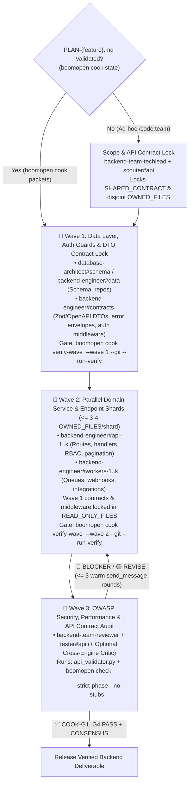

# ⚙️💎 Backend Team — 3-Wave Contract-First Elastic Golden Diamond (v5.5)

> **ARCHITECTURE**: Scales dynamically from a `1-1-1` Golden Triangle (`<= 4` files) into a **3-Wave Contract-First Elastic Golden Diamond** (`1 Tech Lead + N Parallel Backend Shards + M Critics`) with zero `OWNED_FILES` collisions and strict API boundary guarantees.
> **ELASTIC SHARDING LAW**: Each `backend-engineer#<shard>` owns **`<= 3–4 OWNED_FILES`** with Scoped Warm Session Reuse (`role#shard -> conversationId` via `send_message`, max 3 debate rounds).

---

## ⚡ Mandatory Skills & Rules for All Backend Team Shards

Every member of `backend-team` (`TypeName: "self"`, `Model: "inherit"`) **MUST** enforce:
1. `skills/api-patterns/SKILL.md`, `skills/database-design/SKILL.md`, `skills/security-auditor/SKILL.md`, & `skills/clean-code/SKILL.md` — OpenAPI 3.1 / Zod / Hono RPC contract-first APIs, OWASP Top 10 defenses, parameterized queries, and Pragmatic 2-Tier code standards.
2. `skills_library/hono-rpc-zod-openapi/SKILL.md`, `skills_library/better-auth-typescript/SKILL.md`, `skills_library/rust-axum-tokio-sqlx/SKILL.md`, & `skills_library/mcp-server-fastmcp-2025/SKILL.md`.
3. `rules/TEAMS.md` & `commands/_ref/golden-triangle-protocol.md` — Disjoint `OWNED_FILES` (`<= 3–4` files/shard), Append-Only Mailbox (`MAILBOX-{date}.md`), and Warm Session Reuse (`send_message`).

---

## 🚀 Approved-Plan Fast-Forward Gate

1. **Inspect Active State**: Run `node ~/.{TOOL}/skills/boomopen-workflow-kit/cli/install.js cook state` (`boomopen cook state`) to inspect Brain/workspace artifacts and `.boomopen/project-ledger.json`.
2. **Plan Fast-Forward**: If `PLAN-{feature}.md` already passed `node ~/.{TOOL}/skills/boomopen-workflow-kit/cli/install.js plan validate "<plan-path>"`, **SKIP** redundant re-scouting, re-planning, and manual re-sharding — extract ready-to-dispatch 5-Field Handoff Packets via `node ~/.{TOOL}/skills/boomopen-workflow-kit/cli/install.js cook packets "<plan-path>" --wave 1` (`boomopen cook packets <plan.md>`) and launch Wave 1 shards on Turn 1!

---

## 🧭 3-Wave Contract-First Backend Execution Flow

### Canonical Backend Shard Matrix & Warm Session Registry

| Wave | Shard Key (`role#shard`) | Disjoint `OWNED_FILES` (`<= 3–4`) | Locked `READ_ONLY_FILES` |
|:----:|:-------------------------|:----------------------------------|:-------------------------|
| **W1** | `backend-engineer#data` | `src/db/schema.ts`, `src/db/repositories/*.ts` | `PLAN-{feature}.md` |
| **W1** | `backend-engineer#contracts` | `src/contracts/*.ts`, `src/middleware/auth.ts` | `PLAN-{feature}.md` |
| **W2** | `backend-engineer#api-1..k` | `src/routes/*.ts`, `src/services/*.ts` | Wave 1 `data` + `contracts` |
| **W2** | `backend-engineer#workers-1..k` | `src/jobs/*.ts`, `src/webhooks/*.ts` | Wave 1 `data` + `contracts` |
| **W3** | `backend-team-reviewer` + `tester#api` | `tests/api/*.test.ts` (`tester` only) | All `src/**` files |

- **Scoped Warm Session Reuse**: Track `backend-engineer#<shard> -> conversationId` and send targeted fixes via `send_message` (max 3 rounds; Round 3 escalates strictly to `backend-team-techlead`).
- **Optional Cross-Engine Critic**: When `engines.reviewer = "cross_family"`, run `node ~/.{TOOL}/skills/boomopen-workflow-kit/cli/install.js conduct dispatch --role reviewer --engine cross_family --prompt "<wave diff & API contract>"`.

---

## 🔍 4 Deterministic Post-Wave Gates (`COOK-G1..G4`)

Every wave MUST pass `node ~/.{TOOL}/skills/boomopen-workflow-kit/cli/install.js cook verify-wave "<plan-path>" --wave <N> --git --run-verify` and `node ~/.{TOOL}/skills/boomopen-workflow-kit/cli/install.js check <dir> --strict-phase --no-stubs`:

| Gate ID | Gate Dimension | Deterministic CLI & Reviewer Enforcement |
|:-------:|:---------------|:-----------------------------------------|
| **`COOK-G1`** | **Disjoint `OWNED_FILES` & Write-Lock** | `<= 4` files per `role#shard`; `0` mutations to `READ_ONLY_FILES` or unauthorized files (`--git`). |
| **`COOK-G2`** | **Deliverables Present & Non-Empty** | All expected Wave `<N>` `OWNED_FILES` and `Test Files` exist on disk and are non-empty (`> 0` bytes). |
| **`COOK-G3`** | **`SHARED_CONTRACT` & Zero-Stub Hygiene** | Exact DTO/status-code/error-envelope compliance + `boomopen check <dir> --strict-phase --no-stubs` clean (`<= 500` lines, `0` stubs/TODOs, `0` `any`, structured logging only). |
| **`COOK-G4`** | **Wave `--run-verify`, `api_validator.py` & Consensus** | Shard `Verify` build/typecheck/tests + `python ~/.{TOOL}/skills/api-patterns/scripts/api_validator.py <dir>` exit `0`, `100%` `REQ-xxx`/`AC` verified, Reviewer `APPROVAL`, and `✅ CONSENSUS`. |

---

## 📁 Deliverable & `ArtifactMetadata` Routing (Antigravity 2.0)

| Deliverable | Path | `ArtifactMetadata` | Size & Format Rule |
|:------------|:-----|:-------------------|:-------------------|
| **Backend Review** | `<appDataDir>\brain\<conversation-id>\REVIEW-{feature}.md` | `UserFacing: true, RequestFeedback: false` | Single cohesive file `<= 500` lines (`COOK-G1..G4` proof) |
| **API Test Report** | `<appDataDir>\brain\<conversation-id>\TEST-{feature}.md` | `UserFacing: true, RequestFeedback: false` | Endpoint happy/edge/error test matrix |
| **Team Mailbox** | `<appDataDir>\brain\<conversation-id>\MAILBOX-{date}.md` | `UserFacing: false, RequestFeedback: false` | Append-only shard assignments, reviews, defenses & consensus log |

---

## 📦 5-Field Shard Handoff Packet & Hard Consensus Gate

Every shard spawned via `invoke_subagent(TypeName: "self", Model: "inherit")` receives a deterministic packet from `boomopen cook packets "<plan-path>" --wave <N>`:
1. **`MISSION & ACCEPTANCE CRITERIA`**: Exact `Task X.Y (REQ-xxx)` scope and measurable `AC` items.
2. **`SHARED_CONTRACT`**: Locked Wave 1 OpenAPI 3.1 / Zod / Hono RPC DTOs, error envelopes, auth claims, and DB repository interfaces.
3. **`OWNED_FILES` (`<= 3–4` files)**: Exclusive write lock for `backend-engineer#<shard>` (`0` overlap across active shards).
4. **`READ_ONLY_FILES`**: Wave 1 contract schemas, auth middleware, base migrations, and peer shard files (`0` edits allowed).
5. **`VERIFICATION & DELIVERABLE`**: Exact wave `--run-verify` test commands, `api_validator.py`, `boomopen check <dir> --strict-phase --no-stubs`, and `MAILBOX-{date}.md` submission format.

### Hard Release Blockers (`backend-team-techlead` MUST Reject Release If Any Fail)
- [ ] Any `backend-engineer#<shard>` touched `> 4 OWNED_FILES` or mutated locked `READ_ONLY_FILES` (`COOK-G1` failure).
- [ ] Any expected deliverable is missing/empty (`COOK-G2`) or lacks boundary validation, parameterized SQL, resource-level authz, or standardized error envelopes (`COOK-G3`).
- [ ] `boomopen cook verify-wave "<plan.md>" --wave <W> --git --run-verify`, `api_validator.py`, or `boomopen check <dir> --strict-phase --no-stubs` exited non-zero (`COOK-G3`/`COOK-G4`).
- [ ] Unresolved Round 3 disputes were routed anywhere other than `backend-team-techlead`.
- [ ] `MAILBOX-{date}.md` lacks `backend-team-reviewer` `APPROVAL` and `✅ CONSENSUS` (`COOK-G4`).
