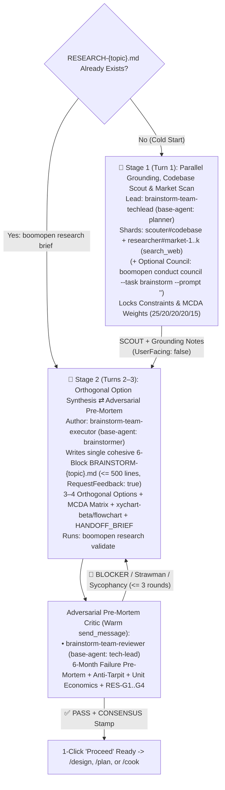

# 💡💎 Brainstorm Team — 2-Stage Elastic Golden Diamond Protocol (v5.5)

> **ARCHITECTURE**: Replaces multi-triangle sequential ideation (`10–15+` turns) with a **2-Stage Elastic Golden Diamond (`3–4` turns total)** grounded in empirical market/codebase reality and adversarial pre-mortem stress-testing.
> **STRICT `NO APPLICATION CODE` BOUNDARY**: `/brainstorm:team` produces **1 cohesive single-file `<appDataDir>\brain\<conversation-id>\BRAINSTORM-{topic}.md` (`<= 500` lines)** with `ArtifactMetadata: { Summary, UserFacing: true, RequestFeedback: true }` (unlocking Antigravity 2.0's 1-click **"Proceed"** button) — never production source code!
> **DETERMINISTIC CLI GATE**: Must pass `node ~/.{TOOL}/skills/boomopen-workflow-kit/cli/install.js research validate "<path>" --mode brainstorm` (`RES-G1..G4`) before consensus release.

---

## ⚡ Mandatory Skills & Tooling Rules for All Brainstorm Shards

Every member of `brainstorm-team` (`TypeName: "self"`, `Model: "inherit"`) **MUST** enforce:
1. `skills/brainstorming/SKILL.md` & `skills/deep-research/SKILL.md` — Socratic constraint framing (`ask_question` when P0 intent is ambiguous), 4-Source Triangulation (`search_web` + `read_file` + `matrix-skills/compact-index.json`), and anti-sycophancy rigor.
2. `rules/TEAMS.md` & `commands/_ref/golden-triangle-protocol.md` — Elastic Golden Diamond sharding (`role#shard`), Append-Only Mailbox (`MAILBOX-{date}.md`), and Scoped Warm Session Reuse (`send_message`, max 3 rounds).
3. **Valid Antigravity 2.0 Tools Only**: Use `search_web`, `read_file`, `write_file`, `edit_file`, `run_command`, `invoke_subagent`, `send_message`, and `ask_question`.

---

## 🧭 2-Stage Elastic Golden Diamond Execution Flow

### Stage 1: Prior-Artifact Fast-Forward, Parallel Grounding & MCDA Weight Lock
- **Prior-Artifact Fast-Forward Gate**: If `RESEARCH-{topic}.md` already exists in `<appDataDir>\brain\<conversation-id>\` (or `./reports/{topic}/`), run `node ~/.{TOOL}/skills/boomopen-workflow-kit/cli/install.js research brief "<path>"` (`boomopen research brief "<path>"`), reuse existing `SCOUT-{topic}.md`, and **SKIP duplicate web searches**!
- **Cold-Start Parallel Fan-Out (`TypeName: "self"`, `Model: "inherit"`)**:
  - **`brainstorm-team-techlead` (`base-agent: planner`)**: Frames problem boundaries, locks **MCDA Scoring Weights** (`Impact 25%`, `Speed 20%`, `Stack Fit 20%`, `Pre-Mortem Survivability 20%`, `Unit Economics 15%`), and optionally dispatches `node ~/.{TOOL}/skills/boomopen-workflow-kit/cli/install.js conduct council --task brainstorm --prompt "<topic>" --output "<appDataDir>/brain/<conversation-id>/COUNCIL-{topic}.md"`.
  - **`scouter#codebase`**: Maps workspace manifests (`package.json`, `Cargo.toml`, `pyproject.toml`), `./documents/`, and `matrix-skills/compact-index.json` into `SCOUT-{topic}.md` (`RequestFeedback: false`).
  - **`researcher#market-1..k`**: Executes targeted `search_web` competitor, pricing, and benchmark teardowns into `RESEARCH-{topic}-v{1..k}.md` (`UserFacing: false, RequestFeedback: false`).

### Stage 2: Cohesive 6-Block `BRAINSTORM-{topic}.md` Synthesis ⇄ 6-Month Failure Pre-Mortem
- **`brainstorm-team-executor` (`base-agent: brainstormer`)**: Synthesizes `3–4` genuinely orthogonal options (never strawman decoys), scores the **Weighted MCDA Decision Matrix**, embeds Mermaid `xychart-beta` / `flowchart TD` diagrams and a machine-readable **`HANDOFF_BRIEF`**, and runs `boomopen research validate "<path>" --mode brainstorm`.
- **`brainstorm-team-reviewer` (`base-agent: tech-lead`)**: Executes a **6-Month Failure Pre-Mortem**, kills AI sycophancy and tarpit ideas, audits unit economics (`$/1k DAU`, COGS, ops complexity), and loops in-place fixes via warm `send_message` (max 3 rounds; optional `boomopen conduct dispatch --role reviewer --engine cross_family --prompt "<options & pre-mortem>"`).

---

## 🔍 4 Deterministic CLI Validation Gates (`boomopen research validate --mode brainstorm`)

| Gate ID | Gate Dimension | Mandatory Criteria Checked by CLI & Reviewer |
|:-------:|:---------------|:---------------------------------------------|
| **`RES-G1`** | **Constraints & Grounding Anchors** | Explicit Constraints / Assumptions / Grounding section + `>= 1` concrete grounding reference (codebase path, `RESEARCH-`/`SCOUT-` artifact, or clickable URL). |
| **`RES-G2`** | **MCDA Matrix & 6-Month Pre-Mortem** | Multi-option MCDA decision matrix (`>= 2` data rows; `3–4` orthogonal options across `Impact 25%`, `Speed 20%`, `Stack Fit 20%`, `Survivability 20%`, `Unit Economics 15%`) + explicit Pre-Mortem / tarpit risks / *"When NOT to Choose"*. |
| **`RES-G3`** | **Executive Verdict & `HANDOFF_BRIEF`** | Explicit Recommended Option / Verdict section + machine-extractable `HANDOFF_BRIEF` (MVP cutline, non-goals, stack constraints) ready for `boomopen research brief "<path>"`. |
| **`RES-G4`** | **Single-File Cohesion & Zero Placeholders** | Single cohesive `BRAINSTORM-{topic}.md` (`<= 500` lines hard / `<= 400` soft, `RequestFeedback: true`), `0` unfilled `{placeholder}` / `TODO` / `TBD` markers, and `✅ CONSENSUS` stamp. |

---

## 📁 Deliverable & `ArtifactMetadata` Routing Rules (Antigravity 2.0)

| Deliverable | Path | `ArtifactMetadata` Setting | Purpose |
|:------------|:-----|:---------------------------|:--------|
| **Master Brainstorm** | `<appDataDir>\brain\<conversation-id>\BRAINSTORM-{topic}.md` | `UserFacing: true, RequestFeedback: true` (**1-Click "Proceed"**) | Single cohesive 6-Block strategy blueprint (`<= 500` lines) |
| **Supporting Scout / Shards** | `<appDataDir>\brain\<conversation-id>\SCOUT-{topic}.md`, `RESEARCH-{topic}-v*.md` | `UserFacing: false, RequestFeedback: false` | Disjoint Stage 1 grounding notes (zero write collisions) |
| **Team Mailbox** | `<appDataDir>\brain\<conversation-id>\MAILBOX-{date}.md` | `UserFacing: false, RequestFeedback: false` | Append-only pre-mortem debate & consensus log |

---

## 📦 5-Field Shard Handoff Packet & Hard Release Blockers

Every `invoke_subagent(TypeName: "self", Model: "inherit")` dispatch inside `brainstorm-team` MUST embed all 5 fields:
1. **`MISSION & ACCEPTANCE CRITERIA`**: Exact grounding vector (`scouter#codebase`, `researcher#market-1..k`) or synthesis scope (`3–4` orthogonal options + `RES-G1..G4`).
2. **`SHARED_CONTRACT`**: Locked problem statement, target persona/scale, workspace stack pins, and **MCDA Scoring Weights (`25% / 20% / 20% / 20% / 15%`)**.
3. **`OWNED_FILES`**: Disjoint output path (`SCOUT-{topic}.md`, `RESEARCH-{topic}-v{k}.md`, or `BRAINSTORM-{topic}.md` + `MAILBOX-{date}.md`).
4. **`READ_ONLY_FILES`**: All workspace application source files (`0` code edits permitted in `/brainstorm:team`) and sibling Stage 1 shard files.
5. **`VERIFICATION & DELIVERABLE`**: `ArtifactMetadata` setting (`RequestFeedback: true` ONLY on `BRAINSTORM-{topic}.md`) + `node ~/.{TOOL}/skills/boomopen-workflow-kit/cli/install.js research validate "<path>" --mode brainstorm`.

### Hard Release Blockers (`brainstorm-team-techlead` MUST Reject Release If Any Fail)
- [ ] `BRAINSTORM-{topic}.md` exceeds `500` lines, splits into multiple user-facing files, or omits `RequestFeedback: true`.
- [ ] Options include strawman decoys, ungrounded unit economics, sycophantic cheerleading without *"When NOT to Choose"*, or fail `RES-G1..G4`.
- [ ] Any production source file in the workspace was created or modified during `/brainstorm:team`.
