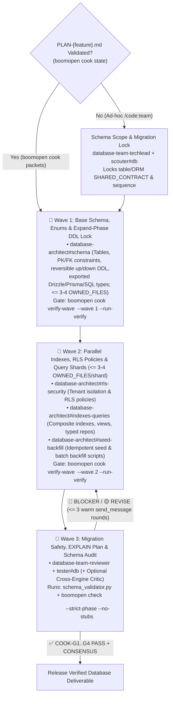

# 🗄️💎 Database Team — 3-Wave Expand-Contract Elastic Golden Diamond (v5.5)

> **ARCHITECTURE**: Enforces zero-downtime **Expand-Contract** schema evolution across a **3-Wave Contract-First Elastic Golden Diamond** (`1 Tech Lead + N Parallel Data Shards + M Critics`) with strict migration ordering, tenant isolation, and data-loss prevention.
> **ELASTIC SHARDING LAW**: Each `database-architect#<shard>` owns **`<= 3–4 OWNED_FILES`** with Scoped Warm Session Reuse (`role#shard -> conversationId` via `send_message`, max 3 rounds).

---

## ⚡ Mandatory Skills & Rules for All Database Team Shards

Every member of `database-team` (`TypeName: "self"`, `Model: "inherit"`) **MUST** enforce:
1. `skills/database-design/SKILL.md`, `skills/accidental-data-loss-prevention/SKILL.md`, & `skills/clean-code/SKILL.md` — 3NF/workload-aware normalization, reversible expand-contract DDL, STOP-AND-VERIFY consent before destructive SQL (`DROP`/`TRUNCATE`), and Pragmatic 2-Tier code standards.
2. `skills_library/supabase-rls-edge-realtime/SKILL.md`, `skills_library/drizzle-neon-turso-edge/SKILL.md`, & `skills_library/cloudflare-d1-r2-durable-objects/SKILL.md`.
3. `rules/TEAMS.md` & `commands/_ref/golden-triangle-protocol.md` — Disjoint `OWNED_FILES` (`<= 3–4` files/shard), Append-Only Mailbox (`MAILBOX-{date}.md`), and Warm Session Reuse (`send_message`).

---

## 🚀 Approved-Plan Fast-Forward Gate

1. **Inspect Active State**: Run `node ~/.{TOOL}/skills/boomopen-workflow-kit/cli/install.js cook state` (`boomopen cook state`) to inspect Brain/workspace artifacts and `.boomopen/project-ledger.json`.
2. **Plan Fast-Forward**: If `PLAN-{feature}.md` already passed `node ~/.{TOOL}/skills/boomopen-workflow-kit/cli/install.js plan validate "<plan-path>"`, **SKIP** redundant re-scouting and manual re-sharding — extract Wave 1 shard packets directly via `node ~/.{TOOL}/skills/boomopen-workflow-kit/cli/install.js cook packets "<plan-path>" --wave 1` (`boomopen cook packets <plan.md>`) and dispatch immediately!

---

## 🧭 3-Wave Expand-Contract Database Execution Flow

### Canonical Database Shard Matrix & Warm Session Registry

| Wave | Shard Key (`role#shard`) | Disjoint `OWNED_FILES` (`<= 3–4`) | Locked `READ_ONLY_FILES` |
|:----:|:-------------------------|:----------------------------------|:-------------------------|
| **W1** | `database-architect#schema` | `db/schema/*.ts`, `db/migrations/0001_*.sql` | `PLAN-{feature}.md` |
| **W2** | `database-architect#rls-security` | `db/policies/*.sql`, `db/migrations/0002_rls.sql` | Wave 1 `schema` + `0001_*.sql` |
| **W2** | `database-architect#indexes-queries` | `db/indexes.sql`, `db/repositories/*.ts` | Wave 1 `schema` + `0001_*.sql` |
| **W2** | `database-architect#seed-backfill` | `db/seed.ts`, `db/backfills/*.ts` | Wave 1 `schema` + `0001_*.sql` |
| **W3** | `database-team-reviewer` + `tester#db` | `tests/db/*.test.ts` (`tester` only) | All `db/**` files |

- **Scoped Warm Session Reuse**: Track `database-architect#<shard> -> conversationId` and route findings via `send_message` (max 3 rounds; Round 3 escalates to `database-team-techlead`).
- **Optional Cross-Engine Critic**: When `engines.reviewer = "cross_family"`, run `node ~/.{TOOL}/skills/boomopen-workflow-kit/cli/install.js conduct dispatch --role reviewer --engine cross_family --prompt "<DDL diff & query plans>"` (`boomopen conduct dispatch --role reviewer --engine cross_family`).

---

## 🔍 4 Deterministic Post-Wave Gates (`COOK-G1..G4`)

Every wave MUST pass `node ~/.{TOOL}/skills/boomopen-workflow-kit/cli/install.js cook verify-wave "<plan-path>" --wave <N> --run-verify` and `node ~/.{TOOL}/skills/boomopen-workflow-kit/cli/install.js check <dir> --strict-phase --no-stubs`:

| Gate ID | Gate Dimension | Deterministic CLI & Reviewer Enforcement |
|:-------:|:---------------|:-----------------------------------------|
| **`COOK-G1`** | **Disjoint `OWNED_FILES` & Migration Lock** | `<= 4` files per `role#shard`; monotonic migration ordering and `0` unauthorized edits to `READ_ONLY_FILES`. |
| **`COOK-G2`** | **`SHARED_CONTRACT` & Zero-Stub Hygiene** | ORM/SQL types match `SHARED_CONTRACT`; `boomopen check <dir> --strict-phase --no-stubs` passes with `0` stubs/TODOs and `0` unconsented destructive DDL. |
| **`COOK-G3`** | **Wave `--run-verify` & `schema_validator.py`** | Up/down migration dry-run & query tests exit `0` + `python ~/.{TOOL}/skills/database-design/scripts/schema_validator.py <dir>` passes + FK/WHERE indexes verified. |
| **`COOK-G4`** | **RTM Traceability & Consensus Stamp** | `100%` of Wave `REQ-xxx` / `AC` verified, `database-team-reviewer` posts `APPROVAL`, and `database-team-techlead` stamps `✅ CONSENSUS`. |

---

## 📁 Deliverable & `ArtifactMetadata` Routing (Antigravity 2.0)

| Deliverable | Path | `ArtifactMetadata` | Size & Format Rule |
|:------------|:-----|:-------------------|:-------------------|
| **Database Review** | `<appDataDir>\brain\<conversation-id>\REVIEW-{feature}.md` | `UserFacing: true, RequestFeedback: false` | Single cohesive file `<= 500` lines (`COOK-G1..G4` proof) |
| **Migration Test Log** | `<appDataDir>\brain\<conversation-id>\TEST-{feature}.md` | `UserFacing: true, RequestFeedback: false` | Up/down rollback, RLS tenant isolation & query plan benchmarks |
| **Team Mailbox** | `<appDataDir>\brain\<conversation-id>\MAILBOX-{date}.md` | `UserFacing: false, RequestFeedback: false` | Append-only shard assignments, reviews, defenses & consensus log |

---

## 📦 5-Field Shard Handoff Packet & Hard Consensus Gate

Every shard spawned via `invoke_subagent(TypeName: "self", Model: "inherit")` receives a deterministic packet from `boomopen cook packets "<plan-path>" --wave <N>`:
1. **`MISSION & ACCEPTANCE CRITERIA`**: Exact `Task X.Y (REQ-xxx)` data-model scope, query SLAs, and measurable `AC` items.
2. **`SHARED_CONTRACT`**: Locked table/enum definitions, Drizzle/Prisma/SQL exported types, FK constraints, and tenant RLS claims.
3. **`OWNED_FILES` (`<= 3–4` files)**: Exclusive write lock for `database-architect#<shard>` with monotonic migration numbering.
4. **`READ_ONLY_FILES`**: Wave 1 base schema and initial expand migrations during Wave 2 (`0` edits allowed).
5. **`VERIFICATION & DELIVERABLE`**: Up/down migration dry-run, `schema_validator.py`, `boomopen check <dir> --strict-phase --no-stubs`, and `MAILBOX-{date}.md` submission format.

### Hard Release Blockers (`database-team-techlead` MUST Reject Release If Any Fail)
- [ ] Any `database-architect#<shard>` touched `> 4 OWNED_FILES` or created conflicting migration sequence numbers (`COOK-G1`).
- [ ] Destructive DDL (`DROP TABLE`/`COLUMN`, `TRUNCATE`) was introduced without expand-contract phasing and explicit user consent (`COOK-G2`).
- [ ] Foreign keys or hot `WHERE`/`JOIN`/`ORDER BY` columns lack supporting indexes or `EXPLAIN` verification (`COOK-G3`).
- [ ] `cook verify-wave --run-verify`, `schema_validator.py`, or `boomopen check --strict-phase --no-stubs` exited non-zero.
- [ ] `MAILBOX-{date}.md` lacks `database-team-reviewer` `APPROVAL` and `✅ CONSENSUS` (`COOK-G4`).
