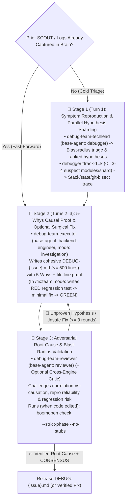

# 🐛💎 Debug Team — SPIE v3.0 Root-Cause Elastic Golden Diamond (v5.5)

> **ARCHITECTURE**: Eliminates guesswork "shotgun debugging" via a **3-Stage SPIE v3.0 (Symptom → Parallel Hypotheses → Isolation → Evidence) Elastic Golden Diamond** (`1 Triage Lead + N Parallel Trace Shards + Root-Cause Critic`).
> **EVIDENCE-BEFORE-PATCH LAW**: No code fix is permitted until a deterministic reproduction or concrete `file:line` causal chain (5-Whys) is proven and approved by `debug-team-reviewer`.

---

## ⚡ Mandatory Skills & Tooling Rules for All Debug Shards

Every member of `debug-team` (`TypeName: "self"`, `Model: "inherit"`) **MUST** enforce:
1. `skills/debugger/SKILL.md` & `skills/tdd-workflow/SKILL.md` — **SPIE v3.0 5-Whys Root Cause Analysis**, deterministic reproduction first, and `RED → GREEN` regression test locking when applying fixes.
2. `skills/clean-code/SKILL.md` — Pragmatic 2-Tier coding standards (`0` leftover debug `console.log`, `0` explicit `any`, `0` stubs).
3. `rules/TEAMS.md` & `commands/_ref/golden-triangle-protocol.md` — Disjoint shard tracing (`<= 3–4` files/shard), Append-Only `MAILBOX-{date}.md`, and Scoped Warm Session Reuse (`send_message`, max 3 rounds).
4. **Valid Tools Only**: `search_web`, `read_file`, `write_file`, `edit_file`, `run_command`, `invoke_subagent`, `send_message`, `ask_question`.

---

## 🧭 3-Stage Root-Cause & Verification Flow

### Canonical Debug Shard Matrix & Warm Session Registry

| Stage | Shard Key (`role#shard`) | Assigned Scope (`<= 3–4` Files / Track) | Output / Lock Rule |
|:-----:|:-------------------------|:----------------------------------------|:-------------------|
| **S1** | `debug-team-techlead` | Symptom triage, ranked hypotheses `H1..Hk`, blast-radius boundary | `TASK_ASSIGNMENT` in `MAILBOX-{date}.md` |
| **S1** | `debugger#track-1..k` | Reproduction command, call-graph trace, state/timing/env diff | `SCOUT-{issue}.md` / trace notes (`UserFacing: false`) |
| **S2** | `debug-team-executor` | Proven 5-Whys causal chain + fix blueprint (or `<= 3–4 OWNED_FILES` patch) | `DEBUG-{issue}.md` (`<= 500` lines) |
| **S3** | `debug-team-reviewer` | Independent causal challenge, side-effect check & CLI verification | `REVIEW` / `APPROVAL` in `MAILBOX-{date}.md` |

- **Scoped Warm Session Reuse**: Record `debugger#track-{k} -> conversationId` and route missing trace requests or fix revisions via `send_message` (max 3 rounds; Round 3 escalates to `debug-team-techlead`).
- **Optional Cross-Engine Critic**: When `engines.debugger = "council"` or `engines.reviewer = "cross_family"`, run `node ~/.{TOOL}/skills/boomopen-workflow-kit/cli/install.js conduct dispatch --role reviewer --engine cross_family --prompt "<symptom + RCA>"`.

---

## 🔍 4 Mandatory Root-Cause Quality Gates (`DBG-G1..G4`)

| Gate ID | Validation Dimension | Mandatory Criteria Enforced Before Consensus |
|:-------:|:---------------------|:---------------------------------------------|
| **`DBG-G1`** | **Deterministic Reproduction** | Failing command, test case, or exact state/input trigger captured (or race-condition timing trace proven). |
| **`DBG-G2`** | **SPIE 5-Whys Causal Proof** | Every link from symptom → proximate trigger → root defect backed by exact `[file:line](file:///...)` evidence (`0` hand-waving). |
| **`DBG-G3`** | **Falsified Alternatives** | Competing hypotheses `H2..Hk` explicitly ruled out with log/code proof so symptoms aren't masked. |
| **`DBG-G4`** | **Blast-Radius & Fix Hygiene** | Sibling callers checked; if patched, `RED → GREEN` regression test + `node ~/.{TOOL}/skills/boomopen-workflow-kit/cli/install.js check <dir> --strict-phase --no-stubs` exit `0` (`0` debug `console.log` left behind). |

---

## 📁 Deliverable & `ArtifactMetadata` Routing Rules (Antigravity 2.0)

| Deliverable | Path | `ArtifactMetadata` Setting | Size & Format Rule |
|:------------|:-----|:---------------------------|:-------------------|
| **Root-Cause Report** | `<appDataDir>\brain\<conversation-id>\DEBUG-{issue}.md` | `UserFacing: true, RequestFeedback: true` (`/debug`) or `false` (`/fix`) | Single cohesive file `<= 500` lines |
| **Trace / Scout Log** | `<appDataDir>\brain\<conversation-id>\SCOUT-{issue}.md` | `UserFacing: false, RequestFeedback: false` | Supporting call-graph & log artifacts |
| **Team Mailbox** | `<appDataDir>\brain\<conversation-id>\MAILBOX-{date}.md` | `UserFacing: false, RequestFeedback: false` | Append-only hypothesis debate & `✅ CONSENSUS` log |

### Hard Release Blockers (`debug-team-techlead` MUST Reject Release If Any Fail)
- [ ] Root cause blames symptoms or external libraries without `file:line` or reproduction proof.
- [ ] Proposed fix suppresses errors (`catch {}` / optional-chaining band-aid) instead of fixing the root invariant.
- [ ] Code was modified during `/fix:team` without a passing regression test and clean `boomopen check --strict-phase --no-stubs`.

---

## 📦 5-Field Shard Handoff Packet (Required on Every `invoke_subagent`)

Every `debugger#track-{k}`, `debug-team-executor`, or `debug-team-reviewer` (`TypeName: "self"`, `Model: "inherit"`) MUST receive:
1. **`MISSION & ACCEPTANCE CRITERIA`**: Assigned hypothesis track `H{k}` (`<= 3–4` suspect modules) and `DBG-G1..G4` causal proof criteria.
2. **`SHARED_CONTRACT`**: Exact failing symptom, stack trace / error code, environment pins, and reproduction command.
3. **`OWNED_FILES`**: `SCOUT-{issue}.md` / `DEBUG-{issue}.md` (plus `<= 3–4` surgical target files ONLY when running `/fix:team`).
4. **`READ_ONLY_FILES`**: All workspace files during `/debug` (or all non-owned modules & existing regression tests during `/fix:team`).
5. **`VERIFICATION & DELIVERABLE`**: Deterministic reproduction log + 5-Whys `file:line` chain (+ `boomopen check <dir> --strict-phase --no-stubs` when patched).
