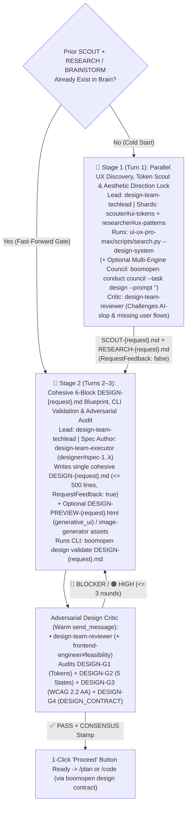

# 🎨💎 Design Team — 2-Stage Elastic Golden Diamond Protocol (v5.5)

> **ARCHITECTURE**: Replaces the legacy 4-triangle sequential pipeline (`12–16+` turns and redundant `designer -> designer` self-handoffs) with a **2-Stage Elastic Golden Diamond (`3–4` turns total)**.
> **STRICT `NO APPLICATION CODE` BOUNDARY**: During `/design:team`, no role writes production `.tsx`/`.vue`/`.swift`/`.css` application source files! The team produces **1 cohesive single-file `<appDataDir>\brain\<conversation-id>\DESIGN-{request}.md` (`<= 500` lines)** with `ArtifactMetadata: { Summary, UserFacing: true, RequestFeedback: true }` (rendering Antigravity 2.0's native 1-click **"Proceed"** button) plus an optional interactive `<appDataDir>\brain\<conversation-id>\DESIGN-PREVIEW-{request}.html` (`generative_ui` prototype).
> **DETERMINISTIC CLI GATE**: Every `DESIGN-{request}.md` MUST pass `node ~/.{TOOL}/skills/boomopen-workflow-kit/cli/install.js design validate "<design-path>"` (`DESIGN-G1..G4`) before consensus sign-off.

---

## ⚡ Mandatory Skills & Rules for All Design Team Shards

Every member of `design-team` (`TypeName: "self"`, `Model: "inherit"`) **MUST** enforce:
1. `skills/design-spec/SKILL.md` & `skills/frontend-design/SKILL.md` — 6-Block `DESIGN-{request}.md` schema, YAML token frontmatter, OKLCH + hex fallback palette, 4-step `surface_elevation` ladder, 3-axis typography (`tabular-nums`), and 5-State Component Matrix.
2. `skills_library/ui-ux-pro-max/SKILL.md` & `skills_library/anti-ai-slop-visual-craft/SKILL.md` — Grounded industry design system generation (`search.py "<query>" --design-system`), Named Aesthetic Direction, 1-Axis Border Rule, and explicit `anti_patterns`.
3. `skills_library/wcag-22-accessibility-ergonomics/SKILL.md` — **WCAG 2.2 AA** (`4.5:1` text contrast, `3:1` UI contrast, `24x24px` web / `44x44pt` mobile targets, `SC 2.4.11` focus not obscured, `SC 2.5.7` drag alternatives, `SC 3.3.8` accessible auth, `prefers-reduced-motion: reduce`, `dvh` units).
4. `rules/TEAMS.md` & `commands/_ref/golden-triangle-protocol.md` — Elastic Golden Diamond sharding (`role#shard`), Append-Only Mailbox (`MAILBOX-{date}.md`), and Scoped Warm Session Reuse (`role#shard -> conversationId` via `send_message`, max 3 debate rounds).

---

## 🧭 2-Stage Elastic Golden Diamond Execution Flow

### Stage 1: Turn-1 Parallel UX Discovery, Existing Token Scout & Aesthetic Direction Lock
- **Prior-Artifact Fast-Forward Gate**: If `SCOUT-{request}.md` and `RESEARCH-{request}.md` (or `BRAINSTORM-{request}.md`) already exist in `<appDataDir>\brain\<conversation-id>\`, **SKIP Stage 1** and jump directly to Stage 2!
- **Turn-1 Parallel Fan-Out (`TypeName: "self"`, `Model: "inherit"`)**:
  - **`design-team-techlead` (Design Director)**: Runs `python ~/.{TOOL}/skills_library/ui-ux-pro-max/scripts/search.py "<query>" --design-system -p "<Project>"`, locks the Named Aesthetic Direction, OKLCH token architecture, and component scope, and (when `engines.planner = "council"` or requested) runs `node ~/.{TOOL}/skills/boomopen-workflow-kit/cli/install.js conduct council --task design --prompt "<request>" --output "<appDataDir>/brain/<conversation-id>/COUNCIL-<request>.md"`.
  - **`scouter#ui-tokens`**: Scans existing repo CSS/Tailwind config (`globals.css`, `tailwind.config.*`, `DESIGN.md`, `components/ui/*`) so the spec reuses existing project tokens into `<appDataDir>\brain\<conversation-id>\SCOUT-{request}.md` (`RequestFeedback: false`).
  - **`researcher#ux-patterns`**: Maps user JTBD flows, information architecture, and edge-case interaction patterns into `<appDataDir>\brain\<conversation-id>\RESEARCH-{request}.md` (`RequestFeedback: false`).

### Stage 2: Cohesive 6-Block `DESIGN-{request}.md` Blueprint, CLI Validation & Adversarial Audit
- **`design-team-executor` (`designer#spec` — `base-agent: designer`)**:
  - Drafts the **single cohesive 6-Block `<appDataDir>\brain\<conversation-id>\DESIGN-{request}.md` (`<= 500` lines)** with `ArtifactMetadata: { Summary: "...", UserFacing: true, RequestFeedback: true }` (NEVER split into a folder at 150 lines!).
  - Optionally generates `<appDataDir>\brain\<conversation-id>\DESIGN-PREVIEW-{request}.html` (`generative_ui`) or invokes `image-generator` for bespoke visual assets.
  - Runs `node ~/.{TOOL}/skills/boomopen-workflow-kit/cli/install.js design validate "<design-path>"` and fixes any `DESIGN-G1..G4` failure before posting `[SUBMISSION]` to `MAILBOX-{date}.md`.
- **`design-team-reviewer` (+ optional `frontend-engineer#feasibility` via warm `send_message`)**:
  - Audits `DESIGN-{request}.md` against `DESIGN-G1..G4` (OKLCH tokens & Anti-Slop, 5-State Matrix, WCAG 2.2 AA & Responsive Ergonomics, and executable `DESIGN_CONTRACT` CSS `@theme` + TypeScript Props).
  - Any `🔴 BLOCKER` or `🟠 HIGH` gap is fixed **in-place** inside `DESIGN-{request}.md` by `design-team-executor` via warm `send_message` (max 3 rounds), re-verified by `boomopen design validate`, and stamped with `✅ CONSENSUS` by `design-team-techlead`.

---

## 🔍 4 Deterministic CLI Validation Gates (`boomopen design validate`)

| Gate ID | Validation Dimension | Mandatory Criteria Checked by CLI & Reviewer |
|:-------:|:---------------------|:---------------------------------------------|
| **`DESIGN-G1`** | **YAML Tokens & Anti-Slop Craft** | YAML frontmatter with `colors` (`oklch(...)` + hex fallback), 4-step `surface_elevation`, 3-axis `typography` (`tabular-nums`), `spacing`, `radius`, `motion`, named `aesthetic_direction`, and `anti_patterns`. |
| **`DESIGN-G2`** | **5-State Component & Screen Matrix** | Every component/screen specifies `Default`, `Loading (Skeleton)`, `Empty`, `Error`, and `Disabled / Focus-Visible` + spatial wireframe & Mermaid user flow. |
| **`DESIGN-G3`** | **WCAG 2.2 AA & Responsive Ergonomics** | `4.5:1` text contrast, `3:1` UI contrast, `24x24px` web / `44x44pt` mobile targets (`SC 2.5.8`), `SC 2.4.11` focus scroll-padding, `SC 2.5.7` drag alternatives, `prefers-reduced-motion: reduce`, `375px`/`768px`/`1024px`/`1440px` breakpoints, `dvh` units. |
| **`DESIGN-G4`** | **Executable `DESIGN_CONTRACT` & Cohesion** | Fenced `css` (`@theme inline` + CSS variables) + fenced `ts` (`interface ...Props`) ready for `boomopen design contract`, in **1 cohesive file `<= 500` lines** with `RequestFeedback: true`. |

---

## 📁 Deliverable & `ArtifactMetadata` Routing Rules (Antigravity 2.0)

| Deliverable | Path | `ArtifactMetadata` Setting | Size & Format Rule |
|:------------|:-----|:---------------------------|:-------------------|
| **Master Design Spec** | `<appDataDir>\brain\<conversation-id>\DESIGN-{request}.md` | `UserFacing: true, RequestFeedback: true` (**1-Click "Proceed"**) | **Single cohesive file `<= 500` lines** (NEVER split at 150 lines!) |
| **Interactive Prototype** | `<appDataDir>\brain\<conversation-id>\DESIGN-PREVIEW-{request}.html` | `UserFacing: true, RequestFeedback: false` | Optional `generative_ui` interactive HTML preview |
| **Token Scout / Research** | `<appDataDir>\brain\<conversation-id>\SCOUT-{request}.md`, `RESEARCH-{request}.md` | `UserFacing: false, RequestFeedback: false` | Supporting Stage 1 discovery artifacts |
| **Team Mailbox** | `<appDataDir>\brain\<conversation-id>\MAILBOX-{date}.md` | `UserFacing: false, RequestFeedback: false` | Append-only debate & consensus log (max 3 rounds) |
