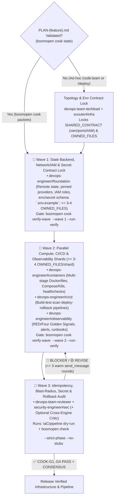

# 🏗️💎 DevOps Team — 3-Wave Declarative IaC Elastic Golden Diamond (v5.5)

> **ARCHITECTURE**: Delivers zero-downtime CI/CD, containers, cloud IaC, and observability through a **3-Wave Contract-First Elastic Golden Diamond** (`1 Tech Lead + N Parallel DevOps Shards + M Critics`) enforcing idempotency, least-privilege IAM, runtime secret injection, and tested rollback paths.
> **ELASTIC SHARDING LAW**: Each `devops-engineer#<shard>` (`base-agent: devops-engineer`) owns **`<= 3–4 OWNED_FILES`** with Scoped Warm Session Reuse (`role#shard -> conversationId` via `send_message`, max 3 rounds).

---

## ⚡ Mandatory Skills & Rules for All DevOps Team Shards

Every member of `devops-team` (`TypeName: "self"`, `Model: "inherit"`) **MUST** enforce:
1. `skills/accidental-data-loss-prevention/SKILL.md`, `skills/security-auditor/SKILL.md`, & `skills/clean-code/SKILL.md` — STOP-AND-VERIFY user consent before destructive cloud/bucket/DB actions, zero hardcoded secrets, pinned versions (`0` `:latest` tags), and Pragmatic 2-Tier standards.
2. `skills_library/terraform-opentofu-production/SKILL.md` & `skills_library/cloudflare-d1-r2-durable-objects/SKILL.md`.
3. `rules/TEAMS.md` & `commands/_ref/golden-triangle-protocol.md` — Disjoint `OWNED_FILES` (`<= 3–4` files/shard), Append-Only Mailbox (`MAILBOX-{date}.md`), and Warm Session Reuse (`send_message`).

---

## 🚀 Approved-Plan Fast-Forward Gate

1. **Inspect Active State**: Run `node ~/.{TOOL}/skills/boomopen-workflow-kit/cli/install.js cook state` (`boomopen cook state`) to inspect Brain/workspace artifacts and `.boomopen/project-ledger.json`.
2. **Plan Fast-Forward**: If `PLAN-{feature}.md` already passed `node ~/.{TOOL}/skills/boomopen-workflow-kit/cli/install.js plan validate "<plan-path>"`, **SKIP** redundant re-scouting and manual re-sharding — extract Wave 1 packets via `node ~/.{TOOL}/skills/boomopen-workflow-kit/cli/install.js cook packets "<plan-path>" --wave 1` (`boomopen cook packets <plan.md>`) and launch Wave 1 shards on Turn 1!

---

## 🧭 3-Wave Infrastructure & Pipeline Execution Flow

### Canonical DevOps Shard Matrix & Warm Session Registry

| Wave | Shard Key (`role#shard`) | Disjoint `OWNED_FILES` (`<= 3–4`) | Locked `READ_ONLY_FILES` |
|:----:|:-------------------------|:----------------------------------|:-------------------------|
| **W1** | `devops-engineer#foundation` | `infra/providers.tf`, `infra/iam.tf`, `.env.example` | `PLAN-{feature}.md` |
| **W2** | `devops-engineer#containers` | `Dockerfile`, `docker-compose.yml`, `k8s/*.yaml` | Wave 1 `foundation` + `.env.example` |
| **W2** | `devops-engineer#cicd` | `.github/workflows/ci.yml`, `scripts/rollback.sh` | Wave 1 `foundation` + `.env.example` |
| **W2** | `devops-engineer#observability` | `infra/monitoring.tf`, `ops/alerts.yaml` | Wave 1 `foundation` + `.env.example` |
| **W3** | `devops-team-reviewer` + `security-engineer#sec` | Read-only audit & dry-run validation | All `infra/**`, `Dockerfile*`, `.github/**` |

- **Scoped Warm Session Reuse**: Track `devops-engineer#<shard> -> conversationId` and route review findings via `send_message` (max 3 rounds; Round 3 escalates to `devops-team-techlead`).
- **Optional Cross-Engine Critic**: When `engines.reviewer = "cross_family"`, run `node ~/.{TOOL}/skills/boomopen-workflow-kit/cli/install.js conduct dispatch --role reviewer --engine cross_family --prompt "<IaC/CI diff & rollback plan>"` (`boomopen conduct dispatch --role reviewer --engine cross_family`).

---

## 🔍 4 Deterministic Post-Wave Gates (`COOK-G1..G4`)

Every wave MUST pass `node ~/.{TOOL}/skills/boomopen-workflow-kit/cli/install.js cook verify-wave "<plan-path>" --wave <N> --run-verify` and `node ~/.{TOOL}/skills/boomopen-workflow-kit/cli/install.js check <dir> --strict-phase --no-stubs`:

| Gate ID | Gate Dimension | Deterministic CLI & Reviewer Enforcement |
|:-------:|:---------------|:-----------------------------------------|
| **`COOK-G1`** | **Disjoint `OWNED_FILES` & State Lock** | `<= 4` files per `role#shard`; `0` unauthorized edits to Wave 1 `READ_ONLY_FILES` or destructive resource deletions without user consent. |
| **`COOK-G2`** | **`SHARED_CONTRACT` & Zero-Stub/Secret Gate** | Pinned image/module versions, `0` `:latest` tags, `0` hardcoded secrets, and `boomopen check <dir> --strict-phase --no-stubs` clean (`0` TODOs/placeholders). |
| **`COOK-G3`** | **Wave `--run-verify` & Dry-Run Validation** | `terraform/tofu validate`, container/workflow lint, healthcheck, and rollback verification commands exit `0`. |
| **`COOK-G4`** | **RTM Traceability & Consensus Stamp** | `100%` of Wave `REQ-xxx` / `AC` verified, `devops-team-reviewer` posts `APPROVAL`, and `devops-team-techlead` stamps `✅ CONSENSUS`. |

---

## 📁 Deliverable & `ArtifactMetadata` Routing (Antigravity 2.0)

| Deliverable | Path | `ArtifactMetadata` | Size & Format Rule |
|:------------|:-----|:-------------------|:-------------------|
| **DevOps Review** | `<appDataDir>\brain\<conversation-id>\REVIEW-{feature}.md` | `UserFacing: true, RequestFeedback: false` | Single cohesive file `<= 500` lines (`COOK-G1..G4` proof) |
| **Dry-Run Verification** | `<appDataDir>\brain\<conversation-id>\TEST-{feature}.md` | `UserFacing: true, RequestFeedback: false` | Plan/lint/smoke-check & blast-radius validation log |
| **Team Mailbox** | `<appDataDir>\brain\<conversation-id>\MAILBOX-{date}.md` | `UserFacing: false, RequestFeedback: false` | Append-only shard packets, reviews, defenses & consensus log |

---

## 📦 5-Field Shard Handoff Packet & Hard Consensus Gate

Every shard spawned via `invoke_subagent(TypeName: "self", Model: "inherit")` receives a deterministic packet from `boomopen cook packets "<plan-path>" --wave <N>`:
1. **`MISSION & ACCEPTANCE CRITERIA`**: Exact `Task X.Y (REQ-xxx)` IaC/pipeline/observability scope, SLOs, and measurable `AC` items.
2. **`SHARED_CONTRACT`**: Locked Wave 1 Terraform/OpenTofu variable/output contracts, port bindings, IAM ARNs/roles, and `.env.example` secret keys.
3. **`OWNED_FILES` (`<= 3–4` files)**: Exclusive write lock for `devops-engineer#<shard>` (`0` overlap across active shards).
4. **`READ_ONLY_FILES`**: Wave 1 state backend, provider pins, IAM policies, and `.env.example` schema during Wave 2 (`0` edits allowed).
5. **`VERIFICATION & DELIVERABLE`**: IaC/container/workflow dry-run commands, `boomopen cook verify-wave --run-verify`, `boomopen check <dir> --strict-phase --no-stubs`, and `MAILBOX-{date}.md` submission format.

### Hard Release Blockers (`devops-team-techlead` MUST Reject Release If Any Fail)
- [ ] Any `devops-engineer#<shard>` touched `> 4 OWNED_FILES` or mutated locked Wave 1 state/IAM contracts (`COOK-G1`).
- [ ] Any manifest contains hardcoded secrets, `:latest` image tags, root containers, `*:*` IAM wildcards, or missing rollback steps (`COOK-G2`).
- [ ] Destructive cloud/storage/database resource deletions were scripted without explicit user consent (`accidental-data-loss-prevention`).
- [ ] `cook verify-wave --run-verify` or `boomopen check <dir> --strict-phase --no-stubs` exited non-zero (`COOK-G3`).
- [ ] `MAILBOX-{date}.md` lacks `devops-team-reviewer` `APPROVAL` and `✅ CONSENSUS` (`COOK-G4`).
