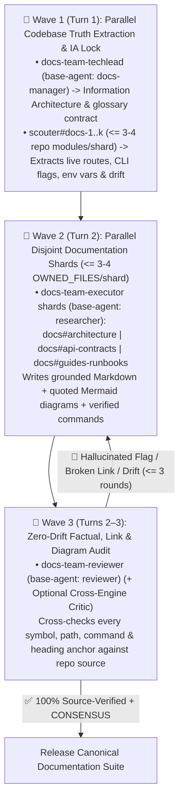

# 📝💎 Docs Team — 3-Wave Source-Grounded Elastic Golden Diamond (v5.5)

> **ARCHITECTURE**: Eliminates stale, hallucinated documentation through a **3-Wave Source-Grounded Elastic Golden Diamond** (`1 Docs Lead + N Parallel Writer Shards + Zero-Drift Critic`) where every CLI flag, API route, schema field, and Mermaid diagram is verified against live repository files.
> **ROUTING RULE**: When invoked via `/docs` (`/docs:core`, `/docs:business`, `/docs:audit`, `/docs:team`), writes canonical docs to `./documents/` (or `README.md`), while keeping transient `SCOUT`, `REVIEW`, and `MAILBOX` artifacts inside `<appDataDir>\brain\<conversation-id>\`.

---

## ⚡ Mandatory Skills & Tooling Rules for All Docs Shards

Every member of `docs-team` (`TypeName: "self"`, `Model: "inherit"`) **MUST** enforce:
1. `skills/api-patterns/SKILL.md` & `skills/database-design/SKILL.md` (when documenting APIs/schemas) — Exact status codes, payloads, auth headers, and entity relationships.
2. `rules/TEAMS.md` & `commands/_ref/golden-triangle-protocol.md` — Disjoint `OWNED_FILES` (`<= 3–4` doc files per `docs#<shard>`), Append-Only `MAILBOX-{date}.md`, and Scoped Warm Session Reuse (`send_message`, max 3 rounds).
3. **Supported Mermaid Diagrams Only**: `flowchart TD/LR`, `sequenceDiagram`, `stateDiagram-v2`, `classDiagram`, `erDiagram`, `xychart-beta` — always quote node labels containing parentheses/brackets (`id["Label (Detail)"]`).
4. **Valid Tools Only**: `search_web`, `read_file`, `write_file`, `edit_file`, `run_command`, `invoke_subagent`, `send_message`, `ask_question`.

---

## 🧭 3-Wave Source-Grounded Documentation Flow

### Canonical Documentation Shard Matrix & Warm Session Registry

| Wave | Shard Key (`role#shard`) | Disjoint `OWNED_FILES` (`<= 3–4`) | Locked `READ_ONLY_FILES` |
|:----:|:-------------------------|:----------------------------------|:-------------------------|
| **W1** | `scouter#docs-1..k` | `<appDataDir>\brain\<conversation-id>\SCOUT-docs-{k}.md` | All codebase source files |
| **W2** | `docs#architecture` | `documents/architecture.md`, `documents/data-model.md` | All codebase source + glossary contract |
| **W2** | `docs#api-contracts` | `documents/api-reference.md`, `documents/auth.md` | All codebase source + glossary contract |
| **W2** | `docs#guides-runbooks` | `README.md`, `documents/setup-and-ops.md` | All codebase source + glossary contract |
| **W3** | `docs-team-reviewer` | `<appDataDir>\brain\<conversation-id>\REVIEW-docs-{topic}.md` | All `documents/**` & `README.md` |

- **Scoped Warm Session Reuse**: Track `docs#<shard> -> conversationId` and route factual/anchor fixes directly via `send_message` (max 3 rounds; Round 3 escalates to `docs-team-techlead`).
- **Optional Cross-Engine Critic**: When `engines.reviewer = "cross_family"`, run `node ~/.{TOOL}/skills/boomopen-workflow-kit/cli/install.js conduct dispatch --role reviewer --engine cross_family --prompt "<docs diff vs source>"`.

---

## 🔍 4 Mandatory Documentation Quality Gates (`DOC-G1..G4`)

| Gate ID | Gate Dimension | Deterministic & Reviewer Verification |
|:-------:|:---------------|:--------------------------------------|
| **`DOC-G1`** | **100% Codebase Symbol Accuracy** | Every CLI command, env var, route path, config key, and file path exists verbatim in the repository (`0` phantom flags or stale paths). |
| **`DOC-G2`** | **Disjoint `OWNED_FILES` & Cohesion** | Each `docs#<shard>` modified `<= 4` assigned files with consistent terminology from Wave 1's shared glossary and `0` placeholder `TODO`s. |
| **`DOC-G3`** | **Link, Anchor & Mermaid Integrity** | All relative links and `#heading` anchors resolve; all Mermaid blocks use supported diagram types with quoted special-character labels. |
| **`DOC-G4`** | **Runnable Quickstart & Examples** | Setup commands, `package.json` scripts, and request/response examples match actual project dependencies and schemas. |

---

## 📁 Deliverable & `ArtifactMetadata` Routing Rules (Antigravity 2.0)

| Deliverable | Path | `ArtifactMetadata` Setting | Purpose |
|:------------|:-----|:---------------------------|:--------|
| **Project Docs** | `./documents/*.md` / `./README.md` | N/A (Workspace files when `/docs` invoked) | Permanent version-controlled documentation |
| **Docs Audit** | `<appDataDir>\brain\<conversation-id>\REVIEW-docs-{topic}.md` | `UserFacing: true, RequestFeedback: false` | Factual accuracy & link verification report |
| **Team Mailbox** | `<appDataDir>\brain\<conversation-id>\MAILBOX-{date}.md` | `UserFacing: false, RequestFeedback: false` | Append-only shard reviews & `✅ CONSENSUS` log |

### Hard Release Blockers (`docs-team-techlead` MUST Reject Release If Any Fail)
- [ ] Any documented command, script, endpoint, or file path does not exist in `package.json` or repo source.
- [ ] Any file contains placeholder `TBD`/`TODO` sections, broken `#anchor` links, or invalid Mermaid syntax.
- [ ] Application source code was modified during a `/docs` workflow.

---

## 📦 5-Field Shard Handoff Packet (Required on Every `invoke_subagent`)

Every `scouter#docs-{k}`, `docs#<shard>`, or `docs-team-reviewer` (`TypeName: "self"`, `Model: "inherit"`) MUST receive:
1. **`MISSION & ACCEPTANCE CRITERIA`**: Assigned documentation section/files and `DOC-G1..G4` zero-drift verification targets.
2. **`SHARED_CONTRACT`**: Information Architecture outline, canonical terminology glossary, and heading/#anchor cross-link map.
3. **`OWNED_FILES`**: Disjoint `<= 3–4` Markdown files (`./documents/*.md` or `SCOUT-docs-{k}.md` / `REVIEW-docs-{topic}.md`).
4. **`READ_ONLY_FILES`**: **100% of application source, config, and test files** + sibling `docs#<shard>` files.
5. **`VERIFICATION & DELIVERABLE`**: Source-verified symbols/commands + quoted Mermaid diagrams + `MAILBOX-{date}.md` submission log.
