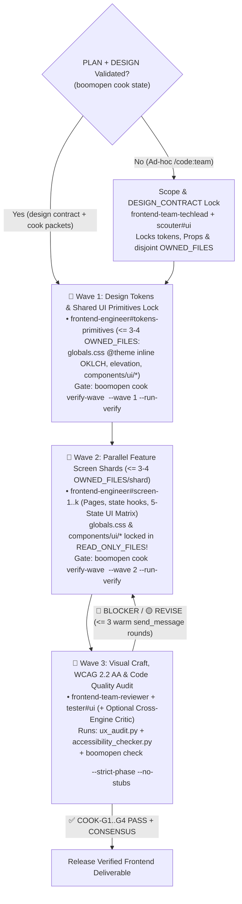

# 🎨💎 Frontend Team — 3-Wave Contract-First Elastic Golden Diamond (v5.5)

> **ARCHITECTURE**: Couples `DESIGN-{request}.md` (`boomopen design contract`) with **2-Wave Frontend Sharding + Wave 3 Automated UX/A11y Verification** so parallel screen builders never collide on `globals.css` or shared UI primitives.
> **ELASTIC SHARDING LAW**: Each `frontend-engineer#<shard>` owns **`<= 3–4 OWNED_FILES`** with Scoped Warm Session Reuse (`role#shard -> conversationId` via `send_message`, max 3 rounds).

---

## ⚡ Mandatory Skills & Rules for All Frontend Team Shards

Every member of `frontend-team` (`TypeName: "self"`, `Model: "inherit"`) **MUST** enforce:
1. `skills/frontend-design/SKILL.md`, `skills/frontend-architecture/SKILL.md`, `skills/design-spec/SKILL.md`, & `skills/clean-code/SKILL.md` — OKLCH perceptual color tokens, 5-State UI Matrix, clean UI/state/data separation, and Pragmatic 2-Tier code standards.
2. `skills_library/tailwind-v4-shadcn-ui/SKILL.md`, `skills_library/react-19-nextjs-15-rsc/SKILL.md`, `skills_library/anti-ai-slop-visual-craft/SKILL.md`, & `skills_library/wcag-22-accessibility-ergonomics/SKILL.md`.
3. `rules/TEAMS.md` & `commands/_ref/golden-triangle-protocol.md` — Disjoint `OWNED_FILES` (`<= 3–4` files/shard), Append-Only Mailbox (`MAILBOX-{date}.md`), and Warm Session Reuse (`send_message`).

---

## 🚀 Approved-Plan & Approved-Design Fast-Forward Gate

1. **Inspect Active State**: Run `node ~/.{TOOL}/skills/boomopen-workflow-kit/cli/install.js cook state` (`boomopen cook state`) to inspect Brain/workspace artifacts.
2. **Design Contract Extraction**: When `DESIGN-{request}.md` exists, run `node ~/.{TOOL}/skills/boomopen-workflow-kit/cli/install.js design contract "<design-path>"` (`boomopen design contract`) to extract locked OKLCH `@theme inline` CSS tokens and TypeScript component prop contracts.
3. **Plan Fast-Forward**: When `PLAN-{feature}.md` already passed `boomopen plan validate`, **SKIP** re-planning/re-sharding — run `node ~/.{TOOL}/skills/boomopen-workflow-kit/cli/install.js cook packets "<plan-path>" --wave 1` (`boomopen cook packets <plan.md>`) and dispatch Wave 1 immediately!

---

## 🧭 3-Wave Frontend Sharding & Verification Flow

### Canonical 2-Wave Frontend Shard Matrix & Warm Session Registry

| Wave | Shard Key (`role#shard`) | Disjoint `OWNED_FILES` (`<= 3–4`) | Locked `READ_ONLY_FILES` |
|:----:|:-------------------------|:----------------------------------|:-------------------------|
| **W1** | `frontend-engineer#tokens-primitives` | `app/globals.css`, `components/ui/*` | `DESIGN-{request}.md` |
| **W2** | `frontend-engineer#screen-1..k` | `app/(routes)/*`, `features/*/hooks.ts` | `app/globals.css`, `components/ui/*`, `DESIGN_CONTRACT` |
| **W3** | `frontend-team-reviewer` + `tester#ui` | `tests/ui/*.spec.tsx` (`tester` only) | All `app/**`, `components/**`, `features/**` |

- **Mandatory 5-State UI Matrix**: Every screen/component MUST implement `Default`, `Loading (Skeleton)`, `Empty`, `Error`, and `Disabled / Focus-Visible`.
- **Warm Session Reuse & Cross-Engine Critic**: Route fixes to `frontend-engineer#<shard>` via `send_message` (max 3 rounds); optionally invoke `node ~/.{TOOL}/skills/boomopen-workflow-kit/cli/install.js conduct dispatch --role reviewer --engine cross_family --prompt "<UI diff & DESIGN_CONTRACT>"` (`boomopen conduct dispatch --role reviewer --engine cross_family`).

---

## 🔍 4 Deterministic Post-Wave Gates (`COOK-G1..G4`)

Every wave MUST pass `node ~/.{TOOL}/skills/boomopen-workflow-kit/cli/install.js cook verify-wave "<plan-path>" --wave <N> --run-verify` and `node ~/.{TOOL}/skills/boomopen-workflow-kit/cli/install.js check <dir> --strict-phase --no-stubs`:

| Gate ID | Gate Dimension | Deterministic CLI & Reviewer Enforcement |
|:-------:|:---------------|:-----------------------------------------|
| **`COOK-G1`** | **Disjoint `OWNED_FILES` & Token Lock** | `<= 4` files per `role#shard`; `0` Wave 2 edits to `globals.css` or `READ_ONLY_FILES`. |
| **`COOK-G2`** | **`DESIGN_CONTRACT`, 5-State & Anti-Stub** | Exact `@theme` OKLCH tokens + 5-State UI coverage; `boomopen check <dir> --strict-phase --no-stubs` reports `0` stubs/TODOs, `0` `any`, `0` `console.log`. |
| **`COOK-G3`** | **Wave `--run-verify` + UX/A11y Scripts** | Typecheck/build/component tests exit `0` + `python ~/.{TOOL}/skills/frontend-design/scripts/ux_audit.py <dir>` + `accessibility_checker.py <dir>` pass WCAG 2.2 AA. |
| **`COOK-G4`** | **RTM Traceability & Consensus Stamp** | `100%` of Wave `REQ-xxx` / `AC` verified, `frontend-team-reviewer` posts `APPROVAL`, and `frontend-team-techlead` stamps `✅ CONSENSUS`. |

---

## 📁 Deliverable & `ArtifactMetadata` Routing (Antigravity 2.0)

| Deliverable | Path | `ArtifactMetadata` | Size & Format Rule |
|:------------|:-----|:-------------------|:-------------------|
| **Frontend Review** | `<appDataDir>\brain\<conversation-id>\REVIEW-{feature}.md` | `UserFacing: true, RequestFeedback: false` | Single cohesive file `<= 500` lines (`COOK-G1..G4` proof) |
| **UI Test Report** | `<appDataDir>\brain\<conversation-id>\TEST-{feature}.md` | `UserFacing: true, RequestFeedback: false` | Component/Playwright & 5-State verification log |
| **Team Mailbox** | `<appDataDir>\brain\<conversation-id>\MAILBOX-{date}.md` | `UserFacing: false, RequestFeedback: false` | Append-only shard packets, reviews, defenses & consensus log |

---

## 📦 5-Field Shard Handoff Packet & Hard Consensus Gate

Every shard spawned via `invoke_subagent(TypeName: "self", Model: "inherit")` receives a deterministic packet from `boomopen cook packets "<plan-path>" --wave <N>`:
1. **`MISSION & ACCEPTANCE CRITERIA`**: Exact `Task X.Y (REQ-xxx)` scope, 5-State UI Matrix states, and measurable `AC` items.
2. **`SHARED_CONTRACT` (`DESIGN_CONTRACT`)**: Output of `boomopen design contract` — locked OKLCH `@theme inline` CSS tokens, `surface_elevation`, motion tokens, and TypeScript component prop interfaces.
3. **`OWNED_FILES` (`<= 3–4` files)**: Exclusive write lock for `frontend-engineer#<shard>` (`0` overlap across active shards).
4. **`READ_ONLY_FILES`**: In Wave 2, `globals.css` and `components/ui/*` are strictly read-only (`0` edits allowed).
5. **`VERIFICATION & DELIVERABLE`**: Wave `--run-verify` tests, `ux_audit.py`, `accessibility_checker.py`, `boomopen check <dir> --strict-phase --no-stubs`, and `MAILBOX-{date}.md` submission format.

### Hard Release Blockers (`frontend-team-techlead` MUST Reject Release If Any Fail)
- [ ] Any Wave 2 screen shard modified `globals.css` / `components/ui/*` or exceeded `4 OWNED_FILES` (`COOK-G1` failure).
- [ ] Any component/screen omits `Default`, `Loading`, `Empty`, `Error`, or `Disabled / Focus-Visible` states (`COOK-G2`).
- [ ] `ux_audit.py`, `accessibility_checker.py`, `cook verify-wave --run-verify`, or `boomopen check --strict-phase --no-stubs` exited non-zero (`COOK-G3`).
- [ ] Any interactive element violates WCAG 2.2 AA (`24x24px` web / `44x44pt` mobile targets, `SC 2.4.11` focus, `4.5:1` contrast).
- [ ] `MAILBOX-{date}.md` lacks `frontend-team-reviewer` `APPROVAL` and `✅ CONSENSUS` (`COOK-G4`).
