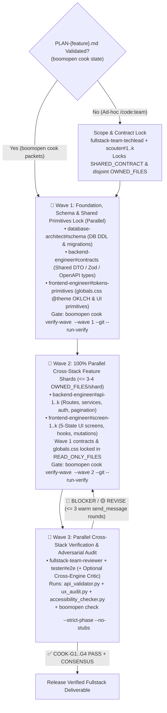

# 🌐💎 Fullstack Team — 3-Wave Contract-First Elastic Golden Diamond (v5.5)

> **ARCHITECTURE**: Eliminates the legacy sequential *"backend-first, frontend-waits"* bottleneck in favor of a **3-Wave Contract-First Parallel Topology** where Backend and Frontend feature shards execute **100% in parallel in Wave 2** against Wave 1's locked schemas, DTO contracts, and OKLCH UI tokens.
> **ELASTIC SHARDING LAW**: Scales from `1-2-1` to `1 Tech Lead + N Parallel Shards (role#shard, <= 3–4 OWNED_FILES/shard) + M Critics` with Scoped Warm Session Reuse (`role#shard -> conversationId` via `send_message`, max 3 rounds).

---

## ⚡ Mandatory Skills & Rules for All Fullstack Team Shards

Every member of `fullstack-team` (`TypeName: "self"`, `Model: "inherit"`) **MUST** enforce:
1. `skills/api-patterns/SKILL.md`, `skills/database-design/SKILL.md`, `skills/frontend-design/SKILL.md`, & `skills/clean-code/SKILL.md` — Contract-first OpenAPI/Zod/Hono RPC boundaries, expand-contract DB schemas, 5-State UI Matrix, and Pragmatic 2-Tier code standards.
2. `skills_library/hono-rpc-zod-openapi/SKILL.md`, `skills_library/better-auth-typescript/SKILL.md`, `skills_library/react-19-nextjs-15-rsc/SKILL.md`, `skills_library/tailwind-v4-shadcn-ui/SKILL.md`, & `skills_library/wcag-22-accessibility-ergonomics/SKILL.md`.
3. `rules/TEAMS.md` & `commands/_ref/golden-triangle-protocol.md` — Disjoint `OWNED_FILES` (`<= 3–4` files/shard), Append-Only Mailbox (`MAILBOX-{date}.md`), and Scoped Warm Session Reuse (`send_message`).

---

## 🚀 Approved-Plan & Approved-Design Fast-Forward Gate

1. **Inspect Active State**: Run `node ~/.{TOOL}/skills/boomopen-workflow-kit/cli/install.js cook state` (`boomopen cook state`) to inspect Brain/workspace artifacts (`SCOUT`, `RESEARCH`, `DESIGN`, `PLAN`) and `.boomopen/project-ledger.json`.
2. **Design Contract Extraction**: When `DESIGN-{feature}.md` exists, extract `DESIGN_CONTRACT` (`@theme inline` OKLCH CSS + TypeScript Props) via `node ~/.{TOOL}/skills/boomopen-workflow-kit/cli/install.js design contract "<design-path>"`.
3. **Plan Fast-Forward**: If `PLAN-{feature}.md` already passed `node ~/.{TOOL}/skills/boomopen-workflow-kit/cli/install.js plan validate "<plan-path>"`, **SKIP** redundant re-scouting, re-planning, and manual re-sharding — generate 5-Field Handoff Packets directly via `node ~/.{TOOL}/skills/boomopen-workflow-kit/cli/install.js cook packets "<plan-path>" --wave 1` (`boomopen cook packets <plan.md>`) and dispatch Wave 1 shards on Turn 1!

---

## 🧭 3-Wave Contract-First Parallel Execution Flow

### Canonical Cross-Stack Shard Matrix & Warm Session Registry

| Wave | Shard Key (`role#shard`) | Disjoint `OWNED_FILES` (`<= 3–4`) | Locked `READ_ONLY_FILES` |
|:----:|:-------------------------|:----------------------------------|:-------------------------|
| **W1** | `database-architect#schema` | `db/schema.ts`, `db/migrations/*` | `PLAN-{feature}.md` |
| **W1** | `backend-engineer#contracts` | `shared/contracts/*.ts`, `shared/errors.ts` | `PLAN-{feature}.md` |
| **W1** | `frontend-engineer#tokens-primitives` | `app/globals.css`, `components/ui/*` | `DESIGN-{feature}.md` |
| **W2** | `backend-engineer#api-1..k` | `server/routes/*.ts`, `server/services/*.ts` | Wave 1 `schema` + `contracts` |
| **W2** | `frontend-engineer#screen-1..k` | `app/(feat)/*`, `features/*/hooks.ts` | Wave 1 `contracts` + `globals.css` + `ui/*` |
| **W3** | `fullstack-team-reviewer` + `tester#e2e` | `tests/e2e/*` (`tester` only; `reviewer` read-only) | All application source files |

- **Scoped Warm Session Reuse**: Record `role#shard -> conversationId` on spawn; route Wave 3 findings directly to the owning shard via `send_message` (max 3 rounds; Round 3 escalates to `fullstack-team-techlead` for binding arbitration).
- **Optional Cross-Engine Critic**: When `engines.reviewer = "cross_family"`, invoke `node ~/.{TOOL}/skills/boomopen-workflow-kit/cli/install.js conduct dispatch --role reviewer --engine cross_family --prompt "<wave diff & SHARED_CONTRACT>"`.

---

## 🔍 4 Deterministic Post-Wave Gates (`COOK-G1..G4`)

Every wave MUST pass `node ~/.{TOOL}/skills/boomopen-workflow-kit/cli/install.js cook verify-wave "<plan-path>" --wave <N> --git --run-verify` and `node ~/.{TOOL}/skills/boomopen-workflow-kit/cli/install.js check <dir> --strict-phase --no-stubs`:

| Gate ID | Gate Dimension | Deterministic CLI & Reviewer Enforcement |
|:-------:|:---------------|:-----------------------------------------|
| **`COOK-G1`** | **Disjoint `OWNED_FILES` & Write-Lock** | `<= 4` files touched per `role#shard`; `0` unauthorized mutations to `READ_ONLY_FILES` (`--git`). |
| **`COOK-G2`** | **Deliverables Present & Non-Empty** | All expected Wave `<N>` `OWNED_FILES` and `Test Files` exist on disk and are non-empty (`> 0` bytes). |
| **`COOK-G3`** | **`SHARED_CONTRACT` & Zero-Stub Hygiene** | DTO/schema/token imports match Wave 1 contracts; `boomopen check <dir> --strict-phase --no-stubs` reports `<= 500` lines, `0` stubs/TODOs, `0` explicit `any`, and `0` stray `console.log`. |
| **`COOK-G4`** | **Wave `--run-verify`, Audits & Consensus** | Typecheck/build/tests + `api_validator.py`, `ux_audit.py`, & `accessibility_checker.py` exit `0`, `100%` `REQ-xxx`/`AC` verified, Reviewer `APPROVAL`, and `✅ CONSENSUS`. |

---

## 📁 Deliverable & `ArtifactMetadata` Routing (Antigravity 2.0)

| Deliverable | Path | `ArtifactMetadata` | Size & Format Rule |
|:------------|:-----|:-------------------|:-------------------|
| **Cross-Stack Review** | `<appDataDir>\brain\<conversation-id>\REVIEW-{feature}.md` | `UserFacing: true, RequestFeedback: false` | Single cohesive file `<= 500` lines (`COOK-G1..G4` proof) |
| **Test Verification** | `<appDataDir>\brain\<conversation-id>\TEST-{feature}.md` | `UserFacing: true, RequestFeedback: false` | API + UI integration/E2E results & RTM matrix |
| **Team Mailbox** | `<appDataDir>\brain\<conversation-id>\MAILBOX-{date}.md` | `UserFacing: false, RequestFeedback: false` | Append-only shard packets, reviews, defenses & consensus log |

---

## 📦 5-Field Shard Handoff Packet & Hard Consensus Gate

Every shard spawned via `invoke_subagent(TypeName: "self", Model: "inherit")` receives a deterministic packet from `boomopen cook packets "<plan-path>" --wave <N>`:
1. **`MISSION & ACCEPTANCE CRITERIA`**: Exact `Task X.Y (REQ-xxx)` scope and measurable `AC` items.
2. **`SHARED_CONTRACT`**: Locked Wave 1 DB schemas, OpenAPI/Zod DTOs, error envelopes, and `DESIGN_CONTRACT` OKLCH `@theme` tokens.
3. **`OWNED_FILES` (`<= 3–4` files)**: Exclusive write lock for `role#shard` (`0` overlap across active Wave `<N>` shards).
4. **`READ_ONLY_FILES`**: Wave 1 shared contracts, `globals.css`, UI primitives, and peer shard files (`0` edits allowed).
5. **`VERIFICATION & DELIVERABLE`**: Exact wave `--run-verify` test commands, `api_validator.py` / `ux_audit.py` / `accessibility_checker.py`, `boomopen check <dir> --strict-phase --no-stubs`, and `MAILBOX-{date}.md` submission format.

### Hard Release Blockers (`fullstack-team-techlead` MUST Reject Release If Any Fail)
- [ ] Any Wave 2 Frontend shard waited sequentially on Backend instead of building in parallel against Wave 1 contracts.
- [ ] Any shard touched `> 4 OWNED_FILES` or mutated locked `READ_ONLY_FILES` (`COOK-G1` failure).
- [ ] `boomopen cook verify-wave "<plan.md>" --wave <W> --git --run-verify` or `boomopen check <dir> --strict-phase --no-stubs` exited non-zero (`COOK-G2`..`COOK-G4`).
- [ ] `api_validator.py`, `ux_audit.py`, or `accessibility_checker.py` reported unresolved `🔴 BLOCKER` findings.
- [ ] `MAILBOX-{date}.md` lacks Reviewer `APPROVAL` (`PASS`) and `✅ CONSENSUS` across all waves (`COOK-G4`).
