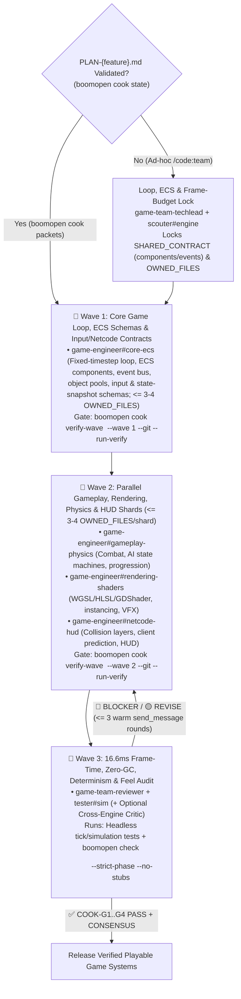

# 🎮💎 Game Team — 3-Wave ECS & Frame-Budget Elastic Golden Diamond (v5.5)

> **ARCHITECTURE**: Coordinates Unity 6 DOTS, Godot 4, Unreal 5, WebGPU/Three.js/R3F, and PixiJS/Phaser builds through a **3-Wave Contract-First Elastic Golden Diamond** (`1 Tech Lead + N Parallel Engine Shards + M Critics`) enforcing deterministic ticks, zero hot-path allocations, and a strict `16.6ms` (`60fps+`) frame budget.
> **ELASTIC SHARDING LAW**: Each `game-engineer#<shard>` owns **`<= 3–4 OWNED_FILES`** with Scoped Warm Session Reuse (`role#shard -> conversationId` via `send_message`, max 3 rounds).

---

## ⚡ Mandatory Skills & Rules for All Game Team Shards

Every member of `game-team` (`TypeName: "self"`, `Model: "inherit"`) **MUST** enforce:
1. `skills/game-developer/SKILL.md` & `skills/clean-code/SKILL.md` — Data-oriented ECS composition, fixed-timestep physics determinism, object pooling (`0` per-frame GC allocations), and Pragmatic 2-Tier code standards.
2. `skills_library/unity-6-dots-ecs-architecture/SKILL.md`, `skills_library/godot-4-gdscript-shaders-2d-3d/SKILL.md`, `skills_library/webgpu-wgsl-three-tsl/SKILL.md`, `skills_library/react-three-fiber-rapier-3d/SKILL.md`, `skills_library/multiplayer-netcode-colyseus/SKILL.md`, & `skills_library/pixijs-v8-phaser-2d-games/SKILL.md`.
3. `rules/TEAMS.md` & `commands/_ref/golden-triangle-protocol.md` — Disjoint `OWNED_FILES` (`<= 3–4` files/shard), Append-Only Mailbox (`MAILBOX-{date}.md`), and Warm Session Reuse (`send_message`).

---

## 🚀 Approved-Plan Fast-Forward Gate

1. **Inspect Active State**: Run `node ~/.{TOOL}/skills/boomopen-workflow-kit/cli/install.js cook state` (`boomopen cook state`) to inspect Brain/workspace artifacts and `.boomopen/project-ledger.json`.
2. **Plan Fast-Forward**: If `PLAN-{feature}.md` already passed `node ~/.{TOOL}/skills/boomopen-workflow-kit/cli/install.js plan validate "<plan-path>"`, **SKIP** redundant re-scouting and manual re-sharding — extract Wave 1 shard packets via `node ~/.{TOOL}/skills/boomopen-workflow-kit/cli/install.js cook packets "<plan-path>" --wave 1` (`boomopen cook packets <plan.md>`) and launch Wave 1 shards on Turn 1!

---

## 🧭 3-Wave ECS & Simulation Execution Flow

### Canonical Game Shard Matrix & Warm Session Registry

| Wave | Shard Key (`role#shard`) | Disjoint `OWNED_FILES` (`<= 3–4`) | Locked `READ_ONLY_FILES` |
|:----:|:-------------------------|:----------------------------------|:-------------------------|
| **W1** | `game-engineer#core-ecs` | `src/core/loop.ts`, `src/ecs/components.ts`, `src/ecs/events.ts` | `PLAN-{feature}.md` |
| **W2** | `game-engineer#gameplay-physics` | `src/systems/combat.ts`, `src/systems/ai.ts` | Wave 1 `core-ecs` |
| **W2** | `game-engineer#rendering-shaders` | `src/render/pipeline.ts`, `src/shaders/*.wgsl` | Wave 1 `core-ecs` |
| **W2** | `game-engineer#netcode-hud` | `src/physics/world.ts`, `src/net/sync.ts`, `src/ui/hud.ts` | Wave 1 `core-ecs` |
| **W3** | `game-team-reviewer` + `tester#sim` | `tests/sim/*.test.ts` (`tester` only) | All `src/**` files |

- **Scoped Warm Session Reuse**: Record `game-engineer#<shard> -> conversationId` and route review fixes via `send_message` (max 3 rounds; Round 3 escalates to `game-team-techlead`).
- **Optional Cross-Engine Critic**: When `engines.reviewer = "cross_family"`, run `node ~/.{TOOL}/skills/boomopen-workflow-kit/cli/install.js conduct dispatch --role reviewer --engine cross_family --prompt "<gameplay/shader diff & frame budget>"`.

---

## 🔍 4 Deterministic Post-Wave Gates (`COOK-G1..G4`)

Every wave MUST pass `node ~/.{TOOL}/skills/boomopen-workflow-kit/cli/install.js cook verify-wave "<plan-path>" --wave <N> --git --run-verify` and `node ~/.{TOOL}/skills/boomopen-workflow-kit/cli/install.js check <dir> --strict-phase --no-stubs`:

| Gate ID | Gate Dimension | Deterministic CLI & Reviewer Enforcement |
|:-------:|:---------------|:-----------------------------------------|
| **`COOK-G1`** | **Disjoint `OWNED_FILES` & ECS Lock** | `<= 4` files per `role#shard`; `0` unauthorized mutations to Wave 1 core loop/ECS `READ_ONLY_FILES` (`--git`). |
| **`COOK-G2`** | **Deliverables Present & Non-Empty** | All expected Wave `<N>` ECS, gameplay, shader, and simulation test files exist on disk and are non-empty (`> 0` bytes). |
| **`COOK-G3`** | **`SHARED_CONTRACT` & Zero-Stub/Hot-Alloc** | Component/event/packet alignment, `0` per-frame heap allocations in `update`/`_physics_process`, and `boomopen check <dir> --strict-phase --no-stubs` clean. |
| **`COOK-G4`** | **Wave `--run-verify`, Sim Tests & Consensus** | Build/shader compile/headless tick & physics tests exit `0` within `16.6ms` (`60fps`) frame budget, `100%` `REQ-xxx`/`AC` verified, Reviewer `APPROVAL`, and `✅ CONSENSUS`. |

---

## 📁 Deliverable & `ArtifactMetadata` Routing (Antigravity 2.0)

| Deliverable | Path | `ArtifactMetadata` | Size & Format Rule |
|:------------|:-----|:-------------------|:-------------------|
| **Game Systems Review** | `<appDataDir>\brain\<conversation-id>\REVIEW-{feature}.md` | `UserFacing: true, RequestFeedback: false` | Single cohesive file `<= 500` lines (`COOK-G1..G4` proof) |
| **Simulation Test Log** | `<appDataDir>\brain\<conversation-id>\TEST-{feature}.md` | `UserFacing: true, RequestFeedback: false` | Headless simulation, collision/netcode & build verification |
| **Team Mailbox** | `<appDataDir>\brain\<conversation-id>\MAILBOX-{date}.md` | `UserFacing: false, RequestFeedback: false` | Append-only shard packets, reviews, defenses & consensus log |

---

## 📦 5-Field Shard Handoff Packet & Hard Consensus Gate

Every shard spawned via `invoke_subagent(TypeName: "self", Model: "inherit")` receives a deterministic packet from `boomopen cook packets "<plan-path>" --wave <N>`:
1. **`MISSION & ACCEPTANCE CRITERIA`**: Exact `Task X.Y (REQ-xxx)` gameplay/rendering/physics scope, `16.6ms` frame budget, and `AC` items.
2. **`SHARED_CONTRACT`**: Locked Wave 1 ECS component schemas, fixed-timestep tick constants, event payloads, and netcode snapshot structs.
3. **`OWNED_FILES` (`<= 3–4` files)**: Exclusive write lock for `game-engineer#<shard>` (`0` overlap across active shards).
4. **`READ_ONLY_FILES`**: Wave 1 core game loop, ECS component definitions, and event/netcode contracts during Wave 2 (`0` edits allowed).
5. **`VERIFICATION & DELIVERABLE`**: Headless simulation/shader/build `--run-verify` commands, `boomopen check <dir> --strict-phase --no-stubs`, and `MAILBOX-{date}.md` submission format.

### Hard Release Blockers (`game-team-techlead` MUST Reject Release If Any Fail)
- [ ] Any `game-engineer#<shard>` touched `> 4 OWNED_FILES` or mutated locked Wave 1 ECS/loop contracts (`COOK-G1`).
- [ ] Expected system/shader deliverables are missing/empty (`COOK-G2`), or per-frame heap/GC allocations (`new`, array/closure churn) or `dt` misuse exist in hot tick loops (`COOK-G3`).
- [ ] `cook verify-wave "<plan.md>" --wave <W> --git --run-verify` or `boomopen check <dir> --strict-phase --no-stubs` exited non-zero (`COOK-G3`/`COOK-G4`).
- [ ] Object pools, asset disposal, or deterministic state transitions lack verification tests.
- [ ] `MAILBOX-{date}.md` lacks `game-team-reviewer` `APPROVAL` and `✅ CONSENSUS` (`COOK-G4`).
