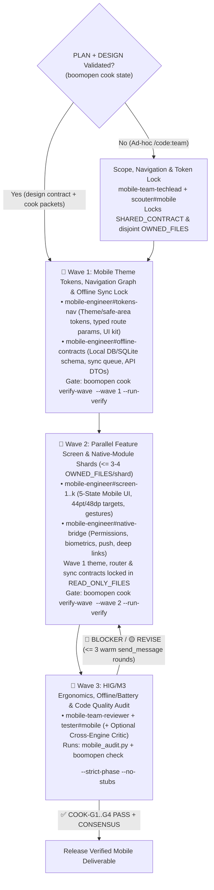

# 📱💎 Mobile Team — 3-Wave Contract-First Elastic Golden Diamond (v5.5)

> **ARCHITECTURE**: Orchestrates React Native / Expo, Flutter, SwiftUI/Kotlin, and Tauri v2 mobile builds via a **3-Wave Contract-First Elastic Golden Diamond** (`1 Tech Lead + N Parallel Mobile Shards + M Critics`) enforcing iOS 18 HIG, Material 3 Expressive, `44pt`/`48dp` touch ergonomics, and offline resilience.
> **ELASTIC SHARDING LAW**: Each `mobile-engineer#<shard>` owns **`<= 3–4 OWNED_FILES`** with Scoped Warm Session Reuse (`role#shard -> conversationId` via `send_message`, max 3 rounds).

---

## ⚡ Mandatory Skills & Rules for All Mobile Team Shards

Every member of `mobile-team` (`TypeName: "self"`, `Model: "inherit"`) **MUST** enforce:
1. `skills/mobile-design/SKILL.md`, `skills/mobile-developer/SKILL.md`, & `skills/clean-code/SKILL.md` — 5-State Mobile UI Matrix, `>= 44x44pt` iOS / `>= 48x48dp` Android touch targets, safe-area tokens, offline-first sync, and Pragmatic 2-Tier code standards.
2. `skills_library/ios18-hig-material3-expressive/SKILL.md`, `skills_library/tauri-v2-rust-desktop-mobile/SKILL.md`, & `skills_library/wcag-22-accessibility-ergonomics/SKILL.md`.
3. `rules/TEAMS.md` & `commands/_ref/golden-triangle-protocol.md` — Disjoint `OWNED_FILES` (`<= 3–4` files/shard), Append-Only Mailbox (`MAILBOX-{date}.md`), and Warm Session Reuse (`send_message`).

---

## 🚀 Approved-Plan & Approved-Design Fast-Forward Gate

1. **Inspect Active State**: Run `node ~/.{TOOL}/skills/boomopen-workflow-kit/cli/install.js cook state` (`boomopen cook state`) to inspect Brain/workspace artifacts.
2. **Design Contract Extraction**: When `DESIGN-{feature}.md` exists, extract mobile tokens, safe-area rules, and component contracts via `node ~/.{TOOL}/skills/boomopen-workflow-kit/cli/install.js design contract "<design-path>"`.
3. **Plan Fast-Forward**: If `PLAN-{feature}.md` already passed `boomopen plan validate`, **SKIP** redundant re-scouting and manual re-sharding — extract Wave 1 packets via `node ~/.{TOOL}/skills/boomopen-workflow-kit/cli/install.js cook packets "<plan-path>" --wave 1` (`boomopen cook packets <plan.md>`) and launch Wave 1 shards immediately!

---

## 🧭 3-Wave Mobile Sharding & Verification Flow

### Canonical Mobile Shard Matrix & Warm Session Registry

| Wave | Shard Key (`role#shard`) | Disjoint `OWNED_FILES` (`<= 3–4`) | Locked `READ_ONLY_FILES` |
|:----:|:-------------------------|:----------------------------------|:-------------------------|
| **W1** | `mobile-engineer#tokens-nav` | `src/theme/tokens.ts`, `src/navigation/types.ts` | `DESIGN-{feature}.md` |
| **W1** | `mobile-engineer#offline-contracts` | `src/storage/schema.ts`, `src/sync/contracts.ts` | `PLAN-{feature}.md` |
| **W2** | `mobile-engineer#screen-1..k` | `src/screens/*`, `src/features/*/hooks.ts` | Wave 1 `tokens-nav` + `offline-contracts` |
| **W2** | `mobile-engineer#native-bridge` | `src/native/*.ts`, `src/permissions/*.ts` | Wave 1 `tokens-nav` + `offline-contracts` |
| **W3** | `mobile-team-reviewer` + `tester#mobile` | `tests/mobile/*.test.tsx` (`tester` only) | All `src/**` files |

- **Scoped Warm Session Reuse**: Record `mobile-engineer#<shard> -> conversationId` and route review fixes via `send_message` (max 3 rounds; Round 3 escalates to `mobile-team-techlead`).
- **Optional Cross-Engine Critic**: When `engines.reviewer = "cross_family"`, run `node ~/.{TOOL}/skills/boomopen-workflow-kit/cli/install.js conduct dispatch --role reviewer --engine cross_family --prompt "<mobile diff & DESIGN_CONTRACT>"` (`boomopen conduct dispatch --role reviewer --engine cross_family`).

---

## 🔍 4 Deterministic Post-Wave Gates (`COOK-G1..G4`)

Every wave MUST pass `node ~/.{TOOL}/skills/boomopen-workflow-kit/cli/install.js cook verify-wave "<plan-path>" --wave <N> --run-verify` and `node ~/.{TOOL}/skills/boomopen-workflow-kit/cli/install.js check <dir> --strict-phase --no-stubs`:

| Gate ID | Gate Dimension | Deterministic CLI & Reviewer Enforcement |
|:-------:|:---------------|:-----------------------------------------|
| **`COOK-G1`** | **Disjoint `OWNED_FILES` & Router Lock** | `<= 4` files per `role#shard`; `0` unauthorized edits to Wave 1 theme/router `READ_ONLY_FILES`. |
| **`COOK-G2`** | **`SHARED_CONTRACT`, 5-State & Anti-Stub** | Typed navigation/DTO compliance + 5-State Mobile UI (`Default`, `Loading`, `Empty`, `Error/Offline`, `Disabled`); `boomopen check <dir> --strict-phase --no-stubs` passes. |
| **`COOK-G3`** | **Wave `--run-verify` & `mobile_audit.py`** | Typecheck/build/widget tests exit `0` + `python ~/.{TOOL}/skills/mobile-design/scripts/mobile_audit.py <dir>` passes (`44pt`/`48dp` targets, safe-area insets, virtualized lists). |
| **`COOK-G4`** | **RTM Traceability & Consensus Stamp** | `100%` of Wave `REQ-xxx` / `AC` verified, `mobile-team-reviewer` posts `APPROVAL`, and `mobile-team-techlead` stamps `✅ CONSENSUS`. |

---

## 📁 Deliverable & `ArtifactMetadata` Routing (Antigravity 2.0)

| Deliverable | Path | `ArtifactMetadata` | Size & Format Rule |
|:------------|:-----|:-------------------|:-------------------|
| **Mobile Review** | `<appDataDir>\brain\<conversation-id>\REVIEW-{feature}.md` | `UserFacing: true, RequestFeedback: false` | Single cohesive file `<= 500` lines (`COOK-G1..G4` proof) |
| **Mobile Test Report** | `<appDataDir>\brain\<conversation-id>\TEST-{feature}.md` | `UserFacing: true, RequestFeedback: false` | Component/navigation/offline lifecycle test verification |
| **Team Mailbox** | `<appDataDir>\brain\<conversation-id>\MAILBOX-{date}.md` | `UserFacing: false, RequestFeedback: false` | Append-only shard packets, reviews, defenses & consensus log |

---

## 📦 5-Field Shard Handoff Packet & Hard Consensus Gate

Every shard spawned via `invoke_subagent(TypeName: "self", Model: "inherit")` receives a deterministic packet from `boomopen cook packets "<plan-path>" --wave <N>`:
1. **`MISSION & ACCEPTANCE CRITERIA`**: Exact `Task X.Y (REQ-xxx)` mobile screen/bridge scope, 5-State Mobile UI states, and `AC` items.
2. **`SHARED_CONTRACT`**: Locked mobile theme/safe-area tokens (`boomopen design contract`), typed route params, and offline sync/API DTOs.
3. **`OWNED_FILES` (`<= 3–4` files)**: Exclusive write lock for `mobile-engineer#<shard>` (`0` overlap across active shards).
4. **`READ_ONLY_FILES`**: Wave 1 theme tokens, navigation graph types, and offline storage schema during Wave 2 (`0` edits allowed).
5. **`VERIFICATION & DELIVERABLE`**: Wave `--run-verify` widget/unit tests, `mobile_audit.py`, `boomopen check <dir> --strict-phase --no-stubs`, and `MAILBOX-{date}.md` submission format.

### Hard Release Blockers (`mobile-team-techlead` MUST Reject Release If Any Fail)
- [ ] Any `mobile-engineer#<shard>` touched `> 4 OWNED_FILES` or mutated locked Wave 1 navigation/theme contracts (`COOK-G1`).
- [ ] Any screen omits offline/error handling, safe-area insets, or `>= 44x44pt` (iOS) / `>= 48x48dp` (Android) touch targets (`COOK-G2`).
- [ ] Unvirtualized long lists, uncleaned native listeners, or `mobile_audit.py` / `boomopen check --strict-phase --no-stubs` failures remain (`COOK-G3`).
- [ ] `cook verify-wave --run-verify` exited non-zero on build, typecheck, or mobile test suites.
- [ ] `MAILBOX-{date}.md` lacks `mobile-team-reviewer` `APPROVAL` and `✅ CONSENSUS` (`COOK-G4`).
