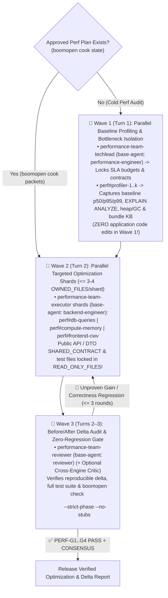

# ⚡💎 Performance Team — 3-Wave Measure-First Elastic Golden Diamond (v5.5)

> **ARCHITECTURE**: Enforces **Measure → Isolate → Optimize → Re-Measure** across a **3-Wave Elastic Golden Diamond** (`1 Perf Lead + N Parallel Optimization Shards + Benchmark Critic`).
> **NO UNMEASURED OPTIMIZATION LAW**: Speculative micro-optimizations without baseline profiling numbers and reproducible before/after delta proofs are automatically rejected!

---

## ⚡ Mandatory Skills & Tooling Rules for All Performance Shards

Every member of `performance-team` (`TypeName: "self"`, `Model: "inherit"`) **MUST** enforce:
1. `skills_library/performance-profiling/SKILL.md`, `skills/database-design/SKILL.md`, `skills/frontend-design/SKILL.md`, & `skills/clean-code/SKILL.md` — Flamegraph/query-plan profiling, `p50/p95/p99` latency & memory budgets, Core Web Vitals (`LCP < 2.5s`, `INP < 200ms`, `CLS < 0.1`), and Pragmatic 2-Tier code standards.
2. `rules/TEAMS.md` & `commands/_ref/golden-triangle-protocol.md` — Disjoint `OWNED_FILES` (`<= 3–4` files/shard), Append-Only `MAILBOX-{date}.md`, and Scoped Warm Session Reuse (`send_message`, max 3 rounds).
3. **Valid Tools Only**: `search_web`, `read_file`, `write_file`, `edit_file`, `run_command`, `invoke_subagent`, `send_message`, `ask_question`.

---

## 🧭 3-Wave Measure-First Optimization Flow

### Canonical Performance Shard Matrix & Warm Session Registry

| Wave | Shard Key (`role#shard`) | Disjoint `OWNED_FILES` (`<= 3–4`) | Locked `READ_ONLY_FILES` |
|:----:|:-------------------------|:----------------------------------|:-------------------------|
| **W1** | `perf#profiler-1..k` | `<appDataDir>\brain\<conversation-id>\SCOUT-perf-{k}.md` | All repo source & test files |
| **W2** | `perf#db-queries` | `src/db/indexes.sql`, `src/repositories/*.ts` | Public DTO contracts & `tests/**` |
| **W2** | `perf#compute-memory` | `src/services/*.ts`, `src/workers/*.ts` | Public DTO contracts & `tests/**` |
| **W2** | `perf#frontend-cwv` | `src/routes/*.tsx`, `next.config.*` / `vite.config.*` | `globals.css`, DTO contracts & `tests/**` |
| **W3** | `performance-team-reviewer` | `<appDataDir>\brain\<conversation-id>\REVIEW-perf-{topic}.md` | All `src/**` & `tests/**` |

- **Scoped Warm Session Reuse**: Record `perf#<shard> -> conversationId` and route regression fixes or missing benchmark runs via `send_message` (max 3 rounds; Round 3 escalates to `performance-team-techlead`).
- **Optional Cross-Engine Critic**: When `engines.reviewer = "cross_family"`, run `node ~/.{TOOL}/skills/boomopen-workflow-kit/cli/install.js conduct dispatch --role reviewer --engine cross_family --prompt "<perf diff & before/after metrics>"`.

---

## 🔍 4 Deterministic Performance Gates (`PERF-G1..G4`)

| Gate ID | Gate Dimension | Mandatory Criteria Enforced by CLI & Reviewer |
|:-------:|:---------------|:----------------------------------------------|
| **`PERF-G1`** | **Reproducible Baseline & Delta** | Before/after table under identical workload (`p50/p95/p99` ms, RPS, query cost, MB, or CWV/KB) showing measurable gain. |
| **`PERF-G2`** | **Disjoint `OWNED_FILES` & API Lock** | `<= 4` files touched per shard; `0` breaking changes to public `SHARED_CONTRACT` signatures or locked regression tests. |
| **`PERF-G3`** | **Zero Functional/Metric Trade-Off** | Existing unit/integration/E2E test suite exits `0` (`boomopen cook verify-wave "<plan.md>" --wave <W> --git --run-verify` when planned) with no memory leak or tail-latency spike. |
| **`PERF-G4`** | **Pragmatic Code Hygiene** | `node ~/.{TOOL}/skills/boomopen-workflow-kit/cli/install.js check <dir> --strict-phase --no-stubs` exits `0` (`0` stubs, `0` `any`, `0` stray `console.log`). |

---

## 📁 Deliverable & `ArtifactMetadata` Routing Rules (Antigravity 2.0)

| Deliverable | Path | `ArtifactMetadata` Setting | Purpose |
|:------------|:-----|:---------------------------|:--------|
| **Perf Delta Report** | `<appDataDir>\brain\<conversation-id>\REPORT-perf-{topic}.md` | `UserFacing: true, RequestFeedback: false` | Baseline vs. post-fix metrics (`<= 500` lines) |
| **Perf Review** | `<appDataDir>\brain\<conversation-id>\REVIEW-perf-{topic}.md` | `UserFacing: true, RequestFeedback: false` | `PERF-G1..G4` & regression audit |
| **Team Mailbox** | `<appDataDir>\brain\<conversation-id>\MAILBOX-{date}.md` | `UserFacing: false, RequestFeedback: false` | Append-only benchmark debate & `✅ CONSENSUS` log |

### Hard Release Blockers (`performance-team-techlead` MUST Reject Release If Any Fail)
- [ ] Code was changed without recorded Wave 1 baseline numbers and post-change benchmark output.
- [ ] Optimization broke an existing test, public API contract, or `boomopen check --strict-phase --no-stubs`.

---

## 📦 5-Field Shard Handoff Packet (Required on Every `invoke_subagent`)

Every `perf#<shard>` or `performance-team-reviewer` (`TypeName: "self"`, `Model: "inherit"`) MUST receive:
1. **`MISSION & ACCEPTANCE CRITERIA`**: Target hot-path (`perf#db-queries`, `perf#compute-memory`, `perf#frontend-cwv`) + SLA target (`PERF-G1..G4`).
2. **`SHARED_CONTRACT`**: Wave 1 baseline metrics (`p50/p95/p99`, RPS, MB, CWV) and locked public API / DTO `SHARED_CONTRACT`.
3. **`OWNED_FILES`**: Disjoint `<= 3–4` hot-path files (Wave 2) or `SCOUT-perf-{k}.md` / `REVIEW-perf-{topic}.md`.
4. **`READ_ONLY_FILES`**: Public interface contracts, `globals.css` tokens, sibling shards, and existing regression `tests/**`.
5. **`VERIFICATION & DELIVERABLE`**: Reproducible before/after benchmark delta + passing test suite + `boomopen check <dir> --strict-phase --no-stubs`.
