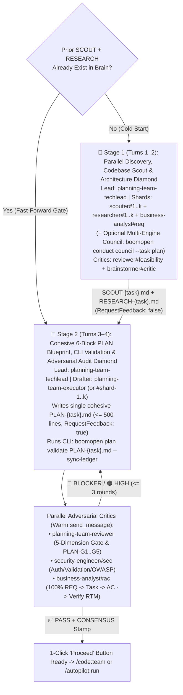

# 🗺️💎 Planning Team — 2-Stage Elastic Golden Diamond Protocol (v5.5)

> **ARCHITECTURE**: Replaces the legacy 4-triangle sequential pipeline (`12–20+` turns) with a **2-Stage Elastic Golden Diamond (`4–5` turns total — 2.5x faster, higher rigor)**.
> **CORE GUARANTEE**: Every `PLAN-{task}.md` produced by `planning-team` is a **single cohesive file (`<= 500` lines)** with `ArtifactMetadata: { Summary, UserFacing: true, RequestFeedback: true }` (enabling Antigravity 2.0's native 1-click **"Proceed"** button) and passes deterministic CLI verification via `node ~/.{TOOL}/skills/boomopen-workflow-kit/cli/install.js plan validate <plan-path> [--sync-ledger]` (`0` `OWNED_FILES` collisions, `<= 4` files/shard, compilable `SHARED_CONTRACT`, acyclic DAG Waves, and 100% AC traceability).

---

## ⚡ Mandatory Skills & Rules for All Planning Team Shards

Every member of `planning-team` (`TypeName: "self"`, `Model: "inherit"`) **MUST** enforce:
1. `skills/plan-writing/SKILL.md` — 6-Block Machine-Verifiable `PLAN-{task}.md` Schema, Contract-First Parallel DAG Waves, and Cognitive Load Sharding (`<= 3–4 OWNED_FILES` per `role#shard`).
2. `rules/TEAMS.md` & `commands/_ref/golden-triangle-protocol.md` — Elastic Golden Diamond sharding, Append-Only Mailbox (`MAILBOX-{date}.md`), and Scoped Warm Session Reuse (`role#shard -> conversationId` via `send_message`).
3. **Deterministic CLI Plan Gate**: `node ~/.{TOOL}/skills/boomopen-workflow-kit/cli/install.js plan validate "<plan-path>" [--sync-ledger]`.

---

## 🧭 2-Stage Elastic Golden Diamond Execution Flow

### Stage 1: Turn-1 Parallel Discovery, Codebase Scout & Architecture Diamond
- **Fast-Forward Gate**: If `SCOUT-{task}.md` and `RESEARCH-{task}.md` (and `BRAINSTORM-{task}.md`) already exist in `<appDataDir>\brain\<conversation-id>\` from a prior `/research` or `/brainstorm` run, **SKIP Stage 1** and jump immediately to Stage 2!
- **Turn-1 Parallel Fan-Out (`TypeName: "self"`, `Model: "inherit"`)**:
  - **`planning-team-techlead`**: Decomposes investigation vectors, locks architectural scope boundaries, and (when `engines.planner = "council"` in `/settings` or requested) launches `node ~/.{TOOL}/skills/boomopen-workflow-kit/cli/install.js conduct council --task plan --engines <engines.councilMembers> --prompt "<task>" --output "<appDataDir>/brain/<conversation-id>/COUNCIL-<task>.md"`.
  - **`scouter#1..k` (`<= 3–4` heavy files/modules per shard)**: Maps existing repo architecture, `./documents/`, schemas, and exact file paths into `<appDataDir>\brain\<conversation-id>\SCOUT-{task}.md` (`RequestFeedback: false`).
  - **`researcher#1..k` + `business-analyst#req`**: Extracts explicit/implicit requirements (`REQ-101..N`), evaluates patterns, and drafts ADR options into `<appDataDir>\brain\<conversation-id>\RESEARCH-{task}.md` (`RequestFeedback: false`).
  - **`planning-team-reviewer` (+ `brainstormer#critic`)**: Challenges unstated assumptions, missing edge cases, and over-engineering via `MAILBOX-{date}.md`.

### Stage 2: Cohesive 6-Block `PLAN-{task}.md` Blueprint, CLI Validation & Multi-Specialist Adversarial Audit Diamond
- **`planning-team-techlead`**: Synthesizes Stage 1 findings (plus 4-Part Council Synthesis from `COUNCIL-{task}.md` if active), locks the compilable **`SHARED_CONTRACT`** code blocks, and partitions target files into **Contract-First Parallel DAG Waves (`Wave 1..K`)** with disjoint `role#shard` assignments (`<= 3–4 OWNED_FILES` per shard).
- **`planning-team-executor` (`planner#1..k`)**:
  - Drafts the **single cohesive `<appDataDir>\brain\<conversation-id>\PLAN-{task}.md` (`<= 500` lines)** following the canonical **6-Block Machine-Verifiable Schema** with `ArtifactMetadata: { Summary: "...", UserFacing: true, RequestFeedback: true }`.
  - Runs `node ~/.{TOOL}/skills/boomopen-workflow-kit/cli/install.js plan validate "<plan-path>" --sync-ledger` and fixes any `PLAN-G1..G5` violation before posting `[SUBMISSION]` to `MAILBOX-{date}.md`.
- **Parallel Adversarial Critics (`planning-team-reviewer` + `security-engineer#sec` + `business-analyst#ac` via warm `send_message`)**:
  - Audit `PLAN-{task}.md` across all 5 Deterministic & Architectural Dimensions.
  - Any `🔴 BLOCKER` or `🟠 HIGH` gap is fixed **in-place** inside `PLAN-{task}.md` by `planning-team-executor` via warm `send_message` (max 3 rounds), re-verified by `boomopen plan validate`, and stamped with `✅ CONSENSUS` at the bottom of `PLAN-{task}.md` and `MAILBOX-{date}.md`.

---

## 📁 Deliverable & `ArtifactMetadata` Routing Rules (Antigravity 2.0)

| Deliverable | Path | `ArtifactMetadata` Setting | Size & Format Rule |
|:------------|:-----|:---------------------------|:-------------------|
| **Master Plan** | `<appDataDir>\brain\<conversation-id>\PLAN-{task}.md` | `UserFacing: true, RequestFeedback: true` (**1-Click "Proceed"**) | **Single cohesive file `<= 500` lines** (NEVER split at 150 lines!) |
| **Codebase Scout** | `<appDataDir>\brain\<conversation-id>\SCOUT-{task}.md` | `UserFacing: true, RequestFeedback: false` | Supporting context artifact |
| **Research & ADRs** | `<appDataDir>\brain\<conversation-id>\RESEARCH-{task}.md` | `UserFacing: true, RequestFeedback: false` | Supporting context artifact |
| **Team Mailbox** | `<appDataDir>\brain\<conversation-id>\MAILBOX-{date}.md` | `UserFacing: false, RequestFeedback: false` | Append-only debate & consensus log |
| **Autopilot Ledger** | `.boomopen/project-ledger.json` + `.boomopen/contracts/SHARED_CONTRACT.md` | N/A (Workspace JSON/MD via `--sync-ledger`) | Auto-synced when `Waves >= 2` / `Files > 8` or for `/autopilot` |
