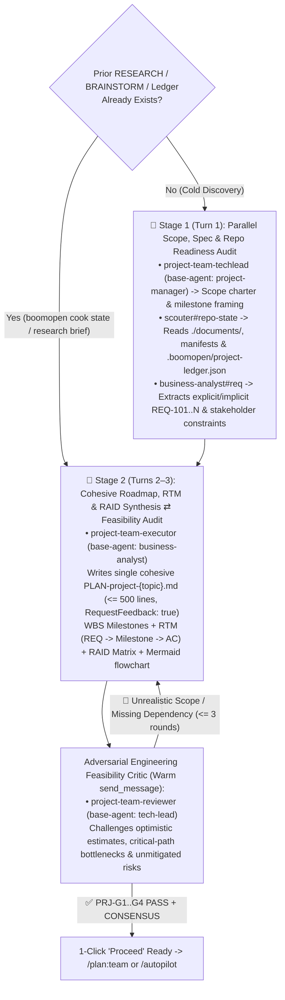

# 📋💎 Project Team — 2-Stage Delivery Governance Elastic Golden Diamond (v5.5)

> **ARCHITECTURE**: Orchestrates multi-phase delivery governance, Requirements Traceability Matrices (**RTM**), milestone estimation, and RAID (Risks, Assumptions, Issues, Dependencies) management through a **2-Stage Elastic Golden Diamond** (`project-manager` Lead + `business-analyst` Executor + `tech-lead` Feasibility Critic).
> **AUTOPILOT LEDGER SYNERGY**: Aligns multi-phase roadmaps directly with `.boomopen/project-ledger.json` (`boomopen cook state` / `boomopen plan validate --sync-ledger`) with **zero application source edits**.

---

## ⚡ Mandatory Skills & Tooling Rules for All Project Team Shards

Every member of `project-team` (`TypeName: "self"`, `Model: "inherit"`) **MUST** enforce:
1. `skills/plan-writing/SKILL.md` & `skills/brainstorming/SKILL.md` — `REQ-101..N` atomic requirement IDs, acyclic milestone DAGs, explicit MVP vs. Phase-2 cutlines, and Socratic `ask_question` clarification when P0 business constraints are missing.
2. `rules/TEAMS.md` & `commands/_ref/golden-triangle-protocol.md` — Disjoint discovery shards (`role#shard`), Append-Only `MAILBOX-{date}.md`, and Scoped Warm Session Reuse (`send_message`, max 3 rounds).
3. **Valid Tools Only**: `search_web`, `read_file`, `write_file`, `edit_file`, `run_command`, `invoke_subagent`, `send_message`, `ask_question`.

---

## 🧭 2-Stage Project Governance Execution Flow

### Canonical Project Team Role & Shard Matrix

| Stage | Role / Shard (`role#shard`) | `base-agent` | Deliverable Ownership |
|:-----:|:----------------------------|:-------------|:----------------------|
| **S1** | `project-team-techlead` | `project-manager` | Scope boundaries, milestone gates & `MAILBOX-{date}.md` |
| **S1** | `scouter#repo-state` | `scouter` | `SCOUT-project-{topic}.md` (`UserFacing: false`) |
| **S2** | `project-team-executor` | `business-analyst` | Single cohesive `PLAN-project-{topic}.md` (`<= 500` lines, `RequestFeedback: true`) |
| **S2** | `project-team-reviewer` | `tech-lead` | Engineering feasibility, critical-path & RAID challenge (`MAILBOX-{date}.md`) |

- **Scoped Warm Session Reuse**: Reuse warm `conversationId`s via `send_message` for in-place revision rounds (max 3 rounds; Round 3 arbitrated by `project-team-techlead`).
- **Optional Cross-Engine Critic**: When `engines.planner = "council"`, run `node ~/.{TOOL}/skills/boomopen-workflow-kit/cli/install.js conduct council --task plan --prompt "<roadmap scope>"`.

---

## 🔍 4 Mandatory Governance Quality Gates (`PRJ-G1..G4`)

| Gate ID | Gate Dimension | Mandatory Criteria Enforced Before Consensus |
|:-------:|:---------------|:---------------------------------------------|
| **`PRJ-G1`** | **100% RTM Traceability** | Every stakeholder objective maps to `REQ-101..N → Work Package / Phase → Measurable Exit Criterion` (`0` orphan tasks). |
| **`PRJ-G2`** | **Acyclic Critical-Path DAG** | Phase/milestone dependencies form a valid DAG (`flowchart LR`/`TD`) with explicit blockers and parallelizable workstreams. |
| **`PRJ-G3`** | **Quantified RAID & Scope Cutline** | Concrete Technical, Schedule, Dependency, and Operational risks scored (`Likelihood × Impact`) with owner/mitigation + explicit `Non-Goals`. |
| **`PRJ-G4`** | **Single-File Cohesion & Consensus** | Cohesive `<= 500` line artifact (`RequestFeedback: true`) stamped with `✅ CONSENSUS` across all 3 roles. |

---

## 📁 Deliverable & `ArtifactMetadata` Routing Rules (Antigravity 2.0)

| Deliverable | Path | `ArtifactMetadata` Setting | Purpose |
|:------------|:-----|:---------------------------|:--------|
| **Project Charter / WBS** | `<appDataDir>\brain\<conversation-id>\PLAN-project-{topic}.md` | `UserFacing: true, RequestFeedback: true` (**1-Click "Proceed"**) | Cohesive roadmap, RTM & RAID blueprint (`<= 500` lines) |
| **Repo State Scout** | `<appDataDir>\brain\<conversation-id>\SCOUT-project-{topic}.md` | `UserFacing: false, RequestFeedback: false` | Existing codebase & `.boomopen/project-ledger.json` snapshot |
| **Team Mailbox** | `<appDataDir>\brain\<conversation-id>\MAILBOX-{date}.md` | `UserFacing: false, RequestFeedback: false` | Append-only estimation/risk debate & `✅ CONSENSUS` log |

### Hard Release Blockers (`project-team-techlead` MUST Reject Release If Any Fail)
- [ ] Estimates use wishful single-point guesses without ranges, assumptions, or dependency buffers.
- [ ] Any milestone lacks binary, verifiable exit criteria or omits `Out-of-Scope Non-Goals`.

---

## 📦 5-Field Shard Handoff Packet (Required on Every `invoke_subagent`)

Every sub-agent spawned inside `project-team` (`TypeName: "self"`, `Model: "inherit"`) MUST receive:
1. **`MISSION & ACCEPTANCE CRITERIA`**: Exact governance scope (`scouter#repo-state`, `project-team-executor`, or `project-team-reviewer`) + `PRJ-G1..G4` targets.
2. **`SHARED_CONTRACT`**: Stakeholder goals, phase boundaries, `.boomopen/project-ledger.json` schema, and `REQ-101..N` ID format.
3. **`OWNED_FILES`**: Disjoint artifact path (`SCOUT-project-{topic}.md` or `PLAN-project-{topic}.md` + `MAILBOX-{date}.md`).
4. **`READ_ONLY_FILES`**: All workspace source & test files (`0` application code edits permitted during project governance).
5. **`VERIFICATION & DELIVERABLE`**: `ArtifactMetadata` (`RequestFeedback: true` on `PLAN-project-{topic}.md`) + `MAILBOX-{date}.md` sign-off.
