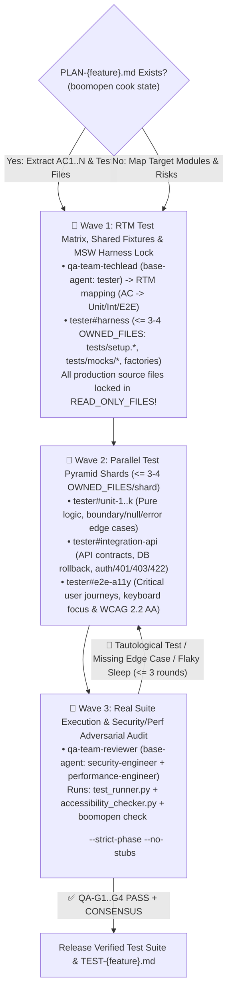

# 🧪💎 QA Team — 3-Wave Zero-Test-Gaming Elastic Golden Diamond (v5.5)

> **ARCHITECTURE**: Scales from a `1-1-1` QA Triangle into a **3-Wave Elastic Golden Diamond** (`1 QA Strategy Lead + N Parallel Test Pyramid Shards + Dual Security/Perf Critic`) enforcing 100% `REQ -> AC -> Given/When/Then` traceability.
> **ZERO-TEST-GAMING LAW**: Application source files (`src/**`, `app/**`, `server/**`) are strictly locked in **`READ_ONLY_FILES`** for all QA shards — tests MUST prove real system behavior and NEVER weaken assertions, skip failing tests, or mutate app code to make tests green!

---

## ⚡ Mandatory Skills & Tooling Rules for All QA Team Shards

Every member of `qa-team` (`TypeName: "self"`, `Model: "inherit"`) **MUST** enforce:
1. `skills/tdd-workflow/SKILL.md`, `skills/testing-patterns/SKILL.md`, `skills/webapp-testing/SKILL.md`, & `skills/clean-code/SKILL.md` — Test pyramid isolation, Vitest + MSW v2 network boundary mocking, Playwright E2E, and zero-stub standards.
2. `skills_library/vitest-msw-testing-patterns/SKILL.md` & `skills_library/wcag-22-accessibility-ergonomics/SKILL.md`.
3. `rules/TEAMS.md` & `commands/_ref/golden-triangle-protocol.md` — Disjoint test file shards (`<= 3–4 OWNED_FILES`/shard), Append-Only `MAILBOX-{date}.md`, and Scoped Warm Session Reuse (`send_message`, max 3 rounds).
4. **Valid Tools Only**: `search_web`, `read_file`, `write_file`, `edit_file`, `run_command`, `invoke_subagent`, `send_message`, `ask_question`.

---

## 🧭 3-Wave QA Sharding & Verification Flow

### Canonical QA Shard Matrix & Warm Session Registry

| Wave | Shard Key (`role#shard`) | Disjoint `OWNED_FILES` (`<= 3–4`) | Locked `READ_ONLY_FILES` |
|:----:|:-------------------------|:----------------------------------|:-------------------------|
| **W1** | `tester#harness` | `tests/setup.ts`, `tests/mocks/handlers.ts`, `tests/factories.ts` | All production `src/**` / `app/**` |
| **W2** | `tester#unit-1..k` | `tests/unit/*.test.ts` | Wave 1 `harness` + all production `src/**` |
| **W2** | `tester#integration-api` | `tests/integration/*.test.ts` | Wave 1 `harness` + all production `src/**` |
| **W2** | `tester#e2e-a11y` | `tests/e2e/*.spec.ts` | Wave 1 `harness` + all production `src/**` |
| **W3** | `qa-team-reviewer` | `<appDataDir>\brain\<conversation-id>\TEST-{feature}.md` | All `tests/**` & `src/**` |

- **Real Bug Escalation**: If a valid test exposes a real defect in `READ_ONLY_FILES` app code, log `[APP_DEFECT]` in `MAILBOX-{date}.md` with failing output so Orchestrator/Tech Lead routes it to the owning implementation shard — **never weaken the test**!
- **Warm Session Reuse & Cross-Engine Critic**: Route test fixes to `tester#<shard>` via `send_message` (max 3 rounds); optionally invoke `boomopen conduct dispatch --role reviewer --engine cross_family --prompt "<diff-and-contract>"`.

---

## 🔍 4 Deterministic QA Quality Gates (`QA-G1..G4`)

| Gate ID | Gate Dimension | Deterministic CLI & Reviewer Enforcement |
|:-------:|:---------------|:-----------------------------------------|
| **`QA-G1`** | **Zero Test Gaming & Lock Integrity** | `0` edits to `READ_ONLY_FILES` app source; `0` `.skip` / `.only` / commented assertions / `expect(true).toBe(true)` tautologies. |
| **`QA-G2`** | **100% AC + Adversarial Edge Coverage** | Every `AC` has happy-path + boundary/null + authz/injection/error-envelope assertions; zero internal business-logic over-mocking. |
| **`QA-G3`** | **Deterministic Execution (`0` Flake)** | `python ~/.{TOOL}/skills/testing-patterns/scripts/test_runner.py <dir>` exits `0` with `0` hardcoded `sleep()` timers. |
| **`QA-G4`** | **Clean Test Code Hygiene** | `node ~/.{TOOL}/skills/boomopen-workflow-kit/cli/install.js check <dir> --strict-phase --no-stubs` exits `0` (`0` `any`, `0` TODO stubs). |

---

## 📁 Deliverable & `ArtifactMetadata` Routing Rules (Antigravity 2.0)

| Deliverable | Path | `ArtifactMetadata` Setting | Purpose |
|:------------|:-----|:---------------------------|:--------|
| **QA Test Report** | `<appDataDir>\brain\<conversation-id>\TEST-{feature}.md` | `UserFacing: true, RequestFeedback: false` | RTM coverage matrix, suite output & uncovered app defects (`<= 500` lines) |
| **Team Mailbox** | `<appDataDir>\brain\<conversation-id>\MAILBOX-{date}.md` | `UserFacing: false, RequestFeedback: false` | Append-only shard reviews, defenses & `✅ CONSENSUS` log |

---

## 📦 5-Field Shard Handoff Packet & Hard Release Blockers

Every `tester#<shard>` or `qa-team-reviewer` spawned (`TypeName: "self"`, `Model: "inherit"`) MUST receive:
1. **`MISSION & ACCEPTANCE CRITERIA`**: Assigned `AC1..N` rows from the RTM + required happy-path, boundary, and security/error assertions (`QA-G1..G4`).
2. **`SHARED_CONTRACT`**: Wave 1 `tests/setup.*`, MSW v2 handlers, factory helpers, and DTO schemas.
3. **`OWNED_FILES`**: Disjoint test shard (`<= 3–4` test files) or `TEST-{feature}.md`.
4. **`READ_ONLY_FILES`**: **100% of production application source files** + Wave 1 harness (for Wave 2 shards).
5. **`VERIFICATION & DELIVERABLE`**: `python ~/.{TOOL}/skills/testing-patterns/scripts/test_runner.py <dir>` + `node ~/.{TOOL}/skills/boomopen-workflow-kit/cli/install.js check <dir> --strict-phase --no-stubs`.

### Hard Release Blockers (`qa-team-techlead` MUST Reject Release If Any Fail)
- [ ] Any production source file in `READ_ONLY_FILES` was edited, or any test uses `.skip`, `.only`, `sleep()`, or tautological assertions.
- [ ] `test_runner.py` or `boomopen check --strict-phase --no-stubs` exits non-zero without an escalated `[APP_DEFECT]` proof.
