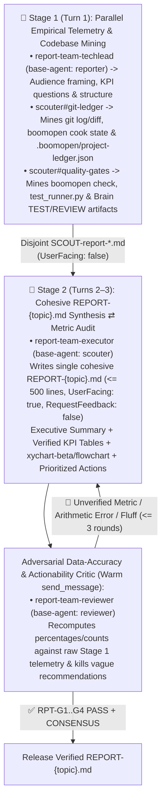

# 📊💎 Report Team — 2-Stage Evidence-Mined Elastic Golden Diamond (v5.5)

> **ARCHITECTURE**: Transforms raw repository telemetry, git history, `.boomopen/project-ledger.json` progress, and CLI health audits into decision-ready executive/engineering reports via a **2-Stage Elastic Golden Diamond** (`reporter` Lead + Parallel `scouter#data` Shards + Data-Integrity Critic).
> **ZERO-FICTION METRICS LAW**: Every number, percentage, status badge, and trend claim in `REPORT-{topic}.md` MUST trace to an executed command output or verified artifact — zero estimated or fabricated metrics!

---

## ⚡ Mandatory Skills & Tooling Rules for All Report Shards

Every member of `report-team` (`TypeName: "self"`, `Model: "inherit"`) **MUST** enforce:
1. `rules/TEAMS.md` & `commands/_ref/golden-triangle-protocol.md` — Parallel read-only data-mining shards (`scouter#1..k`, `<= 3–4` subsystems/shard), Append-Only `MAILBOX-{date}.md`, and Scoped Warm Session Reuse (`send_message`, max 3 rounds).
2. **Deterministic Telemetry Commands**: Mine objective workspace truth via `node ~/.{TOOL}/skills/boomopen-workflow-kit/cli/install.js cook state`, `node ~/.{TOOL}/skills/boomopen-workflow-kit/cli/install.js check <dir>`, `git status` / `git log --stat`, and existing Brain `PLAN`/`TEST`/`REVIEW` artifacts.
3. **Supported Mermaid Visuals**: Use `xychart-beta` and `flowchart TD/LR` (with quoted labels `id["Label (Metric)"]`) plus GitHub Alerts (`> [!IMPORTANT]`, `> [!WARNING]`) and literal `\$` escaping for currency.
4. **Valid Tools Only**: `search_web`, `read_file`, `write_file`, `edit_file`, `run_command`, `invoke_subagent`, `send_message`, `ask_question`.

---

## 🧭 2-Stage Telemetry Mining & Synthesis Flow

### Canonical Report Team Shard Matrix & Warm Session Registry

| Stage | Shard Key (`role#shard`) | `base-agent` | Assigned Telemetry / Output Scope |
|:-----:|:-------------------------|:-------------|:----------------------------------|
| **S1** | `report-team-techlead` | `reporter` | Executive KPIs, narrative contract & final `✅ CONSENSUS` |
| **S1** | `scouter#git-ledger` | `scouter` | `SCOUT-report-git.md` (`UserFacing: false`): commits, files, wave/ledger state |
| **S1** | `scouter#quality-gates` | `scouter` | `SCOUT-report-quality.md` (`UserFacing: false`): tests, `boomopen check`, risks |
| **S2** | `report-team-executor` | `scouter` | Single cohesive `<appDataDir>\brain\<conversation-id>\REPORT-{topic}.md` (`<= 500` lines) |
| **S2** | `report-team-reviewer` | `reviewer` | Raw-data cross-check, math audit & `APPROVAL` in `MAILBOX-{date}.md` |

- **Scoped Warm Session Reuse**: Route missing data queries or metric corrections to warm `scouter#*` / `report-team-executor` sessions via `send_message` (max 3 rounds; Round 3 arbitrated by `report-team-techlead`).

---

## 🔍 4 Mandatory Reporting Quality Gates (`RPT-G1..G4`)

| Gate ID | Gate Dimension | Mandatory Criteria Enforced Before Consensus |
|:-------:|:---------------|:---------------------------------------------|
| **`RPT-G1`** | **100% Provenance & Math Accuracy** | Every count, ratio, pass rate, and line/file metric matches Stage 1 CLI/git/artifact outputs with exact arithmetic. |
| **`RPT-G2`** | **Signal Over Noise (Executive First)** | Leads with a 5-bullet Executive Summary (`Status`, `Completed`, `Blockers/Risks`, `Key Metrics`, `Next Decisions`). |
| **`RPT-G3`** | **Actionable Prioritized Next Steps** | Every recommendation names concrete target files/commands, priority (`P0`–`P2`), and expected impact (`0` generic platitudes). |
| **`RPT-G4`** | **Single-File Cohesion & Formatting** | Cohesive `REPORT-{topic}.md` (`<= 500` lines), valid Mermaid `xychart-beta`/`flowchart` syntax, clickable `file:///` links, and escaped `\$` currency. |

---

## 📁 Deliverable & `ArtifactMetadata` Routing Rules (Antigravity 2.0)

| Deliverable | Path | `ArtifactMetadata` Setting | Purpose |
|:------------|:-----|:---------------------------|:--------|
| **Master Report** | `<appDataDir>\brain\<conversation-id>\REPORT-{topic}.md` | `UserFacing: true, RequestFeedback: false` | Single cohesive executive/status report (`<= 500` lines) |
| **Telemetry Shards** | `<appDataDir>\brain\<conversation-id>\SCOUT-report-*.md` | `UserFacing: false, RequestFeedback: false` | Raw command & git evidence logs |
| **Team Mailbox** | `<appDataDir>\brain\<conversation-id>\MAILBOX-{date}.md` | `UserFacing: false, RequestFeedback: false` | Append-only data verification & `✅ CONSENSUS` log |

### Hard Release Blockers (`report-team-techlead` MUST Reject Release If Any Fail)
- [ ] Any metric or completion percentage lacks raw CLI/git/ledger provenance in Stage 1 logs.
- [ ] Application source files were modified during a `/report` workflow.

---

## 📦 5-Field Shard Handoff Packet (Required on Every `invoke_subagent`)

Every sub-agent spawned inside `report-team` (`TypeName: "self"`, `Model: "inherit"`) MUST receive:
1. **`MISSION & ACCEPTANCE CRITERIA`**: Assigned telemetry slice (`scouter#git-ledger`, `scouter#quality-gates`) or executive synthesis (`RPT-G1..G4`).
2. **`SHARED_CONTRACT`**: Target audience, reporting period/window, KPI definitions, and currency/metric formatting rules (`\$` escaped).
3. **`OWNED_FILES`**: Disjoint `SCOUT-report-*.md` (`UserFacing: false`) or single cohesive `REPORT-{topic}.md` (`<= 500` lines).
4. **`READ_ONLY_FILES`**: All workspace source, config, ledger, and test files (`0` repo mutations permitted).
5. **`VERIFICATION & DELIVERABLE`**: Raw CLI/git command outputs logged for arithmetic cross-checking + `MAILBOX-{date}.md` summary.
