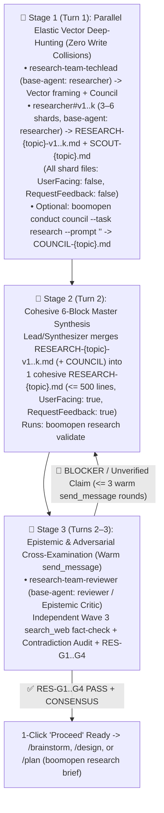

# 🔬💎 Research Team — Elastic 3-to-6 Vector Deep-Research Protocol (v5.5)

> **ARCHITECTURE**: Inspired by **Anthropic's Multi-Agent Research System** and **Stanford STORM**, upgraded to an **Elastic Golden Diamond (`1 Lead Architect + 3–6 Parallel Vector Shards + Epistemic Critic`)** with zero Turn-1 file collisions and deterministic CLI validation.
> **SINGLE COHESIVE MASTER OUTPUT**: Synthesizes into **1 cohesive 6-Block `<appDataDir>\brain\<conversation-id>\RESEARCH-{topic}.md` (`<= 500` lines)** with `ArtifactMetadata: { Summary, UserFacing: true, RequestFeedback: true }` (1-click **"Proceed"** button) verified by `node ~/.{TOOL}/skills/boomopen-workflow-kit/cli/install.js research validate "<path>" --mode research` (`RES-G1..G4`).

---

## ⚡ Mandatory Skills & Valid Antigravity 2.0 Tooling

Every shard of `research-team` MUST be spawned via `invoke_subagent(TypeName: "self", Model: "inherit")` (NEVER read-only `TypeName: "research"`, which lacks `search_web` and `write_file`!) and enforce:
1. `skills/deep-research/SKILL.md` — 4-Source Triangulation, 3-Wave Multi-Hop `search_web` Loop, Dual-Track 5-Lens Framework, and `[Confidence: HIGH|MEDIUM|LOW]` epistemic markers.
2. `skills_library/docs-seeker/SKILL.md` & `skills_library/research/SKILL.md` — Official `/llms.txt`, RFC, GitHub release/changelog discovery, and quantitative trade-off matrices.
3. `rules/TEAMS.md` — Scoped Warm Session Reuse (`researcher#v{k} -> conversationId` via `send_message`, max 3 rounds) and Append-Only `MAILBOX-{date}.md`.
4. **Valid Tools Only**: `search_web`, `read_file`, `write_file`, `edit_file`, `run_command`, `invoke_subagent`, `send_message`, `ask_question`.

---

## 🧭 Collision-Free Elastic Execution Flow (`3–6` Vectors + Council)

### Role Alignment & Turn-1 Write-Collision Prevention

| Role | `base-agent` | Shard Ownership (`OWNED_FILES`) | Mission |
|:-----|:-------------|:--------------------------------|:--------|
| **Lead Research Architect** | `researcher` (`research-team-techlead`) | `RESEARCH-{topic}.md` (Master Synthesis) + `MAILBOX-{date}.md` | Decomposes `3–6` orthogonal vectors, runs official spec/RFC `search_web` queries (+ optional `boomopen conduct council --task research --prompt "<research-context>"`), arbitrates contradictions, and stamps `✅ CONSENSUS`. |
| **Elastic Vector Shards (`3–6`)** | `researcher` (`researcher#v1..k` — `research-team-executor`) | Disjoint `RESEARCH-{topic}-v{1..k}.md` + `SCOUT-{topic}.md` (`UserFacing: false`) | Triangulates workspace manifests (`read_file`), `matrix-skills/compact-index.json` (`1,462` skills), official SDK docs, and benchmarks via 3-Wave `search_web` (`1` vector per shard). |
| **Epistemic Critic** | `reviewer` (`research-team-reviewer`) | `MAILBOX-{date}.md` (Append-only `REVIEW` / `APPROVAL`) | Runs independent Wave 3 adversarial `search_web` counter-queries (CVEs, breaking changes, post-mortems), enforces `[Confidence]` honesty, *"When NOT to Use"*, and `RES-G1..G4`. |

---

## 🔍 4 Deterministic CLI Validation Gates (`boomopen research validate --mode research`)

| Gate ID | Validation Dimension | Mandatory Criteria Checked by CLI & Epistemic Critic |
|:-------:|:---------------------|:-----------------------------------------------------|
| **`RES-G1`** | **Citations & Epistemic Confidence** | `>= 2` concrete `https://`, `file://`, or `file:line` citations (`>= 6` verified sources in Audit Log) + explicit `[Confidence: HIGH\|MEDIUM\|LOW]` tags on claims + pinned `2025`/`2026` versions. |
| **`RES-G2`** | **Comparison Matrix & Anti-Sycophancy Risks** | Multi-option comparison/decision matrix table (`>= 2` data rows; `>= 3` options target) + explicit **Contradiction Arbitration**, **"When NOT to Use"**, CVEs, and failure-mode/latency trade-offs. |
| **`RES-G3`** | **Executive Verdict & `HANDOFF_BRIEF`** | Explicit Executive Verdict / Recommended Option section + machine-extractable `HANDOFF_BRIEF` ready for `boomopen research brief "<path>"`. |
| **`RES-G4`** | **Single-File Cohesion & Zero Placeholders** | Single cohesive `RESEARCH-{topic}.md` (`<= 500` lines hard / `<= 400` soft, `RequestFeedback: true`), `0` unfilled `{placeholder}` / `TODO` / `TBD` markers, and `✅ CONSENSUS` stamp. |

---

## 📁 Deliverable & `ArtifactMetadata` Routing Rules (Antigravity 2.0)

| Deliverable | Path | `ArtifactMetadata` Setting | Size & Collision Rule |
|:------------|:-----|:---------------------------|:----------------------|
| **Master Research** | `<appDataDir>\brain\<conversation-id>\RESEARCH-{topic}.md` | `UserFacing: true, RequestFeedback: true` (**1-Click "Proceed"**) | **Single cohesive file `<= 500` lines** |
| **Vector Shards & Scout** | `RESEARCH-{topic}-v{1..k}.md`, `SCOUT-{topic}.md` | `UserFacing: false, RequestFeedback: false` | Disjoint per-shard Turn-1 outputs (`0` collisions) |
| **Team Mailbox** | `<appDataDir>\brain\<conversation-id>\MAILBOX-{date}.md` | `UserFacing: false, RequestFeedback: false` | Append-only cross-examination & consensus log |

---

## 📦 5-Field Vector Shard Handoff Packet & Hard Release Blockers

Every `invoke_subagent(TypeName: "self", Model: "inherit")` dispatch inside `research-team` MUST embed:
1. **`MISSION & ACCEPTANCE CRITERIA`**: Dedicated vector scope (`researcher#v1..k` or `research-team-reviewer` Wave 3 audit), target track (`Track A` / `Track B` / `Hybrid`), and minimum verified source threshold.
2. **`SHARED_CONTRACT`**: Workspace runtime/framework pins, `[Confidence: HIGH|MEDIUM|LOW]` calibration rules, and T1–T4 Source Hierarchy.
3. **`OWNED_FILES`**: Disjoint shard path (`RESEARCH-{topic}-v{k}.md` or `SCOUT-{topic}.md` with `UserFacing: false, RequestFeedback: false`; `RESEARCH-{topic}.md` owned strictly by Synthesizer).
4. **`READ_ONLY_FILES`**: All workspace source files (`0` code edits in `/research:team`) + sibling `RESEARCH-{topic}-v*.md` shards.
5. **`VERIFICATION & DELIVERABLE`**: `node ~/.{TOOL}/skills/boomopen-workflow-kit/cli/install.js research validate "<path>" --mode research` (`RES-G1..G4`) + `MAILBOX-{date}.md` log.

### Hard Release Blockers (`research-team-techlead` MUST Reject Release If Any Fail)
- [ ] Parallel shards wrote directly to `RESEARCH-{topic}.md` on Turn 1 or left `UserFacing: true` on intermediate `RESEARCH-{topic}-v*.md` files.
- [ ] Master `RESEARCH-{topic}.md` exceeds `500` lines, lacks `RequestFeedback: true`, omits `[Confidence]` tags, Contradiction Arbitration, *"When NOT to Use"*, or fails `RES-G1..G4`.
- [ ] Any API signature or flag relies on unverified parametric memory instead of clickable T1/T2 citations.
