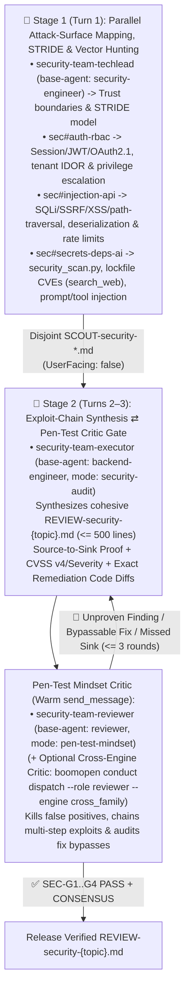

# 🛡️💎 Security Team — 2-Stage STRIDE & Pen-Test Elastic Golden Diamond (v5.5)

> **ARCHITECTURE**: Combines automated SAST/secret scanning with deep manual **STRIDE + OWASP Top 10 (Web/API + 2025 LLM/Agentic)** code auditing in a **2-Stage Elastic Golden Diamond** (`security-engineer` Lead + Parallel Offensive Audit Shards + Pen-Test Mindset Critic).
> **PROOF-OVER-THEATER LAW**: Theoretical scanner noise without a traceable source-to-sink dataflow path is stripped out; every reported `🔴 CRITICAL` / `🟠 HIGH` finding MUST include exact `file:line` evidence, realistic exploit path, and a copy-pasteable remediation diff.

---

## ⚡ Mandatory Skills & Tooling Rules for All Security Shards

Every member of `security-team` (`TypeName: "self"`, `Model: "inherit"`) **MUST** enforce:
1. `skills/security-auditor/SKILL.md`, `skills_library/owasp-llm-agent-security-2025/SKILL.md`, `skills_library/better-auth-typescript/SKILL.md`, & `skills_library/vulnerability-scanner/SKILL.md`.
2. `rules/TEAMS.md` & `commands/_ref/golden-triangle-protocol.md` — Disjoint audit vectors (`<= 3–4` critical modules per shard), Append-Only `MAILBOX-{date}.md`, and Scoped Warm Session Reuse (`send_message`, max 3 rounds).
3. **Automated Baseline Scan**: Run `python ~/.{TOOL}/skills_library/vulnerability-scanner/scripts/security_scan.py <dir>` + `node ~/.{TOOL}/skills/boomopen-workflow-kit/cli/install.js check <dir> --strict-phase --no-stubs`.
4. **Valid Tools Only**: `search_web`, `read_file`, `write_file`, `edit_file`, `run_command`, `invoke_subagent`, `send_message`, `ask_question`.

---

## 🧭 2-Stage Adversarial Security Audit Flow

### Canonical Security Audit Shard Matrix & Warm Session Registry

| Stage | Shard Key (`role#shard`) | `base-agent` | Audit Vector (`<= 3–4` Critical Modules / Shard) |
|:-----:|:-------------------------|:-------------|:-------------------------------------------------|
| **S1** | `security-team-techlead` | `security-engineer` | Trust-boundary diagram, STRIDE matrix & final `✅ CONSENSUS` |
| **S1** | `sec#auth-rbac` | `backend-engineer` | Authn, cookie/token lifecycle, RBAC/ABAC & tenant isolation (IDOR) |
| **S1** | `sec#injection-api` | `backend-engineer` | Untrusted input → validator → SQL/shell/FS/HTTP sink tracing |
| **S1** | `sec#secrets-deps-ai` | `security-engineer` | `security_scan.py`, hardcoded secrets, CVEs & LLM/MCP tool boundaries |
| **S2** | `security-team-reviewer` | `reviewer` | Exploitability verification, severity calibration & fix bypass check |

- **Scoped Warm Session Reuse**: Route missing sink traces or bypassable fix revisions to `sec#<shard>` / `security-team-executor` via `send_message` (max 3 rounds; Round 3 arbitrated by `security-team-techlead`).

---

## 🔍 4 Mandatory Security Audit Gates (`SEC-G1..G4`)

| Gate ID | Gate Dimension | Mandatory Criteria Enforced Before Consensus |
|:-------:|:---------------|:---------------------------------------------|
| **`SEC-G1`** | **Full Attack-Surface Coverage** | All external entrypoints (HTTP/RPC routes, webhooks, CLI args, file uploads, LLM/MCP prompts) mapped across STRIDE. |
| **`SEC-G2`** | **Source-to-Sink Exploit Proof** | Every `🔴 CRITICAL` / `🟠 HIGH` finding cites exact `[file:line](file:///...)` source → sink trace + realistic attacker precondition (`0` unverified scanner dumps). |
| **`SEC-G3`** | **Non-Bypassable Remediation** | Every finding includes a concrete, idiomatic remediation snippet verified against secondary bypasses (e.g., parameterized SQL, allowlist SSRF guard). |
| **`SEC-G4`** | **Clean Audit Boundary** | Read-only audit by default (`0` unauthorized source edits unless running `/fix:team`), cohesive `<= 500` line report, and `✅ CONSENSUS` stamp. |

---

## 📁 Deliverable & `ArtifactMetadata` Routing Rules (Antigravity 2.0)

| Deliverable | Path | `ArtifactMetadata` Setting | Purpose |
|:------------|:-----|:---------------------------|:--------|
| **Security Assessment** | `<appDataDir>\brain\<conversation-id>\REVIEW-security-{topic}.md` | `UserFacing: true, RequestFeedback: false` | STRIDE threat model, verified findings & remediation diffs (`<= 500` lines) |
| **Vector Scan Logs** | `<appDataDir>\brain\<conversation-id>\SCOUT-security-*.md` | `UserFacing: false, RequestFeedback: false` | Raw `security_scan.py` & shard sink-trace notes |
| **Team Mailbox** | `<appDataDir>\brain\<conversation-id>\MAILBOX-{date}.md` | `UserFacing: false, RequestFeedback: false` | Append-only exploitability debate & `✅ CONSENSUS` log |

---

## 📦 5-Field Shard Handoff Packet & Hard Release Blockers

Every `sec#<shard>`, `security-team-executor`, or `security-team-reviewer` (`TypeName: "self"`, `Model: "inherit"`) MUST receive:
1. **`MISSION & ACCEPTANCE CRITERIA`**: Assigned STRIDE / OWASP Top 10 / LLM-Agentic audit vector (`<= 3–4` critical modules) + `SEC-G1..G4`.
2. **`SHARED_CONTRACT`**: Trust-boundary map, authentication/RBAC model, and CVSS/severity calibration thresholds.
3. **`OWNED_FILES`**: Disjoint `SCOUT-security-*.md` (`UserFacing: false`) or `REVIEW-security-{topic}.md` (`<= 500` lines).
4. **`READ_ONLY_FILES`**: All workspace source files during `/review` or `/docs:audit` (only editable in explicit `/fix:team` remediation waves).
5. **`VERIFICATION & DELIVERABLE`**: `security_scan.py` output + `file:line` source-to-sink trace + non-bypassable remediation diff in `MAILBOX-{date}.md`.

### Hard Release Blockers (`security-team-techlead` MUST Reject Release If Any Fail)
- [ ] Unverified SAST noise is reported as `🔴 CRITICAL` / `🟠 HIGH` without a real `file:line` source-to-sink exploit path.
- [ ] Proposed remediation introduces a secondary bypass (e.g., regex blacklist instead of parameterized query / URL allowlist).
