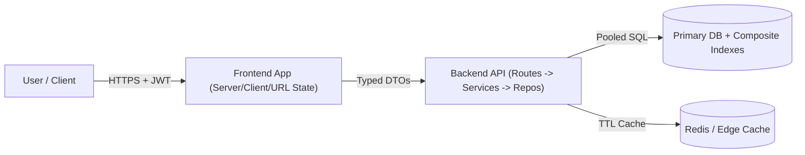

# /architect — Bulletproof System Architecture & Contract Blueprint v2.0

> **MISSION**: Know **HOW** to build before writing a single line of code — discovering every entity, endpoint, and screen across the repo in parallel on Turn 1, then synthesizing **1 cohesive, CLI-validated `<appDataDir>\brain\<conversation-id>\PLAN-arch-{topic}.md`** (`≤ 500` lines, `RequestFeedback: true`).
> **⛔ ABSOLUTE PROHIBITION**: **NO implementation code writing** — architecture & contract blueprints only!

<task>$ARGUMENTS</task>

---

## ⚡ TURN-1 ZERO-TAX DISPATCH, FAST-FORWARD & ARTIFACT CONTRACT

1. **Zero Pre-Flight Tax**: Launch Wave 1 discovery shards **immediately on Turn 1** via `invoke_subagent(TypeName: "self", Model: "inherit")` (Pro High default; NEVER `flash_lite`).
2. **Prior-Artifact Fast-Forward**: If `SCOUT-{topic}.md`, `RESEARCH-{topic}.md`, or `BRAINSTORM-{topic}.md` already exists in `<appDataDir>\brain\<conversation-id>\`, reuse it directly and jump straight to **Wave 2**!
3. **Cognitive Load Sharding (`> 2` Files)**: Never crawl `> 2` specs/modules sequentially in the primary agent. Spawn `scouter#1..k` + `researcher#1..k` (`≤ 3–4` heavy files/modules per shard, `100%` of repo files locked in `READ_ONLY_FILES`), recording `role#shard -> conversationId` for Warm Session Reuse (`send_message`).
4. **Deliverable & `ArtifactMetadata` Routing**:
   - **Primary Deliverable**: Write **1 cohesive single file** (`≤ 500` lines, zero `{name}/` folder splits) to `<appDataDir>\brain\<conversation-id>\PLAN-arch-{topic}.md` with `ArtifactMetadata: { Summary: "...", UserFacing: true, RequestFeedback: true }` so Antigravity 2.0 renders the native 1-click **"Proceed"** button. *(Write `docs/DESIGN-{topic}.md` only when workspace docs are explicitly requested.)*
   - **Discovery Scratch Files (`SCOUT-{topic}.md`, `RESEARCH-{topic}.md`)**: Always set `ArtifactMetadata: { Summary: "...", UserFacing: true, RequestFeedback: false }`.

---

## 🏛️ 7 GOLDEN ARCHITECTURE RULES

1. **NO architecture** without a **C4 Model** (Levels 1–3 in Mermaid).
2. **NO database table** without an **Indexing & Expand-Contract Migration Strategy**.
3. **NO API endpoint** without a **Typed Request/Response + Error Envelope Schema**.
4. **NO frontend state** without **4-Tier State Ownership** (Server / Client / Persistent / URL).
5. **NO system design** without **Global Error Handling across all 8 Error Types**.
6. **NO data path** without a **5-Layer Caching & Invalidation Strategy** (never cache auth/PII/real-time).
7. **NO technology choice** without an **ADR Record** (Frontend, Backend, DB, Auth, Hosting, State, Styling).

---

## 🌊 WAVE 1 (TURN 1): PARALLEL COMPONENT DISCOVERY & CODEBASE SCOUT

Launch `scouter#1..k` and `researcher#1..k` concurrently via `invoke_subagent(TypeName: "self", Model: "inherit")`:
- **`scouter#1..k` (`READ_ONLY_FILES` locked)**: Read `docs/BRIEF.md`, `docs/specs/`, existing schemas, routes, and UI modules (`≤ 3–4` files/shard) via `read_file`; map downstream callers and reusable components → `SCOUT-{topic}.md` (`RequestFeedback: false`).
- **`researcher#1..k`**: Enumerate **100% of Component Inventory** (`Entities → DB Tables + FKs/Indexes`, `Actions → Versioned REST/RPC Endpoints`, `Screens → Routes + 5 UI States`) and evaluate stack/pattern ADRs → `RESEARCH-{topic}.md` (`RequestFeedback: false`).
- *Scope Gate*: If multiple undesigned modules exist and scope is ambiguous, call `ask_question` (Design All vs. Specific Modules) before Wave 2.

---

## 🎯 WAVE 2 (TURN 2): COHESIVE `PLAN-arch-{topic}.md` BLUEPRINT & CLI VALIDATION

Synthesize all architecture layers and execution waves into `<appDataDir>\brain\<conversation-id>\PLAN-arch-{topic}.md` (`≤ 500` lines, `RequestFeedback: true`) using this `boomopen plan validate`-compliant structure:

````markdown
# 🏗️ Architecture & Execution Blueprint: {Topic}

> [!IMPORTANT]
> **1-Click Implementation Ready**: Click **"Proceed"** (or run `/code:team` / `/cook:hard`) to dispatch the contract-locked shards below.

## 1. 📌 Executive Summary & Component Discovery Inventory
> {Verbatim user request & architectural scope}

| # | Component | Layer (`DB` \| `API` \| `Screen` \| `Worker`) | Feature | Auth / Rate Limit | Status |
|---|-----------|-----------------------------------------------|---------|-------------------|--------|
| 1 | `users`, `profiles` | DB Tables (UUID PK, FK + WHERE indexes) | Identity | Row/RBAC | Designed |
| 2 | `POST /api/v1/profiles` | REST Endpoint | Profile | Bearer JWT / `30/m` | Designed |
| 3 | `/dashboard` | Screen (Loading/Empty/Error/Offline/Ready) | Core UX | Authenticated | Designed |

## 2. 🗺️ C4 Architecture (Levels 1–3), ADRs, State, Errors & Caching



### Architecture Decision Records (7+ Mandatory Domains)
| ADR | Domain | Chosen Option | 3 Concrete Reasons & Constraints | Rejected Alternative |
|:---:|--------|---------------|----------------------------------|----------------------|
| ADR-01 | Database & ORM | `{Postgres + Drizzle/Prisma}` | `{ACID, composite/partial indexes, typed migrations}` | `{Unstructured store}` |
| ADR-02 | API & Auth | `{Versioned /api/v1 + Better Auth/JWT}` | `{httpOnly strict cookies, Zod validation, RBAC}` | `{Ad-hoc session}` |

### 4-Tier State, 8 Mandatory Error Types & 5-Layer Cache Matrix
- **State Tiers**: `Server` (TanStack Query/RSC) | `Client` (Zustand UI slices) | `Persistent` (storage prefs) | `URL` (`searchParams` filters/pagination).
- **8 Error Types (All Mapped)**: `422 Validation` (inline field) | `401 Auth` (login redirect) | `403 Permission` (access-denied view) | `404 Not Found` | `Network Offline` (queue + toast) | `500 Server` (3x backoff retry) | `429 Rate Limit` (countdown) | `409 Business Conflict`.
- **5 Cache Layers**: `Browser` → `CDN` → `Client Query` → `Server Redis` → `DB Index/Buffer` *(🚫 NEVER cache auth tokens, PII, or real-time mutations)*.

## 3. 🤝 Shared Interface Contracts (`SHARED_CONTRACT`)
```ts
// Compilable DB table contracts, composite indexes, API DTOs, and RFC 9457 / typed error envelopes
export type ApiErrorCode =
  | 'VALIDATION_ERROR' | 'UNAUTHORIZED' | 'FORBIDDEN' | 'NOT_FOUND'
  | 'NETWORK_OFFLINE' | 'RATE_LIMITED' | 'CONFLICT' | 'INTERNAL_ERROR';

export interface ApiEnvelope<T> {
  readonly success: boolean;
  readonly data?: T;
  readonly error?: { readonly code: ApiErrorCode; readonly message: string; readonly details?: unknown };
}
```

## 4. 🌊 Wave-by-Wave Parallel Shard Execution Plan (`≤ 3–4 OWNED_FILES / Shard`)

## Wave 1: Schema, Shared Contracts & Core Infrastructure (`Parallelizable: Yes` | `Depends On: None`)

### Task 1.1 (REQ-101): Implement DB schema, composite indexes, and expand-contract migrations
- **Agent**: `database-architect#schema`
- **Acceptance**: `AC1`, `AC2`
- **OWNED_FILES**: `src/db/schema.ts`, `src/db/migrations/0001_init.sql`
- **READ_ONLY_FILES**: `package.json`, `tsconfig.json`
- **Test Files**: `tests/db/schema.test.ts`
- **Verify**: `npm test -- tests/db/schema.test.ts && node ~/.{TOOL}/skills/boomopen-workflow-kit/cli/install.js check src/db --strict-phase --no-stubs`

### Task 1.2 (REQ-102): Implement shared API envelopes, Zod validators, and 8-type error middleware
- **Agent**: `backend-engineer#contracts`
- **Acceptance**: `AC2`, `AC3`
- **OWNED_FILES**: `src/shared/contracts.ts`, `src/api/middleware/error-handler.ts`
- **READ_ONLY_FILES**: `src/db/schema.ts`
- **Test Files**: `tests/api/error-handler.test.ts`
- **Verify**: `npm test -- tests/api/error-handler.test.ts && node ~/.{TOOL}/skills/boomopen-workflow-kit/cli/install.js check src/api --strict-phase --no-stubs`

## Wave 2: Parallel Feature API & 5-State Screen Shards (`Parallelizable: Yes` | `Depends On: Wave 1`)

### Task 2.1 (REQ-201): Implement versioned API endpoints, RBAC guards, and Redis/query caching
- **Agent**: `backend-engineer#api`
- **Acceptance**: `AC3`, `AC4`
- **OWNED_FILES**: `src/api/routes.ts`, `src/api/services.ts`
- **READ_ONLY_FILES**: `src/db/schema.ts`, `src/shared/contracts.ts`
- **Test Files**: `tests/api/routes.test.ts`
- **Verify**: `npm test -- tests/api/routes.test.ts && node ~/.{TOOL}/skills/boomopen-workflow-kit/cli/install.js check src/api --strict-phase --no-stubs`

### Task 2.2 (REQ-202): Implement screens with 4-tier state, responsive layout, and 5 UI states
- **Agent**: `frontend-engineer#screens`
- **Acceptance**: `AC4`, `AC5`
- **OWNED_FILES**: `src/components/FeatureScreen.tsx`, `src/stores/uiStore.ts`
- **READ_ONLY_FILES**: `src/shared/contracts.ts`
- **Test Files**: `tests/ui/FeatureScreen.test.tsx`
- **Verify**: `npm test -- tests/ui/FeatureScreen.test.tsx && node ~/.{TOOL}/skills/boomopen-workflow-kit/cli/install.js check src/components --strict-phase --no-stubs`

## 5. 🎯 Acceptance Criteria (`Given / When / Then`) & Edge Cases
| ID | Given | When | Then | Verify |
|----|-------|------|------|--------|
| AC1 | Fresh DB | Migration runs | UUID PKs, timestamps & FK/WHERE indexes created | `tests/db/schema.test.ts` |
| AC2 | Invalid payload | Request hits API | Returns `422 VALIDATION_ERROR` envelope | `tests/api/error-handler.test.ts` |
| AC3 | Unauthorized user | Calls protected route | Returns `401/403` without leaking internals | `tests/api/routes.test.ts` |
| AC4 | Cacheable GET | Repeated within TTL | Served from cache; purged on mutation | `tests/api/routes.test.ts` |
| AC5 | Slow/failed network | Screen renders | Displays skeleton → error retry / empty CTA | `tests/ui/FeatureScreen.test.tsx` |

## 6. 💥 Mandatory 5-Point Design Coverage Audit & Rollback Manifest
- [x] **Entity Coverage**: 100% entities have schema, UUID PK, timestamps, and FK/WHERE/ORDER BY indexes
- [x] **API Coverage**: 100% actions have versioned endpoints, pagination, CORS allowlist, and error codes
- [x] **Screen Coverage**: 100% screens specify route, auth guard, responsive layout, and Loading/Empty/Error states
- [x] **Error & Cache Coverage**: All 8 error types + 5 cache layers (with explicit `NEVER CACHE` list) defined
- [x] **ADR & Rollback Coverage**: All 7+ tech decisions recorded + additive down-migration rollback command defined
````

---

## ✅ DETERMINISTIC CLI GATE & HARD STOP

Before presenting the blueprint, validate it deterministically (must exit `0`):
```bash
# Add --sync-ledger when >= 2 waves or > 8 target files
node ~/.{TOOL}/skills/boomopen-workflow-kit/cli/install.js plan validate "<appDataDir>/brain/<conversation-id>/PLAN-arch-{topic}.md"
```

Present `[PLAN-arch-{topic}.md](file:///...)` (`RequestFeedback: true`) and **STOP** for user approval (`/code:team`, `/deep-audit`, or `/design:hard`).
