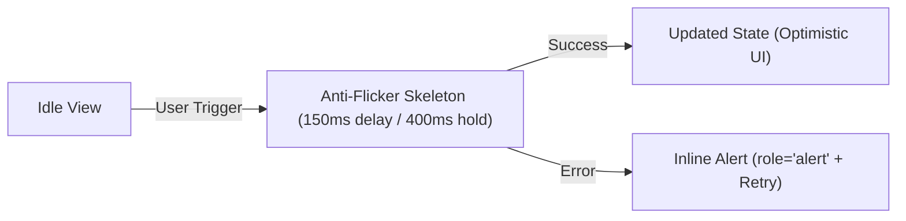

> **📂 Deliverable & Native "Proceed" Routing (v5.5)**: On Antigravity 2.0, write `<appDataDir>\brain\<conversation-id>\DESIGN-{request}.md` as **1 single cohesive file (`<= 500` lines, NEVER split into a `{name}/` folder)** with `ArtifactMetadata: { Summary: "...", UserFacing: true, RequestFeedback: true }` so the native 1-click **"Proceed"** button renders in the UI. Set `RequestFeedback: false` on any intermediate `SCOUT` or `.html` preview file.

---

# /design:fast — Rapid 6-Block Component & UI Design

> **MISSION**: Rapidly create a deterministic, machine-validated 6-Block UI design specification (`DESIGN-{request}.md`) with 2026 Anti-AI-Slop visual craft, OKLCH + sRGB hex tokens, all 5 interactive states, WCAG 2.2 AA guardrails, and a fenced `DESIGN_CONTRACT` (`@theme inline` CSS + TypeScript Props) ready for `/code:fast` or `/plan:fast`.
> **⛔ NO APPLICATION SOURCE CODE — produce design specifications only.**

<request>$ARGUMENTS</request>

---

## ⚡ TURN-1 ZERO-TAX DISPATCH & PRIOR-ARTIFACT FAST-FORWARD

1. **Zero Pre-Flight Tax**: Core orchestration laws and the 5-Field Handoff Packet are pre-loaded in your global entrypoint (`GEMINI.md` / `CLAUDE.md` / `CODEX.md`). Do **NOT** block Turn 1 reading `CORE.md`, `PHASES.md`, or `AGENTS.md`.
2. **Prior-Artifact Fast-Forward Gate**: If `SCOUT-{request}.md` already exists in `<appDataDir>\brain\<conversation-id>\` (or `./reports/{topic}/`), reuse it immediately and skip Phase 1!
3. **Mandatory Design Skills**: Instruct `designer` (`agents/designer.md`) to load `skills/design-spec/SKILL.md`, `skills/frontend-design/SKILL.md`, `skills/frontend-architecture/SKILL.md`, `skills_library/anti-ai-slop-visual-craft/SKILL.md`, and `skills_library/wcag-22-accessibility-ergonomics/SKILL.md`.

| Tier | When | Action |
|------|------|--------|
| **TIER 1** | Antigravity 2.0 Native Sub-Agents (`invoke_subagent`, `send_message`) or `runSubagent` EXISTS | **MUST** invoke isolated sub-agent with `TypeName: "self"`, `Model: "inherit"` (NEVER use `TypeName: "research"`, which disables `write_file` and `run_command`!) |
| **TIER 2** | Tool MISSING or system error | Load `agents/scouter.md` / `agents/designer.md` and EMBODY (FALLBACK ONLY) |

---

## 🎭 Phase 1: FAST TOKEN & COMPONENT CONTEXT SCAN (`scouter`)

| Attribute | Value |
|-----------|-------|
| **Agent** | `scouter` (`agents/scouter.md` via `invoke_subagent(TypeName: "self", Role: "Codebase UI Token Scouter", Model: "inherit")`) |
| **Goal** | Inspect existing CSS custom properties (`globals.css` / `@theme`), Tailwind config, and UI component primitives (`1–4` files) |
| **Exit** | Existing token names, font families, and component conventions mapped |

---

## 🎭 Phase 2: 6-BLOCK `DESIGN-{request}.md` AUTHORING & 4-GATE VALIDATION (`designer`)

| Attribute | Value |
|-----------|-------|
| **Agent** | `designer` (`agents/designer.md` via `invoke_subagent(TypeName: "self", Role: "Principal Design Architect", Model: "inherit")`) |
| **Output** | `<appDataDir>\brain\<conversation-id>\DESIGN-{request}.md` (`<= 500` lines single cohesive file, `ArtifactMetadata: { Summary: "...", UserFacing: true, RequestFeedback: true }`) + optional `<appDataDir>\brain\<conversation-id>\DESIGN-PREVIEW-{request}.html` (`generative_ui`, `RequestFeedback: false`) |
| **CLI Gate** | Run `node ~/.{TOOL}/skills/boomopen-workflow-kit/cli/install.js design validate "<design-path>"` (must pass `DESIGN-G1..G4`) |

### Mandatory 6-Block Cohesive `DESIGN-{request}.md` Template

````markdown
---
version: "2.0"
name: "{Component / Feature Name}"
archetype: "linear-technical-dark" # swiss-editorial | linear-technical-dark | luxury-minimal | tactile-neo-brutalist
colors:
  primary: "oklch(0.68 0.18 255) /* #3B82F6 */"
  accent: "oklch(0.64 0.19 32) /* #EA580C */"
  success: "oklch(0.72 0.17 152) /* #10B981 */"
  warning: "oklch(0.78 0.16 75) /* #F59E0B */"
  error: "oklch(0.64 0.21 25) /* #EF4444 */"
surface_elevation:
  canvas: "oklch(0.12 0.012 260) /* #0B0D13 */"
  card: "oklch(0.155 0.014 260) /* #12151E */"
  elevated: "oklch(0.19 0.016 260) /* #1A1E2B */"
  overlay: "oklch(0.225 0.018 260 / 0.88)"
  border-hairline: "oklch(1 0 0 / 0.08)"
typography:
  display: { fontFamily: "Instrument Serif", fontSize: "clamp(1.75rem, 3vw, 2.5rem)", lineHeight: 1.1 }
  sans: { fontFamily: "Plus Jakarta Sans", fontSize: "16px", lineHeight: 1.6 }
  mono: { fontFamily: "JetBrains Mono", fontSize: "14px", fontFeature: "'tnum' 1" }
motion:
  spring-snappy: "{ stiffness: 420, damping: 32, mass: 0.8 }"
  reduced-motion: "crossfade-120ms"
spacing: { xs: "4px", sm: "8px", md: "16px", lg: "24px", xl: "48px" }
rounded: { sm: "6px", md: "10px", lg: "16px" }
wcag_target: "2.2-AA"
---

# 🎨 Design Specification: {Request Title}

> [!IMPORTANT]
> **1-Click Execution Ready**: Click **"Proceed"** on this artifact (or reply `"proceed"` / `"tiến hành đi"` / `"/code:fast"`) to implement this locked design contract.

## 1. 🧭 Problem, Aesthetic Direction & Anti-Slop Charter
- **User Goal (JTBD)**: {What the user accomplishes and what they see first}
- **Named Aesthetic Direction**: `{Archetype}` — 60% neutral surface, 30% elevated card/hairline, 10% single primary CTA accent.
- **Anti-AI-Slop Guardrails**: Zero `#6366f1 -> #a855f7` purple gradients, zero `grid-cols-3` equal cards, zero `blur-3xl` neon blobs, SVG icons only (`24x24` viewBox), `tabular-nums` on all numeric metrics.

## 2. 🗺️ Information Architecture, Layout & User Flow (Mermaid)


## 3. 🔄 5-State Component & Interaction Matrix (All 5 Mandatory)
| State | Visual & Token Treatment | Interaction, Timing & ARIA Behavior |
|-------|--------------------------|-------------------------------------|
| **Default (`Idle`)** | `--surface-card`, `1px solid var(--border-hairline)`, `tabular-nums` | `cursor-pointer`, hover elevates to `--surface-elevated` (`150ms`) |
| **Loading (`Skeleton`)** | Shimmer matching exact component height (`CLS = 0`) | `150ms` show-delay, `400ms` min hold, `aria-busy="true"` |
| **Empty State** | Restrained SVG icon + `--text-secondary` copy (`max-w-[48ch]`) | Primary creation CTA (`min-h-11` mobile / `min-h-9` desktop) |
| **Error Recovery** | `oklch(0.64 0.21 25 / 0.12)` surface + `--status-error` border | `role="alert"`, preserves user input, explicit Retry button |
| **Disabled & Focus-Visible** | Disabled: `opacity-50 pointer-events-none`; Focus: `2px` `--primary` ring | `Tab`/`Enter`/`Escape` keyboard flow; `scroll-padding-top: 4.5rem` (`SC 2.4.11`) |

## 4. ♿ WCAG 2.2 AA & Responsive Breakpoint Specification
- **Responsive Matrix**: `320px` (1-col, `min-h-dvh`, `>= 44x44pt` touch targets, `>= 16px` inputs) · `768px` (tablet `@container` split) · `1024px–1440px` (desktop Bento grid, `>= 24x24px` targets).
- **WCAG 2.2 AA Verification**: Contrast `>= 4.5:1` text / `>= 3:1` UI (`SC 1.4.3`), Target Size `>= 24x24px` web / `44x44pt` mobile (`SC 2.5.8`), Focus Not Obscured `scroll-padding-top` (`SC 2.4.11`), single-pointer drag alternatives (`SC 2.5.7`), `prefers-reduced-motion: reduce`.

## 5. 🤝 Design-to-Code Contract (`DESIGN_CONTRACT`)

```css
@theme inline {
  --color-canvas: var(--surface-canvas);
  --color-card: var(--surface-card);
  --color-elevated: var(--surface-elevated);
  --color-hairline: var(--border-hairline);
  --color-primary: var(--primary);
  --font-display: 'Instrument Serif', serif;
  --font-sans: 'Plus Jakarta Sans', sans-serif;
  --font-mono: 'JetBrains Mono', monospace;
}
```

```ts
export type ComponentViewState = 'default' | 'loading' | 'empty' | 'error' | 'disabled';

export interface DesignedComponentProps {
  readonly state: ComponentViewState;
  readonly errorMessage?: string;
  readonly onAction: () => Promise<void>;
}
```
````

### Mandatory Pre-Completion CLI Gate
Before finishing Phase 2, run:
```bash
node ~/.{TOOL}/skills/boomopen-workflow-kit/cli/install.js design validate "<appDataDir>/brain/<conversation-id>/DESIGN-{request}.md"
```

---

## ⛔ HARD STOP — AWAIT USER DECISION

Present `<appDataDir>\brain\<conversation-id>\DESIGN-{request}.md` (`RequestFeedback: true`) and **STOP**:
1. 🟢 **Click "Proceed" (or reply `"proceed"` / `"tiến hành đi"`)** → Implement immediately via `/code:fast` (Approved-Design Continuation)
2. 📋 **`/plan:fast`** → Create sharded implementation plan locking `DESIGN_CONTRACT`
3. 🔍 **`/design:hard`** → Escalate to full 2-Wave multi-screen design
4. 🔄 **Iterate** → Refine tokens, layout, or states
