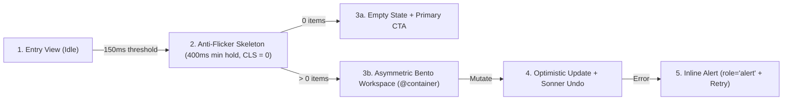

> **📂 Deliverable & Native "Proceed" Routing (v5.5)**: On Antigravity 2.0, write `<appDataDir>\brain\<conversation-id>\DESIGN-{request}.md` as **1 single cohesive file up to `500` lines (NEVER split into a `{name}/` folder)** with `ArtifactMetadata: { Summary: "...", UserFacing: true, RequestFeedback: true }` so Antigravity 2.0 renders the native 1-click **"Proceed"** button. Set `RequestFeedback: false` on `SCOUT-{request}.md`, `RESEARCH-{request}.md`, `COUNCIL-DESIGN-{request}.md`, and `DESIGN-PREVIEW-{request}.html`.

---

# /design:hard — High-Velocity 2-Wave UI/UX & Design System Specification

> **MISSION**: Produce a complete, self-contained, machine-validated **6-Block `DESIGN-{request}.md`** (`<= 500` lines) + optional interactive `DESIGN-PREVIEW-{request}.html` (`generative_ui`) in **2 High-Velocity Parallel Waves**:
> - **Wave 1 (Turn 1)**: Parallel Codebase Token Scout (`scouter`) + Empirical Design System Intelligence (`researcher` running `ui-ux-pro-max/scripts/search.py --design-system`) + optional Multi-Engine Design Council (`boomopen conduct council --task design --prompt "<design-context>"`).
> - **Wave 2 (Turn 2)**: Cohesive 6-Block `DESIGN-{request}.md` (`RequestFeedback: true`) + optional Live HTML Prototype (`generative_ui`) / Bespoke Assets (`image-generator`) + Deterministic 4-Gate CLI Validation (`boomopen design validate`) + `reviewer` Audit.
> **⛔ NO APPLICATION SOURCE CODE — produce design specifications and preview artifacts only.**

<request>$ARGUMENTS</request>

---

## ⚡ TURN-1 ZERO-TAX DISPATCH, PRIOR-ARTIFACT FAST-FORWARD & SHARDING LAW

1. **Zero Pre-Flight Tax**: Core orchestration laws and the 5-Field Handoff Packet are pre-loaded in your global entrypoint (`GEMINI.md` / `CLAUDE.md` / `CODEX.md`). Do **NOT** block Turn 1 reading `CORE.md`, `PHASES.md`, or `AGENTS.md` — launch Wave 1 shards **immediately on Turn 1** via `invoke_subagent(TypeName: "self", Model: "inherit")`.
2. **⚡ PRIOR-ARTIFACT FAST-FORWARD GATE**:
   - Check if `SCOUT-{request}.md` or `RESEARCH-{request}.md` already exists in `<appDataDir>\brain\<conversation-id>\` (or `./reports/{topic}/`).
   - **If present and fresh**: Reuse existing discovery artifacts immediately — skip redundant Wave 1 sub-agent spawns and jump straight to **Wave 2 (`designer`)**!
3. **Cognitive Load Sharding Law (`≤ 3–4 files/sub-agent` or `1` design/research vector)**:
   $$N_{\text{agents}} = \min\!\left(\text{maxParallelSubagents},\; \max\!\left(\left\lceil \frac{\text{Total Target Files}}{3.5} \right\rceil,\; \text{Distinct Domains},\; \text{Research Vectors}\right)\right)$$

| Tier | When | Action |
|------|------|--------|
| **TIER 1** | Antigravity 2.0 Sub-Agents (`invoke_subagent`, `send_message`) or `runSubagent` EXISTS | Spawn isolated shards (`role#shard`) with `TypeName: "self"`, `Model: "inherit"` (Pro High default; NEVER `flash_lite`) |
| **TIER 2** | Tool MISSING or system error | Load `agents/*.md` and EMBODY (FALLBACK ONLY) |

---

## 🌊 WAVE 1 (TURN 1): PARALLEL CODEBASE TOKEN SCOUT & `ui-ux-pro-max` DESIGN INTELLIGENCE

> **🚀 TURN-1 PARALLEL FAN-OUT DIRECTIVE**: Launch `scouter` (`scouter#1..k`) AND `researcher` (`researcher#1..k`) — plus optional `boomopen conduct council --task design --prompt "<design-context>"` — **concurrently in a single Turn-1 tool batch** via `invoke_subagent(TypeName: "self", Model: "inherit")`. Join via Reactive Async Wakeup.

| Parallel Shard(s) | Output Deliverable (`RequestFeedback: false`) | Turn-1 Mission |
|-------------------|-----------------------------------------------|----------------|
| **`scouter` / `scouter#1..k`** (`agents/scouter.md`, `TypeName: "self"`, `Model: "inherit"`) | `<appDataDir>\brain\<conversation-id>\SCOUT-{request}.md` | 1. Audit existing CSS custom properties (`globals.css`, `@theme`), Tailwind config, icon libraries, and UI component primitives (`≤ 3–4` heavy files per shard).<br>2. Map existing route structure, Server vs. Client component seams, and `./documents/` design standards. |
| **`researcher` / `researcher#1..k`** (`agents/researcher.md`, `TypeName: "self"`, `Model: "inherit"`) | `<appDataDir>\brain\<conversation-id>\RESEARCH-{request}.md` | 1. **Run `ui-ux-pro-max` Design System Generator**:<br>`python3 ~/.{TOOL}/skills_library/ui-ux-pro-max/scripts/search.py "<product_type> <industry> <keywords>" --design-system -p "<Project>"` (use `python` or `py -3` on Windows if `python3` is absent).<br>2. Extract JTBD user stories, select 1 of the **7 Named Aesthetic Archetypes** (`skills/frontend-design/SKILL.md`), convert recommended colors into perceptual **OKLCH + sRGB `#hex` dual tokens**, and identify industry UX anti-patterns. |
| **Optional Multi-Engine Design Council** | `<appDataDir>\brain\<conversation-id>\COUNCIL-DESIGN-{request}.md` | When `engines.planner = "council"` or requested by user (`--council`), run `node ~/.{TOOL}/skills/boomopen-workflow-kit/cli/install.js conduct council --task design --prompt "<request>"` in parallel. |

---

## 🎯 WAVE 2 (TURN 2): COHESIVE 6-BLOCK `DESIGN-{request}.md`, LIVE PREVIEW & 4-GATE VALIDATION

| Agent | Mission & Deliverables (`Model: "inherit"`) |
|-------|---------------------------------------------|
| **`designer`** (`agents/designer.md`, `TypeName: "self"`) | 1. **READ** `SCOUT-{request}.md` + `RESEARCH-{request}.md` (+ `COUNCIL-DESIGN-{request}.md` if present) and load `skills/design-spec/SKILL.md`, `skills/frontend-design/SKILL.md`, `skills/frontend-architecture/SKILL.md`, `skills_library/anti-ai-slop-visual-craft/SKILL.md`, `skills_library/oklch-bento-grid-architecture/SKILL.md`, `skills_library/motion-v12-view-transitions-css/SKILL.md`, `skills_library/ai-native-generative-ui-ux/SKILL.md`, and `skills_library/wcag-22-accessibility-ergonomics/SKILL.md`.<br>2. Author **1 cohesive 6-Block `<appDataDir>\brain\<conversation-id>\DESIGN-{request}.md`** (`<= 500` lines, `ArtifactMetadata: { Summary: "...", UserFacing: true, RequestFeedback: true }`).<br>3. **Optional Live Interactive Prototype (`generative_ui` Skill)**: Write `<appDataDir>\brain\<conversation-id>\DESIGN-PREVIEW-{request}.html` (`UserFacing: true, RequestFeedback: false`) loading `https://www.gstatic.com/antigravity/web/dev/tailwindcss.min.js` with interactive 5-state tabs (`Default | Loading | Empty | Error | Disabled`) and responsive layout preview.<br>4. **Optional Bespoke Visual Assets (`image-generator`)**: If custom hero illustrations or empty-state artwork are needed, spawn `invoke_subagent(TypeName: "image-generator", Role: "UI Visual Asset Generator", Model: "inherit", Prompt: ...)` instead of using placeholder URLs. |
| **CLI Validator + `reviewer`** (`agents/reviewer.md`) | 1. Run `node ~/.{TOOL}/skills/boomopen-workflow-kit/cli/install.js design validate "<appDataDir>/brain/<conversation-id>/DESIGN-{request}.md"` (must pass all 4 deterministic gates `DESIGN-G1..G4`).<br>2. Audit against the Anti-AI-Slop rubric and WCAG 2.2 AA ergonomics checklist. |

### Mandatory 6-Block Cohesive `DESIGN-{request}.md` Blueprint (`<= 500` Lines Single File)

````markdown
---
version: "2.0"
name: "{Design System / Feature Name}"
archetype: "linear-technical-dark" # swiss-editorial | linear-technical-dark | luxury-minimal | tactile-neo-brutalist
theme_polarity: "dark-first"       # dark-first | light-first | adaptive-dual
colors:
  primary: "oklch(0.68 0.18 255) /* #3B82F6 */"
  primary-hover: "oklch(0.74 0.18 255) /* #60A5FA */"
  accent: "oklch(0.64 0.19 32) /* #EA580C */"
  success: "oklch(0.72 0.17 152) /* #10B981 */"
  warning: "oklch(0.78 0.16 75) /* #F59E0B */"
  error: "oklch(0.64 0.21 25) /* #EF4444 */"
surface_elevation:
  canvas: "oklch(0.12 0.012 260) /* #0B0D13 */"
  card: "oklch(0.155 0.014 260) /* #12151E */"
  elevated: "oklch(0.19 0.016 260) /* #1A1E2B */"
  overlay: "oklch(0.225 0.018 260 / 0.88)"
  border-hairline: "oklch(1 0 0 / 0.08)"
  specular-top: "inset 0 1px 0 0 oklch(1 0 0 / 0.07)"
typography:
  display: { fontFamily: "Instrument Serif", fontSize: "clamp(2.25rem, 3.8vw + 1rem, 4rem)", lineHeight: 1.08, letterSpacing: "-0.028em" }
  sans: { fontFamily: "Plus Jakarta Sans", fontSize: "16px", lineHeight: 1.6 }
  mono: { fontFamily: "JetBrains Mono", fontSize: "14px", fontFeature: "'tnum' 1, 'zero' 1" }
motion:
  spring-snappy: "{ stiffness: 420, damping: 32, mass: 0.8 }"
  spring-spatial: "{ stiffness: 300, damping: 28, mass: 1.0 }"
  ease-out-expo: "cubic-bezier(0.16, 1, 0.3, 1)"
  reduced-motion: "crossfade-120ms"
spacing: { xs: "4px", sm: "8px", md: "16px", lg: "24px", xl: "48px" }
rounded: { sm: "6px", md: "12px", lg: "20px" }
wcag_target: "2.2-AA"
---

# 🎨 UI/UX Design Specification: {Feature / System Name}

> [!IMPORTANT]
> **1-Click Execution Ready**: Click the **"Proceed"** button on this artifact (or reply `"proceed"` / `"tiến hành đi"` / `"/plan:hard"` / `"/code:hard"`) to transition directly into implementation planning or coding with this locked `DESIGN_CONTRACT`.

## 1. 🧭 Block 1: Problem, Aesthetic Direction & Anti-Slop Charter
- **Verbatim User Request**: "{Exact user request}"
- **JTBD & UX Psychology**: {Primary user goal; Hick's Law progressive disclosure (`⌘K`); Fitts' Law thumb-zone CTA; Doherty `< 400ms` optimistic UI}.
- **Named Aesthetic Archetype**: `{Archetype}` (60% `--surface-canvas`, 30% `--surface-card` & `--border-hairline`, 10% single `--primary` CTA per viewport).
- **Explicit Anti-AI-Slop Ban List**: ❌ No `#6366f1 -> #a855f7` purple gradients · ❌ No `grid-cols-3` equal cards · ❌ No `blur-3xl` neon blobs · ❌ No centered body prose (`max-w-[65ch]` left-aligned) · ❌ No emoji icons (SVG Lucide/Heroicons `24x24` viewBox only).

## 2. 🗺️ Block 2: Information Architecture, Screen Layout & User Journey (Mermaid)


| Breakpoint Tier | Viewport | Grid & Spatial Architecture (`min-h-dvh`, `@container`) | Touch / Hit Target Floor (`SC 2.5.8`) |
|-----------------|:--------:|---------------------------------------------------------|---------------------------------------|
| **Mobile** | `320px–767px` | `1-col` stack (`px-4`, `gap-4`), bottom sheet (`vaul`) | **`>= 44x44pt` (`min-h-11 min-w-11`)**, inputs `>= 16px` |
| **Tablet** | `768px–1023px` | `8-col` (`5:3` asymmetric split, `px-6`, `gap-5`) | **`>= 44x44pt`** on touch controls |
| **Desktop** | `1024px–1439px` | `12-col` Asymmetric Bento (`8:4` split, `px-8`, `gap-6`) | **`>= 24x24px` (`min-h-9`)** + `<kbd>⌘K</kbd>` |
| **Ultra-Wide** | `>= 1440px` | `max-w-[1280px]` workspace + docked inspector pane | **`>= 24x24px`** + `ViewTransition` choreography |

## 3. 🔄 Block 3: 5-State Component & Interaction Matrix (All 5 Mandatory)
| State | Visual & Token Specification | Interaction, Timing & ARIA Ergonomics |
|-------|------------------------------|---------------------------------------|
| **1. `Default` (`Idle`)** | `--surface-card`, `1px solid var(--border-hairline)`, `--specular-top`, `tabular-nums` | `cursor-pointer`, hover transitions to `--surface-elevated` (`150ms`, `0px` layout shift) |
| **2. `Loading` (`Skeleton`)** | Shimmer matching exact row/card dimensions (`CLS = 0.00`) | `150ms` show-delay, `400ms` min hold, `aria-busy="true"` |
| **3. `Empty State`** | Bespoke SVG / `image-generator` illustration + `--text-secondary` copy (`max-w-[48ch]`) | Single high-conviction Primary CTA (`--primary`, `min-h-11`) |
| **4. `Error Recovery`** | `oklch(0.64 0.21 25 / 0.12)` surface + `1px` `--error` border + actionable diagnostic | `role="alert"` (`aria-live="assertive"`), preserves form input, explicit Retry CTA |
| **5. `Disabled` & `Focus-Visible`** | Disabled: `opacity-50 pointer-events-none` (`aria-disabled="true"`); Focus: `2px` `--primary` ring | Full `Tab`/`Enter`/`Escape` loop; `scroll-padding-top: 4.5rem` (`SC 2.4.11`) |

## 4. ♿ Block 4: WCAG 2.2 AA, Responsive & Core Web Vitals Verification
- [x] **SC 1.4.3 / 1.4.11 Contrast**: Text `>= 4.5:1`; UI boundaries/icons `>= 3.0:1`; status paired with SVG icon + text label (never color alone).
- [x] **SC 2.5.8 Target Size**: Desktop interactive targets `>= 24x24px`; mobile touch targets `>= 44x44pt` (`min-h-11 min-w-11`).
- [x] **SC 2.4.11 Focus Not Obscured**: Scroll containers set `scroll-padding-top: 4.5rem` so sticky headers never occlude focused items.
- [x] **SC 2.5.7 Dragging Alternatives & SC 3.3.8 Accessible Auth**: Single-pointer click/keyboard alternatives for any drag/slider UI; paste enabled on auth/OTP inputs.
- [x] **Motion & CWV (`CLS < 0.1`, `INP < 200ms`)**: Compositor-only `transform`/`opacity`; `@media (prefers-reduced-motion: reduce)` collapses springs to `120ms` crossfade; `font-variant-numeric: tabular-nums` on all numbers.

## 5. 🤝 Block 5: Fenced Design-to-Code Contract (`DESIGN_CONTRACT`)

> **LOCKED FRONTEND CONTRACT**: Extractable via `boomopen design contract` for direct injection into `PLAN-{request}.md` (`SHARED_CONTRACT`).

```css
@layer base {
  :root {
    --surface-canvas: #0B0D13;
    --surface-canvas: oklch(0.12 0.012 260);
    --surface-card: #12151E;
    --surface-card: oklch(0.155 0.014 260);
    --surface-elevated: #1A1E2B;
    --surface-elevated: oklch(0.19 0.016 260);
    --border-hairline: oklch(1 0 0 / 0.08);
    --primary: #3B82F6;
    --primary: oklch(0.68 0.18 255);
    --radius-outer: 20px;
    --radius-inner: 12px; /* R_inner = R_outer - 8px padding */
    --sticky-header-offset: 4.5rem;
  }
}

@theme inline {
  --color-canvas: var(--surface-canvas);
  --color-card: var(--surface-card);
  --color-elevated: var(--surface-elevated);
  --color-hairline: var(--border-hairline);
  --color-primary: var(--primary);
  --font-display: 'Instrument Serif', Georgia, serif;
  --font-sans: 'Plus Jakarta Sans', 'Inter', system-ui, sans-serif;
  --font-mono: 'JetBrains Mono', monospace;
}
```

```ts
export type UIViewState = 'default' | 'loading' | 'empty' | 'error' | 'disabled';

export interface FeatureCardProps {
  readonly id: string;
  readonly viewState: UIViewState;
  readonly metricValue: number; // Render with tabular-nums
  readonly errorMessage?: string;
  readonly onPrimaryAction: (id: string) => Promise<void>;
  readonly onRetry?: () => void;
}
```

### Recommended 2-Wave Frontend Shard Topology (For `/plan` & `/code` when `> 3` UI files)
- **Wave 1 (`frontend-engineer#tokens-primitives`, `<= 4 OWNED_FILES`)**: Locks `src/styles/globals.css` (`@theme inline`) + shared UI primitives (`src/components/ui/*`) + `src/types/ui-contracts.ts`.
- **Wave 2 (`frontend-engineer#screen-1..k`, `Depends On: Wave 1`, `Parallelizable: Yes`)**: Builds feature screens in parallel with Wave 1's token & primitive files locked in `READ_ONLY_FILES`.

## 6. ✅ Block 6: 4-Gate CLI Validation (`DESIGN-G1..G4`) & Handoff
- **Deterministic CLI Check**: `node ~/.{TOOL}/skills/boomopen-workflow-kit/cli/install.js design validate "<design-path>"` → **PASS (`DESIGN-G1..G4`)**
````

---

## ⛔ HARD STOP — AWAIT USER DECISION

Present `<appDataDir>\brain\<conversation-id>\DESIGN-{request}.md` (`RequestFeedback: true`) and `<appDataDir>\brain\<conversation-id>\DESIGN-PREVIEW-{request}.html` (if generated), then **STOP**:
1. 🟢 **Click "Proceed" (or reply `"proceed"` / `"tiến hành đi"`)** → Implement directly via `/code:hard` or `/plan:hard` (Approved-Design Continuation)
2. 📋 **`/plan:hard`** → Create sharded Wave-1/Wave-2 implementation plan with `boomopen design contract`
3. 🔺 **`/design:team`** → Escalate to Golden Diamond multi-critic design review
4. 🔄 **Iterate** → Refine tokens, layout, or interactive states
