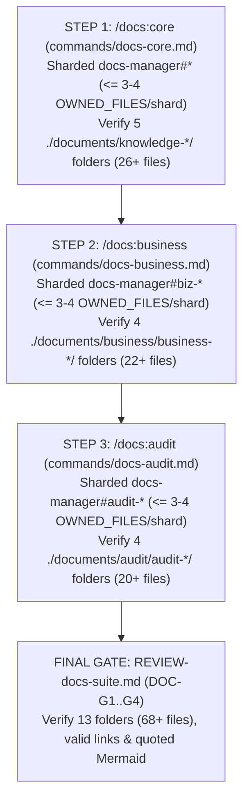

# /docs — Workspace Documentation Suite & Router

> **MISSION**: Generate or update evidence-backed, version-controlled documentation in `./documents/` with **100% codebase symbol accuracy (`DOC-G1..G4`)** and **collision-free parallel sharding (`<= 3–4 OWNED_FILES` per shard)**. When invoked as bare `/docs` for the full suite, execute `/docs:core` → `/docs:business` → `/docs:audit` **SEQUENTIALLY** (`13` folders, `68+` files) and report `"Done"` ONLY when every deliverable exists.

<scope>$ARGUMENTS</scope>

---

## ⚡ TURN-1 ZERO-TAX DISPATCH, SHARDING & ARTIFACT ROUTING

1. **Zero Pre-Flight Tax (`0-Turn` Native Dispatch)**: Core orchestration laws and the **5-Field Handoff Packet** (`1. MISSION & ACCEPTANCE CRITERIA`, `2. SHARED_CONTRACT`, `3. OWNED_FILES`, `4. READ_ONLY_FILES`, `5. VERIFICATION & DELIVERABLE`) are pre-loaded in your global entrypoint (`GEMINI.md` / `CLAUDE.md` / `CODEX.md`). Do **NOT** block Turn 1 reading `CORE.md`, `PHASES.md`, or `AGENTS.md` — read the target `commands/docs-*.md` + `_ref/*.md` and launch Phase 1 sub-agents **in the same Turn-1 parallel batch** via `invoke_subagent(TypeName: "self", Model: "inherit")`.
2. **Collision-Free Parallel Sharding (`docs-manager#1..k` / `docs#<shard>`, `<= 3–4 OWNED_FILES` per Shard)**:
   - Within each `/docs:*` workflow, shard codebase scouting across `scouter#docs-1..k` (`<= 3–4` heavy modules/shard) and shard folder writing across parallel `docs-manager#<shard>` (`docs#<shard>`) writers where **every shard owns a strictly disjoint set of `<= 3–4` Markdown files in `./documents/`**.
   - Lock canonical terminology, ID prefixes (`BG/BR/BF/BW`, `SEC/CMP/DFL/REM`), and relative cross-reference paths in `SHARED_CONTRACT` **before** parallel writers execute so two sub-agents **NEVER** overwrite the same file in `./documents/`!
   - Reuse warm `role#shard -> conversationId` sessions via `send_message` for review/anchor fixes.
3. **Clean Workspace `./documents/` vs. Transient Brain Artifacts (`ArtifactMetadata`)**:
   - **Canonical Documentation (`./documents/**`)**: Permanent workspace files written per `~/.{TOOL}/skills/boomopen-workflow-kit/commands/_ref/docs-folder-specs.md` (omit `ArtifactMetadata`).
   - **Transient Recon, Audit & Mailbox Files (`<appDataDir>\brain\<conversation-id>\`)**: Keep `./documents/` 100% free of scratch logs by routing transient artifacts to Brain with explicit `ArtifactMetadata`:
     - `SCOUT-docs-*.md` & `MAILBOX-{date}.md`: `ArtifactMetadata: { Summary: "...", UserFacing: false, RequestFeedback: false }`
     - `REVIEW-docs-{topic}.md`: `ArtifactMetadata: { Summary: "...", UserFacing: true, RequestFeedback: false }`

---

## 🌐 Multilingual Natural-Language Auto-Triggers (17 Supported Languages)

When the user asks to generate project documentation, knowledge-base docs, PRD/business docs, or security/compliance audit docs in `./documents/` without typing `/docs`, automatically trigger the matching route:

| Language | Natural-Language Trigger Phrases |
|----------|----------------------------------|
| **`en` (English)** | *"generate project documentation"*, *"write architecture/PRD/audit docs"*, *"document the entire codebase"* |
| **`vi` (Tiếng Việt)** | *"viết tài liệu dự án"*, *"tạo bộ tài liệu kiến trúc / PRD / audit"*, *"document lại toàn bộ codebase"* |
| **`zh-CN` / `zh-TW`** | *"生成项目文档"*, *"编写架构与业务文档"* / *"生成專案文檔"*, *"編寫架構與業務文檔"* |
| **`ja` (日本語)** | *"プロジェクトのドキュメントを生成して"*, *"設計書・仕様書を作成して"* |
| **`ko` (한국어)** | *"프로젝트 문서 생성해줘"*, *"아키텍처 및 PRD 문서 작성해줘"* |
| **`es` / `pt-BR`** | *"generar documentación del proyecto"* / *"gerar documentação completa do projeto"* |
| **`fr` / `de` / `it`** | *"générer la documentation du projet"* / *"Projektdokumentation erstellen"* / *"generare la documentazione del progetto"* |
| **`ru` / `tr`** | *"сгенерировать документацию проекта"* / *"proje dokümantasyonunu oluştur"* |
| **`hi` / `ar`** | *"प्रोजेक्ट दस्तावेज़ीकरण बनाएं"* / *"إنشاء وثائق المشروع الكاملة"* |
| **`id` / `th`** | *"buat dokumentasi proyek"* / *"สร้างเอกสารประกอบโปรเจกต์"* |

---

## 🔀 ROUTING LOGIC & AVAILABLE ROUTES

```
IF scope targets technical / codebase architecture / onboarding knowledge base only:
  → Route to /docs:core (commands/docs-core.md)

IF scope targets product PRD / features / workflows / domain glossary only:
  → Route to /docs:business (commands/docs-business.md)

IF scope targets security / compliance / dataflow / remediation audit docs only:
  → Route to /docs:audit (commands/docs-audit.md)

IF explicit :team OR execution.mode = team (adversarial zero-drift verification):
  → Execute target docs scope under Elastic Golden Diamond (agents/teams/docs-team/_team.md)

IF full project documentation suite requested (bare /docs with full-project scope):
  → Execute Sequential Full Suite below: STEP 1 (/docs:core) → STEP 2 (/docs:business) → STEP 3 (/docs:audit)
```

| Route | Workflow File | When to Use |
|-------|---------------|-------------|
| `/docs:core` | `commands/docs-core.md` | Core technical knowledge base: 5 `./documents/knowledge-*/` folders (`26+` files) with sharded `docs-manager#*` writers |
| `/docs:business` | `commands/docs-business.md` | Product & business suite: 4 `./documents/business/business-*/` folders (`22+` files) with `BG/BR/BF/BW` traceability |
| `/docs:audit` | `commands/docs-audit.md` | Security & compliance suite: 4 `./documents/audit/audit-*/` folders (`20+` files) with `SEC/CMP/DFL/REM` scoring |
| `/docs:team` | `agents/teams/docs-team/_team.md` | 3-Wave Source-Grounded Elastic Golden Diamond (`docs-team-techlead` + parallel `docs#<shard>` + `docs-team-reviewer`, `DOC-G1..G4`) |
| `/docs` | `commands/docs.md` | Full sequential documentation suite (`STEP 1 → STEP 2 → STEP 3`: all `13` folders / `68+` files in `./documents/`) |

---

## 🔄 FULL SUITE SEQUENTIAL EXECUTION FLOW (WHEN RUNNING ALL 3 SUITES)

> [!CAUTION]
> **NON-NEGOTIABLE SUITE LAWS**:
> 1. Execute `STEP 1` → `STEP 2` → `STEP 3` **strictly in order** (parallelize shards *inside* each step, NEVER run all 3 suites simultaneously).
> 2. Reuse Phase 1 reconnaissance intelligence (`SCOUT-docs-*.md`) across steps to avoid redundant codebase scans, adding targeted business/security delta scans as needed.
> 3. **NEVER modify application source code** during any `/docs` workflow (`READ_ONLY_FILES` lock on 100% of source/test/config files).
> 4. Report `"Done"` **ONLY** when all `13` folders (`68+` files) exist and pass `DOC-G1..G4`.



### STEP 1: EXECUTE `/docs:core` (`~/.{TOOL}/skills/boomopen-workflow-kit/commands/docs-core.md`)
- [ ] `./documents/knowledge-source-base/` (`00-index.md` + `01..04` sub-files)
- [ ] `./documents/knowledge-overview/` (`00-index.md` + `01..04` sub-files)
- [ ] `./documents/knowledge-architecture/` (`00-index.md` + `01..05` sub-files)
- [ ] `./documents/knowledge-domain/` (`00-index.md` + `01..04` sub-files)
- [ ] `./documents/knowledge-standards/` (`00-index.md` + `01..04` sub-files)
- **⏸️ GATE 1**: Confirm all 5 core folders exist before starting Step 2.

### STEP 2: EXECUTE `/docs:business` (`~/.{TOOL}/skills/boomopen-workflow-kit/commands/docs-business.md`)
- [ ] `./documents/business/business-prd/` (`00-index.md` + `01..04` sub-files)
- [ ] `./documents/business/business-features/` (`00-index.md` + `01..05` sub-files)
- [ ] `./documents/business/business-workflows/` (`00-index.md` + `01..05` sub-files)
- [ ] `./documents/business/business-glossary/` (`00-index.md` + `01..04` sub-files)
- **⏸️ GATE 2**: Confirm all 4 business folders exist before starting Step 3.

### STEP 3: EXECUTE `/docs:audit` (`~/.{TOOL}/skills/boomopen-workflow-kit/commands/docs-audit.md`)
- [ ] `./documents/audit/audit-security/` (`00-index.md` + `01..04` sub-files)
- [ ] `./documents/audit/audit-compliance/` (`00-index.md` + `01..04` sub-files)
- [ ] `./documents/audit/audit-dataflow/` (`00-index.md` + `01..04` sub-files)
- [ ] `./documents/audit/audit-recommendations/` (`00-index.md` + `01..04` sub-files)

---

## ✅ FINAL VERIFICATION & COMPLETION OUTPUT

Before reporting `"Done"`, verify the complete `./documents/` hierarchy and zero-drift `REVIEW-docs-*.md` gate:

```markdown
## ✅ Full Documentation Suite Complete (`v5.5`)

| Suite | Workflow File | Deliverables in `./documents/` | Status |
|-------|---------------|--------------------------------|--------|
| **Core** | `commands/docs-core.md` | 5 `knowledge-*/` folders (`26+` files) | ✅ 5/5 folders |
| **Business** | `commands/docs-business.md` | 4 `business/business-*/` folders (`22+` files) | ✅ 4/4 folders |
| **Audit** | `commands/docs-audit.md` | 4 `audit/audit-*/` folders (`20+` files) | ✅ 4/4 folders |

- **Workspace Docs**: `13` folders (`68+` files) verified in `./documents/` (`0` `TODO` placeholders, `0` write collisions)
- **Audit Artifact**: `<appDataDir>\brain\<conversation-id>\REVIEW-docs-{topic}.md` (`DOC-G1..G4` passed)
```

---

## 📋 PRESENT OPTIONS (Only when `workflows.defaultVariant = ask`)

```markdown
## 📚 Documentation Mode Selection

**Scope**: [parsed scope]

1. 🏗️ **Core Technical** → `/docs:core` — 5 knowledge folders (`commands/docs-core.md`)
2. 💼 **Business & PRD** → `/docs:business` — 4 business folders (`commands/docs-business.md`)
3. 🛡️ **Security & Audit** → `/docs:audit` — 4 audit folders (`commands/docs-audit.md`)
4. 💎 **Team Zero-Drift** → `/docs:team` — Elastic Golden Diamond (`agents/teams/docs-team/_team.md`)
5. 📚 **Full Suite** → `/docs` — All 13 folders sequentially (`68+` files)

⏳ Awaiting selection...
```
