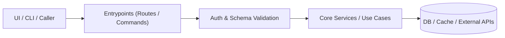

# /onboard — 60-Second Brownfield Codebase Onboarding & Architecture Map

> **MISSION**: Deliver an actionable, source-grounded `ARCHITECTURE-MAP.md` for any existing repository in under 60 seconds — mapping tech stack, runtime entrypoints, end-to-end data flows, risk/churn hotspots, and exact build/lint/test quality gates — with **zero collision with Claude Code's built-in `/init`** and **zero 26-file `./documents/` repository clutter**.

<focus>$ARGUMENTS</focus>

---

## ⚡ TURN-1 PARALLEL SCOUTING & ZERO-CLUTTER ARTIFACT CONTRACT

1. **Strictly Read-Only Workspace Inspection**:
   - Lock **100% of repository source, config, and test files in `READ_ONLY_FILES`** — `/onboard` NEVER modifies project code or commits boilerplate folders into the user's Git working tree!
   - Write **1 single cohesive `ARCHITECTURE-MAP.md` (`<= 350` lines)**:
     - **Antigravity 2.0**: `<appDataDir>\brain\<conversation-id>\ARCHITECTURE-MAP.md` with `ArtifactMetadata: { Summary: "Brownfield codebase architecture map, entrypoints, data flow, hotspots, and quality gates", UserFacing: true, RequestFeedback: false }`.
     - **Claude Code / OpenAI Codex / Cursor / GitHub Copilot**: `./reports/onboarding/ARCHITECTURE-MAP.md` (omitting `ArtifactMetadata`; write into `./documents/` ONLY if the user explicitly asks to commit onboarding docs).
2. **Turn-1 Parallel Recon Fan-Out (`> 2` Modules)**:
   - Run lightweight workspace & Git telemetry immediately (`python ~/.{TOOL}/skills/boomopen-workflow-kit/scripts/session_manager.py info .`, `git status -s`, `git log --oneline -10`).
   - For multi-module or monorepo codebases, launch **3 parallel read-only `scouter` shards on Turn 1** (`invoke_subagent(TypeName: "self", Model: "inherit")` on Antigravity, `Task` on Claude Code, `spawn_agent` on Codex, `runSubagent` on Copilot, or native subagent/TIER 2 on Cursor):

| Parallel Shard | Inspection Scope (`READ_ONLY_FILES`: Entire Repo) | Extracted Intelligence |
|----------------|---------------------------------------------------|------------------------|
| **`scouter#stack-entrypoints`** | Root manifests (`package.json`, `pnpm-workspace.yaml`, `pyproject.toml`, `Cargo.toml`, `go.mod`, `Dockerfile`, `.env.example`) + `src/` / `app/` / `cli/` roots | Frameworks, runtime versions, workspace packages, HTTP/CLI/worker/UI entrypoints, and required environment variables. |
| **`scouter#domain-dataflow`** | Core domain services, API routers/controllers, DB schemas/migrations (`prisma/`, `drizzle/`, `migrations/`), auth middleware, and state stores | End-to-end request/event lifecycle (`Client -> Route -> Auth/Validation -> Service -> DB/External API`), key domain entities, and cross-module boundaries. |
| **`scouter#gates-hotspots`** | CI workflows (`.github/workflows/*`), test configs, largest files, and `git log --format=format: --name-only -n 50` churn | Exact `install` / `dev` / `build` / `typecheck` / `lint` / `test` commands, coverage gaps, >500-line monoliths, and high-churn risk hotspots. |

---

## 🔍 PHASE 1: GROUNDED EVIDENCE COLLECTION (ZERO GUESSWORK)

Every path, command, route, and module named in `ARCHITECTURE-MAP.md` MUST be verified on disk:
1. **Manifest & Workspace Topology**: Identify single-package vs. monorepo layout (`apps/*`, `packages/*`, `services/*`), language/compiler strictness (`tsconfig.json`, `ruff`/`mypy`, `clippy`), and package manager (`pnpm`, `npm`, `yarn`, `bun`, `uv`, `poetry`).
2. **Runtime Entrypoints & Surface Census**: Locate the exact boot files (`main.*`, `server.*`, `index.*`, `app/**/page.*`, `app/**/route.*`, `cli/*`, background queues/cron jobs).
3. **Churn & Complexity Radar**: Combine file line counts and recent Git commit frequency to pinpoint the top `3–5` fragile or high-blast-radius files new contributors must handle carefully.
4. **Executable Gate Verification**: Confirm exact script names from `package.json` / `Makefile` / CI YAML (never invent `npm run typecheck` if the repo uses `npm run check-types`!).

---

## 🗺️ PHASE 2: SYNTHESIZE COHESIVE `ARCHITECTURE-MAP.md` (`<= 350` LINES)

Write `ARCHITECTURE-MAP.md` in the user's language (keeping code identifiers, file paths, and commands in English) with clickable `[basename](file:///abs/path)` links:

````markdown
# 🗺️ Codebase Architecture Map: {Project Name}

## 1. Executive Stack & Repository Snapshot
| Dimension | Grounded Reality |
|-----------|------------------|
| **Purpose & Architecture Style** | {1-sentence product summary & style: modular monolith / Next.js fullstack / CLI / microservices} |
| **Languages & Frameworks** | {Exact versions from manifests, e.g., TypeScript 5.x, Next.js 15, Hono, FastAPI} |
| **Data, Auth & External Integrations** | {DB/ORM, cache/queues, auth provider, third-party SDKs} |
| **Package / Directory Layout** | {Top-level directory responsibilities with clickable links} |

## 2. System Topology & Runtime Entrypoints

- **HTTP / RPC / UI Entrypoints**: {clickable `[file:line](file:///...)` list}
- **CLI / Worker / Cron Entrypoints**: {clickable `[file:line](file:///...)` list}
- **Configuration & `.env` Contract**: {key config loaders & required `.env.example` keys}

## 3. End-to-End Data Flow & Key Invariants
1. **Primary Read/Write Flow**: {Trace 1 canonical request from entrypoint -> validation -> domain logic -> persistence -> response DTO}
2. **Architectural Invariants ("Do Not Break")**: {Auth/tenant scoping rules, transaction patterns, shared contract files, lock rules}

## 4. Risk Hotspots & Tech Debt Radar
| Hotspot File (`[link](file:///...)`) | Lines / Churn | Why It Is High-Risk & Safe Editing Guidance |
|--------------------------------------|:-------------:|---------------------------------------------|
| `{path/to/hotspot.ts}` | `{N}L / high` | `{e.g., Central state coordinator; lock callers tests in READ_ONLY_FILES}` |

## 5. Verified Commands & Quality Gates Cheat Sheet
```bash
# Install & Local Dev
{exact install & dev commands}

# Build, Typecheck, Lint & Automated Tests
{exact build, typecheck, lint, and test commands}

# BoomOpen Pragmatic 2-Tier & Anti-Stub Gate
node ~/.{TOOL}/skills/boomopen-workflow-kit/cli/install.js check . --strict-phase --no-stubs
```
````

---

## ⛔ CONSTRAINTS & ANTI-PATTERNS

| ❌ NEVER | ✅ ALWAYS |
|----------|-----------|
| Confuse `/onboard` with `/init` (scaffolding a brand-new project) | Keep `/onboard` 100% read-only on repository code and configs |
| Dump 20+ generated markdown files into `./documents/` uninvited | Emit **1 cohesive `ARCHITECTURE-MAP.md` (`<= 350` lines)** in Brain / `./reports/onboarding/` |
| Crawl `> 5` directories sequentially inside the primary agent | Fan out parallel `scouter#*` shards on Turn 1 so parent context stays clean |
| Invent unverified CLI scripts (`npm run typecheck`) or guessed paths | Cite only manifest-verified scripts and real disk paths (`[file:line](file:///...)`) |
| Expose real values from local `.env` files in the onboarding map | Inspect `.env.example` keys and config readers ONLY — never read or print secret values |

---

## 🌐 MULTILINGUAL INTENT TRIGGERS (WHEN NL ROUTING IS ENABLED)

| Language | Representative Onboarding Intents |
|----------|-----------------------------------|
| **`en` / `vi`** | *"onboard me to this repo"*, *"map the codebase architecture"* / *"giúp tôi nắm nhanh kiến trúc repo này"*, *"bản đồ codebase"* |
| **`zh` / `ja` / `ko`** | *"快速梳理代码库架构与入口"* / *"このリポジトリの全体構造とエントリーポイントを把握して"* / *"코드베이스 아키텍처와 진입점 빠르게 파악해줘"* |
| **`es` / `fr` / `de`** | *"mapear arquitectura y puntos de entrada del repo"* / *"cartographier l'architecture du dépôt"* / *"Codebase-Architektur schnell erfassen"* |

---

## 🚀 PHASE 3: CONCISE BRIEFING & NEXT WORKFLOW HANDOFF

Present a crisp 8–12 line summary in chat linking `ARCHITECTURE-MAP.md` and suggest the most relevant next command:
- **Plan or build a new feature** → `/plan:hard <feature>` or `/cook:hard <feature>`
- **Audit codebase health, security & spec parity** → `/audit` (or `/review:hard`)
- **Investigate a bug or failing test** → `/debug:hard <issue>`
- **Generate full committed `./documents/` suite (only if desired)** → `/docs:core`
