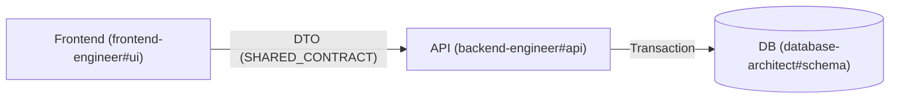

# /plan:hard — High-Velocity 2-Wave Technical & Feature Planning

> **MISSION**: Produce a complete, self-contained, machine-validated implementation plan (`PLAN-{task}.md`, single cohesive file up to `500` lines) in **2 High-Density Parallel Waves**:
> - **Wave 1 (Turn 1)**: Elastic Parallel Codebase Scout (`scouter#1..k`) + Feature/Pattern Research (`researcher#1..k`) + optional Cross-Engine Council (`engines.planner`).
> - **Wave 2 (Turn 2)**: Cohesive 6-Block `PLAN-{task}.md` Blueprint (`ArtifactMetadata.RequestFeedback: true`) + Deterministic CLI Validation (`boomopen plan validate`) + 6-Point Coverage Audit.
> **⛔ NO code writing — plan deliverables only.**

<task>$ARGUMENTS</task>

---

## ⚡ TURN-1 ZERO-TAX DISPATCH, PRIOR-ARTIFACT FAST-FORWARD & SHARDING LAW

1. **Zero Pre-Flight Tax**: Core orchestration laws and the 5-Field Handoff Packet (`1. MISSION`, `2. SHARED_CONTRACT`, `3. OWNED_FILES`, `4. READ_ONLY_FILES`, `5. VERIFICATION`) are pre-loaded in your global entrypoint (`GEMINI.md` / `CLAUDE.md` / `CODEX.md`). Do **NOT** block Turn 1 reading `CORE.md`, `PHASES.md`, or `AGENTS.md` — launch Wave 1 sub-agents **immediately on Turn 1** via `invoke_subagent(TypeName: "self", Model: "inherit")`.
2. **⚡ PRIOR-ARTIFACT FAST-FORWARD GATE**:
   - Check if `SCOUT-{task}.md`, `RESEARCH-{task}.md`, or `BRAINSTORM-{task}.md` already exists in `<appDataDir>\brain\<conversation-id>\` (or `./reports/{topic}/`).
   - **If present and fresh**: Reuse existing discovery artifacts immediately — skip redundant Wave 1 sub-agent spawns and jump straight to **Wave 2 (`planner`)**!
3. **Cognitive Load Sharding Law (`≤ 3–4 files/sub-agent` or `1` research vector)**:
   $$N_{\text{agents}} = \min\!\left(\text{maxParallelSubagents},\; \max\!\left(\left\lceil \frac{\text{Total Target Files}}{3.5} \right\rceil,\; \text{Distinct Domains},\; \text{Research Vectors}\right)\right)$$

| Tier | When | Action |
|------|------|--------|
| **TIER 1** | Antigravity 2.0 Sub-Agents (`invoke_subagent`, `send_message`) or `runSubagent` EXISTS | Spawn isolated shards (`role#shard`) with `TypeName: "self"`, `Model: "inherit"` (Pro High default; NEVER `flash_lite`) |
| **TIER 2** | Tool MISSING or system error | EMBODY agent `.md` file (FALLBACK) |

**Deliverable & `ArtifactMetadata` Routing (Antigravity 2.0 Clean Git Tree)**:
- **`PLAN-{task}.md`**: Write as **1 single cohesive file up to `500` lines** (NEVER split into a `{name}/` folder at 150 lines!) to `<appDataDir>\brain\<conversation-id>\PLAN-{task}.md` with `ArtifactMetadata: { Summary: "...", UserFacing: true, RequestFeedback: true }` so Antigravity 2.0 renders the native 1-click **"Proceed"** button.
- **Intermediate Artifacts (`SCOUT-{task}.md`, `RESEARCH-{task}.md`, `COUNCIL-PLAN-{task}.md`)**: Always set `ArtifactMetadata: { Summary: "...", UserFacing: false, RequestFeedback: false }` so internal discovery files stay hidden and premature "Proceed" buttons never appear.

---

## ⛔ ABSOLUTE PROHIBITION — NO CODE

- ❌ **NEVER** write implementation code (TypeScript, Python, Rust, etc.) or modify source files.
- ❌ **NEVER** auto-transition to `/code`, `/cook`, or `/fix` without explicit user approval.
- ✅ Use `ask_question` (interactive UI multiple-choice widget) only when genuine scope or architectural trade-offs require user confirmation.

---

## 🌊 WAVE 1 (TURN 1): ELASTIC PARALLEL DISCOVERY, CODEBASE SCOUT & RESEARCH FAN-OUT

> **🚀 TURN-1 PARALLEL FAN-OUT DIRECTIVE**: Launch `scouter#1..k` AND `researcher#1..k` (plus `boomopen conduct` when `engines.planner` is configured) **concurrently in a single Turn-1 tool batch** via `invoke_subagent(TypeName: "self", Model: "inherit")`. Join via Reactive Async Wakeup.

| Parallel Shard(s) | Output Deliverable (`RequestFeedback: false`) | Turn-1 Mission |
|-------------------|-----------------------------------------------|----------------|
| **`scouter`** / **`scouter#1..k`** (`Model: "inherit"`) | `<appDataDir>\brain\<conversation-id>\SCOUT-{task}.md` | 1. Check `./documents/` (if present) and map existing architecture, DB schemas, and reusable modules (`≤ 3–4` heavy files/modules per shard).<br>2. Identify exact file paths for `OWNED_FILES`, `READ_ONLY_FILES`, and existing `Test Files`.<br>3. Perform **Blast-Radius Caller Scan**: list all downstream callers/imports of functions or schemas to be modified. |
| **`researcher`** / **`researcher#1..k`** (`Model: "inherit"`) | `<appDataDir>\brain\<conversation-id>\RESEARCH-{task}.md` | 1. **Feature & Entity Discovery**: Map explicit + implicit CRUD/List/Search operations, UI states (loading/empty/error), validation, and permissions.<br>2. **Pattern & Skill Lookup**: Query `<skills>` and `matrix-skills/compact-index.json` (`1,462` skills); evaluate libraries, security/perf trade-offs, and ADR options (`1` vector per shard). |
| **Optional Cross-Engine Planner (`engines.planner`)** | `<appDataDir>\brain\<conversation-id>\COUNCIL-PLAN-{task}.md` | - If `engines.planner = "council"`: Run `node ~/.{TOOL}/skills/boomopen-workflow-kit/cli/install.js conduct council --task plan --engines <engines.councilMembers> --prompt "<task>"` in parallel.<br>- If `engines.planner` is a specific external engine (`claude`, `codex`, etc.): Dispatch via `boomopen conduct dispatch --role planner --engine <engines.planner> --prompt "<task>"` in Wave 2. |

*Interactive Scope Confirmation*: If Wave 1 reveals critical MVP vs. P1/P2 scope ambiguity, call `ask_question` before Wave 2.

---

## 🎯 WAVE 2 (TURN 2): COHESIVE 6-BLOCK `PLAN-{task}.md` BLUEPRINT, CLI VALIDATION & AUDIT

| Agent | `planner` + `reviewer` (`Model: "inherit"`) |
|-------|---------------------------------------------|
| Prerequisite | **READ** `SCOUT-{task}.md`, `RESEARCH-{task}.md` (and `COUNCIL-PLAN-{task}.md` if generated) |
| Deliverable | `<appDataDir>\brain\<conversation-id>\PLAN-{task}.md` (`<= 500` lines single cohesive file, `ArtifactMetadata: { Summary: "...", UserFacing: true, RequestFeedback: true }`) |
| Deterministic Gate | `node ~/.{TOOL}/skills/boomopen-workflow-kit/cli/install.js plan validate "<plan-path>"` (add `--sync-ledger` when `>= 2` waves or `> 8` files) |

### Mandatory 6-Block Cohesive `PLAN-{task}.md` Structure

````markdown
# 📋 Implementation Plan: {Task Title}

> [!IMPORTANT]
> **1-Click Execution Ready**: Click the **"Proceed"** button on this artifact (or reply `"proceed"` / `"tiến hành đi"` / `"/code:hard"`) to dispatch the parallel executor waves below via Direct Plan-to-Executor Dispatch.

## 1. 📌 Executive Summary & User Request (VERBATIM)
> {Exact user request verbatim}

| Metric | Value |
|--------|-------|
| **Scope & Swarm Tier** | `Tier {1\|2\|3}` — `{N} Parallel Executor Shards ({role#shard})` across `{W} Execution Waves` |
| **Total Target Files** | `{F} files` (strictly `≤ 3–4 OWNED_FILES` per shard, `0` parallel overlap) |
| **Coding Standards** | Pragmatic 2-Tier (`~200–350` lines/file target, `≤ 400–450` soft / `500` hard ceiling, `0` `any`, `0` debug `console.log`) |
| **Estimated Effort** | `{X}h raw × 1.5 buffer = {Y}h` |

## 2. 🏗️ Architecture Diagram & Key Decisions (ADR)


| ADR ID | Decision | Rationale & Codebase Constraint (`from SCOUT / RESEARCH`) | Rejected Alternative |
|:------:|----------|-----------------------------------------------------------|----------------------|
| `ADR-1` | `{Chosen pattern}` | `{Concrete evidence + file:line reference}` | `{Alternative & why rejected}` |

## 3. 🤝 Shared Interface Contracts (`SHARED_CONTRACT`)
> **LOCKED CONTRACT**: Parallel shards MUST implement against these exact compilable TypeScript/SQL/JSON definitions.

```ts
// Exact shared DTOs, function signatures, Zod schemas, and error envelopes
export interface FeatureRequestDto {
  readonly id: string;
}
export type FeatureErrorCode = 'ERR_VALIDATION' | 'ERR_UNAUTHORIZED' | 'ERR_NOT_FOUND' | 'ERR_CONFLICT';
```

## 4. 🌊 Wave-by-Wave Parallel Shard Execution Plan (`≤ 3–4 OWNED_FILES / Shard`)

## Wave 1: {Wave Name} (`Parallelizable: Yes` | `Depends On: None`)

### Task 1.1 (REQ-101): {Specific atomic action}
- **Agent**: `database-architect#schema`
- **Acceptance**: `AC1`, `AC2`
- **OWNED_FILES**: `src/db/schema.ts`, `src/db/migrations/001_add_feature.sql`
- **READ_ONLY_FILES**: `src/db/index.ts`
- **Test Files**: `tests/db/schema.test.ts`
- **Verify**: `npm test -- tests/db/schema.test.ts && node ~/.{TOOL}/skills/boomopen-workflow-kit/cli/install.js check src/db --strict-phase --no-stubs`

### Task 1.2 (REQ-102): {Specific atomic action}
- **Agent**: `backend-engineer#api`
- **Acceptance**: `AC2`, `AC3`
- **OWNED_FILES**: `src/api/controller.ts`, `src/api/routes.ts`
- **READ_ONLY_FILES**: `src/db/schema.ts`, `tests/api/existing.test.ts`
- **Test Files**: `tests/api/controller.test.ts`
- **Verify**: `npm test -- tests/api/controller.test.ts && node ~/.{TOOL}/skills/boomopen-workflow-kit/cli/install.js check src/api --strict-phase --no-stubs`

## Wave 2: Integration & E2E Verification (`Parallelizable: No` | `Depends On: Wave 1`)

### Task 2.1 (REQ-201): {Integration & E2E verification}
- **Agent**: `tester#e2e`
- **Acceptance**: `AC1`, `AC2`, `AC3`, `AC4`, `AC5`
- **OWNED_FILES**: `tests/e2e/feature.spec.ts`
- **READ_ONLY_FILES**: `src/api/controller.ts`, `src/db/schema.ts`
- **Test Files**: `tests/e2e/feature.spec.ts`
- **Verify**: `npm test && npm run build`

## 5. 🎯 Acceptance Criteria (`Given / When / Then`) & Edge Cases (`≥ 5`)

| ID | Given | When | Then | Verify |
|----|-------|------|------|--------|
| AC1 | {Precondition} | {Action} | {Expected outcome} | `tests/db/schema.test.ts` |
| AC2 | {Precondition} | {Action} | {Expected outcome} | `tests/api/controller.test.ts` |
| AC3 | **Edge — Empty / Null** | {Empty input/state} | {400 / Empty UI state} | `tests/api/controller.test.ts` |
| AC4 | **Edge — Auth / Permission** | {Unauthorized role} | {401/403 rejection} | `tests/api/controller.test.ts` |
| AC5 | **Edge — Concurrency / Boundary** | {Duplicate/race payload} | {Idempotent / 409 lock} | `tests/e2e/feature.spec.ts` |

*(Include at least 5 Edge Cases covering Empty/Null, Network/Upstream Failure, Boundary/Rate Limit, Auth/Permission Denied, and Concurrent Mutation.)*

## 6. 💥 Blast-Radius Pre-Mortem & Rollback Manifest
- **Modified Public Signatures & Impacted Callers (from `SCOUT`)**: `{Exact file:line callers and backward-compatibility strategy}`
- **Locked Existing Regression Tests (`READ_ONLY_FILES`)**: `{Existing test files that must remain 100% unmodified and green}`
- **Stateful / DB Migration Reversibility (Expand-Contract)**: `{Additive migration design + exact down-migration command}`

| Risk | Prob / Impact | Mitigation in Plan | Exact Rollback Command |
|------|:-------------:|--------------------|------------------------|
| {Specific risk} | M / H | {Contract/test lock} | `git checkout -- src/ && {down-migration cmd}` |
````

### Deterministic CLI Validation & `reviewer` 6-Point Gate (Mandatory Before Stopping)

1. **Run CLI Plan Validator (`< 50ms`)**:
   ```bash
   # Add --sync-ledger when the plan has >= 2 waves/phases or > 8 target files
   node ~/.{TOOL}/skills/boomopen-workflow-kit/cli/install.js plan validate "<appDataDir>/brain/<conversation-id>/PLAN-{task}.md" [--sync-ledger]
   ```
2. **5-Gate CLI & Blast-Radius Coverage Check (`reviewer`)**:
   - [x] `PLAN-G1`: 6-Block schema, fenced TypeScript/SQL/JSON `SHARED_CONTRACT`, and 5-Field task metadata (`Agent`, `Acceptance`, `OWNED_FILES`, `READ_ONLY_FILES`, `Test Files`, `Verify`) present
   - [x] `PLAN-G2`: Every shard owns `≤ 3–4` files (`OWNED_FILES` `≤ 4` hard cap)
   - [x] `PLAN-G3`: Zero `OWNED_FILES` / `READ_ONLY_FILES` intra-task or parallel intra-wave collisions
   - [x] `PLAN-G4`: Acyclic Wave/Phase `Depends On` DAG and valid `role#shard` names
   - [x] `PLAN-G5`: 100% requirement & `AC1..N` traceability (`0` orphan ACs)
   - [x] **Blast-Radius & Rollback Audit**: 3-Part Blast-Radius Pre-Mortem & reversible Rollback command defined

---

## ⛔ HARD STOP — AWAIT USER DECISION

Present `<appDataDir>\brain\<conversation-id>\PLAN-{task}.md` (`RequestFeedback: true`) and **STOP**:
1. 🟢 **Click "Proceed" (or reply `"proceed"` / `"tiến hành đi"`)** → Execute parallel waves immediately via `/code:hard` or `/code:team` (Direct Plan-to-Executor Dispatch)
2. 🏛️ **Multi-Session Autopilot (`/autopilot:run`)** → Run phase-by-phase with the 4-Layer Quality Ratchet via `.boomopen/project-ledger.json` (`boomopen ledger from-plan`)
3. 🔺 **`/plan:team`** → Escalate to Golden Diamond multi-critic adversarial review
4. 🔄 **Refine Plan** → Specify waves, contracts, or scope to adjust
