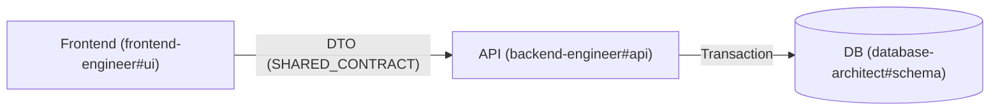

# /plan:team — 2-Stage Elastic Golden Diamond & Multi-Engine Council Planning

> **MISSION**: Maximum-assurance technical planning through a **2-Stage Adversarial Elastic Golden Diamond** (`1 Tech Lead + Parallel Discovery/Planning Shards + Parallel Specialist Critics`) plus optional **Multi-Engine Council (`boomopen conduct council --task plan --prompt "<plan-context>"`)** and **Deterministic CLI Ledger Compilation (`boomopen plan validate --sync-ledger`)**.
> **⛔ NO code writing — plan deliverables only.**

<task>$ARGUMENTS</task>

---

## ⚡ TURN-1 ZERO-TAX DISPATCH, PRIOR-ARTIFACT FAST-FORWARD & REFERENCES

1. **Zero Pre-Flight Tax**: Core orchestration laws and the 5-Field Handoff Packet are pre-loaded in your global entrypoint (`GEMINI.md` / `CLAUDE.md` / `CODEX.md`). Do **NOT** block Turn 1 reading `CORE.md`, `PHASES.md`, or `AGENTS.md` — launch Stage 1 shards **immediately on Turn 1** via `invoke_subagent(TypeName: "self", Model: "inherit")` and load `~/.{TOOL}/skills/boomopen-workflow-kit/commands/_ref/golden-triangle-protocol.md` + `rules/TEAMS.md` on-demand in parallel.
2. **⚡ PRIOR-ARTIFACT FAST-FORWARD GATE**:
   - Check if `SCOUT-{task}.md`, `RESEARCH-{task}.md`, or `BRAINSTORM-{task}.md` already exists in `<appDataDir>\brain\<conversation-id>\` (or `./reports/{topic}/`).
   - **If present and fresh**: Reuse existing discovery artifacts immediately — skip Stage 1 scouting/research and jump directly to **Stage 2 (`planner#1` + Parallel Critics)**!
3. **🎼 MULTI-ENGINE COUNCIL INTEGRATION (`engines.planner = "council"`)**:
   - When `engines.planner = "council"` in `/settings` (or when the user asks for multi-platform planning synthesis), Stage 1 launches `node ~/.{TOOL}/skills/boomopen-workflow-kit/cli/install.js conduct council --task plan --engines <engines.councilMembers> --prompt "<task>"` **in parallel** with `scouter#1..k` and `researcher#1..k` so `PLAN-{task}.md` synthesizes `Claude` + `Codex` + `Antigravity` architectural perspectives.

---

## 📁 DELIVERABLE ROUTING & ANTIGRAVITY 2.0 `ArtifactMetadata` RULES

> **Cohesive Single-File `PLAN-{task}.md` Rule (`<= 500` lines)**: Keep `<appDataDir>\brain\<conversation-id>\PLAN-{task}.md` as **1 single, self-contained file up to 500 lines** (NEVER split `PLAN-{task}.md` into a `{name}/` folder at 150 lines!). Embed ADRs, Council Synthesis, and the QA Traceability Verdict directly inside `PLAN-{task}.md`.

| Stage / Artifact | Path (`<appDataDir>\brain\<conversation-id>\`) | `ArtifactMetadata` Setting |
|------------------|------------------------------------------------|----------------------------|
| **Stage 1 Discovery** | `SCOUT-{task}.md` + `RESEARCH-{task}.md` (+ `COUNCIL-PLAN-{task}.md` if council enabled) | `UserFacing: false, RequestFeedback: false` *(Internal discovery context — no premature "Proceed" button)* |
| **Stage 2 Master Plan** | **`PLAN-{task}.md`** *(Single cohesive file `<= 500` lines with embedded ADRs + QA Traceability Stamp)* | **`UserFacing: true, RequestFeedback: true`** *(Renders native 1-click **"Proceed"** button!)* |
| **Stage 2 Auto-Ledger** | `.boomopen/project-ledger.json` + `.boomopen/contracts/SHARED_CONTRACT.md` + `.boomopen/ROADMAP-PROGRESS.md` | Generated automatically via `boomopen plan validate <plan-path> --sync-ledger` |
| **Inter-Agent Log** | `MAILBOX-{date}.md` | `UserFacing: false, RequestFeedback: false` |

---

## ⛔ ABSOLUTE PROHIBITION — NO CODE

- ❌ **NEVER** write implementation code (TypeScript, Python, Rust, etc.) or modify application source files.
- ❌ **NEVER** auto-transition to `/code`, `/cook`, or `/fix` without explicit user approval.

---

## 💎 STAGE 1 (TURNS 1–2): PARALLEL DISCOVERY, CODEBASE SCOUT & ARCHITECTURE DIAMOND

> **Why Fused**: Combines Codebase Scouting, Business Requirement Extraction, and Technical/ADR Research into **ONE parallel Turn-1 wave** so `researcher` and `business-analyst` ground their analysis in real codebase facts instead of sequential guesswork.

| Governance Pillar | Agent Shard(s) (`TypeName: "self"`, `Model: "inherit"`) | Stage 1 Mission |
|-------------------|---------------------------------------------------------|-----------------|
| **Lead Pillar (`[1]`)** | `tech-lead#1` | Decompose scope into codebase modules, requirement vectors, and architecture questions; post `TASK_BRIEF` to `MAILBOX-{date}.md`. |
| **Executor Pillar (`[2..6 Parallel Shards]`)** | • `scouter#1..k` (`≤ 3–4` modules/shard)<br>• `researcher#1..k` (`1` deep vector/shard)<br>• `business-analyst#req`<br>• *(Optional)* `boomopen conduct council --task plan --prompt "<plan-context>"` | • **`scouter#1..k`**: Map codebase architecture, `./documents/`, exact file paths (`OWNED_FILES`, `READ_ONLY_FILES`, `Test Files`), and **Blast-Radius Caller Scan**.<br>• **`researcher#1..k`**: Evaluate patterns, `1,462` skills, benchmarks, security/perf trade-offs, and draft ADR options.<br>• **`business-analyst#req`**: Extract explicit + implicit CRUD entities, user stories, `AC1..N`, and `≥ 5` edge cases. |
| **Critic Pillar (`[1..2 Parallel Critics]`)** | • `brainstormer#critic` (Blind-Spot Hunter)<br>• `reviewer#feasibility` (Anti-Overengineering) | Challenge every shard submission: hunt missed requirements, unstated assumptions, over-engineering, or unverified codebase claims (max 2 warm `send_message` rounds). |

**Stage 1 Deliverables**: `SCOUT-{task}.md` + `RESEARCH-{task}.md` (+ `COUNCIL-PLAN-{task}.md` if council ran), all with `RequestFeedback: false`.
**Stage 1 Consensus**: `✅ CONSENSUS (Stage 1): tech-lead#1 ✓ | scouter+researcher+ba ✓ | brainstormer+reviewer ✓`

---

## 💎 STAGE 2 (TURNS 3–4): COHESIVE 6-BLOCK `PLAN-{task}.md` BLUEPRINT, CLI VALIDATION & MULTI-SPECIALIST AUDIT DIAMOND

> **Zero Self-Handoff Ceremony**: `planner#1` directly authors the single cohesive `PLAN-{task}.md` (`<= 500` lines, `RequestFeedback: true`), runs `boomopen plan validate --sync-ledger`, and submits to **3 Parallel Specialist Critics** (`tech-lead#arch`, `security-engineer#sec`, `business-analyst#ac`). Any fixes are applied in-place via warm `send_message`.

| Governance Pillar | Agent Shard(s) (`TypeName: "self"`, `Model: "inherit"`) | Stage 2 Mission |
|-------------------|---------------------------------------------------------|-----------------|
| **Executor Pillar (`[1]`)** | `planner#1` | Read Stage 1 artifacts → author the single cohesive **6-Block `PLAN-{task}.md`** (`ArtifactMetadata: { Summary, UserFacing: true, RequestFeedback: true }`) → run `boomopen plan validate <plan-path> --sync-ledger`. |
| **Parallel Critic Pillar (`[3 Critics]`)** | • `tech-lead#arch` (Architecture & Shard Critic)<br>• `security-engineer#sec` (DevSecOps & Threat Critic)<br>• `business-analyst#ac` (Requirement Traceability Critic) | • **`tech-lead#arch`**: Verify compilable `SHARED_CONTRACT`, disjoint `OWNED_FILES` (`≤ 3–4` files/shard), and valid Wave DAG.<br>• **`security-engineer#sec`**: Challenge auth, input validation, injection/IDOR vectors, secrets, and blast-radius rollback safety.<br>• **`business-analyst#ac`**: Verify 100% traceability (`Every REQ/AC → ≥1 Task → Test File + Verify cmd`). |
| **Arbitration & Stamp** | `tech-lead#1` | If any critic flags `🔴 CRITICAL` or `🟠 HIGH`, `planner#1` updates `PLAN-{task}.md` in-place via warm `send_message` and re-runs `boomopen plan validate --sync-ledger` before stamping final consensus. |

### Mandatory 6-Block Cohesive `PLAN-{task}.md` Structure (`<= 500` Lines Single File)

````markdown
# 📋 Implementation Plan: {Task Title}

> [!IMPORTANT]
> **1-Click Execution Ready**: Click the **"Proceed"** button on this artifact (or reply `"proceed"` / `"tiến hành đi"` / `"/code:team"` / `"/autopilot:run"`) to execute this diamond-validated plan.

## 1. 📌 Executive Summary & User Request (VERBATIM)
> {Exact user request verbatim}

| Metric | Value |
|--------|-------|
| **Scope & Swarm Tier** | `Tier {1\|2\|3}` — `{N} Parallel Executor Shards ({role#shard})` across `{W} Execution Waves` |
| **Total Target Files** | `{F} files` (`≤ 3–4 OWNED_FILES` per shard, `0` parallel overlap, validated by `boomopen plan validate`) |
| **Ledger Sync** | `.boomopen/project-ledger.json` + `.boomopen/contracts/SHARED_CONTRACT.md` synced |
| **Estimated Effort** | `{X}h raw × 1.5 buffer = {Y}h` |

## 2. 🏗️ Architecture Diagram, Embedded ADRs & Multi-Engine Council Synthesis



| ADR ID | Decision | Rationale & Codebase Constraint (`from SCOUT / RESEARCH`) | Rejected Alternative |
|:------:|----------|-----------------------------------------------------------|----------------------|
| `ADR-1` | `{Chosen pattern}` | `{Concrete evidence + file:line reference}` | `{Alternative & why rejected}` |

### 🏛️ Multi-Engine Council Synthesis Matrix *(Include when `engines.planner = "council"`)*
- **🟢 Unanimous Consensus**: `{Architectural invariants confirmed across Claude, Codex, and Antigravity}`
- **🟡 Unique Blind-Spot Insights**: `{Security/edge-case/concurrency insights captured by individual engines}`
- **🔴 Contradictions & Evidence Arbitration**: `{Disagreements resolved via SCOUT file:line codebase proof}`
- **🏆 Final Synthesized Conclusion**: `{Unified architectural direction locked below}`

## 3. 🤝 Shared Interface Contracts (`SHARED_CONTRACT`)
> **LOCKED CONTRACT**: Synced to `.boomopen/contracts/SHARED_CONTRACT.md`. Parallel shards MUST implement against these exact compilable definitions.

```ts
// Compilable TypeScript interfaces, DTOs, Zod schemas, and error envelopes
export interface FeatureRequestDto {
  readonly id: string;
}
export type FeatureErrorCode = 'ERR_VALIDATION' | 'ERR_UNAUTHORIZED' | 'ERR_NOT_FOUND' | 'ERR_CONFLICT';
```

## 4. 🌊 Wave-by-Wave Parallel Shard Execution Plan (`≤ 3–4 OWNED_FILES / Shard`)

## Wave 1: {Wave Name} (`Parallelizable: Yes` | `Depends On: None`)

### Task 1.1 (REQ-101): {Specific atomic action}
- **Agent**: `database-architect#schema`
- **Acceptance**: `AC1`, `AC2`
- **OWNED_FILES**: `src/db/schema.ts`, `src/db/migrations/001_init.sql`
- **READ_ONLY_FILES**: `src/db/index.ts`
- **Test Files**: `tests/db/schema.test.ts`
- **Verify**: `npm test -- tests/db/schema.test.ts && node ~/.{TOOL}/skills/boomopen-workflow-kit/cli/install.js check src/db --strict-phase --no-stubs`

### Task 1.2 (REQ-102): {Specific atomic action}
- **Agent**: `backend-engineer#api`
- **Acceptance**: `AC2`, `AC3`
- **OWNED_FILES**: `src/api/controller.ts`, `src/api/routes.ts`
- **READ_ONLY_FILES**: `src/db/schema.ts`, `tests/api/existing.test.ts`
- **Test Files**: `tests/api/controller.test.ts`
- **Verify**: `npm test -- tests/api/controller.test.ts && node ~/.{TOOL}/skills/boomopen-workflow-kit/cli/install.js check src/api --strict-phase --no-stubs`

## Wave 2: Integration & Security Verification (`Parallelizable: No` | `Depends On: Wave 1`)

### Task 2.1 (REQ-201): {End-to-end & security regression verification}
- **Agent**: `tester#e2e`
- **Acceptance**: `AC1`, `AC2`, `AC3`, `AC4`, `AC5`
- **OWNED_FILES**: `tests/e2e/feature.spec.ts`
- **READ_ONLY_FILES**: `src/api/controller.ts`, `src/db/schema.ts`
- **Test Files**: `tests/e2e/feature.spec.ts`
- **Verify**: `npm test && npm run build`

## 5. 🎯 Acceptance Criteria (`Given / When / Then`), Edge Cases (`≥ 5`) & Traceability Matrix

| ID | Req ID | Mapped Task & Shard | Given | When | Then | Verify |
|----|:------:|---------------------|-------|------|------|--------|
| AC1 | `REQ-101` | `Task 1.1 (database-architect#schema)` | {Precondition} | {Action} | {Expected outcome} | `tests/db/schema.test.ts` |
| AC2 | `REQ-102` | `Task 1.2 (backend-engineer#api)` | {Precondition} | {Action} | {Expected outcome} | `tests/api/controller.test.ts` |
| AC3 | `REQ-102` | `Task 1.2` *(Edge: Empty/Null)* | {Null/empty input} | {Submit} | {400 validation error} | `tests/api/controller.test.ts` |
| AC4 | `REQ-102` | `Task 1.2` *(Edge: Auth/RBAC)* | {Unauthenticated/wrong role} | {Request} | {401/403 rejection} | `tests/api/controller.test.ts` |
| AC5 | `REQ-201` | `Task 2.1` *(Edge: Concurrency/Rate/Timeout)* | {Concurrent duplicate request} | {Parallel POST} | {Idempotent / 409 lock} | `tests/e2e/feature.spec.ts` |

## 6. 💥 Blast-Radius Pre-Mortem, Rollback Manifest & Diamond QA Stamp
- **Modified Public Signatures & Impacted Callers (from `SCOUT`)**: `{Exact file:line callers and backward-compatibility proof}`
- **Locked Existing Regression Tests (`READ_ONLY_FILES`)**: `{Existing test suites locked against modification}`
- **Stateful / DB Migration Reversibility (Expand-Contract)**: `{Additive migration strategy + exact down-migration command}`

| Risk | Prob / Impact | Pre-Emptive Mitigation | Exact Rollback Command |
|------|:-------------:|------------------------|------------------------|
| {Specific risk} | M / H | {Contract/security lock} | `git checkout -- src/ && {down-migration cmd}` |

- **CLI Validation**: `boomopen plan validate --sync-ledger` → **PASS (`0` collisions, `≤ 4` files/shard)**
- **Diamond Consensus**: `✅ CONSENSUS (Stage 2): tech-lead#arch ✓ | planner#1 ✓ | security-engineer#sec ✓ | business-analyst#ac ✓`
````

---

## ⛔ HARD STOP — AWAIT USER DECISION

Present `<appDataDir>\brain\<conversation-id>\PLAN-{task}.md` (`RequestFeedback: true`) and **STOP**:
1. 🟢 **Click "Proceed" (or reply `"proceed"` / `"tiến hành đi"`)** → Execute immediately via `/code:team` (Elastic Golden Diamond parallel executor waves)
2. 🏛️ **Autonomous Multi-Session Runner (`/autopilot:run`)** → Execute phase-by-phase from `.boomopen/project-ledger.json` with the 4-Layer Quality Ratchet
3. 🎼 **Cross-Engine Pipeline (`/conduct:pipeline`)** → Dispatch each shard to its highest-affinity CLI engine (`Author != Critic`)
4. 🔄 **Revise Plan** → Specify waves, contracts, or requirements to adjust
