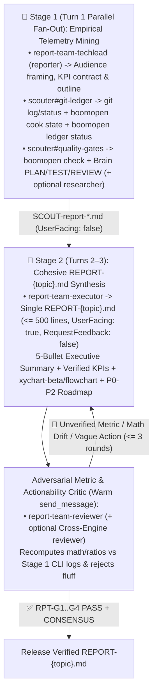

# /report:team — 2-Stage Evidence-Mined Elastic Golden Diamond (`v5.5`)

> **MISSION**: Produce stakeholder-ready executive, audit, or engineering reports through the **2-Stage Evidence-Mined Elastic Golden Diamond (`report-team`)**. Every number, ratio, trend chart, and status badge is mined from live CLI/git telemetry and independently recomputed by an adversarial critic before `✅ CONSENSUS` release.

<task>$ARGUMENTS</task>

---

## ⚡ TURN-1 ZERO-TAX DISPATCH & MANDATORY TEAM PROTOCOLS

1. **Same-Turn Protocol Load + Stage 1 Fan-Out (Topology A)**: Core orchestration laws and the **5-Field Handoff Packet** (`1. MISSION & ACCEPTANCE CRITERIA`, `2. SHARED_CONTRACT`, `3. OWNED_FILES`, `4. READ_ONLY_FILES`, `5. VERIFICATION & DELIVERABLE`) are pre-loaded in your global entrypoint (`GEMINI.md` / `CLAUDE.md` / `CODEX.md`). Do **NOT** waste Turn 1 reading reference files alone — read these two binding team specs AND launch Stage 1 shards **in the same Turn-1 parallel tool batch** via `invoke_subagent(TypeName: "self", Model: "inherit")`:
   - `~/.{TOOL}/skills/boomopen-workflow-kit/commands/_ref/golden-triangle-protocol.md` — Elastic Golden Diamond scaling, `MAILBOX-{date}.md` format, and Scoped Warm Session Reuse (`send_message`, max 3 rounds).
   - `~/.{TOOL}/skills/boomopen-workflow-kit/agents/teams/report-team/_team.md` — Canonical `report-team` 2-Stage topology and `RPT-G1..G4` release blockers.
2. **Cohesive Brain Artifact Routing (`<= 500` Lines — NEVER Folder-Split)**:
   - **Master Report**: Write **1 single cohesive Brain Artifact** `<appDataDir>\brain\<conversation-id>\REPORT-{topic}.md` (`<= 500` lines — **NEVER** split into `{name}/` folders!) with `ArtifactMetadata: { Summary: "Consensus-verified report for {topic}", UserFacing: true, RequestFeedback: false }`. Write to `./reports/{topic}/REPORT-{topic}.md` **ONLY** if explicitly requested by the user (or on non-Antigravity tools without `<appDataDir>`).
   - **Telemetry Shards & Mailbox**: Write `<appDataDir>\brain\<conversation-id>\SCOUT-report-git.md`, `SCOUT-report-quality.md` (+ optional `RESEARCH-report-{topic}.md`), and `MAILBOX-{date}.md` with `ArtifactMetadata: { Summary: "...", UserFacing: false, RequestFeedback: false }`.

---

## ⛔ ABSOLUTE PROHIBITION — ZERO APPLICATION CODE & ZERO FICTION

- ❌ **NEVER** write or modify application source, config, or test files (`READ_ONLY_FILES` lock across 100% of repository files).
- ❌ **NEVER** invent, estimate, or round-up unverified metrics — unsupported claims trigger immediate Stage 2 `report-team-reviewer` rejection.
- ❌ **NEVER** auto-transition to `/code`, `/cook`, or `/fix` after consensus — present `REPORT-{topic}.md` and **STOP**.
- ✅ Write deliverables in the **user's input language** (technical identifiers in English; escape currency dollars as `\$`).

---

## 🧭 2-STAGE ELASTIC GOLDEN DIAMOND EXECUTION FLOW



---

## 🎭 Stage 1: PARALLEL EMPIRICAL TELEMETRY & CODEBASE MINING (`Turn 1`)

Spawn all Stage 1 shards **concurrently in 1 Turn-1 batch** via `invoke_subagent(TypeName: "self", Model: "inherit")` and record `role#shard -> conversationId`:

| Shard Key (`role#shard`) | Base Persona | Deterministic Commands & Mission | Disjoint `OWNED_FILES` (`UserFacing: false`) |
|:-------------------------|:-------------|:---------------------------------|:---------------------------------------------|
| `report-team-techlead` | `reporter` | Lock target audience, reporting window, KPI definitions, and section contract | `<appDataDir>\brain\<conversation-id>\MAILBOX-{date}.md` (`TASK_BRIEF`) |
| `scouter#git-ledger` | `scouter` | Run `git status --short`, `git log --stat -n 30`, `node ~/.{TOOL}/skills/boomopen-workflow-kit/cli/install.js cook state`, and `node ~/.{TOOL}/skills/boomopen-workflow-kit/cli/install.js ledger status` *(if `.boomopen/project-ledger.json` exists)* | `<appDataDir>\brain\<conversation-id>\SCOUT-report-git.md` (`RequestFeedback: false`) |
| `scouter#quality-gates` | `scouter` | Run `node ~/.{TOOL}/skills/boomopen-workflow-kit/cli/install.js check <dir>`, audit Brain `PLAN`/`TEST`/`REVIEW`/`DEBUG` artifacts & `file:line` risks *(+ `researcher#bench` if external benchmarks requested)* | `<appDataDir>\brain\<conversation-id>\SCOUT-report-quality.md` (`RequestFeedback: false`) |

---

## 🎭 Stage 2: COHESIVE `REPORT-{topic}.md` SYNTHESIS ⇄ METRIC AUDIT (`Turns 2–3`)

### Step 2A — Single-File Executive Synthesis (`report-team-executor`)
Dispatch `report-team-executor` (`TypeName: "self"`, `Model: "inherit"`) consuming `SCOUT-report-git.md` + `SCOUT-report-quality.md` + `TASK_BRIEF` to write **1 cohesive `<appDataDir>\brain\<conversation-id>\REPORT-{topic}.md` (`<= 500` lines, `UserFacing: true, RequestFeedback: false`)**:

```markdown
# 📊 Report: {Topic}
**Date**: {YYYY-MM-DD} | **Type**: {Status | Audit | Architecture | Post-Mortem} | **Audience**: {Stakeholders / Engineering}

> [!IMPORTANT]
> **Executive Summary**
> - **Overall Status**: {🟢 / 🟡 / 🔴 + 1-line verdict}
> - **Completed Milestones**: {verified phases, commits, deliverables}
> - **Critical Risks / Blockers**: {top evidence-backed blockers}
> - **Headline Metrics**: {exact CLI/git numbers}
> - **Decisions Required**: {concrete choices for leadership/user}

## 1. Scope, Methodology & Telemetry Provenance
- Exact CLI commands executed (`boomopen cook state`, `boomopen ledger status`, `boomopen check`, `git log`) and known data boundaries.

## 2. Quantitative KPIs & Visual Trends
- Verified KPI table + Mermaid `xychart-beta` or `flowchart TD/LR` (with quoted labels `id["Label (Metric)"]`).

## 3. Evidence-Backed Findings
### Finding {N}: {Title} (`Confidence: High | Medium | Low`)
- **Evidence**: `[file.ts](file:///.../file.ts#L10-L25)` + raw CLI metric | **Impact**: {quantified}

## 4. Prioritized Action Plan & Risk Matrix
| Priority | Recommendation | Target Files / Command | Effort | Expected Impact |
|----------|----------------|------------------------|--------|-----------------|
| `P0`–`P2` | {concrete action} | `{verified path / CLI}` | {S/M/L} | {measurable uplift} |
```

### Step 2B — Adversarial Metric & Actionability Audit (`report-team-reviewer` via Warm `send_message`)
Spawn `report-team-reviewer` (`TypeName: "self"`, `Model: "inherit"`; plus optional Cross-Engine critic via `node ~/.{TOOL}/skills/boomopen-workflow-kit/cli/install.js conduct dispatch --role reviewer --engine cross_family --prompt "<diff-and-contract>"` when configured) to audit `REPORT-{topic}.md` against **`RPT-G1..G4`**:
- **`RPT-G1` (Provenance & Math)**: Recompute every sum, ratio, and percentage against `SCOUT-report-*.md` (`0` unverified numbers).
- **`RPT-G2` (Executive Signal)**: 5-bullet Executive Summary stands alone with zero filler.
- **`RPT-G3` (Actionability)**: Every recommendation specifies concrete files/commands and `P0–P2` priority.
- **`RPT-G4` (Single-File Cohesion & Syntax)**: Single file `<= 500` lines, valid quoted Mermaid syntax, clickable `file:///` links, escaped `\$` currency.

Route any `🔴 CRITICAL` / `🟠 HIGH` data or formatting defect back to warm `report-team-executor` / `scouter#*` `conversationId`s via `send_message` (max `3` debate rounds logged in `MAILBOX-{date}.md`), culminating in `report-team-techlead` stamping:
`✅ CONSENSUS: report-team-techlead ✓ | scouter#git-ledger ✓ | scouter#quality-gates ✓ | report-team-executor ✓ | report-team-reviewer ✓`

---

## ⛔ HARD STOP — AWAIT USER DECISION

> **WORKFLOW COMPLETE. DO NOT PROCEED FURTHER.**
> Present `<appDataDir>\brain\<conversation-id>\REPORT-{topic}.md` and **STOP**:
> 1. ✅ **Done** — Consensus-verified report complete (`RPT-G1..G4` passed)
> 2. 📚 `/docs:core` — Sync permanent workspace documentation in `./documents/`
> 3. 🔄 **Iterate** — Refine specific sections via warm session reuse
