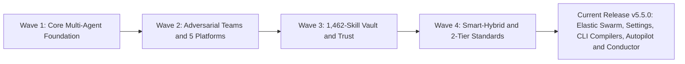

# BoomOpen Workflow Kit — Dependencies and Release Sequencing

> **Purpose**: Feature dependency graph (`BF-001`–`BF-027`), capability wave evolution through `v5.5.0`, and recommended adoption sequence
> **Parent**: [00-index.md](./00-index.md)
> **Last Updated**: 2026-11-25
> **Generated By**: `docs-business` workflow (`v5.5.0` synchronized)

---

## Feature Dependency Graph (`v5.5.0`)

```mermaid
flowchart TD
    BF001["BF-001: Global Install and Ledgers"] --> BF002["BF-002: Unified 5 Platforms"]
    BF001 --> BF003["BF-003: Smart-Hybrid Orchestrator"]
    BF001 --> BF023["BF-023: CLI List and Doctor"]
    BF001 --> BF024["BF-024: 3-Surface Settings and Web UI"]
    BF001 --> BF025["BF-025: CLI Compilers and CI Gates"]

    BF002 --> BF023
    BF002 --> BF024
    BF002 --> BF027["BF-027: Cross-Engine Conductor"]

    BF003 --> BF004["BF-004: 22 Specialist Agents"]
    BF003 --> BF005["BF-005: 36 Commands (93 Flat Files)"]
    BF003 --> BF008["BF-008: 4-Tier Elastic Swarm"]
    BF003 --> BF009["BF-009: L1-L10 and 2-Tier Standards"]
    BF003 --> BF012["BF-012: E0-E6 Self-Healing"]

    BF004 --> BF007["BF-007: HSOL v5.5 (1,462 Skills)"]
    BF004 --> BF010["BF-010: Anchoring and Warm Reuse"]
    BF004 --> BF011["BF-011: 18 Elastic Teams (72 Files)"]
    BF004 --> BF015["BF-015: Multi-Pack /docs"]
    BF004 --> BF019["BF-019: /deploy Workflows"]
    BF004 --> BF020["BF-020: /auto and /orchestrate"]
    BF004 --> BF021["BF-021: /report System"]

    BF005 --> BF006["BF-006: Multi-Tier Variants"]
    BF005 --> BF015
    BF005 --> BF017["BF-017: 17-Language NL Router"]
    BF005 --> BF020
    BF005 --> BF022["BF-022: 5-Stage Fast-Forward"]
    BF005 --> BF025

    BF006 --> BF011
    BF008 --> BF010
    BF008 --> BF011
    BF009 --> BF018["BF-018: Law L6 and 17 Locales"]
    BF009 --> BF025
    BF010 --> BF012

    BF007 --> BF013["BF-013: Dynamic Skill Discovery"]
    BF013 --> BF014["BF-014: Trust Progression"]

    BF011 --> BF016["BF-016: Debate Mailbox"]
    BF011 --> BF027

    BF025 --> BF022
    BF025 --> BF026["BF-026: /autopilot and Ledger"]
    BF025 --> BF027

    classDef must fill:#1a7f37,stroke:#1a7f37,color:#fff
    classDef should fill:#0969da,stroke:#0969da,color:#fff
    classDef could fill:#8250df,stroke:#8250df,color:#fff

    class BF001,BF002,BF003,BF004,BF005,BF006,BF007,BF008,BF009,BF010 must
    class BF011,BF012,BF013,BF014,BF015,BF016,BF017,BF018,BF024,BF025 should
    class BF019,BF020,BF021,BF022,BF023,BF026,BF027 could
```

**Legend**: Green = **Must Have (`10`)** | Blue = **Should Have (`10`)** | Purple = **Could Have (`7`)** — **All `27/27` Delivered in `v5.5.0`**.

---

## Dependency Matrix (`BF-001`–`BF-027`)

| Feature | Depends On | Depended On By |
|---------|------------|----------------|
| `BF-001` | Node.js `>=18.0.0` (root) | `BF-002`, `BF-003`, `BF-023`, `BF-024`, `BF-025` |
| `BF-002` | `BF-001` | `BF-023`, `BF-024`, `BF-027` |
| `BF-003` | `BF-001` | `BF-004`, `BF-005`, `BF-008`, `BF-009`, `BF-012` |
| `BF-004` | `BF-003` | `BF-007`, `BF-010`, `BF-011`, `BF-015`, `BF-019`, `BF-020`, `BF-021` |
| `BF-005` | `BF-003`, `BF-004` | `BF-006`, `BF-015`, `BF-017`, `BF-020`, `BF-022`, `BF-025` |
| `BF-006` | `BF-005` | `BF-011` |
| `BF-007` | `BF-004` | `BF-013` |
| `BF-008` | `BF-003`, `BF-004` | `BF-010`, `BF-011` |
| `BF-009` | `BF-003` | `BF-018`, `BF-025` |
| `BF-010` | `BF-004`, `BF-008` | `BF-012` |
| `BF-011` | `BF-004`, `BF-006`, `BF-008` | `BF-016`, `BF-027` |
| `BF-012` | `BF-003`, `BF-010` | (leaf resilience layer) |
| `BF-013` | `BF-007` | `BF-014` |
| `BF-014` | `BF-013` | (leaf ecosystem gate) |
| `BF-015` | `BF-004`, `BF-005` | (leaf documentation suite) |
| `BF-016` | `BF-011` | (leaf audit mailbox) |
| `BF-017` | `BF-005` | (leaf 17-language router) |
| `BF-018` | `BF-009` | (leaf localization law) |
| `BF-019` | `BF-004`, `BF-005` | (leaf deployment workflow) |
| `BF-020` | `BF-004`, `BF-005`, `BF-008` | (leaf autonomous router) |
| `BF-021` | `BF-004`, `BF-005` | (leaf reporting workflow) |
| `BF-022` | `BF-005`, `BF-025` | (leaf fast-forward compiler) |
| `BF-023` | `BF-001`, `BF-002` | (leaf CLI diagnostics) |
| `BF-024` | `BF-001`, `BF-002` | (leaf 3-surface settings control) |
| `BF-025` | `BF-001`, `BF-005`, `BF-009` | `BF-022`, `BF-026`, `BF-027` |
| `BF-026` | `BF-005`, `BF-025` | (leaf multi-session ledger) |
| `BF-027` | `BF-002`, `BF-011`, `BF-025` | (leaf cross-engine council) |

### Critical Dependency Chains

1. **Knowledge & Ecosystem Chain (`6` hops)**: `BF-001 -> BF-003 -> BF-004 -> BF-007 -> BF-013 -> BF-014`
2. **Adversarial & Cross-Engine Chain (`6` hops)**: `BF-001 -> BF-003 -> BF-005 -> BF-006 -> BF-011 -> BF-027`
3. **Deterministic Compiler & Autopilot Chain (`5` hops)**: `BF-001 -> BF-003 -> BF-005 -> BF-025 -> BF-026`

---

## Capability Evolution Waves Through `v5.5.0`

### Wave 1 — Core Multi-Agent Foundation
- Established global CLI installation (`BF-001`), multi-platform adaptation (`BF-002`), Orchestrator delegation (`BF-003`), domain specialist personas (`BF-004`, expanded to `22` specialist agents in `v5.5.0`), structured slash commands and `:fast`/`:hard` variants (`BF-005`, `BF-006`), domain matrix skill injection (`BF-007`), TIER 1/TIER 2 execution (`BF-008`), `10` Orchestration Laws (`BF-009`), cognitive anchoring (`BF-010`), error classification (`BF-012`), `/docs` generation (`BF-015`), natural-language intent detection (`BF-017`), and `Law L6` language compliance (`BF-018`).

### Wave 2 — Adversarial Teams, Reporting & Deployment
- Expanded platform coverage to all `5` AI platforms with OpenAI Codex (`BF-002`), introduced `:team` adversarial collaboration (`BF-006`, `BF-011`) and the append-only debate mailbox (`BF-016`), and added `/deploy` (`BF-019`), `/auto` (`BF-020`), `/report` (`BF-021`), and approved-plan short-circuiting (`BF-022`).

### Wave 3 — `1,462`-Skill Vault Scale & Dynamic Trust
- Scaled the domain skill ecosystem across `19` domains (`22` Core Skills + `1,440` Library Skills = `1,462` indexed skills in `BF-007`) and introduced dynamic skill registration (`BF-013`) plus the 4-stage `NEW -> EVALUATING -> VALIDATED -> PROMOTED` trust lifecycle (`BF-014`).

### Wave 4 — Smart-Hybrid Architecture & Pragmatic 2-Tier Standards
- Introduced the Smart-Hybrid 2-Mode Complexity Threshold Gate (`Mode A` vs. `Mode B` in `BF-003`), Quality-First `Model: "inherit"` policy (`BF-004`), Brain Artifact routing, Direct Plan-to-Executor Dispatch, Contract-First `SHARED_CONTRACT` + `OWNED_FILES` locks, Scoped Warm Session Reuse (`BF-010`), `matrix-skills/compact-index.json` (`O(1)` lookup in `BF-007`), `boomopen list` & `boomopen doctor` (`BF-023`), and Pragmatic 2-Tier Coding Standards (`Soft 400` / `Hard 500` in `BF-009`).

### Current Release — `v5.5.0` (`2026-11-25`) — Multi-Platform Unified & Smart-Hybrid Edition
- **100% Feature Completion (`27/27` Delivered)**:
  - Unified `platforms/{antigravity,claude,codex,copilot,cursor}/` bundles, deduplicated `~/.agents/skills_library/` vault (`80%` disk savings), Antigravity `--as-plugin`, and SHA-256 install ownership ledgers (`BF-001`, `BF-002`).
  - `100%` flat command layout (`93` files across `36` base slash commands including `/audit`, `/pr`, `/onboard`, `/release` in `BF-005`), `22` specialist agents including `spec-reconciler` (`BF-004`), and `18/18` Elastic Golden Diamond specialist teams (`72` team files including `brainstorm-team` in `BF-011`).
  - `4`-Tier Dynamic Elastic Swarm sharding (`role#shard`, `<= 3–4` `OWNED_FILES`/shard in `BF-008`) and `E0–E6` self-healing + warm auto-revive (`BF-012`).
  - `17`-language natural-language intent router (`BF-017`) and `17` localized README editions (`BF-018`) + bilingual (`EN`/`VI`) showcase at `https://boomopen.com`.
  - `3`-Surface `/settings` with `5` core presets (`frontier-guardrails` `< 2.5 KB` Slim Guardrails default + `carbon-guardrails` alias) + CSP-hardened Local Web UI (`http://127.0.0.1:4567`, `< 10ms` AOT hot-sync in `BF-024`).
  - Deterministic `< 50ms` CLI compilers (`research`, `design`, `plan`, `cook`, `reconcile`, `audit`, `check`, `doctor` across `14` CLI subcommands), `34` `node:test` suites, Security Engine v6, and Cross-OS GitHub Actions CI (`BF-025`, `BF-022`, `BF-023`).
  - Multi-Session Autonomous Project Autopilot (`/autopilot` & `boomopen ledger` with Git checkpoint `rollback` in `BF-026`) and Cross-Engine Autonomous Conductor & 6-Task Multi-Engine Council (`/conduct` & `boomopen conduct` in `BF-027`).

---

## Recommended Rollout Order for Adopting Teams

### Phase 1 — Day 1: Global Install, Diagnostics & Preset Selection
- **Activate**: `BF-001`, `BF-002`, `BF-023`, `BF-024`, `BF-003`, `BF-004`, `BF-009`, `BF-010`
- **Action**: Clone `Kennyboom/BoomOpen-Workflow-Kit-Pro`, run `node cli/install.js install --all`, verify with `node cli/install.js list` and `node cli/install.js doctor`, and select a team preset (`frontier-guardrails` default or `smart-hybrid`) via `/settings` or `--ui`.

### Phase 2 — Days 1–3: Core Flat Commands, 17-Language Routing & Fast-Forward Execution
- **Activate**: `BF-005`, `BF-006`, `BF-008`, `BF-012`, `BF-017`, `BF-018`, `BF-022`, `BF-025`
- **Action**: Use natural language (in any of the `17` languages) or `/plan`, `/design`, `/cook`, `/code`, `/fix`, and `/test` with deterministic `boomopen plan|design|cook|check` gates.

### Phase 3 — Week 1: `1,462`-Skill Vault, Documentation Suites & Reporting
- **Activate**: `BF-007`, `BF-013`, `BF-014`, `BF-015`, `BF-019`, `BF-021`
- **Action**: Leverage `HSOL v5.5` 2-step `compact-index.json` skill resolution, generate repository docs via `/docs:core` and `/docs:business`, and standardize `/report` and `/deploy:check`.

### Phase 4 — Week 2+: Elastic Golden Diamond Teams, Multi-Session Autopilot & Multi-Engine Councils
- **Activate**: `BF-011`, `BF-016`, `BF-020`, `BF-026`, `BF-027`
- **Action**: Run `:team` on high-risk modules, govern multi-phase specs with `/autopilot` (`.boomopen/project-ledger.json`), and convene Cross-Engine `/conduct:council` syntheses across Claude, Codex, and Antigravity.

---

## Evidence Sources

| Source | Path |
|--------|------|
| CHANGELOG (`v5.5.0`) | [../../../CHANGELOG.md](../../../CHANGELOG.md) |
| Product Requirements Document — index | [../business-prd/00-index.md](../business-prd/00-index.md) |
| PRD — problem, goals, and scope | [../business-prd/02-problem-goals-and-scope.md](../business-prd/02-problem-goals-and-scope.md) |
| Knowledge overview — features | [../../knowledge-overview/03-features.md](../../knowledge-overview/03-features.md) |
| CORE rules | [../../../rules/CORE.md](../../../rules/CORE.md) |
| SKILLS rules | [../../../rules/SKILLS.md](../../../rules/SKILLS.md) |
| TEAMS rules | [../../../rules/TEAMS.md](../../../rules/TEAMS.md) |
| CLI entry & subcommands | [../../../cli/install.js](../../../cli/install.js) |
