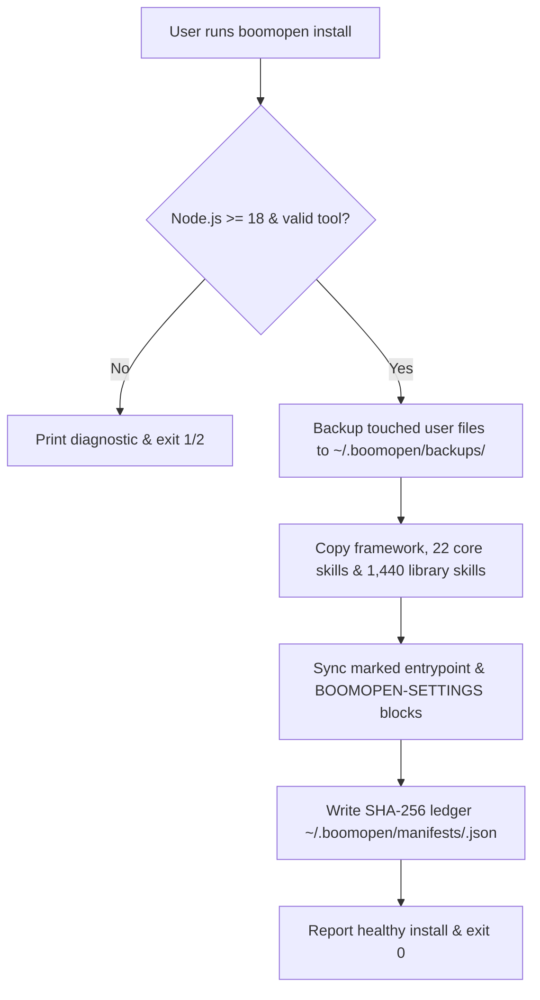
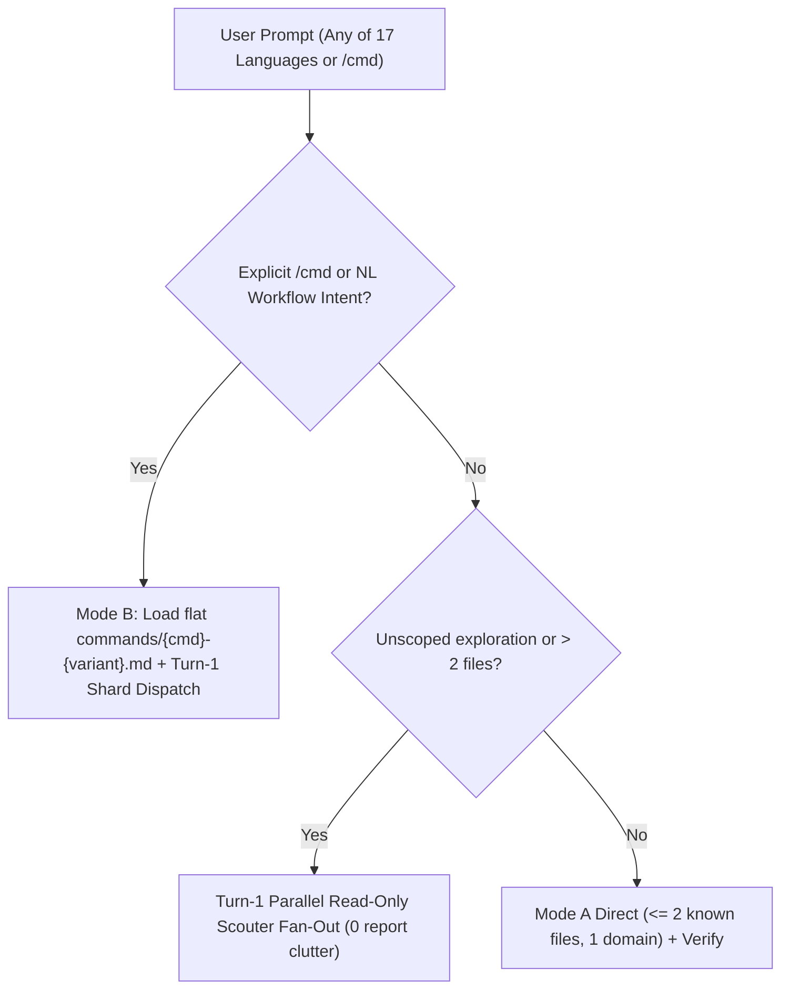
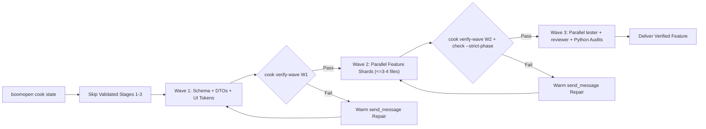
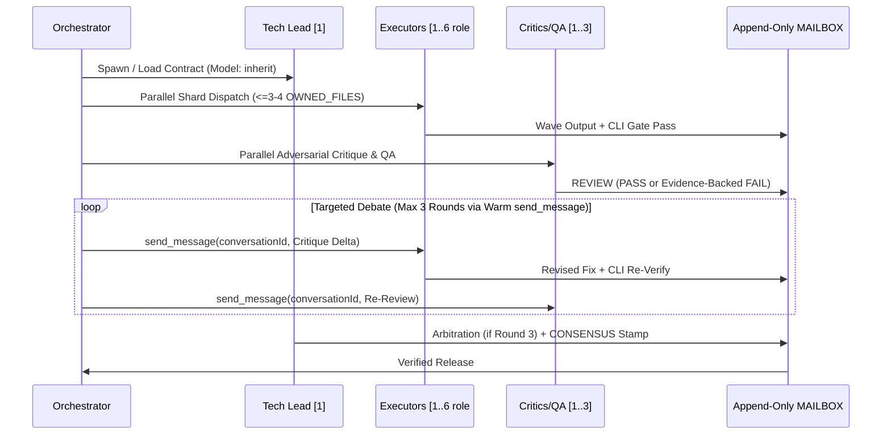

# BoomOpen Workflow Kit — Detailed Workflows

| Field | Value |
|-------|-------|
| **Purpose** | Step-by-step operational flows, deterministic CLI gates, branching rules, and Mermaid diagrams for all `16` workflows (`BW-001` – `BW-016`) in `@boomopen/workflow-kit` `v5.5.0` |
| **Parent** | [00-index.md](./00-index.md) |
| **Last Updated** | 2026-11-10 |
| **Version** | 5.5.0 (Smart-Hybrid Edition) |

---

## BW-001 — Multi-Platform Framework Installation

1. User clones `https://github.com/Kennyboom/BoomOpen-Workflow-Kit-Pro.git` and runs `node cli/install.js install <tool|--all> [--with-hooks]`.
2. Installer verifies Node.js `>= 18.0.0` and resolves target platform layout (`cursor`, `copilot`, `antigravity`, `claude`, `codex`).
3. Existing non-kit user files slated for touch are backed up under `~/.boomopen/backups/`; legacy stale paths (e.g., old `~/.gemini/CLAUDE.md`) are cleaned safely.
4. Copies `CORE_DIRS` (`agents`, `rules`, `documents`, `commands`, `matrix-skills`, `cli`, `scripts`), `ROOT_FILES` (`README.md`, `SKILL.md`, `package.json`), `22` core skills (`skills/`), and `1,440` library skills (`skills_library/`), applying platform path replacements (`VERBATIM_DIRS = {'documents', 'skills_library'}` copied verbatim).
5. Injects or updates marked entrypoint blocks (`<!-- boomopen-workflow-kit-START/END -->` and `<!-- BOOMOPEN-SETTINGS-START/END -->`), merges `~/.codex/config.toml` + `~/.codex/agents/boomopen/*.toml` on Codex, optionally registers `validate-tool-call.mjs` in `~/.claude/settings.json` (`--with-hooks`), and writes SHA-256 ownership ledger `~/.boomopen/manifests/<tool>.json`.

---

## BW-002 — Manifest-Safe Framework Uninstallation

1. User runs `node cli/install.js uninstall <tool|--all>`.
2. CLI reads `~/.boomopen/manifests/<tool>.json` (falling back to `<frameworkPath>/install-files.json` if needed).
3. Removes only kit-owned files whose SHA-256 / ownership record matches the manifest, strips marked blocks from shared host files (`CLAUDE.md`, `GEMINI.md`, `config.toml`, `~/.claude/settings.json`), preserves all user-authored files, and prunes empty kit directories.

---

## BW-003 — Proactive Gate & 17-Language Command Routing

1. Primary session receives user input in any of the **17 supported languages** (`en`, `vi`, `zh-CN`, `zh-TW`, `ja`, `ko`, `es`, `fr`, `de`, `pt-BR`, `ru`, `hi`, `ar`, `id`, `th`, `tr`, `it`).
2. **Gate 1 — Explicit `/cmd` or 17-Language Workflow Intent?**:
   - Matches any of the `32` base slash commands (`84` flat files in `commands/*.md` + `commands/_ref/*.md`) or natural-language workflow intent (`plan`, `design`, `research`, `brainstorm`, `review`, `debug`, `fix`, `test`, `cook`, `code`, `autopilot`, `conduct`, `docs`, `report`, `deploy`, `settings`) -> **Mode B**: read mapped flat `commands/{cmd}-{variant}.md` AND launch Turn-1 `TypeName: "self", Model: "inherit"` shards in the **same tool batch** (`0` pre-flight rule-read tax).
3. **Gate 2 — Open-Ended Codebase Q&A (`> 2` files, `0` workflow intent)?**:
   - Spawns parallel read-only `scouter#1..k` sub-agents (`Model: "inherit"`) with `0` `.md` report clutter.
4. **Gate 3 — Known-Target Micro-Direct (`<= 2` Turn-1 known files, `1` domain, `0` exploration)?**:
   - Executes **Mode A Direct** under Pragmatic 2-Tier Coding Standards + Persistent Verification.

---

## BW-004 — Elastic Swarm Sharding & Warm Session Delegation

1. Compute parallel shard count via the **Cognitive Load Sharding Law**:
   `N_agents = min(maxParallelSubagents, max(ceil(Files / 3.5), Domains, Vectors))` (`maxParallelSubagents = 8` default).
2. Partition target work so each scoped `<role>#<shard>` owns **`<= 3–4` heavy `OWNED_FILES`** (or `1` disjoint vector file `*-v{k}.md`).
3. Assemble the mandatory **5-Field Handoff Packet** (`1. MISSION & ACCEPTANCE CRITERIA`, `2. SHARED_CONTRACT`, `3. OWNED_FILES`, `4. READ_ONLY_FILES`, `5. VERIFICATION & DELIVERABLE`).
4. **TIER 1 Dispatch**: Invoke `TypeName: "self", Role: "<role>#<shard>", Model: "inherit"` concurrently in one turn (`flash_lite` strictly forbidden; TIER 2 embodiment used only if sub-agent tool is unavailable).
5. Record `role#shard -> conversationId` in the **Active Sub-agent Session Registry**; wait via Reactive Async Wakeup (never poll) and route all follow-ups/fixes to the warm `conversationId` via `send_message`.

---

## BW-005 — Fast 2-Step Skill Resolution (HSOL v5.5)

1. Specialist shard evaluates task complexity: trivial tasks skip lookup; complex tasks run **Fast 2-Step Progressive Lookup**:
   - **Step 1 (`0ms`)**: Check pre-loaded `<skills>` system prompt (`22` Core Skills in `skills/`). If matched, read `skills/<id>/SKILL.md`.
   - **Step 2 (`O(1)`)**: Query `matrix-skills/compact-index.json` (`1,462` skills = `22` Core + `1,440` Library across `19` domains) via `skill-seeker` and read **only** the matched `skills_library/<id>/SKILL.md`.
2. When no local skill covers a niche `:hard`/`:team` requirement (`fitness < 0.75` under the 5-weight HSOL formula `0.35*Semantic + 0.25*Specificity + 0.20*Trust + 0.10*Freshness + 0.10*SuccessRate`), optionally discover external candidates (confirming with user when low-trust + critical) and track dynamic trust in `_dynamic.yaml` (`NEW 0.3 -> EVALUATING 0.5 -> VALIDATED 0.7 -> PROMOTED 1.0`, or `BLOCKED 0.0` if `< 85%` success / `> 30d` inactive).

---

## BW-006 — Deep Research & Grounded Brainstorming

1. Triggered by `/research` or `/brainstorm` (`auto_team` routes natural-language requests to `commands/research-team.md` or `commands/brainstorm-team.md`).
2. **Turn-1 Parallel Vector Fan-Out**: Spawns `researcher#v1..k` + `scouter#codebase` + `researcher#adversarial` (or `brainstormer#opt-1..k` + Devil's Advocate pre-mortem critic) writing disjoint `*-v{k}.md` scratch notes (`UserFacing: false`). Zero application code may be written.
3. Synthesizes **1 cohesive single file (`<= 500` lines)** (`RESEARCH-{topic}.md` or `BRAINSTORM-{topic}.md`, `RequestFeedback: true`).
4. Runs `boomopen research validate <file.md> [--mode research|brainstorm]` enforcing `RES-G1..G4` (6-Block structure, triangulated citations, contradiction audit, MCDA/recommendation); extracts downstream `HANDOFF_BRIEF` via `boomopen research brief`.

---

## BW-007 — UI/UX Design Spec & Contract Extraction

1. Triggered by `/design` (`commands/design-hard.md` / `design-team.md`). Reuses existing `SCOUT-*` / `RESEARCH-*` briefs if present.
2. Authors **1 cohesive 6-Block `DESIGN-{task}.md` (`<= 500` lines, `RequestFeedback: true`)** with optional `DESIGN-PREVIEW-{task}.html` (`zero` application source edits).
3. Validates via `boomopen design validate <design.md>` (`DESIGN-G1..G4`: perceptual OKLCH + hex color tokens, typography/elevation/motion scales, 5-State Component Matrix `default|loading|empty|error|disabled/populated`, WCAG 2.2 AA contrast & touch targets).
4. Extracts machine-consumable `DESIGN_CONTRACT` (`@theme` CSS + TypeScript component props) via `boomopen design contract <design.md>` for Wave 1 frontend execution.

---

## BW-008 — Deterministic Planning & Approved-Plan Execution

1. `/plan` (`commands/plan-hard.md` / `plan-team.md`) synthesizes Discovery + `DESIGN_CONTRACT` into **1 cohesive 6-Block `PLAN-{task}.md` (`<= 500` lines, `RequestFeedback: true`)**.
2. Runs `boomopen plan validate <plan.md> [--sync-ledger]` enforcing **`PLAN-G1..G5`**: (G1) 6-Block completeness & requirements registry, (G2) acyclic wave DAG, (G3) 100% disjoint `OWNED_FILES` (`<= 4` files/shard), (G4) explicit `SHARED_CONTRACT` & `READ_ONLY_FILES`, (G5) concrete verification commands & `<= 500` lines.
3. **Approved-Plan Fast-Forward (`/code`)**: When the user clicks **"Proceed"** or replies *"proceed"* / *"ok em làm đi"*, Orchestrator **never re-runs `/plan`** — it loads `commands/code-hard.md` or `code-team.md`, runs `boomopen cook preflight` + `boomopen cook packets "<plan.md>"`, and dispatches directly from `PLAN` to domain shards (**Direct Plan-to-Executor Dispatch**, zero middleman `tech-lead` hop).

---

## BW-009 — 5-Stage Fast-Forward & 3-Wave Cook Execution

1. **Stage Check (`boomopen cook state`)**: Inspects Brain Artifacts (`<appDataDir>/brain/<conversation-id>/` or `./reports/{topic}/`) and skips already-validated Stage 1 (Discovery), Stage 2 (`DESIGN`), and Stage 3 (`PLAN`).
2. **Stage 4 — 3-Wave Contract-First Implementation**:
   - **Wave 1 (Foundation Lock)**: Parallel `database-architect#schema` + `backend-engineer#contracts` + `frontend-engineer#tokens-primitives` -> gate with `boomopen cook verify-wave "<plan.md>" --wave 1 --git --run-verify`.
   - **Wave 2 (Parallel Feature Shards)**: Emit packets via `boomopen cook packets "<plan.md>" --wave 2` (Wave 1 contracts, UI primitives, and existing `tests/**` locked in `READ_ONLY_FILES`); fan out `backend-engineer#1..k` + `frontend-engineer#screen-1..k` + `mobile-engineer#1..k` concurrently -> gate with `boomopen cook verify-wave "<plan.md>" --wave 2 --git --run-verify` (`COOK-G1..G4` + `boomopen check --strict-phase --no-stubs`).
3. **Stage 5 — Parallel QA & Adversarial Audit (Wave 3)**: Concurrent `tester#1..k` + `reviewer#1..m` + Python audits (`ux_audit.py`, `accessibility_checker.py`, `api_validator.py`); any defect routes via warm `send_message` to the exact owning `role#shard`.

---

## BW-010 — Elastic SPIE Debugging & Surgical Fix

1. `/debug:hard` / `/debug:team` locks production files in `READ_ONLY_FILES` and fans out parallel hypothesis shards (`debugger#h1..k`, `TypeName: "self"`, `Model: "inherit"`) writing disjoint `DEBUG-{issue}-h{k}.md` traces.
2. If Round-1 hypotheses are inconclusive, escalates via `boomopen conduct dispatch --role debugger --engine cross_family` (`E6`).
3. Synthesizes **1 cohesive `DEBUG-{issue}.md` (`<= 500` lines, `RequestFeedback: true`)** satisfying **`DBG-G1..G4`**: (G1) deterministic repro, (G2) `SPIE v3.0` 5-Whys causal chain with `[file:line]` citations, (G3) falsification matrix, (G4) blast-radius map + fail-first regression test spec.
4. Clicking **"Proceed"** or invoking `/fix` fast-forwards straight into writing the failing reproduction test (`RED`), applying surgical shard fixes (`GREEN`), and passing `boomopen check --strict-phase --no-stubs`.

---

## BW-011 — Elastic Golden Diamond Team Collaboration

1. Selects the domain team from `agents/teams/*-team/` (`18` teams) and chooses Round-1 topology:
   - **Topology A (Turn-1 Parallel Fan-Out)**: Used for `/research:team`, `/brainstorm:team`, `/review:team`, Stage 1 discovery, and validated-plan `/code:team` / `/cook:team`.
   - **Topology B (Contract-Lock First)**: Used for unplanned multi-file coding where Tech Lead first writes `SHARED_CONTRACT` + disjoint `OWNED_FILES` to `MAILBOX-{date}.md`.
2. Critics/Testers inspect shard outputs and post evidence-backed `PASS` or `FAIL` entries to Append-Only `MAILBOX-{date}.md`.
3. Only shards with `CRITICAL`/`HIGH` findings enter Round 2/3 via warm `send_message(Recipient: conversationId)` (max `3` rounds, after which Tech Lead issues binding `ARBITRATION` and applies the `CONSENSUS` stamp).

---

## BW-012 — Multi-Session Autonomous Project Autopilot

1. **`/autopilot:init`**: Compiles approved `PLAN-*.md` or multi-doc specs into `.boomopen/project-ledger.json` (`boomopen ledger init|from-plan|validate`) with SHA-256 spec hashes.
2. **`/autopilot:run`**: Calls `boomopen ledger next` to load active Phase `K` (verifying zero spec-hash drift and locking prior `test_files` in `READ_ONLY_FILES`), executes 3-Wave sharded implementation, and enforces the 4-Layer Ratchet: `check --strict-phase --no-stubs`, monotonic cumulative passed tests, `boomopen ledger verify --phase <id> --passed-tests <N> --run-verify`, and `phase-K-verified` checkpoint.
3. **`/autopilot:audit`**: Runs `boomopen ledger audit` across all phases for full spec-to-test traceability.

---

## BW-013 — Cross-Engine Conductor & Multi-Engine Council

1. `boomopen conduct probe` discovers available local CLIs (`claude`, `codex`, `agy`) and queue-fallback IDEs (`cursor`, `copilot`).
2. **Pipeline Mode (`/conduct:pipeline`)**: `boomopen conduct dispatch --role <role> --author-engine <prev>` selects a distinct model family (`Author != Critic`), snapshots SHA-256 digests of `READ_ONLY_FILES` before execution, and reverts + fails on any unauthorized file mutation.
3. **Council Mode (`/conduct:council`)**: `boomopen conduct council --task <research|brainstorm|plan|design|review|debug> --engines claude,codex,antigravity` runs engines in parallel and reconciles `.boomopen/conductor/runs/<runId>-COUNCIL-SYNTHESIS.md` (Unanimous Consensus, Blind-Spot Insights, Evidence Arbitration, Final Synthesis).

---

## BW-014 — 3-Surface Settings Control Center & AOT Sync

1. User invokes `/settings` (interactive `ask_question` UI), `boomopen settings <set|preset|mode|reset>`, or `boomopen settings --ui` (`http://127.0.0.1:4567`).
2. Validates enum/integer schema (`4` presets, `20` enum keys + `softFileLines`/`hardFileLines`), persists `~/.boomopen/settings.json` (or `./.boomopen.json`), and re-injects `<!-- BOOMOPEN-SETTINGS-START/END -->` into every installed platform entrypoint in `< 10ms`.

---

## BW-015 — Sequential Repository Documentation Suite

1. `/docs` (`:core`, `:business`, `:audit`) scouts repository ground truth first (`commands/_ref/docs-recon-protocol.md`), then fans out sharded `docs-manager#s1..k` (`<= 3–6` files/shard) writing committed `./documents/` folders (`knowledge-*/` -> `business/business-*/` -> audit reports).
2. Verifies `0` broken relative links, `0` mojibake/legacy strings, and `boomopen doctor --source-only` exit `0`.

---

## BW-016 — Graduated Self-Healing & Error Recovery

1. Captures fault context (`error_code`, failed CLI gate ID, `role#shard`, `conversationId`, `OWNED_FILES`) and classifies into **`E0–E6`**:
   - **`E0` (Interrupted Shard)** -> Warm auto-revive via `send_message(Recipient: conversationId)`.
   - **`E1` (Transient Tool/Timeout)** -> Retry up to `3x` with cross-platform shell fallback.
   - **`E1b` (Artifact `> 500` Lines)** -> Compress to 1 cohesive file (`<= 500` lines) or sync epic into `.boomopen/project-ledger.json`.
   - **`E2` (Build / Type / Test / `check` Error)** -> Send `File:Line` log to warm `role#shard` via `send_message` until `0` errors.
   - **`E3` (Ambiguous / Conflicting Requirement)** -> Apply `autonomous_first` if safe, else prompt user via `ask_question` with `(Recommended)` first.
   - **`E4` (Cross-Shard Contract Drift)** -> Rollback affected `OWNED_FILES`, amend `SHARED_CONTRACT`, broadcast delta to warm shards via `send_message`.
   - **`E5` (CLI Gate Failure)** -> Route failed `RES`/`DESIGN`/`PLAN`/`COOK`/`ledger` gate IDs to owning warm shard and re-run validator until exit `0`.
   - **`E6` (Round-2 Debug Deadlock)** -> Escalate via `boomopen conduct dispatch --role debugger --engine cross_family`.

---

## Evidence Sources

- [../../../rules/CORE.md](../../../rules/CORE.md) · [../../../rules/PHASES.md](../../../rules/PHASES.md) · [../../../rules/AGENTS.md](../../../rules/AGENTS.md) · [../../../rules/TEAMS.md](../../../rules/TEAMS.md) · [../../../rules/SKILLS.md](../../../rules/SKILLS.md) · [../../../rules/ERRORS.md](../../../rules/ERRORS.md)
- [../../../cli/install.js](../../../cli/install.js) · [../../../cli/research.js](../../../cli/research.js) · [../../../cli/design.js](../../../cli/design.js) · [../../../cli/plan.js](../../../cli/plan.js) · [../../../cli/cook.js](../../../cli/cook.js) · [../../../cli/ledger.js](../../../cli/ledger.js) · [../../../cli/conductor.js](../../../cli/conductor.js) · [../../../cli/settings.js](../../../cli/settings.js)
- [../../../commands/cook.md](../../../commands/cook.md) · [../../../commands/debug-hard.md](../../../commands/debug-hard.md) · [../../../commands/autopilot.md](../../../commands/autopilot.md) · [../../../commands/conduct.md](../../../commands/conduct.md)
