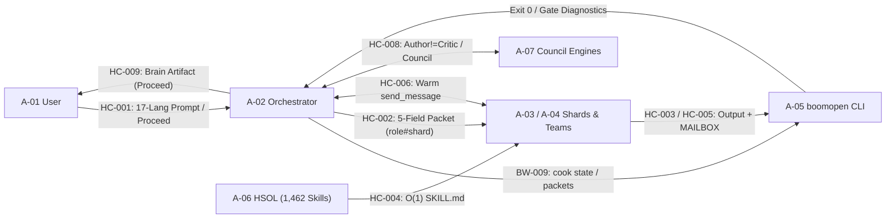

# BoomOpen Workflow Kit — SLA & Handoffs

| Field | Value |
|-------|-------|
| **Purpose** | Define deterministic CLI/AI timing targets, the canonical 5-Field Handoff Packet, Scoped Warm Session Reuse (`role#shard -> conversationId`), 3-surface artifact routing, and SLA/SLO targets for `@boomopen/workflow-kit` `v5.5.0` |
| **Parent** | [00-index.md](./00-index.md) |
| **Last Updated** | 2026-11-10 |
| **Version** | 5.5.0 (Smart-Hybrid Edition) |

---

## 1. Timing Expectations by Operation Tier

### Deterministic Local CLI & Runtime Operations (System-Controlled)

| Workflow / Command | Operation | Target Latency | Hard Ceiling / Notes |
|--------------------|-----------|:--------------:|----------------------|
| `BW-014` (`boomopen settings`) | AOT `BOOMOPEN-SETTINGS` marker sync across installed platforms | **`< 10ms`** | Pure Node `fs` marker replacement (`cli/settings-sync.js`) |
| `BW-005` (`HSOL v5.5`) | Step 1 `<skills>` + Step 2 `compact-index.json` (`1,462` skills) lookup | **`< 5ms` (`O(1)`)** | Pre-compiled JSON dictionary; zero YAML directory scan |
| `BW-006`..`BW-012` (`boomopen` gates) | `research`, `design`, `plan`, `cook state\|packets`, `ledger status\|next` | **`< 50ms`** | Deterministic single-pass Node.js parsers |
| `BW-009` (`boomopen check`) | Pragmatic 2-Tier + `--strict-phase --no-stubs` repository scan | **`< 2s`** | Zero-dependency JS/TS/Py/Go/Rs lexer (`cli/checker.js`) |
| `BW-001` / `BW-002` (`install` / `uninstall`) | Single-platform install or manifest-safe uninstall (`--all` across `5` tools) | **`< 15s`** (`< 45s` `--all`) | Includes `1,440`-skill vault copy + SHA-256 manifest write |
| `BW-004` (`send_message` warm reuse) | Follow-up fix, wave continuation, or `:team` Round 2/3 critique | **`0s` cold-start** | Reuses live `role#shard -> conversationId` with `100%` context retained |

### AI-Inference & Multi-Agent Operations (Model-Dependent SLO Ranges)

| Workflow | Operation | Expected Range | Bounded By |
|----------|-----------|:--------------:|------------|
| `BW-003` (Mode A Direct) | Known-target `<= 2`-file micro-edit + test verification | `10s – 90s` | Single-session edit + test command |
| `BW-003` / `BW-004` (Turn-1 Fan-Out) | Command routing + parallel `role#shard` Turn-1 launch | `1` model turn | Zero pre-flight rule-file read tax |
| `BW-006` / `BW-007` / `BW-008` | Parallel `/research`, `/brainstorm`, `/design`, or `/plan` + CLI validate | `1 – 6 min` | Parallel vector count (`1..6`) + synthesis |
| `BW-009` (`/cook` 3-Wave Feature) | Wave 1 Contracts -> Wave 2 Parallel Shards -> Wave 3 Parallel QA | `3 – 20 min` | `<= 3–4` files/shard executed concurrently per wave |
| `BW-011` (`:team` Golden Diamond) | 3-Pillar execution + targeted warm `send_message` debate (`<= 3` rounds) | `3 – 25 min` | Only failing shards enter Round 2/3 |
| `BW-013` (`/conduct:council`) | Parallel 3-engine council (`claude`, `codex`, `antigravity`) + synthesis | `2 – 10 min` | Concurrent subprocess execution (`cli/conductor.js`) |

---

## 2. Canonical 5-Field Handoff Packet & Warm Session Registry

Every Mode B `invoke_subagent` call and `boomopen cook packets "<plan.md>" --wave <W>` dispatch **must** carry the pre-embedded **5-Field Handoff Packet**:

```yaml
1. MISSION & ACCEPTANCE CRITERIA:
   - Scoped shard key (e.g., backend-engineer#contracts), task IDs, and Given/When/Then criteria.
2. SHARED_CONTRACT:
   - Locked SQL DDL, OpenAPI/Zod DTOs, RFC 9457 error envelopes, and DESIGN_CONTRACT (@theme CSS + TS props).
3. OWNED_FILES (Write Lock — <= 3-4 heavy files or 1 *-v{k}.md scratch note per shard):
   - Exact disjoint list of files this shard is permitted to create or modify.
4. READ_ONLY_FILES (Immutable Lock):
   - Wave 1 contracts, globals.css, shared UI primitives, sibling shards' files, and existing regression tests/**.
5. VERIFICATION & DELIVERABLE:
   - Required domain scripts, unit/E2E tests, `boomopen check <dir> --strict-phase --no-stubs`, and target artifact path.
```

### Scoped Warm Session Reuse (`role#shard -> conversationId`)
- **Registry Rule**: Immediately upon spawning `invoke_subagent(TypeName: "self", Role: "<role>#<shard>", Model: "inherit")`, the Orchestrator records `role#shard -> conversationId`.
- **Warm Messaging Rule**: Review fixes (`E2`), CLI gate auto-repairs (`E5`), `:team` debate rounds (`BW-011`), and interrupted shard recovery (`E0`) **must** call `send_message(Recipient: conversationId, Message: ...)` rather than cold re-spawning a new sub-agent.

---

## 3. Inter-Actor Handoff Contracts (`HC-001` – `HC-009`)

| ID | From -> To | Trigger | Required Payload | Acceptance / Gate Verification |
|----|------------|---------|------------------|--------------------------------|
| **`HC-001`** | User -> Orchestrator | Prompt (any of `17` languages), `/cmd`, or 1-click `"Proceed"` | Natural-language intent, `/cmd:variant`, or approved `PLAN`/`DESIGN`/`DEBUG` artifact | Classified via `BW-003`; `"Proceed"` skips straight to `/code` or `/fix` (`0` re-planning) |
| **`HC-002`** | Orchestrator -> `role#shard` | Turn-1 Mode B fan-out or Direct Plan-to-Executor Dispatch | **5-Field Handoff Packet** + `Model: "inherit"` (`TypeName: "self"`) | Disjoint `OWNED_FILES` (`<= 3–4` files); `role#shard -> conversationId` registered |
| **`HC-003`** | `role#shard` -> Orchestrator | Shard finishes wave or artifact | Completion report via `send_message` + artifact/code paths + test output | Verified by `boomopen research\|design\|plan validate` or `boomopen cook verify-wave` (`COOK-G1..G4`) |
| **`HC-004`** | `HSOL v5.5` -> `role#shard` | Complex domain task inside shard | Matched `SKILL.md` path(s) from `<skills>` (`22` core) or `compact-index.json` (`1,462` total) | Shard loads exact `SKILL.md` rules and runs bundled `scripts/*.py` validators |
| **`HC-005`** | Tech Lead <-> Executors <-> Critics | `:team` Round 1–3 collaboration | `SHARED_CONTRACT`, wave output, and evidence-backed `PASS`/`FAIL` in `MAILBOX-{date}.md` | Max `3` warm `send_message` rounds -> Tech Lead `ARBITRATION` + `CONSENSUS` stamp |
| **`HC-006`** | Orchestrator -> Warm `role#shard` | `E0` interrupt, `E2` build/test error, or `E5` CLI gate failure | Exact `File:Line` diagnostic or failed gate ID (`RES`/`DESIGN`/`PLAN`/`COOK`) via `send_message` | Shard repairs in-place and re-runs CLI gate until exit `0` |
| **`HC-007`** | `/plan` -> `/autopilot` Ledger | `boomopen plan validate --sync-ledger` or `ledger from-plan` | Validated `PLAN-{task}.md` phases, requirements, `test_files`, and spec paths | `.boomopen/project-ledger.json` written with SHA-256 Spec-Hash Drift Guard |
| **`HC-008`** | Orchestrator -> External Engines | `/conduct:pipeline`, `/conduct:council`, or `E6` Round-2 deadlock | Task prompt + `--author-engine` + `READ_ONLY_FILES` list via `boomopen conduct` | `Author != Critic` enforced + SHA-256 `READ_ONLY_FILES` verified + `COUNCIL-SYNTHESIS.md` written |
| **`HC-009`** | Orchestrator -> User | Executable artifact ready or blocking `E3`/`E4` conflict | Cohesive `<= 500`-line Brain Artifact (`RequestFeedback: true`) or `ask_question` options | Native 1-click **"Proceed"** button rendered (Antigravity) or explicit user choice recorded |

---

## 4. 3-Surface Deliverable & Artifact Routing Contract

| Deliverable Class | Antigravity Default (`brain_artifacts`) | Non-Antigravity / Fallback (`workspace_reports`) | Committed Repo Path (`/docs` Only) | `RequestFeedback` Metadata |
|-------------------|-----------------------------------------|--------------------------------------------------|------------------------------------|:--------------------------:|
| `PLAN-*`, `DESIGN-*`, standalone `RESEARCH-*`, `BRAINSTORM-*`, `DEBUG-*` | `<appDataDir>/brain/<conversation-id>/{TYPE}-{scope}.md` (`1` file `<= 500` lines) | `./reports/{topic}/{type_plural}/{TYPE}-{scope}.md` | Never committed unless exported | **`true`** (`UserFacing: true`) |
| Clean `TEST-*`, `REVIEW-*`, `REPORT-*`, `DESIGN-PREVIEW-*.html` | `<appDataDir>/brain/<conversation-id>/{TYPE}-{scope}.{md,html}` | `./reports/{topic}/{type_plural}/...` | Never committed | **`false`** (`UserFacing: true`) |
| Internal scratch (`SCOUT-*`, `*-v{k}.md`, `*-h{k}.md`, `MAILBOX-*`, raw `COUNCIL-*`) | `<appDataDir>/brain/<conversation-id>/...` | `./reports/{topic}/...` or `.boomopen/conductor/runs/` | Ignored in `.gitignore` | **`false`** (`UserFacing: false`) |
| Knowledge & Business Documentation (`/docs:core\|:business\|:audit`) | Summary only in chat | — | `./documents/knowledge-*/` & `./documents/business/business-*/` | N/A (workspace files) |

---

## 5. Enforced SLAs & End-to-End Handoff Topology

| SLA ID | Guarantee | Target | Enforcement Mechanism |
|--------|-----------|:------:|-----------------------|
| `SLA-001` | Zero silent workflow halts | **100%** | `rules/ERRORS.md` (`E0–E6` self-healing or explicit `ask_question`) |
| `SLA-002` | Disjoint parallel shard file locks | **100%** (`<= 3–4` files/shard) | `boomopen plan validate` (`PLAN-G3`) + `boomopen cook verify-wave` (`COOK-G1`) |
| `SLA-003` | Immutable `READ_ONLY_FILES` & regression tests | **100%** | SHA-256 pre/post verification in `cook verify-wave`, `ledger verify`, and `conduct dispatch` |
| `SLA-004` | Zero explicit `any`, hollow stubs, or skipped tests | **100%** | `boomopen check --strict-phase --no-stubs` (`cli/checker-rules.js`) + CI |
| `SLA-005` | Model quality preservation | **100%** (`Model: "inherit"`) | `flash_lite` forbidden across all `21` agents and `18` teams |
| `SLA-006` | Cohesive single-file Brain Artifacts | **`<= 500` lines** | Enforced by `PLAN-G5`, `DESIGN`, `RESEARCH` validators, and `E1b` rule |



---

## Evidence Sources

- [../../../GEMINI.md](../../../GEMINI.md) · [../../../CLAUDE.md](../../../CLAUDE.md) — Embedded 5-Field Handoff Packet, `< 10ms` settings block, Brain Artifact routing
- [../../../rules/AGENTS.md](../../../rules/AGENTS.md) · [../../../rules/PHASES.md](../../../rules/PHASES.md) · [../../../rules/TEAMS.md](../../../rules/TEAMS.md) · [../../../rules/ERRORS.md](../../../rules/ERRORS.md)
- [../../../cli/cook.js](../../../cli/cook.js) · [../../../cli/plan.js](../../../cli/plan.js) · [../../../cli/checker.js](../../../cli/checker.js) · [../../../cli/conductor.js](../../../cli/conductor.js) · [../../../cli/settings-sync.js](../../../cli/settings-sync.js)
