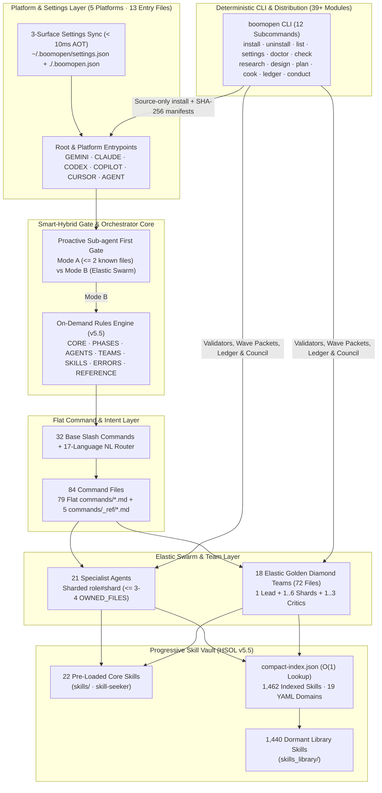

# Knowledge Architecture

> **Purpose**: Architecture summary, table of contents, and cross-references for **BoomOpen Workflow Kit v5.5.0** (`@boomopen/workflow-kit` `5.5.0` — Multi-Platform Unified & Smart-Hybrid Edition)
> **Last Updated**: 2026-11-10
> **Version**: `5.5.0`

---

## Quick Summary

**BoomOpen Workflow Kit v5.5.0** (`@boomopen/workflow-kit`) is a **Smart-Hybrid multi-agent orchestration and deterministic CLI compiler framework** for AI coding assistants. It pairs zero-latency Markdown/YAML instruction protocols—executed directly by the host AI model—with **12 deterministic `< 50ms` Node.js CLI subcommands** (`cli/install.js` + `39` modular `cli/*.js` files) that validate artifacts, compile wave handoff packets, enforce file-ownership locks, verify multi-session project ledgers, and orchestrate cross-engine model councils.

At runtime, platform entrypoints (`GEMINI.md`, `CLAUDE.md`, `CODEX.md`, `COPILOT.md`, `CURSOR.md`, `AGENT.md`) enforce a **Proactive Sub-agent First Gate**: known-target micro-edits (`<= 2` files, `1` domain, `0` exploration, no `/cmd`) run directly in **Mode A**, whereas unscoped exploration, `> 2` files, `>= 2` domains, **17-language natural-language workflow intents**, or explicit `/cmd` invocations activate **Mode B**. Mode B loads on-demand governance rules (`rules/*.md`), routes through **`84` flat command files** (`32` base slash commands: `79` `commands/*.md` + `5` `commands/_ref/*.md`), shards work across **`21` specialist agents** (`role#shard`, `<= 3–4 OWNED_FILES` per shard) and **`18` Elastic Golden Diamond teams** (`72` team files scaling from `1-1-1` up to `1 Tech Lead + 1..6 Parallel Shard Executors + 1..3 Parallel Critics`), and resolves domain expertise in `O(1)` across **`1,462` indexed skills** (`22` pre-loaded Core Skills in `skills/` + `1,440` on-demand Library Skills in `skills_library/` via `matrix-skills/compact-index.json`).

---

## Table of Contents

1. [Quick Summary](#quick-summary)
2. [Sub-Files](#sub-files)
3. [Quick Facts](#quick-facts)
4. [Cross-References](#cross-references)
5. [Architectural Boundaries and Residual Trade-offs](#architectural-boundaries-and-residual-trade-offs)
6. [Evidence Sources](#evidence-sources)

---

## Sub-Files

| # | File | Description |
|---|------|-------------|
| 1 | [01-system-overview.md](./01-system-overview.md) | Smart-Hybrid architecture style, high-level topology diagram, 6 layer boundaries, key decisions, and 10 Orchestration Laws (`v5.5.0`) |
| 2 | [02-components.md](./02-components.md) | Per-component breakdown — Orchestrator, Rules, Flat Commands (`84` files), `21` Agents, `18` Elastic Golden Diamond Teams, `1,462`-Skill Vault, `12` CLI Subcommands, `5` Platform Bundles, Tests/CI, and Web App |
| 3 | [03-data-flow.md](./03-data-flow.md) | 5-Stage Fast-Forward & 3-Wave execution lifecycle, SHA-256 manifest install flow, 2-step `O(1)` HSOL skill resolution, Elastic Golden Diamond / Conductor flows, and `E0–E6` recovery |
| 4 | [04-design-patterns.md](./04-design-patterns.md) | Catalog of `13` core architectural patterns in `v5.5.0` — Elastic Swarm Sharding, 3-Wave Contract-First Locks, Deterministic CLI Gatekeepers, Warm Session Reuse, and Cross-Engine Council |
| 5 | [05-decisions.md](./05-decisions.md) | Architecture Decision Records (`ADR-001` through `ADR-007`) with `v5.5.0` context, alternatives considered, rationale, and trade-offs |

---

## Quick Facts

| Key | Value |
|-----|-------|
| Package & Version | `@boomopen/workflow-kit` **`v5.5.0`** (Smart-Hybrid Edition) |
| Canonical Repository | `https://github.com/Kennyboom/BoomOpen-Workflow-Kit-Pro` |
| Distribution Model | Source-only Git clone + `node cli/install.js install <tool>` (or `npm link` -> `boomopen`; `npmPublish: false`) |
| Architecture Style | Smart-Hybrid Multi-Agent Orchestrator + Deterministic Node.js CLI Compilers |
| Supported Platforms | `5` (`Antigravity (Gemini)`, `Claude Code`, `OpenAI Codex`, `Cursor`, `GitHub Copilot`) |
| Audited Entry Files | `13` (`6` root entrypoints + `7` platform bundle entrypoints, each `<= 250` lines) |
| Core Rule Files | `7` (`CORE`, `PHASES`, `AGENTS`, `TEAMS`, `SKILLS`, `ERRORS`, `REFERENCE`, each `<= 300` lines, loaded on demand in Mode B) |
| Slash Command Suite | `32` base commands (`16` multi-variant families + `16` standalone) across `84` flat files (`79` `commands/*.md` + `5` `commands/_ref/*.md`, `<= 450` lines) |
| Natural-Language Routing | `17` languages (`en`, `vi`, `zh-CN`, `zh-TW`, `ja`, `ko`, `es`, `fr`, `de`, `pt-BR`, `ru`, `hi`, `ar`, `id`, `th`, `tr`, `it`) |
| Specialist Agents | `21` individual specialists in `agents/*.md` (`<= 450` lines each, `Model: "inherit"` default) |
| Specialist Teams | `18` Elastic Golden Diamond teams (`72` files = `54` role files + `18` `_team.md`, scaling `1` Lead + `1..6` Executor Shards + `1..3` Critics) |
| Skills Vault (`HSOL v5.5`) | `1,462` indexed skills (`22` Core Skills in `skills/` + `1,440` Library Skills in `skills_library/`) across `19` YAML domains + `compact-index.json` |
| Deterministic CLI | `12` `boomopen` subcommands across `cli/install.js` + `39` modular `cli/*.js` files (`Node.js >= 18.0.0`, `0` runtime npm dependencies) |
| Error & Guardrail Model | `7` self-healing error classes (`E0–E6`), `14` anti-patterns (`A1–A14`), `4` team checkpoints (`C8-TEAMS-01..04`) |
| Automated Verification | `30` active `node:test` suites (`29` `cli/*.test.js` + `web/build/kit-stats.test.mjs`), `7` Python `scripts/*.py` helpers, cross-OS GitHub Actions CI (`ci.yml`, `release.yml`) |

---

## Cross-References

| Resource | Path | Relationship |
|----------|------|-------------|
| Knowledge Overview | [../knowledge-overview/00-index.md](../knowledge-overview/00-index.md) | Project identity, tech stack, feature matrix, and getting started |
| Knowledge Source Base | [../knowledge-source-base/00-index.md](../knowledge-source-base/00-index.md) | Directory tree, entrypoints, modular `cli/` breakdown, and configuration |
| Knowledge Domain | [../knowledge-domain/00-index.md](../knowledge-domain/00-index.md) | Domain entities, schemas, CLI/settings contracts, and business rules |
| Knowledge Standards | [../knowledge-standards/00-index.md](../knowledge-standards/00-index.md) | Pragmatic 2-Tier Coding Standards, conventions, CI/Git workflow, and testing |
| Business PRD | [../business/business-prd/00-index.md](../business/business-prd/00-index.md) | Product vision, target personas, requirements, and release governance |
| HSOL Assessment | [../HSOL-ASSESSMENT.md](../HSOL-ASSESSMENT.md) | Detailed evaluation of the Hybrid Skill Orchestration Layer |
| Smart Skill Blueprint | [../SMART-SKILL-ORCHESTRATION-BLUEPRINT.md](../SMART-SKILL-ORCHESTRATION-BLUEPRINT.md) | Architectural blueprint for progressive skill orchestration |
| Core Rules | [../../rules/CORE.md](../../rules/CORE.md) | Proactive Sub-agent First Gate, 4-Tier Elastic Swarm, and Laws `L1–L10` |
| Phase Rules | [../../rules/PHASES.md](../../rules/PHASES.md) | 5-Stage Fast-Forward state machine and 3-Wave Contract-First topology |
| Agent Rules | [../../rules/AGENTS.md](../../rules/AGENTS.md) | Quality-First model policy, 5-Field Handoff Packets, and `role#shard` locks |
| Team Rules | [../../rules/TEAMS.md](../../rules/TEAMS.md) | `18` Elastic Golden Diamond teams, Topology A/B, and `C8-TEAMS-01..04` |
| Skills Rules | [../../rules/SKILLS.md](../../rules/SKILLS.md) | Fast 2-step `O(1)` lookup, CLI gate auto-repair, and HSOL fitness formula |
| Error Rules | [../../rules/ERRORS.md](../../rules/ERRORS.md) | `E0–E6` error classification, warm auto-revive, and `A1–A14` anti-patterns |
| Reference Rules | [../../rules/REFERENCE.md](../../rules/REFERENCE.md) | 17-language routing table, cross-platform tool vocabulary, and `32` commands |
| Compact Skill Index | [../../matrix-skills/compact-index.json](../../matrix-skills/compact-index.json) | Pre-compiled `O(1)` lookup dictionary for all `1,462` indexed skills |
| CLI Entrypoint | [../../cli/install.js](../../cli/install.js) | Unified `boomopen` CLI dispatcher for all `12` subcommands |

---

## Architectural Boundaries and Residual Trade-offs

> **Evolution in `v5.5.0`**: Earlier design iterations relied purely on behavioral conventions for handoffs, plan structure, and skill scanning. `v5.5.0` resolved those gaps via **5-Field Handoff Packets** (`boomopen cook packets`), **deterministic `< 50ms` CLI validators** (`research`, `design`, `plan`, `cook`, `ledger`, `check --strict-phase --no-stubs`), **pre-compiled `O(1)` skill indexing** (`compact-index.json`), and an explicit **Cross-Platform Tool Vocabulary** (`rules/REFERENCE.md`). The remaining architectural trade-offs are:

| # | Boundary / Trade-off | Impact | Mitigation in `v5.5.0` |
|---|----------------------|--------|------------------------|
| 1 | Native warm sub-agent session reuse (`send_message` by `conversationId`) depends on host IDE primitives | Low | Supported natively on Antigravity (`send_message`), Claude Code (`SendMessage`), and Codex (`send_input`); falls back cleanly to re-dispatching the 5-Field Handoff Packet on Copilot and Cursor (`rules/REFERENCE.md`) |
| 2 | Dynamic community skill trust progression (`0.3 -> 1.0`) has no background telemetry daemon | Low | All `1,462` bundled skills (`22` Core + `1,440` Library) are pre-verified by `boomopen doctor` at `trust = 1.0`; external community skills (`fitness < 0.75`) require explicit user confirmation |
| 3 | Append-only `MAILBOX-{date}.md` semantics rely on behavioral compliance during intra-wave debate | Low | Paired with hard post-wave Git diff ownership checks (`boomopen cook verify-wave --git`) and optional Claude/Antigravity `PreToolUse` destructive-command hooks (`validate-tool-call.mjs`) |
| 4 | Cross-Engine Conductor (`boomopen conduct`) requires external CLI binaries (`claude`, `codex`, `gemini`) on `PATH` for live subprocess execution | Low | `boomopen conduct probe` detects installed CLIs automatically and falls back to structured queue handoff files in `.boomopen/conductor/runs/` when an engine binary is absent |
| 5 | Marketing web app (`web/`) is an independent React 19 + Vite sub-project outside the shipped CLI runtime | Informational | Kept decoupled from runtime dependencies while synchronized with live repository counts via `web/build/kit-stats.test.mjs` in `npm test` |

---

## Evidence Sources

| Source | Path | What It Provides |
|--------|------|------------------|
| `package.json` | [../../package.json](../../package.json) | Version `5.5.0`, `"bin": { "boomopen": "./cli/install.js" }`, `30` `node:test` suites, zero runtime dependencies |
| `cli/install.js` | [../../cli/install.js](../../cli/install.js) | `12` CLI subcommands, SHA-256 `InstallLedger`, `{TOOL}` replacement, `< 10ms` AOT settings sync |
| `rules/CORE.md` | [../../rules/CORE.md](../../rules/CORE.md) | `v5.5` Proactive Sub-agent First Gate, 4-Tier Elastic Swarm, 17-language routing, Laws `L1–L10` |
| `rules/PHASES.md` | [../../rules/PHASES.md](../../rules/PHASES.md) | 5-Stage Fast-Forward state machine, 3-Wave Contract-First topology, Autopilot & Conductor gates |
| `rules/AGENTS.md` | [../../rules/AGENTS.md](../../rules/AGENTS.md) | Quality-First model policy, Cognitive Load Sharding Law, 5-Field Handoff Packets, `21` agents & `18` teams |
| `rules/TEAMS.md` | [../../rules/TEAMS.md](../../rules/TEAMS.md) | Elastic Golden Diamond pillars, Topology A vs. Topology B, warm `send_message` debate, `C8-TEAMS-01..04` |
| `rules/SKILLS.md` | [../../rules/SKILLS.md](../../rules/SKILLS.md) | Fast 2-step lookup (`<skills>` -> `compact-index.json`), `1,462` skills (`22` Core + `1,440` Library), HSOL formula |
| `rules/ERRORS.md` | [../../rules/ERRORS.md](../../rules/ERRORS.md) | `E0–E6` deterministic recovery, warm auto-revive, Cross-Engine debug escalation, `A1–A14` anti-patterns |
| `rules/REFERENCE.md` | [../../rules/REFERENCE.md](../../rules/REFERENCE.md) | Cross-platform tool mapping, `32` base slash commands (`84` files), deliverable & CLI quick reference |
| `matrix-skills/_index.yaml` | [../../matrix-skills/_index.yaml](../../matrix-skills/_index.yaml) | `19` skill domains, `21` agent profile mappings, HSOL fitness weights and thresholds |
