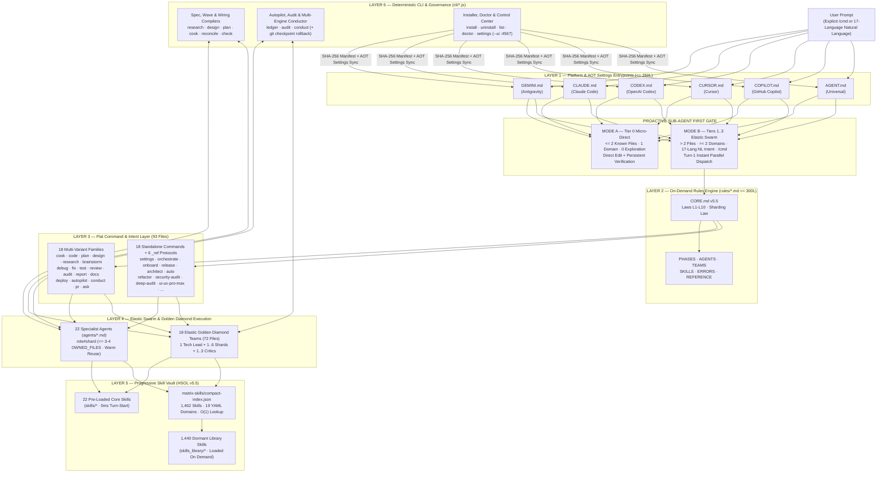

# BoomOpen Workflow Kit — System Overview

> **Purpose**: High-level architecture diagram, Smart-Hybrid execution model, layer boundaries, key design decisions, and governance laws for **BoomOpen Workflow Kit v5.5.0**
> **Parent**: [00-index.md](./00-index.md)
> **Last Updated**: 2026-11-25
> **Version**: `5.5.0`

---

## Table of Contents

1. [Architecture Style](#architecture-style)
2. [High-Level Architecture Diagram](#high-level-architecture-diagram)
3. [Layer Boundaries](#layer-boundaries)
4. [Key Design Decisions](#key-design-decisions)
5. [Governance Model (Laws L1–L10)](#governance-model-laws-l1l10)
6. [Evidence Sources](#evidence-sources)

---

## Architecture Style

**BoomOpen Workflow Kit v5.5.0** (`@boomopen/workflow-kit`) is a **Smart-Hybrid Multi-Agent Orchestrator and Deterministic CLI Compiler Framework**. Rather than running a persistent cloud backend or heavyweight agent daemon, the framework combines two complementary planes:

1. **Declarative Instruction Plane (Markdown + YAML + JSON)**: Zero-latency platform entrypoints, on-demand governance rules, `93` flat workflow commands, `22` specialist agent personas (including `spec-reconciler`), `18` Elastic Golden Diamond team topologies, and `1,462` domain skills executed natively by the host AI coding assistant at inference time.
2. **Deterministic Verification & Compiler Plane (Pure Node.js `>= 18.0.0` CLI)**: `14` `< 50ms` `boomopen` CLI subcommands (`cli/install.js` + `48` modular `cli/*.js` modules with `0` runtime npm dependencies) that validate `RESEARCH`, `BRAINSTORM`, `DESIGN`, and `PLAN` artifacts, compile 5-Field Wave Handoff Packets, reconcile Wave 2.5 spec-to-code wiring (`REC-G1..G4`), enforce disjoint `OWNED_FILES` / `READ_ONLY_FILES` locks, prevent stubbed code or skipped tests, maintain SHA-256 multi-session project and audit ledgers with Git checkpoint rollbacks, and coordinate cross-engine model councils.

### What It Is

| Characteristic | `v5.5.0` Architecture |
|---------------|-----------------------|
| **Type** | Smart-Hybrid instruction-distribution + deterministic CLI compiler framework |
| **Runtime** | Host AI model executes Markdown/YAML workflows, gated by local `< 50ms` Node.js CLI validators |
| **Distribution** | Source-only Git clone (`https://github.com/Kennyboom/BoomOpen-Workflow-Kit-Pro.git`) + `node cli/install.js install <tool>` (or `npm link` -> `boomopen`; `npmPublish: false`) |
| **Turn-1 Boot** | Pre-loaded platform entrypoint (`<= 250` lines) + AOT-synced settings block (`< 10ms`); `rules/*.md` loaded **on demand only** when Mode B triggers |
| **Execution Gate** | **Mode A** (Micro-Direct for `<= 2` known files, `1` domain, `0` exploration) vs. **Mode B** (4-Tier Dynamic Elastic Swarm for `> 2` files, `>= 2` domains, 17-language NL workflow intents, or `/cmd`) |
| **State** | Session-scoped `role#shard -> conversationId` warm registry, clean-tree Brain Artifacts (`<appDataDir>\brain\<conversation-id>\` or `./reports/{topic}/`), append-only `MAILBOX-{date}.md`, and persistent `.boomopen/project-ledger.json` (SHA-256 Spec Ratchet) |

### What It Is NOT

- Not a hosted cloud service, SaaS backend, or external telemetry collector
- Not a published npm registry package (`npmPublish: false` by design; installed strictly from source)
- Not an always-on background daemon *(note: `boomopen settings --ui` starts an on-demand localhost-only Web UI on `http://127.0.0.1:4567` strictly while the user configures settings)*
- Not a rigid single-model wrapper — supports `5` coding platforms and cross-family model arbitration via `boomopen conduct`

### Architectural Influences

| Influence | How It Manifests in `v5.5.0` |
|-----------|------------------------------|
| **Smart-Hybrid Microkernel** | Minimal `<= 250`-line entrypoint stays resident; rules, commands, and `1,440` library skills load strictly on demand |
| **Data-Parallel Sharding** | Cognitive Load Sharding Law caps every `role#shard` sub-agent at `<= 3–4` heavy `OWNED_FILES` or `1` research vector |
| **Design-by-Contract** | Wave 1 locks schemas, API DTOs, and `DESIGN_CONTRACT` into `SHARED_CONTRACT` + `READ_ONLY_FILES` before Wave 2 feature shards run |
| **Compiler Gatekeeper** | `boomopen research|design|plan|cook|check|ledger` turn Markdown specs into machine-verified DAGs, contracts, and ownership locks |
| **Actor & Adversarial Council** | Elastic Golden Diamond teams (`1` Lead + `1..6` Shards + `1..3` Critics) and Cross-Engine Councils (`Author != Critic`) debate via append-only mailboxes and warm `send_message` channels |

---

## High-Level Architecture Diagram

---

## Layer Boundaries

The `v5.5.0` architecture is structured into **5 runtime layers** plus **1 cross-cutting CLI compiler and distribution layer**.

### Layer 1: Platform & Settings Layer (Zero-Latency Entrypoints)

| Attribute | Value |
|-----------|-------|
| **Files** | Root `GEMINI.md`, `CLAUDE.md`, `CODEX.md`, `COPILOT.md`, `CURSOR.md`, `AGENT.md` + `7` platform bundle entrypoints in `platforms/{antigravity,claude,codex,copilot,cursor}/` (`13` audited entry files, each `<= 250` lines) |
| **Responsibility** | Pre-load active user/project settings (`<!-- BOOMOPEN-SETTINGS-START/END -->`), enforce Pragmatic 2-Tier Coding Standards, evaluate the Proactive Sub-agent First Gate (`Mode A` vs. `Mode B`), and map platform-native tool names |
| **Boundary** | Zero pre-flight file reads on Turn 1 for simple tasks; installs into global instruction files via non-destructive `<!-- boomopen-workflow-kit-START/END -->` markers |
| **Communicates With** | Mode A Direct execution or Layer 2/3/4 on Turn-1 Mode B dispatch |

### Layer 2: Orchestrator Core (On-Demand Rules Engine)

| Attribute | Value |
|-----------|-------|
| **Files** | `rules/CORE.md`, `rules/PHASES.md`, `rules/AGENTS.md`, `rules/TEAMS.md`, `rules/SKILLS.md`, `rules/ERRORS.md`, `rules/REFERENCE.md` (`7` files, each `<= 300` lines) |
| **Responsibility** | Define `v5.5` governance laws (`L1–L10`), 5-Stage Fast-Forward state transitions, 3-Wave Contract-First sharding, Quality-First model policy (`Model: "inherit"`), Elastic Golden Diamond debate rules, `O(1)` skill lookup, and `E0–E6` recovery |
| **Boundary** | Loaded **on demand** only when Mode B or a specific subsystem (teams, skills, error recovery) is active — eliminating Turn-1 context bloat |
| **Communicates With** | Layer 1 (entrypoint activation), Layer 3 (workflow routing), Layer 4 (shard & team protocols) |

### Layer 3: Flat Command & Multilingual Intent Layer

| Attribute | Value |
|-----------|-------|
| **Files** | `87` flat workflow files in `commands/*.md` (`commands/{cmd}.md` + `commands/{cmd}-{variant}.md`) + `6` shared protocol references in `commands/_ref/*.md` = **`93` files total** (`<= 450` lines each; zero nested command subdirectories) |
| **Responsibility** | Route `36` base slash commands (`18` multi-variant families + `18` standalone commands) and **17-language natural-language intents** (`en`, `vi`, `zh-CN`, `zh-TW`, `ja`, `ko`, `es`, `fr`, `de`, `pt-BR`, `ru`, `hi`, `ar`, `id`, `th`, `tr`, `it`) to concrete execution pipelines |
| **Boundary** | Routers (`commands/{cmd}.md`) classify intent/variant and fast-forward via `boomopen cook state`; variant workflows (`commands/{cmd}-{variant}.md`) orchestrate waves and CLI gates |
| **Communicates With** | Layer 2 (protocol rules), Layer 4 (specialist shards & teams), Layer 6 (`boomopen` CLI gates) |

### Layer 4: Elastic Swarm & Team Execution Layer

| Attribute | Value |
|-----------|-------|
| **Files** | `agents/*.md` (`22` specialist agents) + `agents/teams/*-team/` (`18` teams = `54` role files + `18` `_team.md` manifests = `72` team files), each `<= 450` lines |
| **Responsibility** | Execute sharded domain work under the **Cognitive Load Sharding Law** (`<= 3–4` heavy `OWNED_FILES` or `1` deep vector per `role#shard`), reusing warm sub-agent sessions (`role#shard -> conversationId`) via `send_message` |
| **Boundary** | Strict TIER 1 sub-agent isolation (`TypeName: "self"`, `Model: "inherit"` on Antigravity; native equivalents on Claude/Codex/Copilot/Cursor) with TIER 2 embodiment strictly as a tool-unavailable fallback |
| **Communicates With** | Layer 3 (wave dispatch), Layer 5 (`O(1)` skill injection), Layer 6 (CLI validators), sibling agents (via `SHARED_CONTRACT` & append-only `MAILBOX-{date}.md`) |

### Layer 5: Progressive Skill Vault (`HSOL v5.5`)

| Attribute | Value |
|-----------|-------|
| **Files** | `22` pre-loaded Core Skills in `skills/*/SKILL.md` (+ root `SKILL.md`), `1,440` dormant Library Skills in `skills_library/*/SKILL.md`, `19` domain matrices in `matrix-skills/*.yaml` + `_index.yaml` + `_dynamic.yaml`, and pre-compiled `matrix-skills/compact-index.json` (**`1,462` indexed skills**) |
| **Responsibility** | Inject domain patterns, architectural guardrails, and checklists into specialist shards via a **2-Step `O(1)` Progressive Lookup** (`<skills>` system prompt -> `compact-index.json` / `skill-seeker`) |
| **Boundary** | Dormant `1,440` library skills sit in `skills_library/` outside IDE startup indexing so idle token overhead is `0`; only matched `SKILL.md` files are read on demand |
| **Communicates With** | Layer 4 (specialist shards) and Layer 6 (`boomopen doctor --rebuild-index` verifies `100%` path resolution) |

### Layer 6 (Cross-Cutting): Deterministic CLI Compilers, Automation & CI/CD

| Attribute | Value |
|-----------|-------|
| **Files** | `cli/install.js` + `48` modular `cli/*.js` modules, `7` Python helpers in `scripts/*.py`, `34` `node:test` suites (`33` `cli/*.test.js` + `web/build/kit-stats.test.mjs`), `.github/workflows/{ci,release}.yml` |
| **Responsibility** | Provide `14` deterministic `boomopen` subcommands (`install`, `uninstall`, `list`, `settings`, `doctor`, `check`, `research`, `design`, `plan`, `cook`, `reconcile`, `audit`, `ledger`, `conduct`), SHA-256 install ledgers, CSP-hardened Settings Web UI (`:4567`), and cross-OS automated verification |
| **Boundary** | Pure Node.js built-ins (`>= 18.0.0`, `0` runtime npm dependencies); refuses self-destructive `install`/`uninstall` from inside an installed `~/.<tool>/skills/boomopen-workflow-kit/` copy |
| **Communicates With** | All layers at install time, configuration sync time, and runtime phase/wave gate verification |

---

## Key Design Decisions

| # | Decision | `v5.5.0` Choice | Rationale | Impact |
|---|----------|-----------------|-----------|--------|
| 1 | **Smart-Hybrid Execution** | Pair Markdown workflows with `14` `< 50ms` Node.js CLI validators/compilers | Pure Markdown is flexible for AI reasoning; deterministic CLI gates eliminate hallucinated plans, file-lock collisions, and hollow stubs | Best of both worlds: zero server infra + machine-enforced contracts (`34` `node:test` suites) |
| 2 | **Proactive Sub-agent Gate** | Mode A (`frontier-guardrails` `<= 10` files / `smart-hybrid` `<= 2` files) vs. Mode B (Elastic Swarm) | Known-target edits complete without ceremony; unscoped or multi-domain `/cmd` tasks fan out on Turn 1 without polluting parent context | Parent context window stays clean while daily edits stay fast |
| 3 | **Elastic Swarm Sharding** | Cognitive Load Sharding Law (`<= 3–4 OWNED_FILES` per `role#shard`, Tiers `0..3`) | Overloading 1 agent with `10+` files causes truncation and omissions; disjoint horizontal shards scale cleanly up to `maxParallelSubagents` (`8` default) | Zero concurrent write collisions; predictable high-density code quality |
| 4 | **Elastic Golden Diamond** | `18` specialist teams scaling `1` Lead + `1..6` Executor Shards + `1..3` Critics | Replaces rigid 3-agent bottlenecks on large full-stack tasks while preserving 3-round adversarial debate and binding Tech Lead arbitration | Scales from `1-1-1` (`<= 4` files) to parallel multi-shard waves (`> 4` files) |
| 5 | **2-Tier Skills Vault** | `22` Core Skills in `skills/` + `1,440` Library Skills in `skills_library/` + `compact-index.json` | Loading `1,462` skills into IDE startup prompts would exhaust context; `O(1)` JSON lookup loads niche skills only when needed | Zero idle token bloat with `1,462` skills instantly reachable |
| 6 | **Flat Command Topology** | `93` flat files (`87` `commands/*.md` + `6` `commands/_ref/*.md`) | Flat hyphenated files (`cook-hard.md`, `plan-team.md`) map 1:1 to slash/workflow registries across all 5 IDEs without nested-folder incompatibilities | Uniform routing across Antigravity, Claude Code, Codex, Cursor, and Copilot |
| 7 | **3-Wave + Wave 2.5 Reconcile** | Wave 1 (Contracts) -> Wave 2 (Shards) -> Wave 2.5 (`boomopen reconcile`) -> Wave 3 (Parallel QA) | Locking interfaces before coding and reconciling island shards/routes (`REC-G1..G4`) before QA eliminates integration drift | Parallel frontend/backend shards integrate cleanly on the first pass |
| 8 | **Scoped Warm Reuse** | Track `role#shard -> conversationId` and iterate via `send_message` (`E0` auto-revive) | Cold re-spawning agents for review/test fixes wastes tokens and loses file mental models | `0s` cold-start latency on Round 2/3 fixes and adversarial debates |
| 9 | **Source-Only + Zero Deps** | Git clone distribution (`npmPublish: false`) + pure Node.js built-ins | Zero supply-chain risk, instant execution on Windows/macOS/Linux, SHA-256 manifest safety (`~/.boomopen/manifests/<tool>.json`) | User custom files are backed up and preserved across upgrades/uninstalls |
| 10 | **Cross-Engine Conductor** | `boomopen conduct` (`Author != Critic` pipelines & 6-Task Multi-Engine Council) | Single model families can share blind spots on subtle bugs or architecture reviews | Cross-family verification across Claude, Codex, and Antigravity breaks deadlocks (`E6`) |

---

## Governance Model (Laws L1–L10)

`rules/CORE.md` (`v5.5`) enforces **10 Orchestration Laws** across every interaction:

| Law | Name | `v5.5.0` Enforcement Mechanism |
|-----|------|-------------------------------|
| **L1** | Zero-Latency Entry | Pre-loaded entrypoint (`<= 250` lines) evaluates Mode A vs. Mode B immediately; `rules/*.md` load on demand only in Mode B |
| **L2** | Requirement & Ledger Integrity | 100% fidelity in the Requirements Registry, 17-language NL intent routing, and SHA-256 `.boomopen/project-ledger.json` tracking |
| **L3** | 4-Tier Elastic Swarm Gate | Enforce the Cognitive Load Sharding Law ($N_{\text{agents}}$, `<= 3–4` heavy `OWNED_FILES` or `1` vector per shard; zero solo crawling `> 2` files) |
| **L4** | Quality-First Model Policy | Mandatory `Model: "inherit"` (or `"pro"`) across all `22` specialist agents; `"flash"` strictly for trivial chores; **`"flash_lite"` forbidden** |
| **L5** | 3-Wave Contract-First Execution | Lock `SHARED_CONTRACT` + disjoint `OWNED_FILES` (`boomopen research|design|plan validate`) before parallel Wave 2 feature shards |
| **L6** | Language Compliance | User responses & artifacts match user's input language (technical terms in English); code and code comments are always in English |
| **L7** | Direct Plan Dispatch & Fast-Forward | Inspect artifacts via `boomopen cook state` and dispatch directly from validated `PLAN` via `boomopen cook packets` (never re-plan after `"Proceed"`) |
| **L8** | Scoped Warm Session Reuse | Record `role#shard -> conversationId` and route all follow-ups, review fixes, and `E0` revives via `send_message` |
| **L9** | 5-Layer Phase Quality Ratchet | Gate completion on `boomopen check --strict-phase --no-stubs`, tests/build, Wave 2.5 `boomopen reconcile`, adversarial review, and `boomopen ledger verify` (+ `rollback`) |
| **L10** | Clean Git Tree & Brain Artifacts | Route transient deliverables (`PLAN`, `DESIGN`, `RESEARCH`, `BRAINSTORM`, `SCOUT`, `DEBUG`, `TEST`, `REVIEW`, `MAILBOX`) to `<appDataDir>\brain\<conversation-id>\` on Antigravity (`./reports/{topic}/` elsewhere) |

Complementing `L1–L10`, [../../rules/ERRORS.md](../../rules/ERRORS.md) codifies **`7` deterministic error recovery classes (`E0–E6`)** and **`14` forbidden anti-patterns (`A1–A14`)**.

---

## Evidence Sources

| Source | Path | What It Provides |
|--------|------|------------------|
| `rules/CORE.md` | [../../rules/CORE.md](../../rules/CORE.md) | `v5.5` Proactive Sub-agent First Gate, Cognitive Load Sharding Law, 17-language routing, Laws `L1–L10` |
| `rules/PHASES.md` | [../../rules/PHASES.md](../../rules/PHASES.md) | 5-Stage Fast-Forward state machine (`boomopen cook state`), 3-Wave Contract-First topology |
| `rules/AGENTS.md` | [../../rules/AGENTS.md](../../rules/AGENTS.md) | Quality-First model policy, Direct Plan-to-Executor Dispatch, 5-Field Handoff Packets, `22` agents & `18` teams |
| `rules/TEAMS.md` | [../../rules/TEAMS.md](../../rules/TEAMS.md) | Elastic Golden Diamond architecture, Topology A/B, `C8-TEAMS-01..04` checkpoints |
| `rules/SKILLS.md` | [../../rules/SKILLS.md](../../rules/SKILLS.md) | Fast 2-step lookup (`<skills>` -> `compact-index.json`), CLI gate warm auto-repair, HSOL scoring |
| `rules/ERRORS.md` | [../../rules/ERRORS.md](../../rules/ERRORS.md) | Error classes `E0–E6`, warm auto-revive, Round-2 cross-engine escalation, anti-patterns `A1–A14` |
| `rules/REFERENCE.md` | [../../rules/REFERENCE.md](../../rules/REFERENCE.md) | `36` base commands (`93` files), 17-language workflow table, cross-platform tool translation |
| `package.json` | [../../package.json](../../package.json) | Version `5.5.0`, `"bin": { "boomopen": "./cli/install.js" }`, `34` `node:test` suites, `Node >= 18.0.0` |
| `cli/install.js` | [../../cli/install.js](../../cli/install.js) | `14` CLI subcommands, `5` platform plans, SHA-256 `InstallLedger`, settings sync |
| `cli/doctor.js` | [../../cli/doctor.js](../../cli/doctor.js) | Source & platform health checks, Markdown budget audits, `compact-index.json` verification |
