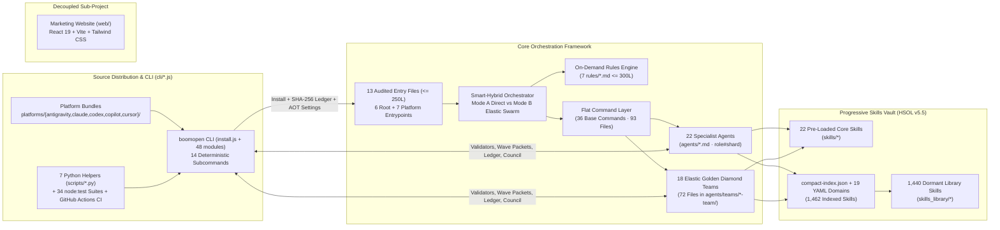

# BoomOpen Workflow Kit — Components

> **Purpose**: Per-component breakdown of every major subsystem in **BoomOpen Workflow Kit v5.5.0** — responsibility, interfaces, dependencies, and exact file locations
> **Parent**: [00-index.md](./00-index.md)
> **Last Updated**: 2026-11-25
> **Version**: `5.5.0`

---

## Table of Contents

1. [Component Map](#component-map)
2. [Smart-Hybrid Orchestrator](#smart-hybrid-orchestrator)
3. [On-Demand Rules Engine (`7` Files)](#on-demand-rules-engine-7-files)
4. [Flat Command Layer (`36` Base Commands · `93` Files)](#flat-command-layer-36-base-commands--93-files)
5. [Specialist Agents (`22` Individual Agents)](#specialist-agents-22-individual-agents)
6. [Elastic Golden Diamond Teams (`18` Teams · `72` Files)](#elastic-golden-diamond-teams-18-teams--72-files)
7. [Skills Vault & Compact Index (`1,462` Indexed Skills)](#skills-vault--compact-index-1462-indexed-skills)
8. [Deterministic `boomopen` CLI Suite (`14` Subcommands · `49` Modules)](#deterministic-boomopen-cli-suite-14-subcommands--49-modules)
9. [Platform Bundles & Root Entrypoints (`5` Platforms · `13` Entry Files)](#platform-bundles--root-entrypoints-5-platforms--13-entry-files)
10. [Python Helpers, Automated Test Suites & CI/CD](#python-helpers-automated-test-suites--cicd)
11. [Marketing Web Application (`web/`)](#marketing-web-application-web)
12. [Evidence Sources](#evidence-sources)

---

## Component Map



---

## Smart-Hybrid Orchestrator

| Attribute | Value |
|-----------|-------|
| **Name** | Smart-Hybrid Orchestrator |
| **Responsibility** | Evaluate the Turn-1 **Proactive Sub-agent First Gate**, execute `<= 2` known-file micro-edits directly in **Mode A**, or shard, delegate, verify, and synthesize across parallel specialist sub-agents in **Mode B** |
| **Key Files** | Root entrypoints (`GEMINI.md`, `CLAUDE.md`, `CODEX.md`, `COPILOT.md`, `CURSOR.md`, `AGENT.md`) and [../../rules/CORE.md](../../rules/CORE.md) (`v5.5`) |
| **Interfaces** | **Input**: Explicit `/cmd[:variant]` or natural language in any of **17 supported languages**. **Output**: Verified code changes + cohesive `<= 500`-line Brain Artifacts (`<appDataDir>\brain\<conversation-id>\` or `./reports/{topic}/`). |
| **Governance** | Cognitive Load Sharding Law ($N_{\text{agents}}$, `<= 3–4 OWNED_FILES` per shard), Pragmatic 2-Tier Coding Standards (Soft `400` / Hard `500` lines, `0` explicit `any`, `0` production `console.log`), Quality-First `Model: "inherit"`, Laws `L1–L10` |

### Execution Loop (`v5.5.0`)

```text
1. GATE (Turn 1):
   - Mode A (<= 2 already-known files, 1 domain, 0 exploration, no /cmd, no workflow intent) -> Execute & verify directly.
   - Mode B (> 2 files, >= 2 domains, unscoped exploration, 17-language NL workflow intent, or /cmd) -> Load flat commands/{cmd}-{variant}.md + Turn-1 Instant Dispatch.
2. FAST-FORWARD (`boomopen cook state`):
   - Detect existing validated SCOUT / RESEARCH / BRAINSTORM / DESIGN / PLAN artifacts and jump to the earliest incomplete stage.
3. SHARD & LOCK (`boomopen cook packets`):
   - Emit 5-Field Handoff Packets locking SHARED_CONTRACT, disjoint OWNED_FILES (<= 3-4 files/shard), and READ_ONLY_FILES.
4. VERIFY (`boomopen research|design|plan|cook|check|ledger`):
   - Run deterministic CLI gates; repair any violation via warm `send_message(Recipient: conversationId)` until exit 0.
5. DELIVER:
   - Present verified results and cohesive Brain Artifacts (with native Antigravity `RequestFeedback: true` "Proceed" button where applicable).
```

---

## On-Demand Rules Engine (`7` Files)

| Attribute | Value |
|-----------|-------|
| **Name** | Rules Engine (`v5.5`) |
| **Responsibility** | Define modular orchestration laws, wave pipelines, shard ownership locks, team topologies, `O(1)` skill lookup, error recovery, and cross-platform tool translations |
| **Key Files** | `rules/*.md` (`7` files, strictly enforced `<= 300` lines each by `boomopen doctor`) |
| **Loading Strategy** | **Zero-Latency On-Demand**: Never read on Turn 1 for Mode A tasks; loaded selectively only when Mode B or a specific subsystem triggers |

### Rule File Inventory

| File | Purpose | Load Trigger |
|------|---------|--------------|
| [../../rules/CORE.md](../../rules/CORE.md) | 4-Tier Dynamic Elastic Swarm, 17-language routing, Quality-First model policy, Laws `L1–L10`, Brain Artifact routing | Mode B orchestration laws & deliverable table needed |
| [../../rules/PHASES.md](../../rules/PHASES.md) | 5-Stage Fast-Forward state machine (`boomopen cook state`), 3-Wave Contract-First topology, Autopilot & Conductor hooks | Running multi-stage workflows or 3-Wave implementation |
| [../../rules/AGENTS.md](../../rules/AGENTS.md) | Cognitive Load Sharding Law, Direct Plan-to-Executor Dispatch, Active Session Registry (`role#shard -> conversationId`), 5-Field Handoff Packet | Delegating to `22` specialist agents or `18` teams |
| [../../rules/TEAMS.md](../../rules/TEAMS.md) | `18` Elastic Golden Diamond teams, Topology A vs. Topology B Round-1 fan-out, max 3 debate rounds, `C8-TEAMS-01..04` | `:team` variant or `/conduct` invoked |
| [../../rules/SKILLS.md](../../rules/SKILLS.md) | Fast 2-step progressive skill lookup (`<skills>` -> `compact-index.json`), CLI gate warm auto-repair, HSOL fitness formula | Complex domain skill resolution or CLI gate repair |
| [../../rules/ERRORS.md](../../rules/ERRORS.md) | `E0–E6` deterministic error classification, warm auto-revive (`send_message`), Round-2 cross-engine escalation, `A1–A14` anti-patterns | Error, sub-agent interruption, or CLI gate failure |
| [../../rules/REFERENCE.md](../../rules/REFERENCE.md) | 17-language intent matrix, cross-platform tool translation table (`5` IDEs), `36` command lookup table, CLI quick reference | Cross-platform tool mapping or fast lookup |

---

## Flat Command Layer (`36` Base Commands · `93` Files)

| Attribute | Value |
|-----------|-------|
| **Name** | Flat Command & Intent Layer |
| **Responsibility** | Map explicit `/cmd[:variant]` invocations and 17-language natural-language requests to deterministic multi-agent workflows |
| **Key Files** | `87` flat workflow files in `commands/*.md` + `6` shared protocol modules in `commands/_ref/*.md` = **`93` files** (each `<= 450` lines; zero nested command directories) |
| **Shared Protocols (`commands/_ref/`)** | `convergent-analysis-loop.md`, `docs-folder-specs.md`, `docs-recon-protocol.md`, `golden-triangle-protocol.md`, `implementation-loop.md`, `reconcile-loop.md` |

### `18` Multi-Variant Slash Command Families

| Command | Router File | Flat Variant Files (`commands/`) | Primary CLI Gate / Artifact |
|---------|------------|----------------------------------|-----------------------------|
| `/cook` | `commands/cook.md` | `cook-fast.md`, `cook-hard.md`, `cook-team.md` | `boomopen cook <state\|packets\|verify-wave\|amend-plan>` |
| `/code` | `commands/code.md` | `code-fast.md`, `code-hard.md`, `code-team.md` | Approved-`PLAN` direct execution (`boomopen cook`) |
| `/plan` | `commands/plan.md` | `plan-fast.md`, `plan-hard.md`, `plan-team.md` | `PLAN-{task}.md` (`boomopen plan validate`) |
| `/design` | `commands/design.md` | `design-fast.md`, `design-hard.md`, `design-team.md` | `DESIGN-{task}.md` (`boomopen design validate`) |
| `/research` | `commands/research.md` | `research-fast.md`, `research-hard.md`, `research-team.md` | `RESEARCH-{topic}.md` (`boomopen research validate`) |
| `/brainstorm` | `commands/brainstorm.md` | `brainstorm-fast.md`, `brainstorm-hard.md`, `brainstorm-team.md` | `BRAINSTORM-{topic}.md` (`boomopen research validate --mode brainstorm`) |
| `/debug` | `commands/debug.md` | `debug-fast.md`, `debug-hard.md`, `debug-team.md` | `DEBUG-{issue}.md` |
| `/fix` | `commands/fix.md` | `fix-fast.md`, `fix-hard.md`, `fix-team.md` | `boomopen check --strict-phase --no-stubs` + `TEST` |
| `/test` | `commands/test.md` | `test-fast.md`, `test-hard.md`, `test-team.md` | `TEST-{scope}.md` (`boomopen check --strict-phase --no-stubs`) |
| `/review` | `commands/review.md` | `review-fast.md`, `review-hard.md`, `review-team.md` | `REVIEW-{scope}.md` |
| `/audit` | `commands/audit.md` | `audit-run.md`, `audit-fix.md`, `audit-auto.md` | `.boomopen/audit-ledger.json` (`boomopen audit`) |
| `/report` | `commands/report.md` | `report-fast.md`, `report-hard.md`, `report-team.md` | `REPORT-{type}-{date}.md` |
| `/docs` | `commands/docs.md` | `docs-core.md`, `docs-business.md`, `docs-audit.md` | `./documents/knowledge-*/` & `./documents/business/` |
| `/deploy` | `commands/deploy.md` | `deploy-check.md`, `deploy-preview.md`, `deploy-production.md`, `deploy-rollback.md` | Pre-deploy verification & rollback checklists |
| `/autopilot` | `commands/autopilot.md` | `autopilot-init.md`, `autopilot-run.md`, `autopilot-audit.md` | `.boomopen/project-ledger.json` (`boomopen ledger`) |
| `/conduct` | `commands/conduct.md` | `conduct-council.md`, `conduct-pipeline.md` | `.boomopen/conductor/runs/` (`boomopen conduct`) |
| `/pr` | `commands/pr.md` | `pr-review.md` | Pre-PR quality/reconcile gate & PR review |
| `/ask` | `commands/ask.md` | `ask-fast.md`, `ask-hard.md` | Grounded architectural & codebase Q&A |

### `18` Standalone Slash Commands (`commands/*.md`)

`/settings`, `/orchestrate`, `/onboard`, `/release`, `/save`, `/recap`, `/init`, `/next`, `/status`, `/preview`, `/rollback`, `/architect`, `/auto`, `/refactor`, `/performance`, `/security-audit`, `/deep-audit`, `/ui-ux-pro-max`.

---

## Specialist Agents (`22` Individual Agents)

| Attribute | Value |
|-----------|-------|
| **Name** | Specialist Agents |
| **Responsibility** | Execute focused, single-responsibility domain work inside isolated sub-agent shards (`role#shard`, `<= 3–4 OWNED_FILES` each) |
| **Key Files** | `agents/*.md` (**`22` files**, each `<= 450` lines) |
| **Interfaces** | **Input**: 5-Field Handoff Packet (`MISSION`, `SHARED_CONTRACT`, `OWNED_FILES`, `READ_ONLY_FILES`, `VERIFICATION`). **Output**: Verified code/artifact reported back + reusable `conversationId`. |
| **Model Policy** | Mandatory `Model: "inherit"` (or `"pro"`) across all `22` specialists; `"flash_lite"` is strictly forbidden |

### `22`-Agent Inventory (`agents/*.md` & `matrix-skills/_index.yaml`)

| Agent (`agents/*.md`) | Category | Matrix Profile | Primary Responsibility |
|-----------------------|----------|----------------|------------------------|
| `tech-lead` | meta | `architecture:orchestration` | System architecture, ADRs, contract governance, `:team` arbitration |
| `planner` | meta | `planning:analysis` | 6-Block `PLAN-{task}.md` authoring, DAG wave & shard allocation |
| `backend-engineer` | execution | `backend:execution` | API contracts (Wave 1), services, auth, server logic (Wave 2) |
| `frontend-engineer` | execution | `frontend:execution` | OKLCH CSS tokens & UI primitives (Wave 1), feature screens (Wave 2) |
| `database-architect` | execution | `data:execution` | Additive schemas, indexes, RLS, reversible `UP`/`DOWN` migrations |
| `mobile-engineer` | execution | `mobile:execution` | iOS 18, Android Material 3 Expressive, React Native, Flutter |
| `game-engineer` | execution | `gaming:execution` | ECS architecture, Unity/Unreal/Godot/WebGPU, physics, 60fps loops |
| `tester` | validation | `quality:validation` | Sharded unit, integration, and E2E suites (`tester#1..k`) |
| `reviewer` | validation | `quality:review` | Adversarial code, architecture, and accessibility review |
| `spec-reconciler` | validation | `quality:reconcile` | Wave 2.5 spec-to-code & cross-shard wiring reconciliation (`REC-G1..G4`) |
| `security-engineer` | validation | `security:validation` | OWASP Top 10, STRIDE threat modeling, auth/secret auditing |
| `performance-engineer` | validation | `performance:validation` | Profiling, query tuning, bundle/Core Web Vitals optimization |
| `debugger` | validation | `quality:debugging` | Multi-hypothesis root-cause investigation (`DEBUG-{issue}.md`) |
| `researcher` | research | `research:analysis` | Multi-vector external & technical research (`RESEARCH-{topic}.md`) |
| `scouter` | research | `research:exploration` | Fast parallel read/write codebase mapping (`SCOUT-{topic}.md`) |
| `brainstormer` | research | `planning:discovery` | Grounded ideation, MCDA option scoring (`BRAINSTORM-{topic}.md`) |
| `designer` | research | `design:creative` | 6-Block `DESIGN-{task}.md` specs, OKLCH tokens, `DESIGN_CONTRACT` |
| `docs-manager` | support | `research:documentation` | Technical & business documentation suites (`./documents/`) |
| `devops-engineer` | support | `devops:execution` | CI/CD pipelines, containers, IaC, deployment readiness |
| `business-analyst` | support | `planning:business` | PRD/BRD authoring, acceptance criteria, stakeholder workflows |
| `project-manager` | support | `management:orchestration` | Multi-phase delivery tracking, risk & milestone governance |
| `reporter` | support | `reporting:synthesis` | Engineering metrics, executive status reports (`REPORT-*.md`) |

---

## Elastic Golden Diamond Teams (`18` Teams · `72` Files)

| Attribute | Value |
|-----------|-------|
| **Name** | Elastic Golden Diamond Teams |
| **Responsibility** | Execute high-stakes `:team` workflows via **3 Adversarial Governance Pillars** (`1 Tech Lead + 1..6 Parallel Shard Executors + 1..3 Parallel Critics/Testers`) |
| **Key Files** | `agents/teams/*-team/` (**`18` team directories**, each containing `_team.md`, `techlead.md`, `executor.md`, `reviewer.md` = `54` role files + `18` `_team.md` = **`72` team files**, `<= 450` lines each) |
| **Scaling Law** | Classic `1-1-1` (`3` agents) for `<= 4` files; scales elastically up to `1` Lead + `2–6` Executor Shards (`<= 3–4 OWNED_FILES` each) + `1–3` Critics when tasks span `> 4` files or multiple domains/vectors |
| **Checkpoints** | `C8-TEAMS-01` (append-only Mailbox), `C8-TEAMS-02` (max 3 debate rounds), `C8-TEAMS-03` (CLI gate + consensus stamp), `C8-TEAMS-04` (disjoint `OWNED_FILES` lock) |

### Complete `18`-Team Roster (`agents/teams/`)

| Team Directory | Primary Domain | Team Directory | Primary Domain |
|----------------|----------------|----------------|----------------|
| `backend-team/` | Sharded APIs & server services | `mobile-team/` | iOS, Android, RN & Flutter apps |
| `brainstorm-team/` | 2-stage grounded ideation & pre-mortems | `performance-team/` | Profiling, load testing & optimization |
| `database-team/` | Schema design, migrations & query tuning | `planning-team/` | 2-stage 6-Block `PLAN` & AC validation |
| `debug-team/` | Multi-hypothesis RCA & regression fix | `project-team/` | Multi-phase delivery & risk management |
| `design-team/` | 2-stage 6-Block `DESIGN` & WCAG audit | `qa-team/` | Sharded unit/integration/E2E verification |
| `devops-team/` | CI/CD, IaC & zero-downtime release | `report-team/` | Metrics synthesis & executive reporting |
| `docs-team/` | Architecture & business documentation | `research-team/` | Multi-vector deep research & fact-checking |
| `frontend-team/` | `DESIGN_CONTRACT` tokens & UI screens | `security-team/` | OWASP/STRIDE pentest & remediation |
| `fullstack-team/` | End-to-end 3-Wave Contract-First builds | `game-team/` | Real-time ECS, 3D/WebGPU & physics |

---

## Skills Vault & Compact Index (`1,462` Indexed Skills)

| Attribute | Value |
|-----------|-------|
| **Name** | Two-Tier Progressive Skills Vault (`HSOL v5.5`) |
| **Responsibility** | Provide `1,462` curated domain skills with **zero startup context bloat** via a 2-step `O(1)` lookup |
| **Tier 1 — Core Skills (`22`)** | `skills/*/SKILL.md` (`api-patterns`, `app-builder`, `behavioral-modes`, `brainstorming`, `clean-code`, `database-design`, `debugger`, `deep-research`, `design-spec`, `frontend-architecture`, `frontend-design`, `game-developer`, `intelligent-routing`, `mobile-design`, `mobile-developer`, `plan-writing`, `security-auditor`, `seo-fundamentals`, `skill-seeker`, `tdd-workflow`, `testing-patterns`, `webapp-testing`) + root `SKILL.md` |
| **Tier 2 — Library Vault (`1,440`)** | `skills_library/*/SKILL.md` installed outside IDE startup folders (`~/.{TOOL}/skills_library/`) and loaded strictly on demand via `skill-seeker` |
| **Matrix & Compact Index** | `19` domain YAML files (`ai-ml`, `architecture`, `backend`, `cloud`, `data`, `design`, `devops`, `frontend`, `gaming`, `languages`, `management`, `mcp`, `mobile`, `performance`, `planning`, `quality`, `research`, `security`, `tools`) + `_index.yaml` + `_dynamic.yaml`, compiled into [../../matrix-skills/compact-index.json](../../matrix-skills/compact-index.json) (`1,462` unique skills across `1,476` domain entries) |

---

## Deterministic `boomopen` CLI Suite (`14` Subcommands · `49` Modules)

| Attribute | Value |
|-----------|-------|
| **Name** | `boomopen` CLI Compiler & Control Suite |
| **Entrypoint** | [../../cli/install.js](../../cli/install.js) (`"bin": { "boomopen": "./cli/install.js" }`, backed by `48` modular `cli/*.js` subsystems) |
| **Runtime** | Node.js `>= 18.0.0`, `0` runtime npm dependencies (`node:fs`, `node:path`, `node:os`, `node:crypto`, `node:http`, `node:child_process`, `node:readline`) |

### All `14` `boomopen` CLI Subcommands

| Subcommand | Backing Module(s) | Deterministic Function |
|------------|-------------------|------------------------|
| `install <tool\|--all> [--with-hooks] [--as-plugin]` | `install.js`, `install-steps.js`, `tool-config.js`, `manifest.js` | Installs across `cursor`, `copilot`, `antigravity`, `claude`, `codex` with SHA-256 ledgers (`~/.boomopen/manifests/<tool>.json`), backups, and shared `~/.agents/skills_library` deduplication |
| `uninstall <tool\|--all>` | `install.js`, `manifest.js`, `install-ownership.js` | Removes unmodified kit files while restoring user backups and keeping user-edited files |
| `list` | `cli-router.js`, `manifest.js` | Displays installation health, entry files, and tracked manifest counts across all `5` tools |
| `settings [subcmd\|--ui]` (alias `config`) | `settings*.js`, `settings-slim.js`, `settings-ui*.js` | Manages `~/.boomopen/settings.json` + `./.boomopen.json` (`5` core presets `frontier-guardrails` default / `carbon-guardrails` alias, `20` enum keys + `2` line-limit keys, `< 10ms` AOT sync, CSP-hardened Web UI on `http://127.0.0.1:4567`) |
| `doctor [--platform] [--source-only] [--rebuild-index]` | `doctor*.js` | Audits source tree, `5` platform bundles, Markdown line budgets/mojibake, `compact-index.json` (`1,462` skills), settings, and Conductor CLI engines |
| `check [dir] [--strict-phase] [--no-stubs]` | `checker*.js` | Enforces Pragmatic 2-Tier Coding Standards (Soft `400` / Hard `500` lines, `0` explicit `any`, `0` prod `console.log`) + anti-stub / anti-test-gaming ratchet |
| `research <validate\|brief> <file.md>` | `research.js` | Enforces `RES-G1..G4` on `RESEARCH-*` / `BRAINSTORM-*` (`--mode brainstorm`) and compiles compact `HANDOFF_BRIEF` |
| `design <validate\|contract> <design.md>` | `design.js` | Enforces `DESIGN-G1..G4` (OKLCH tokens, 5-State UI Matrix, WCAG 2.2 AA) and extracts `@theme` CSS + TypeScript `DESIGN_CONTRACT` |
| `plan <validate\|compile> <plan.md> [--sync-ledger]` | `plan.js` | Enforces `PLAN-G1..G5` (DAG acyclicity, disjoint `OWNED_FILES <= 4`/shard, `SHARED_CONTRACT`, verify commands, `<= 500` lines) & compiles ledger |
| `cook <state\|packets\|verify-wave\|preflight\|amend-plan>` | `cook.js` | Runs 5-Stage Fast-Forward state detection, compiles 5-Field Wave Handoff Packets, enforces `COOK-G1..G4` post-wave gates, and appends Wave 2.5 delta waves |
| `reconcile [dir] [--plan <p>] [--strict]` | `reconcile.js` | Enforces Wave 2.5 spec-to-code wiring gates `REC-G1..G4` (island shards, FE/BE route parity, `[SC-*]` sub-clauses, `.env.example` parity) |
| `audit <init\|slice\|record\|approve\|verify-fix\|rollback\|status>` | `audit.js`, `audit-scanners.js`, `git-checkpoints.js` | Manages stateful multi-round `.boomopen/audit-ledger.json`, monotonic test ratchets, and confirmation-gated Git checkpoint rollbacks |
| `ledger <init\|from-plan\|validate\|status\|next\|verify\|rollback\|audit>` | `ledger.js`, `git-checkpoints.js` | Manages `.boomopen/project-ledger.json` with SHA-256 Spec-Hash Drift Guard, monotonic test ratchets, and Git checkpoint rollbacks for `/autopilot` |
| `conduct <probe\|dispatch\|council\|status>` (alias `conductor`) | `conductor.js`, `conductor-engines.js` | Orchestrates `Author != Critic` cross-engine pipelines, SHA-256 `READ_ONLY_FILES` guards, and 6-Task Multi-Engine Councils (`COUNCIL-SYNTHESIS.md`) |

---

## Platform Bundles & Root Entrypoints (`5` Platforms · `13` Entry Files)

| Platform | Bundle Directory | Installed Global Targets |
|----------|------------------|--------------------------|
| **Antigravity (Gemini)** | `platforms/antigravity/` (`GEMINI.md`, `AntigravityGlobal.agent.md`, `plugin.json`, `hooks/*.mjs`, `workflows/*.py`) | `~/.gemini/GEMINI.md`, `~/.gemini/agents/`, `~/.antigravity/agents/`, `~/.gemini/config/global_workflows/`, `~/.antigravity/workflows/`, optional `~/.gemini/config/plugins/boomopen-workflow-kit/`, `~/.gemini/config/skills/boomopen-workflow-kit/`, `~/.gemini/config/skills_library/` |
| **Claude Code** | `platforms/claude/` (`CLAUDE.md`) | `~/.claude/CLAUDE.md`, `~/.claude/AGENT.md`, `~/.claude/commands/` (+ colon aliases), `~/.claude/agents/`, `~/.claude/skills/boomopen-workflow-kit/`, `~/.claude/skills_library/`, optional `PreToolUse` + `Stop` hooks in `~/.claude/settings.json` (`--with-hooks`) |
| **OpenAI Codex** | `platforms/codex/` (`CODEX.md`, `config.toml`) | `~/.codex/CODEX.md`, `~/.codex/AGENTS.md`, `~/.codex/AGENT.md`, TOML-merged `~/.codex/config.toml`, `22` role TOMLs in `~/.codex/agents/boomopen/*.toml`, `87` generated command skills + `22` core skills in `~/.codex/skills/`, `~/.codex/skills_library/` |
| **Cursor** | `platforms/cursor/` (`.cursorrules`, `rules/boomopen-workflow-kit.mdc`) | `~/.cursor/CURSOR.md`, `~/.cursor/AGENT.md`, `~/.cursor/rules/boomopen-workflow-kit.mdc`, `~/.cursor/commands/`, `~/.cursor/agents/`, `~/.cursor/skills/boomopen-workflow-kit/`, `~/.cursor/skills_library/` |
| **GitHub Copilot** | `platforms/copilot/` (`boomopen-workflow-kit.agent.md`) | `~/.copilot/COPILOT.md`, `~/.copilot/copilot-instructions.md`, `~/.copilot/AGENT.md`, `<VSCodeUser>/prompts/boomopen-workflow-kit.agent.md`, `~/.copilot/commands/`, `~/.copilot/agents/`, `~/.copilot/skills/boomopen-workflow-kit/`, `~/.copilot/skills_library/` |

All `6` root entrypoints (`GEMINI.md`, `CLAUDE.md`, `CODEX.md`, `COPILOT.md`, `CURSOR.md`, `AGENT.md`) plus the `7` platform bundle entry files (`13` files total) are enforced `<= 250` lines and carry synchronized `<!-- BOOMOPEN-SETTINGS-START/END -->` blocks.

---

## Python Helpers, Automated Test Suites & CI/CD

| Subsystem | Location | Details |
|-----------|----------|---------|
| **Python Automation (`7` scripts)** | `scripts/*.py` | `auto_preview.py`, `checklist.py`, `kit_checks.py`, `kit_console.py`, `kit_process.py`, `session_manager.py`, `verify_all.py` |
| **Automated Tests (`34` suites)** | `cli/*.test.js` (`33`) + `web/build/kit-stats.test.mjs` (`1`) | Executed via `npm test` (`node --test`), `npm run test:unit`, `npm run lint` (`.github/scripts/check-syntax.js`), and `npm run test:pack` (`.github/scripts/pack-smoke.js`) |
| **CI & Release Workflows** | `.github/workflows/ci.yml` & `.github/workflows/release.yml` | Cross-OS GitHub Actions matrix (`ubuntu-latest`, `windows-latest`, `macos-latest` across Node `18`, `20`, `22`) + guarded manual Semantic Release (`release-guard.js`, `npmPublish: false`) |

---

## Marketing Web Application (`web/`)

| Attribute | Value |
|-----------|-------|
| **Name** | BoomOpen Bilingual (`EN`/`VI`) Web Showcase (`https://boomopen.com`) |
| **Key Files** | `web/` (React 19 + Vite + Tailwind CSS + `web/build/kit-stats.test.mjs`) |
| **Relationship** | Standalone showcase site excluded from installed platform copies; synchronized with repository skill/agent/command counts via `web/build/kit-stats.test.mjs` |

---

## Evidence Sources

| Source | Path | What It Provides |
|--------|------|------------------|
| `package.json` | [../../package.json](../../package.json) | `5.5.0` metadata, `boomopen` binary, `14` CLI subcommands, `34` `node:test` suites |
| `cli/install.js` | [../../cli/install.js](../../cli/install.js) | CLI subcommand router, `InstallLedger`, `CORE_DIRS`, `VERBATIM_DIRS`, hook registration |
| `cli/doctor.js` | [../../cli/doctor.js](../../cli/doctor.js) | `REQUIRED_PLATFORM_ASSETS`, `DOC_LINE_LIMITS`, `compact-index.json` builder & verifier |
| `rules/CORE.md` | [../../rules/CORE.md](../../rules/CORE.md) | Mode A / Mode B gate, sharding formula, 17-language routing, Laws `L1–L10` |
| `rules/AGENTS.md` | [../../rules/AGENTS.md](../../rules/AGENTS.md) | `22` specialist agents, `18` Elastic Golden Diamond teams, 5-Field Handoff Packet |
| `rules/TEAMS.md` | [../../rules/TEAMS.md](../../rules/TEAMS.md) | 3-Pillar Elastic Golden Diamond, Topology A/B, `C8-TEAMS-01..04` |
| `rules/SKILLS.md` | [../../rules/SKILLS.md](../../rules/SKILLS.md) | `22` Core + `1,440` Library = `1,462` skills in `compact-index.json` |
| `rules/REFERENCE.md` | [../../rules/REFERENCE.md](../../rules/REFERENCE.md) | `36` base slash commands (`93` files) & cross-platform tool vocabulary |
| `matrix-skills/_index.yaml` | [../../matrix-skills/_index.yaml](../../matrix-skills/_index.yaml) | `19` YAML domains and `22` agent profile mappings |
