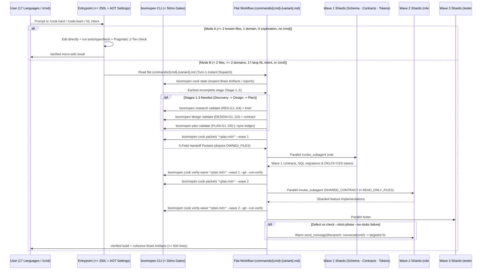
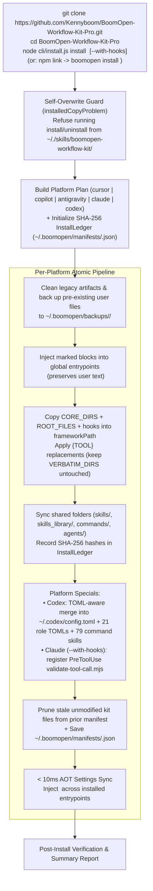
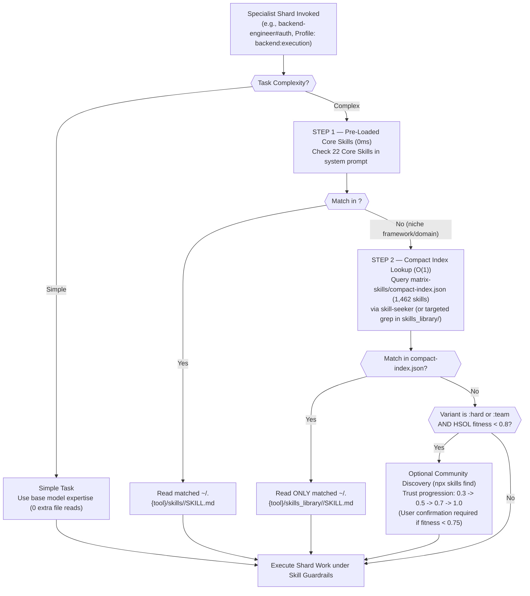
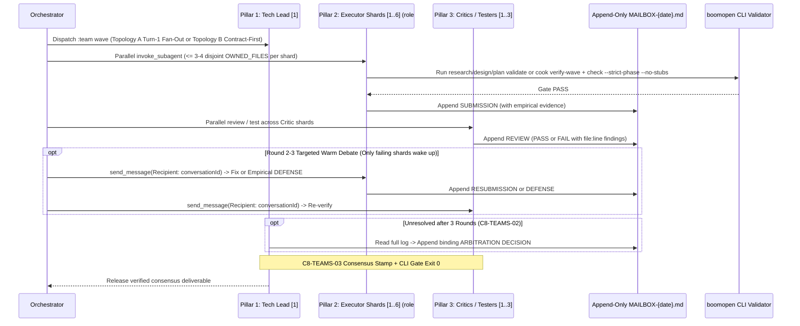
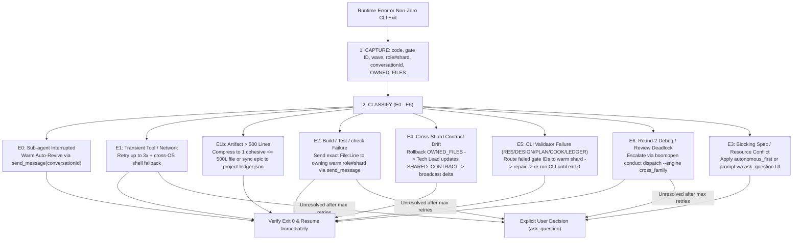

# BoomOpen Workflow Kit — Data Flow

> **Purpose**: End-to-end runtime lifecycles — 5-Stage Fast-Forward & 3-Wave execution, SHA-256 manifest CLI install, 2-step `O(1)` skill resolution, Elastic Golden Diamond / Conductor flows, and `E0–E6` recovery for **BoomOpen Workflow Kit v5.5.0**
> **Parent**: [00-index.md](./00-index.md)
> **Last Updated**: 2026-11-10
> **Version**: `5.5.0`

---

## Table of Contents

1. [Smart-Hybrid Command, Fast-Forward & 3-Wave Lifecycle](#smart-hybrid-command-fast-forward--3-wave-lifecycle)
2. [Source-Only CLI Install & SHA-256 Ownership Flow](#source-only-cli-install--sha-256-ownership-flow)
3. [2-Step `O(1)` Progressive Skill Resolution Flow (`HSOL v5.5`)](#2-step-o1-progressive-skill-resolution-flow-hsol-v55)
4. [Elastic Golden Diamond (`:team`), Autopilot & Conductor Flows](#elastic-golden-diamond-team-autopilot--conductor-flows)
5. [Self-Healing Error Recovery Flow (`E0–E6`)](#self-healing-error-recovery-flow-e0e6)
6. [Evidence Sources](#evidence-sources)

---

## Smart-Hybrid Command, Fast-Forward & 3-Wave Lifecycle

From a user prompt in any of **17 supported languages** (or an explicit `/cmd[:variant]`), the pre-loaded platform entrypoint evaluates the **Proactive Sub-agent First Gate**. Mode A handles `<= 2` known-file micro-edits directly; Mode B loads the flat workflow file (`commands/{cmd}-{variant}.md`), runs the **5-Stage Fast-Forward State Machine** (`boomopen cook state`), compiles **5-Field Wave Handoff Packets** (`boomopen cook packets`), and verifies each wave via deterministic CLI gates.

### Data Flowing Across Stages (`boomopen cook` + Validators)

| Stage | Primary Artifact / Payload | Deterministic CLI Gate |
|-------|----------------------------|------------------------|
| **Turn-1 Gate** | Prompt + active `BOOMOPEN-SETTINGS` block | Mode A (`<= 2` known files) vs. Mode B (`commands/{cmd}-{variant}.md`) |
| **Stage 1: Discovery** | `SCOUT-{task}.md`, `RESEARCH-{task}.md` / `BRAINSTORM-{task}.md` | `boomopen research <validate\|brief>` (`RES-G1..G4`) |
| **Stage 2: UI/UX Design** | `DESIGN-{task}.md` (`<= 500` lines) + optional `DESIGN-PREVIEW-*.html` | `boomopen design <validate\|contract>` (`DESIGN-G1..G4` -> `@theme` CSS + TS Props) |
| **Stage 3: Planning** | `PLAN-{task}.md` (`<= 500` lines, `RequestFeedback: true`) | `boomopen plan <validate\|compile>` (`PLAN-G1..G5` -> DAG & `<= 4` `OWNED_FILES`/shard) |
| **Stage 4: 3-Wave Code** | 5-Field Wave Handoff Packets (`SHARED_CONTRACT`, `OWNED_FILES`, `READ_ONLY_FILES`) | `boomopen cook <packets\|verify-wave>` (`COOK-G1..G4`) + `boomopen check --strict-phase --no-stubs` |
| **Stage 5: Parallel QA** | `TEST-{task}.md` & `REVIEW-{task}.md` + warm `send_message` repairs | Full test suite + `boomopen check --strict-phase --no-stubs` (`0` stubs, `0` `.skip`/`.only`) |

---

## Source-Only CLI Install & SHA-256 Ownership Flow

BoomOpen Workflow Kit is distributed strictly from its Git repository (`npmPublish: false`). During installation, `cli/install.js` builds a per-platform plan (`cli/tool-config.js`), tracks every file written into shared user directories with a SHA-256 ledger (`~/.boomopen/manifests/<tool>.json`), backs up pre-existing user files (`~/.boomopen/backups/`), injects marked kit/settings blocks without clobbering user prose, and refuses to execute from inside an already-installed framework copy.

### Installed Artifact Routing per Platform

| Asset Group | Source in Repo | Installed Destination | Transform Policy |
|-------------|----------------|-----------------------|------------------|
| Global Entrypoints | `GEMINI.md`, `CLAUDE.md`, `CODEX.md`, `COPILOT.md`, `CURSOR.md`, `AGENT.md`, `platforms/*` | `~/.gemini/GEMINI.md`, `~/.claude/CLAUDE.md`, `~/.codex/{CODEX,AGENTS}.md`, `~/.cursor/CURSOR.md`, `~/.copilot/COPILOT.md`, etc. | Marked block + `{TOOL}` replacement + AOT settings block |
| Framework Core (`CORE_DIRS`) | `agents/`, `rules/`, `commands/`, `matrix-skills/`, `cli/`, `scripts/`, `documents/` | `~/.{tool}/skills/boomopen-workflow-kit/` (`~/.gemini/config/skills/boomopen-workflow-kit/` on Antigravity) | `{TOOL}` replacement (`documents/` copied verbatim via `VERBATIM_DIRS`) |
| Core Skills (`22`) | `skills/*/SKILL.md` | `~/.{tool}/skills/*/` (`~/.gemini/config/skills/*/` on Antigravity) | `{TOOL}` replacement + SHA-256 manifest ledger |
| Library Vault (`1,440`) | `skills_library/*/SKILL.md` | `~/.{tool}/skills_library/*/` (`~/.gemini/config/skills_library/*/` on Antigravity) | Copied verbatim (`VERBATIM_DIRS`) + SHA-256 manifest ledger |
| Ownership Manifest | Generated at install | `~/.boomopen/manifests/<tool>.json` & `~/.boomopen/backups/<tool>/` | Preserves user-modified files on upgrade/uninstall |

---

## 2-Step `O(1)` Progressive Skill Resolution Flow (`HSOL v5.5`)

To keep startup token overhead near zero while exposing `1,462` domain skills, agents never scan all `19` YAML matrices manually. Instead, `rules/SKILLS.md` enforces a **Fast 2-Step Progressive Lookup** backed by `matrix-skills/compact-index.json`.

### HSOL Fitness Formula & Trust Tiers (`matrix-skills/_index.yaml`)

$$\text{Fitness} = 0.35 \times \text{Semantic} + 0.25 \times \text{Specificity} + 0.20 \times \text{Trust} + 0.10 \times \text{Freshness} + 0.10 \times \text{SuccessRate}$$

- **Bundled Core (`22`) & Library (`1,440`) Skills**: Pre-verified (`trust = 1.0`) by `boomopen doctor`.
- **Dynamic Community Skills (`_dynamic.yaml`)**: `NEW (0.3)` $\rightarrow$ `EVALUATING (0.5, 3 runs)` $\rightarrow$ `VALIDATED (0.7, 10 runs)` $\rightarrow$ `PROMOTED (1.0, >= 85% success)`.

---

## Elastic Golden Diamond (`:team`), Autopilot & Conductor Flows

### 1. Elastic Golden Diamond (`18` Specialist Teams)

When `:team` is invoked (or auto-triggered via `naturalLanguageResearchTrigger = auto_team`), `rules/TEAMS.md` scales from `1-1-1` (`<= 4` files) up to **`1 Tech Lead + 1..6 Parallel Shard Executors + 1..3 Parallel Critics/Testers`**, using **Topology A** (Turn-1 parallel fan-out for research, brainstorm, review, Stage 1 discovery, and CLI-validated plans) or **Topology B** (`SHARED_CONTRACT` lock first for unplanned multi-file coding).

### 2. Multi-Session Autopilot (`boomopen ledger`) & Cross-Engine Conductor (`boomopen conduct`)

- **Autopilot Ledger (`.boomopen/project-ledger.json`)**: `boomopen ledger from-plan <plan.md>` compiles multi-phase specs with SHA-256 spec hashes. Across sessions, `boomopen ledger next` loads the next unfinished phase (locking prior `test_files` in `READ_ONLY_FILES`), and `boomopen ledger verify --phase <id> --passed-tests <N> --run-verify` enforces monotonic cumulative test growth before advancing.
- **Cross-Engine Conductor (`boomopen conduct`)**:
  - **6-Task Parallel Council (`research|brainstorm|plan|design|review|debug`)**: `boomopen conduct council --task <type> --engines claude,codex,antigravity` runs multiple engines in parallel and reconciles `.boomopen/conductor/runs/<runId>-<engine>.md` into `<runId>-COUNCIL-SYNTHESIS.md`.
  - **Cross-Engine Pipeline (`boomopen conduct dispatch`)**: Enforces `Author != Critic` across model families and guards `READ_ONLY_FILES` via SHA-256 snapshots before and after external engine execution.

---

## Self-Healing Error Recovery Flow (`E0–E6`)

`rules/ERRORS.md` (`v5.5`) classifies every runtime or CLI failure into **`7` deterministic classes (`E0–E6`)** so workflows never halt silently and never cold-respawn warm shards unnecessarily.

---

## Evidence Sources

| Source | Path | What It Provides |
|--------|------|------------------|
| `rules/CORE.md` | [../../rules/CORE.md](../../rules/CORE.md) | Turn-1 Mode A/B gate, 17-language routing, Brain Artifact defaults |
| `rules/PHASES.md` | [../../rules/PHASES.md](../../rules/PHASES.md) | 5-Stage Fast-Forward (`boomopen cook state`), 3-Wave Contract-First pipeline |
| `rules/AGENTS.md` | [../../rules/AGENTS.md](../../rules/AGENTS.md) | 5-Field Handoff Packet, `role#shard -> conversationId` warm reuse |
| `rules/TEAMS.md` | [../../rules/TEAMS.md](../../rules/TEAMS.md) | Elastic Golden Diamond, Topology A/B, `C8-TEAMS-01..04` |
| `rules/SKILLS.md` | [../../rules/SKILLS.md](../../rules/SKILLS.md) | 2-step progressive lookup (`<skills>` -> `compact-index.json`), HSOL formula |
| `rules/ERRORS.md` | [../../rules/ERRORS.md](../../rules/ERRORS.md) | `E0–E6` recovery flows and `A1–A14` anti-patterns |
| `cli/install.js` | [../../cli/install.js](../../cli/install.js) | `InstallLedger`, backups, `{TOOL}` transforms, `< 10ms` AOT settings sync |
| `cli/cook.js` | [../../cli/cook.js](../../cli/cook.js) | `detectCookState`, `compileWavePackets`, `verifyWaveExecution` (`COOK-G1..G4`) |
| `cli/ledger.js` | [../../cli/ledger.js](../../cli/ledger.js) | `.boomopen/project-ledger.json` SHA-256 spec-hash drift guard & phase ratchet |
| `cli/conductor.js` | [../../cli/conductor.js](../../cli/conductor.js) | `Author != Critic` dispatch, SHA-256 `READ_ONLY_FILES` guard, 6-Task Council |
