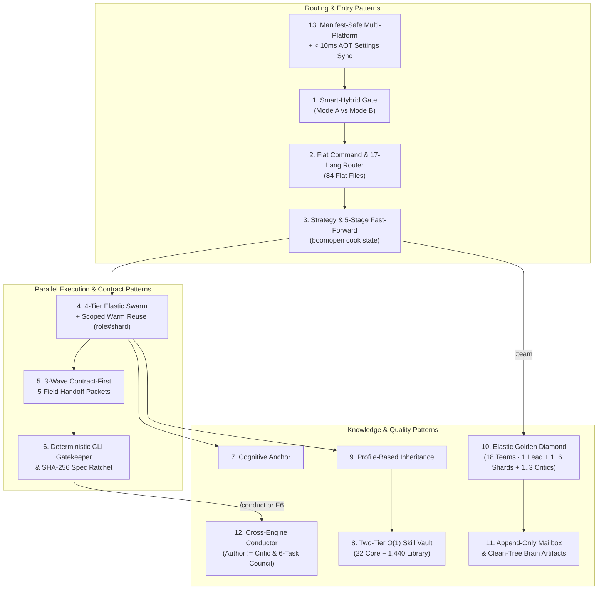

# BoomOpen Workflow Kit — Design Patterns

> **Purpose**: Catalog of the `13` core architectural and orchestration design patterns in **BoomOpen Workflow Kit v5.5.0**, with locations, rationale, and repository references
> **Parent**: [00-index.md](./00-index.md)
> **Last Updated**: 2026-11-10
> **Version**: `5.5.0`

---

## Table of Contents

1. [Pattern Overview](#pattern-overview)
2. [Smart-Hybrid Gate Pattern (`Mode A` vs. `Mode B`)](#smart-hybrid-gate-pattern-mode-a-vs-mode-b)
3. [Flat Command Router & 17-Language Intent Pattern](#flat-command-router--17-language-intent-pattern)
4. [Strategy & 5-Stage Fast-Forward Pattern](#strategy--5-stage-fast-forward-pattern)
5. [4-Tier Dynamic Elastic Swarm & Scoped Warm Reuse](#4-tier-dynamic-elastic-swarm--scoped-warm-reuse)
6. [3-Wave Contract-First Ownership Lock (`5-Field Packet`)](#3-wave-contract-first-ownership-lock-5-field-packet)
7. [Deterministic CLI Gatekeeper & Spec Ratchet](#deterministic-cli-gatekeeper--spec-ratchet)
8. [Cognitive Anchor Pattern](#cognitive-anchor-pattern)
9. [Two-Tier `O(1)` Progressive Skill Vault (`HSOL v5.5`)](#two-tier-o1-progressive-skill-vault-hsol-v55)
10. [Profile-Based Domain Inheritance Pattern](#profile-based-domain-inheritance-pattern)
11. [Elastic Golden Diamond Adversarial Pattern (`18` Teams)](#elastic-golden-diamond-adversarial-pattern-18-teams)
12. [Append-Only Mailbox & Clean-Tree Brain Artifacts](#append-only-mailbox--clean-tree-brain-artifacts)
13. [Cross-Engine Conductor & Multi-Engine Council](#cross-engine-conductor--multi-engine-council)
14. [Manifest-Safe Multi-Platform Abstraction & AOT Settings Sync](#manifest-safe-multi-platform-abstraction--aot-settings-sync)
15. [Evidence Sources](#evidence-sources)

---

## Pattern Overview



---

## Smart-Hybrid Gate Pattern (`Mode A` vs. `Mode B`)

| Attribute | Value |
|-----------|-------|
| **Pattern Type** | Structural & Behavioral — Turn-1 Execution Gate |
| **Where Applied** | All `13` audited entrypoints (`GEMINI.md`, `CLAUDE.md`, `CODEX.md`, `COPILOT.md`, `CURSOR.md`, `AGENT.md`, `platforms/*`) and [../../rules/CORE.md](../../rules/CORE.md) |
| **Rationale** | Eliminates orchestration ceremony on known 1–2 file micro-edits while forbidding context-polluting solo file crawling when scope is unknown or spans `> 2` files |

### Mechanics

- **Mode A (Tier 0 Micro-Direct)**: Activated strictly when exact target files (`<= 2`) are already known on Turn 1, `1` domain, `0` exploration needed, and no `/cmd` or workflow intent is present. Executes and verifies directly without reading `rules/*.md`.
- **Mode B (Tiers 1–3 Multi-Agent Orchestration)**: Activated immediately when target files are unknown, scope spans `> 2` files or `>= 2` domains, a **17-language natural-language workflow intent** matches, or an explicit `/cmd` is typed. Primary agent acts strictly as Orchestrator and fans out parallel sub-agents on Turn 1.

---

## Flat Command Router & 17-Language Intent Pattern

| Attribute | Value |
|-----------|-------|
| **Pattern Type** | Behavioral — Multilingual Intent & Flat Slash Dispatcher |
| **Where Applied** | `commands/*.md` (`79` flat files) + `commands/_ref/*.md` (`5` shared protocols) + `skills/intelligent-routing/SKILL.md` |
| **Rationale** | Flat `commands/{cmd}.md` and `commands/{cmd}-{variant}.md` files register cleanly across all `5` AI IDEs without nested folder incompatibilities, while 17-language intent matching gives non-English and slash-free prompts identical workflow rigor |

### Mechanics

- **`32` Base Commands (`84` Total Files)**: `16` multi-variant families (`/cook`, `/code`, `/plan`, `/design`, `/research`, `/brainstorm`, `/debug`, `/fix`, `/test`, `/review`, `/report`, `/docs`, `/deploy`, `/autopilot`, `/conduct`, `/ask`) + `16` standalone commands (`/settings`, `/orchestrate`, `/architect`, `/auto`, `/refactor`, `/security-audit`, `/deep-audit`, `/ui-ux-pro-max`, etc.).
- **17-Language Semantic Router**: Natural-language prompts across `en`, `vi`, `zh-CN`, `zh-TW`, `ja`, `ko`, `es`, `fr`, `de`, `pt-BR`, `ru`, `hi`, `ar`, `id`, `th`, `tr`, and `it` automatically load their canonical `commands/{cmd}-{variant}.md` workflow rather than degrading into unguided ad-hoc sub-agents.

---

## Strategy & 5-Stage Fast-Forward Pattern

| Attribute | Value |
|-----------|-------|
| **Pattern Type** | Behavioral — Complexity Variant Selection & Stateful Fast-Forward |
| **Where Applied** | `commands/{cmd}-{variant}.md`, [../../rules/PHASES.md](../../rules/PHASES.md), and `cli/cook.js` (`boomopen cook state`) |
| **Rationale** | Matches workflow rigor (`:fast`, `:hard`, `:team`) to task risk and skips redundant discovery, design, or planning stages when validated artifacts already exist |

### Mechanics

- **Variant Selection**: `:fast` (streamlined implementation), `:hard` (deep multi-vector verification), `:team` (Elastic Golden Diamond adversarial review), plus specialized operational variants (`docs-{core,business,audit}`, `deploy-{check,preview,production,rollback}`, `autopilot-{init,run,audit}`, `conduct-{council,pipeline}`).
- **Deterministic Fast-Forward (`boomopen cook state`)**: Inspects `<appDataDir>\brain\<conversation-id>\` (or `./reports/{topic}/`) for validated `SCOUT`, `RESEARCH`/`BRAINSTORM`, `DESIGN`, and `PLAN` files—jumping straight to Stage 4 (`3-Wave Code`) when the user approves a `PLAN` (`"Proceed"` / `/code`).

---

## 4-Tier Dynamic Elastic Swarm & Scoped Warm Reuse

| Attribute | Value |
|-----------|-------|
| **Pattern Type** | Concurrency & Resource Management — Horizontal Sharding + Session Affinity |
| **Where Applied** | [../../rules/CORE.md](../../rules/CORE.md), [../../rules/AGENTS.md](../../rules/AGENTS.md) |
| **Rationale** | Prevents single-agent context overflow (`> 4` heavy files) and eliminates cold-start token waste during multi-round test/review iterations |

### Mechanics

1. **Cognitive Load Sharding Law**:
   $$N_{\text{agents}} = \min\!\left(\text{maxParallelSubagents},\; \max\!\left(\left\lceil \frac{\text{Total Target Files}}{3.5} \right\rceil,\; \text{Distinct Domains},\; \text{Research Vectors}\right)\right)$$
   Sizes swarms into **Tier 0** (`0` sub-agents), **Tier 1** (`2–3`), **Tier 2** (`4–6`), or **Tier 3** (`7–10+`, up to `maxParallelSubagents`).
2. **Direct Plan-to-Executor Dispatch**: Once `PLAN-{task}.md` passes `boomopen plan validate`, the orchestrator dispatches directly to `role#shard` specialists without a redundant `tech-lead` middleman hop.
3. **Scoped Warm Session Registry (`role#shard -> conversationId`)**: Every spawned shard's `conversationId` is stored and reused via `send_message` across Wave 3 fixes, `:team` debates, and `E0` auto-revives.

---

## 3-Wave Contract-First Ownership Lock (`5-Field Packet`)

| Attribute | Value |
|-----------|-------|
| **Pattern Type** | Structural & Concurrency — Interface Locking & Disjoint Write Isolation |
| **Where Applied** | [../../rules/PHASES.md](../../rules/PHASES.md), [../../rules/AGENTS.md](../../rules/AGENTS.md), `cli/cook.js` (`boomopen cook packets|verify-wave`) |
| **Rationale** | Parallel agents corrupt shared codebases if they invent incompatible DTOs or edit the same file concurrently; locking contracts in Wave 1 and disjoint `OWNED_FILES` in Wave 2 guarantees conflict-free parallel execution |

### 5-Field Handoff Packet Schema

```yaml
1. MISSION & ACCEPTANCE CRITERIA: Shard ID (role#shard), task IDs, Given/When/Then criteria
2. SHARED_CONTRACT: Locked SQL DDL, Zod/OpenAPI DTOs, and DESIGN_CONTRACT (@theme CSS + TS Props)
3. OWNED_FILES: Strictly <= 3-4 disjoint files authorized for write by this shard
4. READ_ONLY_FILES: Wave 1 contracts, globals.css, components/ui/*, sibling shards, locked tests/**
5. VERIFICATION & DELIVERABLE: CLI validators, test commands, check --strict-phase --no-stubs, artifact path
```

- **Wave 1**: Foundation schemas, DTO contracts, and OKLCH UI tokens/primitives.
- **Wave 2**: Parallel backend/frontend/mobile/game feature shards (`Wave 1` artifacts locked in `READ_ONLY_FILES`).
- **Wave 3**: Parallel `tester#1..k`, `reviewer#1..m`, and `security-engineer#sec` shards.

---

## Deterministic CLI Gatekeeper & Spec Ratchet

| Attribute | Value |
|-----------|-------|
| **Pattern Type** | Quality & Verification — Compiler-in-the-Loop Gatekeeping |
| **Where Applied** | `cli/research.js`, `cli/design.js`, `cli/plan.js`, `cli/cook.js`, `cli/checker.js`, `cli/ledger.js` |
| **Rationale** | Replaces subjective AI self-grading with `< 50ms` deterministic exit-code validators that reject missing citations, invalid DAGs, overlapping `OWNED_FILES`, `TODO` stubs, explicit `any`, or test `.skip`/`.only` gaming |

### Gate Matrix

- `boomopen research validate` (`RES-G1..G4`) -> `HANDOFF_BRIEF`
- `boomopen design validate` (`DESIGN-G1..G4`) -> `DESIGN_CONTRACT`
- `boomopen plan validate` (`PLAN-G1..G5`) -> `.boomopen/project-ledger.json`
- `boomopen cook verify-wave` (`COOK-G1..G4`) + `boomopen check --strict-phase --no-stubs`
- `boomopen ledger verify` -> SHA-256 Spec-Hash Drift Guard + monotonic passed-test ratchet

---

## Cognitive Anchor Pattern

| Attribute | Value |
|-----------|-------|
| **Pattern Type** | Quality — Role-Drift Guardrail |
| **Where Applied** | All `21` specialist files in `agents/*.md` and `72` team files in `agents/teams/*-team/` |
| **Rationale** | Prevents LLM persona drift in long engineering sessions by binding the agent's Core Directive, Constraints (e.g., `NO APPLICATION CODE` on `designer`/`brainstormer`), and Output Format at file top |

---

## Two-Tier `O(1)` Progressive Skill Vault (`HSOL v5.5`)

| Attribute | Value |
|-----------|-------|
| **Pattern Type** | Structural — Lazy-Loaded Knowledge Plugin Vault |
| **Where Applied** | `skills/` (`22` Core Skills), `skills_library/` (`1,440` Library Skills), `matrix-skills/compact-index.json` (`1,462` total), `skills/skill-seeker/SKILL.md` |
| **Rationale** | Exposing `1,462` skills directly to an IDE's startup prompt bloats every turn; keeping `22` high-frequency Core Skills active in `<skills>` and indexing `1,440` niche skills in `compact-index.json` yields `O(1)` lookup with `0` idle context cost |

---

## Profile-Based Domain Inheritance Pattern

| Attribute | Value |
|-----------|-------|
| **Pattern Type** | Quality — Declarative Expertise Provisioning |
| **Where Applied** | Agent YAML frontmatter (`profile: "{domain}:{category}"`), [../../matrix-skills/_index.yaml](../../matrix-skills/_index.yaml), `19` `matrix-skills/*.yaml` domain files |
| **Rationale** | Maps each of the `21` specialist agents (`backend:execution`, `frontend:execution`, `security:validation`, `research:documentation`, etc.) to curated primary and inherited skill domains automatically |

---

## Elastic Golden Diamond Adversarial Pattern (`18` Teams)

| Attribute | Value |
|-----------|-------|
| **Pattern Type** | Quality & Governance — Elastic 3-Pillar Adversarial Collaboration |
| **Where Applied** | [../../rules/TEAMS.md](../../rules/TEAMS.md), `agents/teams/*-team/` (`18` teams = `54` role files + `18` `_team.md` = `72` files) |
| **Rationale** | Preserves structured builder-vs-critic tension while scaling horizontally beyond `3` agents when multi-domain tasks span `> 4` files |

### Pillars & Topologies

- **Pillar 1 — Tech Lead (`[1]`)**: Owns `SHARED_CONTRACT`, arbitrates unresolved Round-3 disputes, signs consensus stamp.
- **Pillar 2 — Parallel Shard Executors (`[1..6]`)**: Each owns `<= 3–4` disjoint files (or `1` research/option vector `*-v{k}.md`) and defends decisions with empirical evidence.
- **Pillar 3 — Parallel Critics / Testers (`[1..3]`)**: Devil's Advocate code reviewers, pre-mortem architects, security auditors, and QA shards.
- **Topology A (Turn-1 Parallel Fan-Out)** vs. **Topology B (Contract-Lock First)**, governed by `C8-TEAMS-01..04` and capped at **3 debate rounds**.

---

## Append-Only Mailbox & Clean-Tree Brain Artifacts

| Attribute | Value |
|-----------|-------|
| **Pattern Type** | Communication & Hygiene — Event-Sourced Audit Log + Out-of-Tree Deliverables |
| **Where Applied** | [../../rules/CORE.md](../../rules/CORE.md), [../../rules/PHASES.md](../../rules/PHASES.md), [../../rules/TEAMS.md](../../rules/TEAMS.md) |
| **Rationale** | Keeps the user's Git working tree `100%` clean of transient orchestration notes while preserving a full, auditable inter-agent debate history and 1-click UI actions |

### Mechanics

- **Brain Artifacts First**: Transient deliverables (`PLAN`, `DESIGN`, `RESEARCH`, `BRAINSTORM`, `SCOUT`, `DEBUG`, `TEST`, `REVIEW`, `MAILBOX`, `COUNCIL`) write to `<appDataDir>\brain\<conversation-id>\` on Antigravity (mapping cleanly to `./reports/{topic}/` on Claude Code, Codex, Cursor, and Copilot).
- **Cohesive `<= 500`-Line Single-File Rule + `RequestFeedback`**: Standalone `PLAN`, `DESIGN`, `RESEARCH`, `BRAINSTORM`, and `DEBUG` artifacts stay in `1` cohesive file (`<= 500` lines) with `ArtifactMetadata.RequestFeedback: true` to render Antigravity's native **"Proceed"** button.

---

## Cross-Engine Conductor & Multi-Engine Council

| Attribute | Value |
|-----------|-------|
| **Pattern Type** | Resilience & Verification — Heterogeneous Model Consensus |
| **Where Applied** | `cli/conductor.js`, `cli/conductor-engines.js`, `commands/conduct*.md`, [../../rules/ERRORS.md](../../rules/ERRORS.md) (`E6`) |
| **Rationale** | Eliminates single-model blind spots by enforcing `Author != Critic` across distinct model families (`Claude`, `Codex`, `Antigravity`) and synthesizing parallel council runs |

### Mechanics

- **6-Task Multi-Engine Council (`boomopen conduct council`)**: Runs `research`, `brainstorm`, `plan`, `design`, `review`, or `debug` prompts across multiple engines concurrently and compiles `.boomopen/conductor/runs/<runId>-COUNCIL-SYNTHESIS.md`.
- **Cross-Engine Pipeline & `E6` Escalation (`boomopen conduct dispatch`)**: Routes review or Round-2 deadlocked debugging to a different engine family while guarding `READ_ONLY_FILES` via SHA-256 hashes.

---

## Manifest-Safe Multi-Platform Abstraction & AOT Settings Sync

| Attribute | Value |
|-----------|-------|
| **Pattern Type** | Structural — Write-Once Deploy-to-5 with Cryptographic Ownership |
| **Where Applied** | `cli/install.js`, `cli/tool-config.js`, `cli/manifest.js`, `cli/settings-sync.js`, [../../rules/REFERENCE.md](../../rules/REFERENCE.md) |
| **Rationale** | Delivers `100%` workflow parity across `5` heterogeneous AI tools while guaranteeing user customizations are never destroyed during install, settings sync, or uninstall |

### Mechanics

- **Install-Time `{TOOL}` Replacement + Runtime Tool Vocabulary**: Rewrites framework paths per platform while `rules/REFERENCE.md` maps canonical Antigravity tool calls to native Claude Code, Codex, Copilot, and Cursor primitives.
- **SHA-256 `InstallLedger` + Marked Blocks**: Tracks installed files in `~/.boomopen/manifests/<tool>.json`, backs up user collisions to `~/.boomopen/backups/`, and updates `<!-- BOOMOPEN-SETTINGS-START/END -->` in `< 10ms` whenever `boomopen settings` changes presets or keys.

---

## Evidence Sources

| Source | Path | What It Provides |
|--------|------|------------------|
| `rules/CORE.md` | [../../rules/CORE.md](../../rules/CORE.md) | Smart-Hybrid Gate, 4-Tier Elastic Swarm, 17-language routing, Laws `L1–L10` |
| `rules/PHASES.md` | [../../rules/PHASES.md](../../rules/PHASES.md) | 5-Stage Fast-Forward, 3-Wave Contract-First topology, Brain Artifact rules |
| `rules/AGENTS.md` | [../../rules/AGENTS.md](../../rules/AGENTS.md) | Cognitive Load Sharding Law, Direct Plan Dispatch, Warm Reuse, 5-Field Packet |
| `rules/TEAMS.md` | [../../rules/TEAMS.md](../../rules/TEAMS.md) | `18` Elastic Golden Diamond teams, Topology A/B, `C8-TEAMS-01..04` |
| `rules/SKILLS.md` | [../../rules/SKILLS.md](../../rules/SKILLS.md) | 2-step `O(1)` lookup (`<skills>` -> `compact-index.json`), CLI gate auto-repair |
| `rules/REFERENCE.md` | [../../rules/REFERENCE.md](../../rules/REFERENCE.md) | `32` base slash commands (`84` files) & 5-platform tool translation table |
| `cli/install.js` | [../../cli/install.js](../../cli/install.js) | `12` CLI subcommands, SHA-256 `InstallLedger`, `< 10ms` AOT settings sync |
| `matrix-skills/_index.yaml` | [../../matrix-skills/_index.yaml](../../matrix-skills/_index.yaml) | `19` skill domains and `21` specialist agent inheritance profiles |
