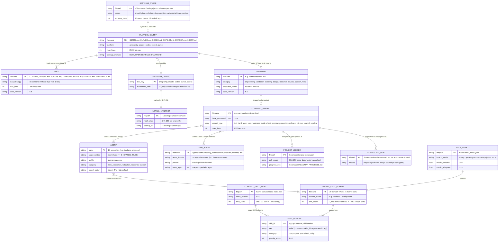

# Knowledge Domain

> **Purpose**: Domain model summary, entity overview, bounded contexts, and cross-references for BoomOpen Workflow Kit (`@boomopen/workflow-kit` `v5.5.0` — Multi-Platform Unified & Smart-Hybrid Edition)
> **Version**: `5.5.0`
> **Repository**: `https://github.com/Kennyboom/BoomOpen-Workflow-Kit-Pro`
> **Last Updated**: 2026-11-10
> **Generated By**: docs-core skill

---

## Quick Summary

BoomOpen Workflow Kit (`v5.5.0`) uses a deterministic, zero-database file-and-ledger domain model. Every runtime instruction, specialist persona, workflow topology, skill index, user setting, install manifest, multi-session project ledger, and cross-engine synthesis record is stored as a human-auditable Markdown (`.md`), YAML (`.yaml`), TOML (`.toml`), `.mdc`, or JSON (`.json`) file. There is no external SQL/NoSQL database, no ORM, and zero runtime npm dependencies (pure Node.js `>= 18.0.0` built-ins).

Across **6 bounded contexts**, **14 core entity types** govern **`21` Specialist Agents**, **`18` Elastic Golden Diamond Teams** (`72` files = `54` role files + `18` `_team.md` protocols), **`84` flat Slash Command files** (`32` base slash commands across `79` `commands/*.md` files + `5` shared protocols in `commands/_ref/*.md`), **`7` On-Demand Core Rules** (`<= 300` lines each), **`1,462` Indexed Skills** (`22` Pre-loaded Core Skills in `skills/` + `1,440` On-Demand Library Skills in `skills_library/` indexed in `matrix-skills/compact-index.json`), **`12` deterministic `boomopen` CLI subcommands**, and unified installation across **`5` AI coding platforms** (`Antigravity`, `Claude Code`, `OpenAI Codex`, `Cursor`, and `GitHub Copilot`).

---

## Table of Contents

1. [Quick Summary](#quick-summary)
2. [Sub-Files](#sub-files)
3. [Entity Overview Diagram](#entity-overview-diagram)
4. [Quick Facts](#quick-facts)
5. [Bounded Contexts](#bounded-contexts)
6. [Cross-References](#cross-references)
7. [Architecture Guarantees and Design Notes](#architecture-guarantees-and-design-notes)
8. [Evidence Sources](#evidence-sources)

---

## Sub-Files

| # | File | Description |
|---|------|-------------|
| 1 | [01-entities.md](./01-entities.md) | Complete deep dive across all 14 `v5.5.0` entities: `21` Specialist Agents, `18` Elastic Golden Diamond Teams, `84` flat Command files, `7` Rules, `1,462` Skills, Settings, Manifests, Project Ledger, and Conductor Runs |
| 2 | [02-database-schema.md](./02-database-schema.md) | File-based and JSON state/ledger schemas: YAML frontmatter, `compact-index.json`, `settings.json` / `.boomopen.json`, SHA-256 install manifests, `.boomopen/project-ledger.json`, and Conductor artifacts |
| 3 | [03-api-contracts.md](./03-api-contracts.md) | `"bin": { "boomopen": "./cli/install.js" }`, all `12` `boomopen` CLI subcommands & gate IDs (`RES-G1..G4`, `DESIGN-G1..G4`, `PLAN-G1..G5`, `COOK-G1..G4`), exact 5-platform install paths, `32` base slash commands, and `HSOL v5.5` resolution |
| 4 | [04-business-rules.md](./04-business-rules.md) | `v5.5.0` governance: Laws `L1–L10`, Pragmatic 2-Tier Coding Standards (`400`/`500` lines), Cognitive Load Sharding (`<= 3–4 OWNED_FILES` per `role#shard`), Elastic Golden Diamond, Quality-First Model Policy, 17-Language Routing, Brain Artifacts First, and `E0–E6` / `A1–A14` |

---

## Entity Overview Diagram

---

## Quick Facts

| Key | `v5.5.0` Canonical Value |
|-----|--------------------------|
| **Package & Version** | `@boomopen/workflow-kit` `5.5.0` (Smart-Hybrid Edition; source-only via GitHub, `npmPublish: false`) |
| **Canonical Repository** | `https://github.com/Kennyboom/BoomOpen-Workflow-Kit-Pro` |
| **CLI Binary & Subcommands** | `"bin": { "boomopen": "./cli/install.js" }` — **`12` subcommands** across `39` modular `cli/*.js` files |
| **Total Domain Entity Types** | `14` |
| **Bounded Contexts** | `6` |
| **Storage Formats** | Markdown (`.md`), YAML (`.yaml`), JSON (`.json`), TOML (`.toml`), Cursor MDC (`.mdc`) |
| **Specialist Agents** | **`21`** (`agents/*.md`, `<= 450` lines each, including `researcher`) |
| **Elastic Golden Diamond Teams** | **`18` teams** (`agents/teams/*-team/` = `54` role files + `18` `_team.md` protocols = **`72` files**, `<= 450` lines each, including `brainstorm-team`) |
| **Slash Command Files** | **`84` flat files** (`79` workflow files in `commands/*.md` + `5` shared protocols in `commands/_ref/*.md`, `<= 450` lines each) |
| **Base Slash Commands** | **`32`** (`16` multi-variant command families + `16` standalone commands) |
| **On-Demand Core Rules** | **`7` files** (`rules/*.md`, `<= 300` lines each) |
| **Skills Vault (`HSOL v5.5`)** | **`1,462` indexed skills** (`22` Pre-loaded Core Skills in `skills/` + `1,440` On-Demand Library Skills in `skills_library/`, indexed in `matrix-skills/compact-index.json` across `19` domains) |
| **Supported Platforms** | **`5`** (`Antigravity / Gemini`, `Claude Code`, `OpenAI Codex`, `Cursor`, `GitHub Copilot`) |
| **Audited Entrypoint Files** | **`13`** (`6` root `*.md` entrypoints + `7` platform bundle entrypoints, all `<= 250` lines) |
| **Natural-Language Routing** | **`17` languages** (`en`, `vi`, `zh-CN`, `zh-TW`, `ja`, `ko`, `es`, `fr`, `de`, `pt-BR`, `ru`, `hi`, `ar`, `id`, `th`, `tr`, `it`) |
| **Python Helper Scripts** | **`7`** (`scripts/*.py`) |
| **Automated Test Suites & CI/CD** | **`30` active `node:test` suites** (`29` `cli/*.test.js` + `web/build/kit-stats.test.mjs`) + Cross-OS GitHub Actions CI (`.github/workflows/ci.yml`) & guarded Semantic Release (`.github/workflows/release.yml`) |

---

## Bounded Contexts

### 1. Orchestration & Settings Context

Defines the Zero-Latency Entrypoint contract, On-Demand Mode B governance laws, `HSOL v5.5` skill orchestration rules, and the 3-Surface Unified Settings Control Center.

| Entity | Location | Count |
|--------|----------|-------|
| On-Demand Core Rule | `rules/*.md` (`<= 300` lines) | `7` |
| HSOL Configuration | `matrix-skills/_index.yaml` + `matrix-skills/_dynamic.yaml` | `2` |
| Unified Settings Store | `~/.boomopen/settings.json` + `./.boomopen.json` (`cli/settings-schema.js`) | `20` enum + `2` line-limit keys (`4` presets) |

### 2. Workflow & Command Context

Defines how explicit `/cmd` invocations and natural-language intents across 17 languages route into flat, deterministic 5-Stage Fast-Forward and 3-Wave Contract-First workflows.

| Entity | Location | Count |
|--------|----------|-------|
| Flat Slash Command & Variant Files | `commands/*.md` (`<= 450` lines; `32` base commands) | `79` |
| Shared Command Reference Protocols | `commands/_ref/*.md` (`<= 450` lines) | `5` (`84` total in `commands/`) |

### 3. Agency & Elastic Swarm Context

Defines the `21` specialist personas and `18` adversarial Elastic Golden Diamond teams that execute horizontally sharded work (`role#shard`, `<= 3–4 OWNED_FILES` per shard).

| Entity | Location | Count |
|--------|----------|-------|
| Specialist Agent | `agents/*.md` (`<= 450` lines) | `21` |
| Elastic Golden Diamond Team Files | `agents/teams/*-team/*.md` (`<= 450` lines) | `72` (`18` `_team.md` + `54` role files) |

### 4. Knowledge & Skills Vault Context

Defines the 2-tier progressive skill architecture separating always-visible core skills from the dormant on-demand library vault via `O(1)` JSON indexing.

| Entity | Location | Count |
|--------|----------|-------|
| Matrix Skill Domain YAMLs | `matrix-skills/*.yaml` | `19` domains (+ `_index.yaml`, `_dynamic.yaml`) |
| Pre-Compiled Compact Skill Index | `matrix-skills/compact-index.json` | `1` (`1,462` unique skills) |
| Core & Library Skill Modules | `skills/*/SKILL.md` (`22`) + `skills_library/*/SKILL.md` (`1,440`) | `1,462` (+ root `SKILL.md`) |

### 5. State, Autopilot & Cross-Engine Context

Provides persistent multi-session project orchestration and cross-model consensus/pipeline verification inside workspace `.boomopen/` directories.

| Entity | Location | Count |
|--------|----------|-------|
| Project Autopilot Ledger | `.boomopen/project-ledger.json` + `.boomopen/ROADMAP-PROGRESS.md` + `.boomopen/contracts/SHARED_CONTRACT.md` | Per-workspace |
| Cross-Engine Conductor Runs | `.boomopen/conductor/runs/<runId>-COUNCIL-SYNTHESIS.md` (+ per-engine run logs & `queue/`) | Per-run |

### 6. Distribution & Install Safety Context

Packages and deploys the framework across all `5` AI coding platforms with SHA-256 per-file ownership tracking, automatic user backups, and non-destructive marked instruction blocks.

| Entity | Location | Count |
|--------|----------|-------|
| Platform Configuration | `cli/tool-config.js` + `platforms/{antigravity,claude,codex,copilot,cursor}/` | `5` platforms |
| Entrypoint Files | Root `*.md` (`6`) + `platforms/**` bundle entrypoints (`7`) | `13` (`<= 250` lines each) |
| SHA-256 Install Manifest & Backups | `~/.boomopen/manifests/<tool>.json` + `~/.boomopen/backups/<tool>/` + `<frameworkPath>/install-files.json` | `1` per installed platform |

---

## Cross-References

| Topic | See |
|-------|-----|
| System architecture and data flow | [knowledge-architecture/00-index.md](../knowledge-architecture/00-index.md) |
| Project identity, tech stack, features | [knowledge-overview/00-index.md](../knowledge-overview/00-index.md) |
| HSOL orchestration blueprint | [SMART-SKILL-ORCHESTRATION-BLUEPRINT.md](../SMART-SKILL-ORCHESTRATION-BLUEPRINT.md) |
| HSOL assessment report | [HSOL-ASSESSMENT.md](../HSOL-ASSESSMENT.md) |
| Per-entity attributes, rosters, and relationships | [01-entities.md](./01-entities.md) |
| File-based and JSON ledger schemas | [02-database-schema.md](./02-database-schema.md) |
| `boomopen` CLI subcommands, install paths, and slash commands | [03-api-contracts.md](./03-api-contracts.md) |
| Governance laws, 2-Tier standards, sharding, and error recovery | [04-business-rules.md](./04-business-rules.md) |

---

## Architecture Guarantees and Design Notes

1. **Deterministic CLI Schema & Gate Enforcement** — Unlike purely convention-based prompt packs, `v5.5.0` validates Markdown/YAML/JSON artifacts programmatically via `boomopen doctor` (line limits, mojibake, legacy refs, `compact-index.json`, platform bundles), `boomopen research` (`RES-G1..G4`), `boomopen design` (`DESIGN-G1..G4`), `boomopen plan` (`PLAN-G1..G5`), `boomopen cook` (`COOK-G1..G4`), `boomopen ledger`, and `30` automated `node:test` suites.
2. **Zero Idle Context Tax** — Global entrypoints stay `<= 250` lines, rules stay `<= 300` lines (loaded on demand in Mode B), commands, agents, and teams stay `<= 450` lines, and only `22` Core Skills sit in the active `<skills>` prompt while `1,440` Library Skills remain dormant on disk until resolved via `matrix-skills/compact-index.json`.
3. **Clean Git Working Tree (`Brain Artifacts First`)** — Transient deliverables (`RESEARCH`, `BRAINSTORM`, `SCOUT`, `DESIGN`, `PLAN`, `DEBUG`, `TEST`, `REVIEW`, `REPORT`, `MAILBOX`) default to `<appDataDir>\brain\<conversation-id>\` on Antigravity (mapping cleanly to `./reports/{topic}/` on Claude Code, Codex, Cursor, and Copilot).
4. **Cross-Platform Tool Translation** — Commands and agents use canonical Antigravity tool primitives and map deterministically to native equivalents across Claude Code (`Task`/`SendMessage`), OpenAI Codex (`spawn_agent`/`send_input` + `config.toml`), Cursor, and GitHub Copilot (`runSubagent`) via `rules/REFERENCE.md`.

---

## Evidence Sources

| Source | Path |
|--------|------|
| Package manifest & `boomopen` binary | [package.json](../../package.json) |
| CLI entrypoint & 12 subcommands | [cli/install.js](../../cli/install.js) |
| Platform path & bundle definitions | [cli/tool-config.js](../../cli/tool-config.js) |
| SHA-256 install manifest engine | [cli/manifest.js](../../cli/manifest.js) |
| Unified settings schema (`20` enum + `2` line-limit keys) | [cli/settings-schema.js](../../cli/settings-schema.js) |
| Autopilot ledger engine | [cli/ledger.js](../../cli/ledger.js) |
| Cross-Engine Conductor & Council engine | [cli/conductor.js](../../cli/conductor.js) |
| Core governance rules (`7` files) | [rules/CORE.md](../../rules/CORE.md), [rules/PHASES.md](../../rules/PHASES.md), [rules/AGENTS.md](../../rules/AGENTS.md), [rules/TEAMS.md](../../rules/TEAMS.md), [rules/SKILLS.md](../../rules/SKILLS.md), [rules/ERRORS.md](../../rules/ERRORS.md), [rules/REFERENCE.md](../../rules/REFERENCE.md) |
| Matrix skills index & compact O(1) index | [matrix-skills/_index.yaml](../../matrix-skills/_index.yaml), [matrix-skills/compact-index.json](../../matrix-skills/compact-index.json) |
| Root platform entrypoints (`6` files) | [GEMINI.md](../../GEMINI.md), [CLAUDE.md](../../CLAUDE.md), [CODEX.md](../../CODEX.md), [COPILOT.md](../../COPILOT.md), [CURSOR.md](../../CURSOR.md), [AGENT.md](../../AGENT.md) |
