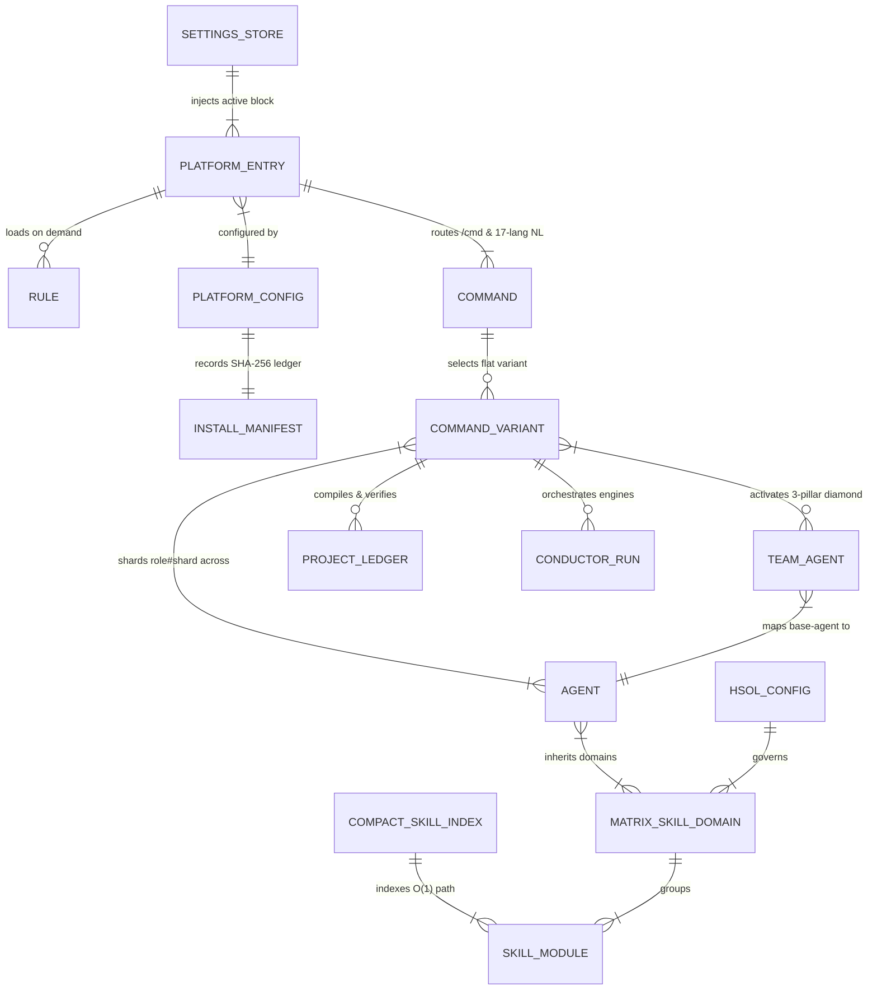

# BoomOpen Workflow Kit — Domain Entities

> **Purpose**: Complete per-entity deep dive with attributes, types, constraints, rosters, and relationships (`v5.5.0` Smart-Hybrid Edition)
> **Parent**: [00-index.md](./00-index.md)
> **Version**: `5.5.0`
> **Last Updated**: 2026-11-10
> **Generated By**: docs-core skill

---

## Table of Contents

1. [Entity Relationship Diagram](#entity-relationship-diagram)
2. [Entity 1: Specialist Agent (`21` Files)](#entity-1-specialist-agent-21-files)
3. [Entity 2: Elastic Golden Diamond Team (`18` Teams / `72` Files)](#entity-2-elastic-golden-diamond-team-18-teams--72-files)
4. [Entity 3: Base Slash Command & Router (`32` Base Commands)](#entity-3-base-slash-command--router-32-base-commands)
5. [Entity 4: Flat Workflow Variant & Protocol (`84` Command Files)](#entity-4-flat-workflow-variant--protocol-84-command-files)
6. [Entity 5: On-Demand Core Rule (`7` Files)](#entity-5-on-demand-core-rule-7-files)
7. [Entity 6: Matrix Skill Domain & Compact Index (`19` Domains + `compact-index.json`)](#entity-6-matrix-skill-domain--compact-index-19-domains--compact-indexjson)
8. [Entity 7: Skill Module (`22` Core + `1,440` Library = `1,462` Skills)](#entity-7-skill-module-22-core--1440-library--1462-skills)
9. [Entity 8: Platform Configuration (`5` Platforms)](#entity-8-platform-configuration-5-platforms)
10. [Entity 9: Platform Entry Point (`6` Root + `7` Bundle = `13` Files)](#entity-9-platform-entry-point-6-root--7-bundle--13-files)
11. [Entity 10: HSOL v5.5 Configuration](#entity-10-hsol-v55-configuration)
12. [Entity 11: Unified Settings Store (`settings.json` & `.boomopen.json`)](#entity-11-unified-settings-store-settingsjson--boomopenjson)
13. [Entity 12: Install Ownership Manifest (`manifests/<tool>.json`)](#entity-12-install-ownership-manifest-manifeststooljson)
14. [Entity 13: Project Autopilot Ledger (`project-ledger.json`)](#entity-13-project-autopilot-ledger-project-ledgerjson)
15. [Entity 14: Cross-Engine Conductor Run (`COUNCIL-SYNTHESIS.md`)](#entity-14-cross-engine-conductor-run-council-synthesismd)
16. [Evidence Sources](#evidence-sources)

---

## Entity Relationship Diagram

---

## Entity 1: Specialist Agent (`21` Files)

- **Location**: `agents/*.md` (`21` files, audited `<= 450` lines each by `boomopen doctor`)
- **Format**: Markdown with YAML frontmatter
- **Role**: Domain specialists invoked as isolated parallel shards (`role#shard`, `Model: "inherit"`, `<= 3–4 OWNED_FILES` per shard) during Mode B execution

### Frontmatter Attributes

| Attribute | Type | Required | Constraints | Example |
|-----------|------|----------|-------------|---------|
| `name` | string | yes | Unique kebab-case ID across all `21` specialists | `backend-engineer` |
| `description` | string | yes | Concise 3-Wave / domain mission summary | `Principal Backend Architect — 3-Wave Contract-First API/service sharding...` |
| `profile` | string | yes | `{domain}:{category}` mapped in `matrix-skills/_index.yaml` | `"backend:execution"` |
| `handoffs` | string[] | yes | Allowed specialist agent names for downstream delegation | `[tester, database-architect, performance-engineer, devops-engineer, frontend-engineer, security-engineer]` |
| `version` | string | yes | Current kit specification version | `"5.5"` |
| `category` | enum | yes | `meta`, `execution`, `validation`, `research`, `support` | `execution` |

### Category Distribution (`21` Specialist Agents)

| Category | Count | Agent IDs | Default Model | Write Scope |
|----------|:-----:|-----------|:-------------:|-------------|
| `meta` | `2` | `tech-lead`, `planner` | `inherit` | `PLAN-*`, `MAILBOX-*`, `SHARED_CONTRACT` (never app source code) |
| `execution` | `5` | `backend-engineer`, `frontend-engineer`, `database-architect`, `mobile-engineer`, `game-engineer` | `inherit` | Disjoint `OWNED_FILES` (`<= 3–4` files per `role#shard`) |
| `validation` | `5` | `tester`, `reviewer`, `security-engineer`, `performance-engineer`, `debugger` | `inherit` | Test suites, `TEST-*`, `REVIEW-*`, `DEBUG-*`, `PERF-*` |
| `research` | `4` | `researcher`, `scouter`, `brainstormer`, `designer` | `inherit` | `RESEARCH-*`, `SCOUT-*`, `BRAINSTORM-*`, `DESIGN-*` (no app code) |
| `support` | `5` | `docs-manager`, `devops-engineer`, `business-analyst`, `project-manager`, `reporter` | `inherit` | `documents/`, CI/CD & IaC configs, `REQ-*`, `REPORT-*` |

### Full `21`-Agent Profile & Domain Inheritance Roster

| # | Agent | Profile | Primary Domain | Inherited Domains (`matrix-skills/_index.yaml`) |
|:-:|-------|---------|----------------|-------------------------------------------------|
| 1 | `backend-engineer` | `backend:execution` | `backend` | `backend`, `architecture`, `quality`, `data`, `languages`, `mcp`, `ai-ml` |
| 2 | `brainstormer` | `planning:discovery` | `planning` | `planning`, `research` |
| 3 | `business-analyst` | `planning:business` | `planning` | `planning`, `management` |
| 4 | `database-architect` | `data:execution` | `data` | `data`, `performance`, `architecture` |
| 5 | `debugger` | `quality:debugging` | `quality` | `quality`, `performance` |
| 6 | `designer` | `design:creative` | `design` | `design`, `frontend` |
| 7 | `devops-engineer` | `devops:execution` | `devops` | `devops`, `security`, `cloud` |
| 8 | `docs-manager` | `research:documentation` | `research` | `research`, `planning`, `tools`, `quality` |
| 9 | `frontend-engineer` | `frontend:execution` | `frontend` | `frontend`, `design`, `architecture` |
| 10 | `game-engineer` | `gaming:execution` | `gaming` | `gaming`, `performance`, `frontend` |
| 11 | `mobile-engineer` | `mobile:execution` | `mobile` | `mobile`, `design`, `frontend` |
| 12 | `performance-engineer` | `performance:validation` | `performance` | `performance`, `backend`, `frontend` |
| 13 | `planner` | `planning:analysis` | `planning` | `planning`, `architecture` |
| 14 | `project-manager` | `management:orchestration` | `management` | `management`, `planning` |
| 15 | `reporter` | `reporting:synthesis` | `research` | `research`, `planning`, `tools`, `quality` |
| 16 | `researcher` | `research:analysis` | `research` | `research`, `planning`, `mcp`, `ai-ml` |
| 17 | `reviewer` | `quality:review` | `quality` | `quality`, `security`, `architecture` |
| 18 | `scouter` | `research:exploration` | `research` | `research`, `architecture` |
| 19 | `security-engineer` | `security:validation` | `security` | `security`, `architecture` |
| 20 | `tech-lead` | `architecture:orchestration` | `architecture` | `architecture`, `quality`, `planning`, `mcp`, `ai-ml` |
| 21 | `tester` | `quality:validation` | `quality` | `quality` |

---

## Entity 2: Elastic Golden Diamond Team (`18` Teams / `72` Files)

- **Location**: `agents/teams/{domain}-team/*.md` (`18` team directories x `4` files = **`72` files** = `54` role files + `18` `_team.md` protocol manifests, all `<= 450` lines)
- **Format**: Markdown with YAML frontmatter (`pattern: elastic-golden-diamond`, `version: 5.5.0` / `"5.5"`)
- **Role**: 3-Pillar adversarial collaboration units that scale elastically from a `1-1-1` Golden Triangle (`<= 4` target files) up to **`1 Tech Lead + 1..6 Parallel Shard Executors (`role#shard`) + 1..3 Parallel Critics/Testers`** for multi-file or multi-vector tasks

### Team Directory Structure (`4` Files per Team)

| File | Category | Role & Responsibility |
|------|----------|-----------------------|
| `_team.md` | `team-protocol` | Canonical team topology, wave contracts, deliverables (`REVIEW-*`, `TEST-*`, `MAILBOX-*`), and CLI verification gates |
| `techlead.md` | `team-role` | **Pillar 1 (`[1]`)**: Locks `SHARED_CONTRACT` & disjoint `OWNED_FILES`, arbitrates disputes after max 3 rounds, stamps consensus |
| `executor.md` | `team-role` | **Pillar 2 (`[1..6 Shards]`)**: Executes Wave 1 contracts/tokens and Wave 2 parallel feature/vector shards (`<= 3–4 OWNED_FILES` each) |
| `reviewer.md` | `team-role` | **Pillar 3 (`[1..3 Critics]`)**: Adversarial Devil's Advocate, OWASP/WCAG/performance critic, and acceptance-criteria verifier |

### Full `18`-Team Roster

| # | Team Directory | Lead Pillar (`[1]`) | Executor Pillar (`[1..6 Shards]`) | Critic / QA Pillar (`[1..3 Critics]`) |
|:-:|----------------|---------------------|-----------------------------------|---------------------------------------|
| 1 | `backend-team` | `tech-lead` | `backend-engineer#contracts` (W1) -> `backend-engineer#1..N` (W2) | `reviewer#code` (+ `security-engineer#sec`, `tester#api`) |
| 2 | `brainstorm-team` | `brainstorm-team-techlead` | `scouter#1..k` + `researcher#1..k` (S1) -> `brainstormer#opt-1..k` (S2, zero app code) | `brainstorm-team-reviewer` (`tech-lead#premortem`) |
| 3 | `database-team` | `tech-lead` | `database-architect#schema` + `database-architect#queries` | `reviewer#schema` + `performance-engineer#query` |
| 4 | `debug-team` | `debugger#lead` | `debugger#hypothesis-1..N` + `backend-engineer#fix` | `reviewer#root-cause` + `tester#regression` |
| 5 | `design-team` | `design-team-techlead` | `scouter#ui-tokens` + `researcher#ux` (S1) -> `designer#spec-1..k` (S2, zero app code) | `design-team-reviewer` (+ `frontend-engineer#feasibility`) |
| 6 | `devops-team` | `devops-engineer` | `devops-engineer#iac` + `devops-engineer#ci` | `security-engineer#devsecops` |
| 7 | `docs-team` | `docs-manager` | `researcher#shard-1..N` + `docs-manager#writer` | `reviewer#accuracy` |
| 8 | `frontend-team` | `tech-lead` | `frontend-engineer#tokens-primitives` (W1) -> `frontend-engineer#screen-1..N` (W2) | `reviewer#ui` (+ `designer#a11y`, `tester#e2e`) |
| 9 | `fullstack-team` | `tech-lead` | W1: `database-architect#schema` + `backend-engineer#contracts` + `frontend-engineer#tokens-primitives` -> W2: `backend-engineer#1..N` + `frontend-engineer#screen-1..M` | `reviewer#code` + `security-engineer#sec` + `tester#1..K` |
| 10 | `game-team` | `tech-lead` | `game-engineer#ecs-contracts` (W1) -> `game-engineer#1..N` (W2) | `reviewer#arch` + `performance-engineer#60fps` |
| 11 | `mobile-team` | `tech-lead` | `mobile-engineer#tokens-navigation` (W1) -> `mobile-engineer#screen-1..N` (W2) | `reviewer#platform-ux` + `tester#mobile` |
| 12 | `performance-team` | `performance-engineer` | `backend-engineer#opt` + `frontend-engineer#opt` | `reviewer#benchmarks` |
| 13 | `planning-team` | `planning-team-techlead` | `scouter#1..k` + `researcher#1..k` (S1) -> `planner#1..k` (S2) | `planning-team-reviewer` (+ `security-engineer#sec`, `business-analyst#ac`) |
| 14 | `project-team` | `project-manager` | `business-analyst#req-1..N` | `tech-lead#feasibility` |
| 15 | `qa-team` | `tester#lead` | `tester#unit` + `tester#integration` + `tester#e2e` | `security-engineer#sec` + `performance-engineer#perf` |
| 16 | `report-team` | `reporter` | `scouter#metrics-1..N` | `reviewer#data-accuracy` |
| 17 | `research-team` | `researcher#lead` (Vector 1) | `researcher#vector-2..N` + `scouter#codebase` | `researcher#adversarial` (Fact-checker & blind-spot hunter) |
| 18 | `security-team` | `security-engineer#lead` | `security-engineer#audit-1..N` + `backend-engineer#remediate` | `reviewer#pentest` |

---

## Entity 3: Base Slash Command & Router (`32` Base Commands)

- **Location**: `commands/{cmd}.md` (flat layout; `<= 450` lines each)
- **Format**: Markdown with YAML frontmatter (`version: "5.5"`, `execution-mode: router` for multi-variant families or `execute` for standalone workflows)
- **Role**: Entrypoint commands invoked explicitly via `/{cmd}` or automatically via the 17-Language Natural-Language Workflow Router

### `16` Multi-Variant Command Families

| # | Command | Router File | Variants (`commands/{cmd}-{variant}.md`) | Primary CLI Gate / Engine |
|:-:|---------|-------------|------------------------------------------|---------------------------|
| 1 | `/cook` | `commands/cook.md` | `cook-fast.md`, `cook-hard.md`, `cook-team.md` | `boomopen cook <state\|packets\|verify-wave\|preflight>` |
| 2 | `/code` | `commands/code.md` | `code-fast.md`, `code-hard.md`, `code-team.md` | `boomopen cook <packets\|verify-wave>` + `check --strict-phase --no-stubs` |
| 3 | `/plan` | `commands/plan.md` | `plan-fast.md`, `plan-hard.md`, `plan-team.md` | `boomopen plan <validate\|compile>` (`PLAN-G1..G5`) |
| 4 | `/design` | `commands/design.md` | `design-fast.md`, `design-hard.md`, `design-team.md` | `boomopen design <validate\|contract>` (`DESIGN-G1..G4`) |
| 5 | `/research` | `commands/research.md` | `research-fast.md`, `research-hard.md`, `research-team.md` | `boomopen research <validate\|brief>` (`RES-G1..G4`) |
| 6 | `/brainstorm` | `commands/brainstorm.md` | `brainstorm-fast.md`, `brainstorm-hard.md`, `brainstorm-team.md` | `boomopen research <validate\|brief> --mode brainstorm` (`RES-G1..G4`) |
| 7 | `/debug` | `commands/debug.md` | `debug-fast.md`, `debug-hard.md`, `debug-team.md` | Root-cause evidence & reproduction gate |
| 8 | `/fix` | `commands/fix.md` | `fix-fast.md`, `fix-hard.md`, `fix-team.md` | `boomopen check --strict-phase --no-stubs` + regression verification |
| 9 | `/test` | `commands/test.md` | `test-fast.md`, `test-hard.md`, `test-team.md` | `boomopen check --strict-phase --no-stubs` (zero `.skip`/`.only`) |
| 10 | `/review` | `commands/review.md` | `review-fast.md`, `review-hard.md`, `review-team.md` | P0–P3 evidence-cited audit & OWASP gate |
| 11 | `/report` | `commands/report.md` | `report-fast.md`, `report-hard.md`, `report-team.md` | Metrics & status verification |
| 12 | `/docs` | `commands/docs.md` | `docs-core.md`, `docs-business.md`, `docs-audit.md` | `./documents/` link & accuracy audit |
| 13 | `/deploy` | `commands/deploy.md` | `deploy-check.md`, `deploy-preview.md`, `deploy-production.md`, `deploy-rollback.md` | Pre-deploy readiness & rollback safety |
| 14 | `/autopilot` | `commands/autopilot.md` | `autopilot-init.md`, `autopilot-run.md`, `autopilot-audit.md` | `boomopen ledger <init\|from-plan\|validate\|next\|verify\|audit>` |
| 15 | `/conduct` | `commands/conduct.md` | `conduct-council.md`, `conduct-pipeline.md` | `boomopen conduct <probe\|dispatch\|council\|status>` |
| 16 | `/ask` | `commands/ask.md` | `ask-fast.md`, `ask-hard.md` | Grounded technical Q&A |

### `16` Standalone Commands (`commands/*.md`)

| Command | File | Purpose |
|---------|------|---------|
| `/settings` | `commands/settings.md` | Interactive Unified Settings & Control Center (`ask_question` UI + `boomopen settings`) |
| `/orchestrate` | `commands/orchestrate.md` | Multi-agent domain & shard swarm orchestration |
| `/save` | `commands/save.md` | Persist session state and context snapshot (`session_manager.py`) |
| `/recap` | `commands/recap.md` | Restore session context and summarize active progress |
| `/init` | `commands/init.md` | Bootstrap a new project with stack conventions and contracts |
| `/next` | `commands/next.md` | Inspect artifacts/ledger and recommend the exact next workflow |
| `/status` | `commands/status.md` | Display project, ledger, and active shard status board |
| `/preview` | `commands/preview.md` | Start, stop, or inspect local preview servers (`auto_preview.py`) |
| `/rollback` | `commands/rollback.md` | Emergency recovery of code, deployment, or database migrations |
| `/architect` | `commands/architect.md` | C4 architecture diagrams, ADRs, database schemas, and API contracts (zero app code) |
| `/auto` | `commands/auto.md` | Autonomous meta-router selecting and executing the optimal workflow end-to-end |
| `/refactor` | `commands/refactor.md` | Behavior-preserving structural refactoring gated by existing regression tests |
| `/performance` | `commands/performance.md` | Performance budgets, flamegraph profiling, and bottleneck tuning |
| `/security-audit` | `commands/security-audit.md` | OWASP Top 10, STRIDE threat modeling, and DevSecOps audit |
| `/deep-audit` | `commands/deep-audit.md` | Pre-implementation logic and consistency audit across specifications |
| `/ui-ux-pro-max` | `commands/ui-ux-pro-max.md` | SOTA OKLCH design-system generation and high-craft UI/UX specifications |

---

## Entity 4: Flat Workflow Variant & Protocol (`84` Command Files)

- **Location**: `79` flat workflow files in `commands/*.md` (`16` routers + `47` variant files `commands/{cmd}-{variant}.md` + `16` standalone files) + `5` shared protocol files in `commands/_ref/*.md` = **`84` files total** (`<= 450` lines each)
- **Constraint**: `commands/` is **100% flat** (`commands/_ref/` is the sole subdirectory, enforced by `cli/docs-content.test.js`). Both `/cook:hard` and `/cook/hard` resolve to `commands/cook-hard.md`.

### `5` Shared Reference Protocols (`commands/_ref/*.md`)

| File | Shared Protocol |
|------|-----------------|
| `commands/_ref/convergent-analysis-loop.md` | Multi-pass convergent analysis and contradiction elimination loop |
| `commands/_ref/docs-folder-specs.md` | Canonical directory & chunking specs for `./documents/knowledge-*/` and `./documents/business/` |
| `commands/_ref/docs-recon-protocol.md` | Parallel codebase reconnaissance protocol for `/docs` shards |
| `commands/_ref/golden-triangle-protocol.md` | Reusable Elastic Golden Diamond 3-pillar execution & consensus protocol |
| `commands/_ref/implementation-loop.md` | 3-Wave Contract-First implementation, verification, and warm auto-repair loop |

---

## Entity 5: On-Demand Core Rule (`7` Files)

- **Location**: `rules/*.md` (`7` files, strictly `<= 300` lines each, enforced by `boomopen doctor`)
- **Load Strategy**: **Zero-Latency On-Demand Loading**. Global entrypoints (`GEMINI.md`, `CLAUDE.md`, etc.) pre-embed the Turn-1 routing gate and 5-Field Handoff Packet so simple Mode A edits incur `0` rule-file reads; `rules/*.md` load on demand only when Mode B or a specialized protocol is triggered.

| File | Version | Load Trigger | Key Governance Scope |
|------|:-------:|--------------|----------------------|
| `rules/CORE.md` | `5.5` | Mode B orchestration & deliverable routing | 4-Tier Elastic Swarm formula, 17-Language NL Router, Model Policy, Laws `L1–L10`, Brain Artifact table |
| `rules/PHASES.md` | `5.5` | Multi-stage / 3-Wave workflows | 5-Stage Fast-Forward (`boomopen cook state`), 3-Wave Contract-First topology, Autopilot & Conductor gates |
| `rules/AGENTS.md` | `5.5` | Specialist shard delegation | Cognitive Load Sharding (`<= 3–4 OWNED_FILES`), Direct Plan-to-Executor Dispatch, Warm Session Registry (`role#shard -> conversationId`) |
| `rules/TEAMS.md` | `5.5` | `:team` or `/conduct` workflows | Elastic Golden Diamond (`18` teams), Topology A vs B, C8 Checkpoints (`C8-TEAMS-01..04`), max 3 debate rounds |
| `rules/SKILLS.md` | `5.5` | Complex domain skill lookup | Fast 2-Step `O(1)` lookup (`<skills>` -> `compact-index.json` via `skill-seeker`), CLI gates, HSOL fitness |
| `rules/ERRORS.md` | `5.5` | Tool, build, or CLI gate failures | Error codes `E0–E6` (Warm Auto-Revive, CLI Gate Auto-Repair, Cross-Engine Escalation) & Anti-Patterns `A1–A14` |
| `rules/REFERENCE.md` | `5.5` | Cross-platform lookup | 14-workflow 17-language routing table, Cross-Platform Tool Vocabulary (5 platforms), `32`-command lookup |

---

## Entity 6: Matrix Skill Domain & Compact Index (`19` Domains + `compact-index.json`)

- **Location**: `matrix-skills/*.yaml` (`19` domain YAMLs + `_index.yaml` + `_dynamic.yaml`) and `matrix-skills/compact-index.json`
- **Role**: Categorizes `1,462` unique skills across `19` technical domains (`1,476` total domain entries because `14` cross-cutting skills are indexed in two domains) and compiles them into a single `O(1)` JSON lookup dictionary (`compact-index.json`, rebuilt and verified by `boomopen doctor --rebuild-index`).

| Domain Key | YAML File | Display Name | Domain Entries |
|------------|-----------|--------------|:--------------:|
| `ai_ml` | `ai-ml.yaml` | AI/ML Engineering | `230` |
| `tools` | `tools.yaml` | Tools & Utilities | `231` |
| `backend` | `backend.yaml` | Backend Development | `210` |
| `frontend` | `frontend.yaml` | Frontend Development | `115` |
| `security` | `security.yaml` | Security Engineering | `106` |
| `research` | `research.yaml` | Research & Documentation | `83` |
| `devops` | `devops.yaml` | DevOps & Deployment | `68` |
| `cloud` | `cloud.yaml` | Cloud & Infrastructure | `68` |
| `quality` | `quality.yaml` | Quality Assurance | `62` |
| `languages` | `languages.yaml` | Programming Languages | `59` |
| `design` | `design.yaml` | UI/UX Design | `42` |
| `planning` | `planning.yaml` | Planning & Analysis | `39` |
| `data` | `data.yaml` | Data & Database | `36` |
| `mobile` | `mobile.yaml` | Mobile Development | `29` |
| `architecture` | `architecture.yaml` | System Architecture | `24` |
| `management` | `management.yaml` | Project Management | `23` |
| `performance` | `performance.yaml` | Performance Engineering | `22` |
| `gaming` | `gaming.yaml` | Game Development | `16` |
| `mcp` | `mcp.yaml` | MCP & Agents | `13` |
| **Total** | `19` files + `compact-index.json` | **`1,462` unique skills** (`14` shared across 2 domains) | **`1,476` entries** |

---

## Entity 7: Skill Module (`22` Core + `1,440` Library = `1,462` Skills)

- **Locations**:
  - **Pre-loaded Core Skills (`22` modules in `skills/*/SKILL.md` + root `SKILL.md`, `<= 450` lines each)**: Installed into each platform's active skills directory (`~/.gemini/config/skills/`, `~/.claude/skills/`, `~/.codex/skills/`, `~/.cursor/skills/`, `~/.copilot/skills/`) so they are visible at zero latency in `<skills>`:
    `api-patterns`, `app-builder`, `behavioral-modes`, `brainstorming`, `clean-code`, `database-design`, `debugger`, `deep-research`, `design-spec`, `frontend-architecture`, `frontend-design`, `game-developer`, `intelligent-routing`, `mobile-design`, `mobile-developer`, `plan-writing`, `security-auditor`, `seo-fundamentals`, `skill-seeker`, `tdd-workflow`, `testing-patterns`, `webapp-testing`.
  - **Dormant On-Demand Library Vault (`1,440` modules in `skills_library/*/SKILL.md`)**: Installed verbatim into each platform's sibling vault (`~/.gemini/config/skills_library/`, `~/.claude/skills_library/`, `~/.codex/skills_library/`, `~/.cursor/skills_library/`, `~/.copilot/skills_library/`), consuming **zero idle prompt tokens** until resolved via `skill-seeker` + `matrix-skills/compact-index.json`.

---

## Entity 8: Platform Configuration (`5` Platforms)

- **Location**: `cli/tool-config.js` (`buildTools` & `buildPlan`) + `platforms/{antigravity,claude,codex,copilot,cursor}/`
- **Role**: Declarative installation topologies, placeholder replacement maps, shared folder definitions, and legacy cleanup lists across all `5` supported AI coding platforms

| Tool Key | Platform Name | Global Entrypoint(s) | Framework Root (`<frameworkPath>`) | Core Skills & Library Vault |
|----------|---------------|----------------------|------------------------------------|-----------------------------|
| `antigravity` (alias `gemini`) | Antigravity (Gemini) | `~/.gemini/GEMINI.md` (+ `~/.gemini/agents/AntigravityGlobal.agent.md`) | `~/.gemini/config/skills/boomopen-workflow-kit/` | `~/.gemini/config/skills/` & `~/.gemini/config/skills_library/` |
| `claude` (alias `claude-code`) | Claude Code | `~/.claude/CLAUDE.md`, `~/.claude/AGENT.md` (+ opt-in `--with-hooks` `validate-tool-call.mjs`) | `~/.claude/skills/boomopen-workflow-kit/` | `~/.claude/skills/` & `~/.claude/skills_library/` |
| `codex` | OpenAI Codex | `~/.codex/CODEX.md`, `~/.codex/AGENTS.md`, `~/.codex/AGENT.md` (+ TOML merge in `~/.codex/config.toml`) | `~/.codex/skills/boomopen-workflow-kit/` | `~/.codex/skills/` (+ `79` `boomopen-workflow-kit-*` command skills) & `~/.codex/skills_library/` |
| `cursor` | Cursor | `~/.cursor/CURSOR.md`, `~/.cursor/AGENT.md` (+ `~/.cursor/rules/boomopen-workflow-kit.mdc`) | `~/.cursor/skills/boomopen-workflow-kit/` | `~/.cursor/skills/` & `~/.cursor/skills_library/` |
| `copilot` | GitHub Copilot | `~/.copilot/COPILOT.md`, `~/.copilot/AGENT.md` (+ `<VSCodeUser>/prompts/boomopen-workflow-kit.agent.md`) | `~/.copilot/skills/boomopen-workflow-kit/` | `~/.copilot/skills/` & `~/.copilot/skills_library/` |

### Core Framework Directories & Verbatim Preservation (`cli/tool-config.js`)

- **`CORE_DIRS`**: `['agents', 'rules', 'documents', 'commands', 'matrix-skills', 'cli', 'scripts']` copied into `<frameworkPath>/` along with `install-files.json`.
- **`ROOT_FILES`**: `['README.md', 'SKILL.md', 'package.json']` copied into `<frameworkPath>/`.
- **`VERBATIM_DIRS`**: `Set(['documents', 'skills_library'])` copied byte-for-byte without `{TOOL}` placeholder substitution so documentation examples and vendored skills remain intact.

---

## Entity 9: Platform Entry Point (`6` Root + `7` Bundle = `13` Files)

- **Locations**:
  - **Root Entrypoints (`6` files, `<= 250` lines each)**: `GEMINI.md`, `CLAUDE.md`, `CODEX.md`, `COPILOT.md`, `CURSOR.md`, `AGENT.md`
  - **Platform Bundle Entrypoints (`7` files, `<= 250` lines each)**: `platforms/antigravity/GEMINI.md`, `platforms/antigravity/AntigravityGlobal.agent.md`, `platforms/claude/CLAUDE.md`, `platforms/codex/CODEX.md`, `platforms/copilot/boomopen-workflow-kit.agent.md`, `platforms/cursor/.cursorrules` (installed to `~/.cursor/CURSOR.md`), and `platforms/cursor/rules/boomopen-workflow-kit.mdc`
- **Role**: Zero-latency system-prompt entrypoints wrapped in non-destructive `<!-- boomopen-workflow-kit-START/END -->` markers (preserving user custom instructions) with an AOT-compiled `<!-- BOOMOPEN-SETTINGS-START/END -->` block synced in `< 10ms` by `boomopen settings`.

---

## Entity 10: HSOL v5.5 Configuration

- **Location**: `matrix-skills/_index.yaml` + `matrix-skills/_dynamic.yaml` + `rules/SKILLS.md`
- **Role**: Governs the **Hybrid Skill Orchestration Layer (`HSOL v5.5`)** — combining `0ms` `<skills>` inspection, `< 5ms` `O(1)` lookup in `matrix-skills/compact-index.json` via `skill-seeker`, weighted fitness scoring (`0.35` semantic + `0.25` specificity + `0.20` trust + `0.10` freshness + `0.10` success rate), decision thresholds (`0.80` sufficient, `0.75` adequate, `0.15` superiority delta), and `_dynamic.yaml` trust progression (`0.3 -> 0.5 -> 0.7 -> 1.0`).

---

## Entity 11: Unified Settings Store (`settings.json` & `.boomopen.json`)

- **Locations**: Global `~/.boomopen/settings.json` and per-workspace `./.boomopen.json` (defined in `cli/settings-schema.js`)
- **Precedence**: `1. Explicit Turn Command (/cmd:variant, @fast/@deep/@team)` > `2. Workspace ./.boomopen.json` > `3. Global ~/.boomopen/settings.json` > `4. Default Kit Rules`
- **Schema**: **`20` validated enum keys + `2` custom numeric line-limit keys** (`codingStandards.softFileLines`, `codingStandards.hardFileLines`), plus **`4` named presets** (`smart-hybrid` default, `solo-fast`, `deep-architect`, `adversarial-team`, plus `custom`). Manageable via `/settings`, `boomopen settings`, or the local Web UI (`boomopen settings --ui` on `http://127.0.0.1:4567`).

---

## Entity 12: Install Ownership Manifest (`manifests/<tool>.json`)

- **Locations**: `~/.boomopen/manifests/<tool>.json`, `~/.boomopen/backups/<tool>/<timestamp>/`, and `<frameworkPath>/install-files.json` (`cli/manifest.js`)
- **Role**: Cryptographic SHA-256 install ledger tracking every file written into shared user directories (`commands`, `agents`, `workflows`, `skills`, `skills_library`, `~/.codex/agents/boomopen/`). Backs up pre-existing or user-modified files before overwrite, preserves dotfiles symlinks, and guarantees `boomopen uninstall <tool>` removes only unmodified kit-owned files while restoring prior user files.

---

## Entity 13: Project Autopilot Ledger (`project-ledger.json`)

- **Locations**: `.boomopen/project-ledger.json`, `.boomopen/ROADMAP-PROGRESS.md`, and `.boomopen/contracts/SHARED_CONTRACT.md` (`cli/ledger.js`)
- **Role**: Persistent multi-session state machine for `/autopilot` (`:init`, `:run`, `:audit`) and `boomopen plan compile`. Records `spec_documents[]` with **SHA-256 Spec-Hash Drift Guard** (`sha256` + `lines`), topologically ordered `phases[]` (`pending` | `in_progress` | `verified`), `features[]` Requirement Traceability Matrix (`req_id`, `owned_files`, `verification_cmd`, `passes`), and `active_cursor` (`current_phase_id` + monotonic `baseline_passed_tests` regression ratchet).

---

## Entity 14: Cross-Engine Conductor Run (`COUNCIL-SYNTHESIS.md`)

- **Locations**: `.boomopen/conductor/runs/<runId>-<engine>-prompt.md`, `<runId>-<engine>.md`, `<runId>-COUNCIL-SYNTHESIS.md`, and `.boomopen/conductor/queue/` (`cli/conductor.js`)
- **Role**: Execution artifacts for `boomopen conduct` (`dispatch` and `council`). Captures 5-Field Cross-Engine Handoff Envelopes, SHA-256 `READ_ONLY_FILES` integrity snapshots, 3-tier quota failover history, and 4-part Multi-Engine Council synthesis reports (`Unanimous Consensus`, `Unique Blind-Spot Insights`, `Contradictions & Evidence Arbitration`, `Final Synthesized Conclusion`) across `research`, `brainstorm`, `plan`, `design`, `review`, and `debug` tasks.

---

## Evidence Sources

| Source | Path |
|--------|------|
| Specialist agents (`21` files) | [agents/backend-engineer.md](../../agents/backend-engineer.md), [agents/researcher.md](../../agents/researcher.md) |
| Elastic Golden Diamond teams (`18` teams / `72` files) | [agents/teams/backend-team/_team.md](../../agents/teams/backend-team/_team.md), [agents/teams/brainstorm-team/_team.md](../../agents/teams/brainstorm-team/_team.md) |
| Flat commands & shared protocols (`84` files) | [commands/cook.md](../../commands/cook.md), [commands/cook-hard.md](../../commands/cook-hard.md), [commands/_ref/implementation-loop.md](../../commands/_ref/implementation-loop.md) |
| On-demand governance rules (`7` files) | [rules/CORE.md](../../rules/CORE.md), [rules/AGENTS.md](../../rules/AGENTS.md), [rules/TEAMS.md](../../rules/TEAMS.md), [rules/SKILLS.md](../../rules/SKILLS.md) |
| Matrix skills & compact O(1) index | [matrix-skills/_index.yaml](../../matrix-skills/_index.yaml), [matrix-skills/compact-index.json](../../matrix-skills/compact-index.json) |
| Core skills (`22` modules) | [skills/skill-seeker/SKILL.md](../../skills/skill-seeker/SKILL.md), [skills/intelligent-routing/SKILL.md](../../skills/intelligent-routing/SKILL.md) |
| Platform config, manifest, settings, ledger, conductor | [cli/tool-config.js](../../cli/tool-config.js), [cli/manifest.js](../../cli/manifest.js), [cli/settings-schema.js](../../cli/settings-schema.js), [cli/ledger.js](../../cli/ledger.js), [cli/conductor.js](../../cli/conductor.js) |
