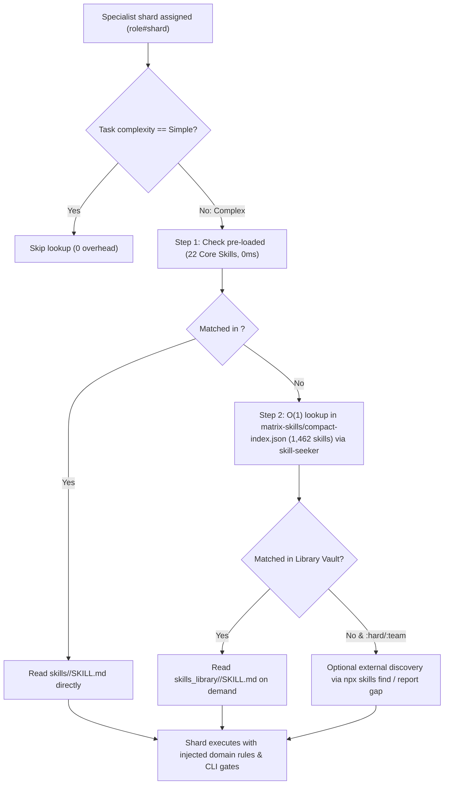

# BoomOpen Workflow Kit — CLI, Platform & Prompt API Contracts

> **Purpose**: Complete `v5.5.0` specification for the `boomopen` CLI (`12` subcommands & deterministic gates), 5-platform installation contracts, `32` base slash commands (`84` flat files), 17-language routing, and `HSOL v5.5` skill resolution
> **Parent**: [00-index.md](./00-index.md)
> **Version**: `5.5.0`
> **Last Updated**: 2026-11-10
> **Generated By**: docs-core skill

---

## Table of Contents

1. [API Surface Overview](#api-surface-overview)
2. [`boomopen` CLI Contract (`12` Subcommands)](#boomopen-cli-contract-12-subcommands)
3. [Deterministic Gate Specifications (`RES`, `DESIGN`, `PLAN`, `COOK`, `CHECK`)](#deterministic-gate-specifications-res-design-plan-cook-check)
4. [5-Platform Installation & Asset Mapping Contract](#5-platform-installation--asset-mapping-contract)
5. [Prompt Command & 17-Language Routing Interface (`32` Base Commands)](#prompt-command--17-language-routing-interface-32-base-commands)
6. [`HSOL v5.5` Progressive Skill Resolution Protocol](#hsol-v55-progressive-skill-resolution-protocol)
7. [Evidence Sources](#evidence-sources)

---

## API Surface Overview

BoomOpen Workflow Kit (`@boomopen/workflow-kit` `v5.5.0`) exposes four coordinated interfaces with **zero runtime npm dependencies**:

| Interface | Type | Consumer | Entry Point |
|-----------|------|----------|-------------|
| **`boomopen` CLI** | Node.js `>= 18.0.0` CLI (`12` subcommands) | Developer terminal & AI sub-agents | `"bin": { "boomopen": "./cli/install.js" }` (`39` modular `cli/*.js` files) |
| **Settings Local Web UI** | Local loopback HTTP server (`127.0.0.1:4567`) | Browser control panel | `boomopen settings --ui` (`cli/settings-ui.js`) |
| **Slash & 17-Language Prompt API** | `32` base slash commands (`84` flat files) + 17-language NL router | AI coding assistant at runtime | `GEMINI.md`, `CLAUDE.md`, `CODEX.md`, `CURSOR.md`, `COPILOT.md`, `AGENT.md` |
| **`HSOL v5.5` Skill Resolution API** | 2-step `O(1)` progressive lookup protocol | Specialist agent shards | `<skills>` + `matrix-skills/compact-index.json` + `skills/skill-seeker/SKILL.md` |

### Distribution & Invocation Contract

The repository is distributed **from source via GitHub** (`.releaserc.json` sets `npmPublish: false`):

```bash
git clone https://github.com/Kennyboom/BoomOpen-Workflow-Kit-Pro.git
cd BoomOpen-Workflow-Kit-Pro
node cli/install.js install --all
# Optional global `boomopen` binary link from local clone:
npm link && boomopen doctor
```

**Standard CLI Exit Codes**: `0` = Pass / Verified, `1` = Validation / Gate / Runtime Failure, `2` = Invalid CLI Usage / Arguments.

---

## `boomopen` CLI Contract (`12` Subcommands)

### Package Binary & npm Script Shortcuts (`package.json`)

```json
{
  "name": "@boomopen/workflow-kit",
  "version": "5.5.0",
  "main": "cli/install.js",
  "bin": {
    "boomopen": "./cli/install.js"
  }
}
```

### Summary of All `12` `boomopen` Subcommands

| # | Subcommand | Syntax | npm Script | Primary Purpose |
|:-:|------------|--------|------------|-----------------|
| 1 | `install` | `boomopen install <tool\|--all> [--with-hooks] [--force]` | `install:{cursor\|copilot\|antigravity\|claude\|codex\|all}` | Install kit across `cursor`, `copilot`, `antigravity` (alias `gemini`), `claude` (alias `claude-code`), `codex` with SHA-256 manifest backups; `--with-hooks` registers `validate-tool-call.mjs` in `~/.claude/settings.json` |
| 2 | `uninstall` | `boomopen uninstall <tool\|--all> [--force]` | `uninstall:{cursor\|copilot\|antigravity\|claude\|codex\|all}` | Manifest-safe removal preserving user files, restoring backups, and stripping marked blocks |
| 3 | `list` | `boomopen list` | `npm run list` | List all `5` supported platforms and live installation status |
| 4 | `settings` (alias `config`) | `boomopen settings [status\|get\|set\|mode\|preset\|sync\|reset\|ui\|--ui] [--project] [--port 4567]` | `npm run settings`, `npm run settings:ui` | Manage `~/.boomopen/settings.json` & `./.boomopen.json` (`4` presets, `20` enum + `2` line-limit keys), `< 10ms` AOT sync, and local Web UI on `http://127.0.0.1:4567` |
| 5 | `doctor` | `boomopen doctor [--platform <name>] [--source-only] [--rebuild-index]` | `npm run doctor` | Audit kit source, `5` platform bundles, Markdown line budgets & mojibake, `compact-index.json` (`1,462` skills), settings, and Conductor CLI engines |
| 6 | `check` | `boomopen check [dir] [--strict-phase] [--no-stubs] [--ignore <glob>]` | `npm run check` | Enforce Pragmatic 2-Tier Coding Standards (`400`/`500` lines, zero explicit `any`, zero prod `console.log`) + anti-stub / anti-skip ratchet |
| 7 | `research` | `boomopen research <validate\|brief> <file.md> [--mode research\|brainstorm] [--out <path>] [--json]` | `npm run research` | Validate `RESEARCH-*` / `BRAINSTORM-*` (`RES-G1..G4`) & compile compact downstream `HANDOFF_BRIEF` |
| 8 | `design` | `boomopen design <validate\|contract> <design.md> [--out <path>] [--json]` | `npm run design` | Validate `DESIGN-*` (`DESIGN-G1..G4`) & compile executable `DESIGN_CONTRACT` (`@theme` CSS + TypeScript props) |
| 9 | `plan` | `boomopen plan <validate\|compile> <plan.md> [--sync-ledger] [--json]` | `npm run plan` | Validate `PLAN-*` (`PLAN-G1..G5`: `<= 4 OWNED_FILES`/shard, collision-free DAG, `SHARED_CONTRACT`) & compile `.boomopen/project-ledger.json` |
| 10 | `cook` | `boomopen cook <state\|packets\|verify-wave\|preflight> [plan.md] [--wave <W>] [--git] [--run-verify]` | `npm run cook` | 5-Stage Fast-Forward state machine, 5-Field Wave Handoff Packet emitter, and post-wave `COOK-G1..G4` verifier |
| 11 | `ledger` | `boomopen ledger <init\|from-plan\|validate\|status\|next\|verify\|audit>` | `npm run ledger` | Multi-Session Autopilot `.boomopen/project-ledger.json` manager with SHA-256 Spec-Hash Drift Guard & test ratchet |
| 12 | `conduct` (alias `conductor`) | `boomopen conduct <probe\|dispatch\|council\|status> [options]` | `npm run conduct` | Cross-Engine `Author != Critic` pipeline (`READ_ONLY_FILES` SHA-256 guard) & 6-task Parallel Multi-Engine Council (`research\|brainstorm\|plan\|design\|review\|debug`) |

---

## Deterministic Gate Specifications (`RES`, `DESIGN`, `PLAN`, `COOK`, `CHECK`)

### 1. `boomopen research` Gates (`RES-G1..G4`)

| Gate ID | Validation Contract (`research` & `--mode brainstorm`) |
|---------|--------------------------------------------------------|
| **`RES-G1`** | `research` mode requires `>= 2` concrete citations (`https://`, `file://`, or `path.ext:line`) + explicit `[HIGH]`/`[MEDIUM]`/`[LOW]` confidence tags; `brainstorm` mode requires explicit Constraints/Assumptions + `>= 1` codebase/artifact/URL grounding anchor |
| **`RES-G2`** | Requires a comparison/decision matrix Markdown table (`>= 2` data rows) + an explicit Trade-Offs / Contradictions / Pre-Mortem / Devil's Advocate / Risks section |
| **`RES-G3`** | Requires both an Executive Verdict / Recommended Option section and a downstream `HANDOFF_BRIEF` / Recommended Architecture / Next Steps section |
| **`RES-G4`** | Enforces cohesive single-file hygiene (`<= 500` lines hard, `400` lines soft) with zero unfilled `{topic}` placeholders or `TODO`/`TBD` deferred markers |

### 2. `boomopen design` Gates (`DESIGN-G1..G4`)

| Gate ID | Validation Contract |
|---------|---------------------|
| **`DESIGN-G1`** | Requires perceptual `oklch(...)` tokens (or YAML `colors` + `typography` + `surface_elevation`/`spacing`) and rejects AI-slop defaults (banned un-paired `Inter`/`Roboto`/`Arial` primary fonts or `#8B5CF6` + `#06B6D4` neon purple-cyan gradients) |
| **`DESIGN-G2`** | Enforces the complete **5-State Component UI Matrix** (`Default`, `Loading`, `Empty`, `Error`, `Disabled/Focus`) across all 17 supported languages |
| **`DESIGN-G3`** | Enforces **WCAG 2.2 AA** contrast ratios (`4.5:1` / `3:1`), pointer/touch hit targets (`24x24px` or `44x44pt` / `48x48dp`), `prefers-reduced-motion`, and mobile + desktop breakpoints (`375px`..`1440px`) |
| **`DESIGN-G4`** | Enforces cohesive single-file size (`<= 500` lines) and an extractable `DESIGN_CONTRACT` (`@theme` / `--color-*` CSS block + TypeScript component `Props` interfaces) |

### 3. `boomopen plan` Gates (`PLAN-G1..G5`)

| Gate ID | Validation Contract |
|---------|---------------------|
| **`PLAN-G1`** | Requires `>= 1` structured task, unique `REQ-*` IDs, assigned `- **Agent**: <role#shard>`, non-empty `- **OWNED_FILES**:`, concrete `- **Verify**:` command, and `## Shared Interface Contracts (SHARED_CONTRACT)` whenever `>= 2` agents or parallel tasks exist |
| **`PLAN-G2`** | Enforces the Cognitive Load Sharding ceiling: **`<= 4 OWNED_FILES` per task shard** |
| **`PLAN-G3`** | Rejects self-contradictory `OWNED_FILES` / `READ_ONLY_FILES` overlaps and rejects any file/folder path collision between parallel tasks in the same wave |
| **`PLAN-G4`** | Verifies every `Depends On` phase/wave ID exists and guarantees the phase/wave dependency graph is a cycle-free DAG |
| **`PLAN-G5`** | Ensures 100% of declared `AC-*` acceptance criteria map to tasks/traceability and enforces cohesive single-file size (`<= 500` lines) |

### 4. `boomopen cook verify-wave` Gates (`COOK-G1..G4`) & `boomopen check`

| Gate ID | Validation Contract |
|---------|---------------------|
| **`COOK-G1`** | Inspects `git status --porcelain` (or `--changed-files`) and fails immediately if any `READ_ONLY_FILES` or out-of-scope file outside wave `OWNED_FILES` was mutated |
| **`COOK-G2`** | Verifies every expected deliverable in the wave's `OWNED_FILES` and `testFiles` exists on disk and is non-empty |
| **`COOK-G3`** | Runs `inspectSourceFile(..., { strictPhase: true })` across wave code deliverables (enforcing active `codingStandards` soft/hard line limits, zero explicit `any`, zero prod `console.log`, zero `TODO`/`FIXME` stubs, zero `.skip`/`.only`) |
| **`COOK-G4`** | Executes each shard's concrete `Verify` shell command (with `--run-verify`) and requires exit code `0` |

---

## 5-Platform Installation & Asset Mapping Contract

### Framework Bundle Contents (`<frameworkPath>/`)

Every `boomopen install <tool>` builds an isolated `<frameworkPath>/` containing:
- **`CORE_DIRS`**: `agents/`, `rules/`, `documents/` (verbatim), `commands/`, `matrix-skills/`, `cli/`, `scripts/` (`7` Python helpers)
- **`ROOT_FILES`**: `README.md`, `SKILL.md`, `package.json`, plus generated `install-files.json`

### Exact Per-Platform Target Paths (`cli/tool-config.js`)

| Platform (`tool`) | Global Entrypoint(s) (Marked Blocks) | Framework Root (`<frameworkPath>`) | Shared Commands / Workflows & Agents | Core Skills (`22`) & Library Vault (`1,440`) | Platform-Specific Extras & Legacy Cleanup |
|-------------------|--------------------------------------|------------------------------------|--------------------------------------|----------------------------------------------|-------------------------------------------|
| **Antigravity (Gemini)** (`antigravity`, `gemini`) | `~/.gemini/GEMINI.md` | `~/.gemini/config/skills/boomopen-workflow-kit/` | Agents: `~/.gemini/agents/` (incl. `AntigravityGlobal.agent.md`) & `~/.antigravity/agents/`; Workflows: `~/.gemini/config/global_workflows/` & `~/.antigravity/workflows/` | `~/.gemini/config/skills/` & `~/.gemini/config/skills_library/` | Cleans legacy `~/.gemini/AGENT.md` & `~/.gemini/CLAUDE.md` |
| **Claude Code** (`claude`, `claude-code`) | `~/.claude/CLAUDE.md`, `~/.claude/AGENT.md` | `~/.claude/skills/boomopen-workflow-kit/` | Commands: `~/.claude/commands/`; Agents: `~/.claude/agents/` | `~/.claude/skills/` & `~/.claude/skills_library/` | Opt-in `--with-hooks` installs & registers `validate-tool-call.mjs` (`PreToolUse`) in `~/.claude/settings.json` |
| **OpenAI Codex** (`codex`) | `~/.codex/CODEX.md`, `~/.codex/AGENTS.md`, `~/.codex/AGENT.md` | `~/.codex/skills/boomopen-workflow-kit/` | Commands: `~/.codex/commands/`; `21` role TOMLs: `~/.codex/agents/boomopen/*.toml` | `~/.codex/skills/` (`22` core + `79` `boomopen-workflow-kit-*` command skills) & `~/.codex/skills_library/` | TOML-aware merge into `~/.codex/config.toml` (validated before write) |
| **Cursor** (`cursor`) | `~/.cursor/CURSOR.md` (from `platforms/cursor/.cursorrules`), `~/.cursor/AGENT.md` | `~/.cursor/skills/boomopen-workflow-kit/` | Rule: `~/.cursor/rules/boomopen-workflow-kit.mdc`; Commands: `~/.cursor/commands/`; Agents: `~/.cursor/agents/` | `~/.cursor/skills/` & `~/.cursor/skills_library/` | Prunes deprecated pre-v5 global instruction files on upgrade |
| **GitHub Copilot** (`copilot`) | `~/.copilot/COPILOT.md`, `~/.copilot/AGENT.md` | `~/.copilot/skills/boomopen-workflow-kit/` | VS Code prompt: `<VSCodeUser>/prompts/boomopen-workflow-kit.agent.md`; Commands: `~/.copilot/commands/`; Agents: `~/.copilot/agents/` | `~/.copilot/skills/` & `~/.copilot/skills_library/` | Removes legacy `~/.copilot/CLAUDE.md` |

---

## Prompt Command & 17-Language Routing Interface (`32` Base Commands)

### Command Invocation Syntax

```text
/{cmd} [args]            -> Invokes router `commands/{cmd}.md` (or standalone command)
/{cmd}:{variant} [args]  -> Invokes flat workflow `commands/{cmd}-{variant}.md` directly
/{cmd}/{variant} [args]  -> Alias syntax resolving to `commands/{cmd}-{variant}.md`
```

### Complete `32`-Command Contract Matrix (`84` Flat Files = `79` `commands/*.md` + `5` `_ref/*.md`)

| Family / Group | Commands & Variants | Key Contract & Deliverable |
|----------------|---------------------|----------------------------|
| **Feature & Code (`2`)** | `/cook` (`:fast`, `:hard`, `:team`), `/code` (`:fast`, `:hard`, `:team`) | Turn-1 `boomopen cook state` fast-forward -> 3-Wave Contract-First `role#shard` execution (`COOK-G1..G4`) |
| **Architecture, UI & Discovery (`4`)** | `/plan`, `/design`, `/research`, `/brainstorm` (all `:fast`, `:hard`, `:team`) | Cohesive `<= 500`-line Brain Artifacts (`PLAN-*`, `DESIGN-*`, `RESEARCH-*`, `BRAINSTORM-*`) gated by `PLAN-G1..G5`, `DESIGN-G1..G4`, `RES-G1..G4` |
| **Quality, Debug & Audit (`5`)** | `/debug`, `/fix`, `/test`, `/review`, `/report` (all `:fast`, `:hard`, `:team`) | Evidence-cited `DEBUG-*`, `TEST-*`, `REVIEW-*`, `REPORT-*` + `boomopen check --strict-phase --no-stubs` |
| **Docs, Deploy & Q&A (`3`)** | `/docs` (`:core`, `:business`, `:audit`), `/deploy` (`:check`, `:preview`, `:production`, `:rollback`), `/ask` (`:fast`, `:hard`) | Workspace `./documents/` suites, deployment readiness gates, and grounded Q&A |
| **Autopilot & Conductor (`2`)** | `/autopilot` (`:init`, `:run`, `:audit`), `/conduct` (`:council`, `:pipeline`) | `.boomopen/project-ledger.json` multi-session execution & `.boomopen/conductor/runs/<runId>-COUNCIL-SYNTHESIS.md` |
| **Standalone (`16`)** | `/settings`, `/orchestrate`, `/save`, `/recap`, `/init`, `/next`, `/status`, `/preview`, `/rollback`, `/architect`, `/auto`, `/refactor`, `/performance`, `/security-audit`, `/deep-audit`, `/ui-ux-pro-max` | Single-command control, session persistence, architecture, security, performance, and design-system workflows |

### 17-Language Natural-Language Workflow Router (`skills/intelligent-routing/SKILL.md`)

Users speaking naturally without typing `/` in any of the **`17` supported languages** (`en`, `vi`, `zh-CN`, `zh-TW`, `ja`, `ko`, `es`, `fr`, `de`, `pt-BR`, `ru`, `hi`, `ar`, `id`, `th`, `tr`, `it`) are automatically routed into Mode B `commands/{cmd}-{variant}.md`:
- Research, brainstorming, and code/security review intents route to `:team` when `workflows.naturalLanguageResearchTrigger = auto_team`.
- Planning, UI/UX design, root-cause debug, multi-file bug-fix (`> 2` files), testing, end-to-end feature building, autopilot, cross-engine council, and documentation intents route directly to their canonical `commands/{cmd}-{variant}.md` workflow.
- **Approved-Plan Continuation** (*"proceed"*, *"go ahead"*, *"implement the plan"* after an approved `PLAN-*` exists) routes directly to `/code` (`boomopen cook packets`) without re-running `/plan`.

---

## `HSOL v5.5` Progressive Skill Resolution Protocol



### Fitness Scoring & Thresholds (`matrix-skills/_index.yaml`)

$$\text{fitness} = 0.35 \cdot \text{SEMANTIC\_MATCH} + 0.25 \cdot \text{SPECIFICITY} + 0.20 \cdot \text{TRUST\_LEVEL} + 0.10 \cdot \text{FRESHNESS} + 0.10 \cdot \text{SUCCESS\_RATE}$$

| Parameter | Value | Contract |
|-----------|:-----:|----------|
| `matrix_sufficient` | `>= 0.80` | Execute immediately with local Core/Library skill; skip external discovery |
| `matrix_adequate` | `0.75 – 0.80` | Execute with local skill; optional async recommendation |
| `matrix_insufficient` | `< 0.75` | External discovery candidate (`npx skills find "{keywords}"`, confirm with user before installing external packages) |
| `superiority_delta` | `0.15` | External dynamic skill must exceed local skill fitness by `>= 0.15` to supersede |

---

## Evidence Sources

| Source | Path |
|--------|------|
| Package manifest & binary definition | [package.json](../../package.json) |
| CLI router & install/uninstall/list | [cli/install.js](../../cli/install.js), [cli/tool-config.js](../../cli/tool-config.js), [cli/manifest.js](../../cli/manifest.js) |
| Settings CLI & Local Web UI (`4567`) | [cli/settings.js](../../cli/settings.js), [cli/settings-schema.js](../../cli/settings-schema.js), [cli/settings-ui.js](../../cli/settings-ui.js) |
| Doctor & 2-Tier code checker | [cli/doctor.js](../../cli/doctor.js), [cli/checker.js](../../cli/checker.js) |
| Artifact & wave compilers (`RES`, `DESIGN`, `PLAN`, `COOK`) | [cli/research.js](../../cli/research.js), [cli/design.js](../../cli/design.js), [cli/plan.js](../../cli/plan.js), [cli/cook.js](../../cli/cook.js) |
| Autopilot ledger & Cross-Engine Conductor | [cli/ledger.js](../../cli/ledger.js), [cli/conductor.js](../../cli/conductor.js) |
| Command & HSOL runtime rules | [rules/CORE.md](../../rules/CORE.md), [rules/SKILLS.md](../../rules/SKILLS.md), [rules/REFERENCE.md](../../rules/REFERENCE.md) |
