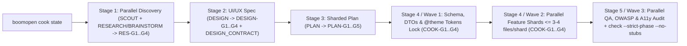

# BoomOpen Workflow Kit — Business Rules & Governance Logic

> **Purpose**: Complete `v5.5.0` governance specification — Orchestration Laws (`L1–L10`), Pragmatic 2-Tier Coding Standards, Cognitive Load Sharding (`role#shard`), Elastic Golden Diamond, Quality-First Model Policy, 17-Language Routing, Brain Artifacts First, and Self-Healing (`E0–E6`, `A1–A14`)
> **Parent**: [00-index.md](./00-index.md)
> **Version**: `5.5.0`
> **Last Updated**: 2026-11-10
> **Generated By**: docs-core skill

---

## Table of Contents

1. [Orchestration Laws (`L1–L10`)](#orchestration-laws-l1l10)
2. [Pragmatic 2-Tier Coding Standards & Zero-Omission Ratchet](#pragmatic-2-tier-coding-standards--zero-omission-ratchet)
3. [Proactive Sub-Agent First Gate & Cognitive Load Sharding (`role#shard`)](#proactive-sub-agent-first-gate--cognitive-load-sharding-roleshard)
4. [Quality-First Model Policy (`Model: "inherit"`)](#quality-first-model-policy-model-inherit)
5. [17-Language Natural-Language Intent Routing](#17-language-natural-language-intent-routing)
6. [5-Stage Fast-Forward & 3-Wave Contract-First Execution](#5-stage-fast-forward--3-wave-contract-first-execution)
7. [Elastic Golden Diamond Debate Rules & Cross-Engine Conductor](#elastic-golden-diamond-debate-rules--cross-engine-conductor)
8. [HSOL v5.5 Progressive Skill Resolution & Trust Progression](#hsol-v55-progressive-skill-resolution--trust-progression)
9. [Brain Artifacts First, Cohesive Single-File Rule & Language Compliance](#brain-artifacts-first-cohesive-single-file-rule--language-compliance)
10. [Error Classification (`E0–E6`) & Anti-Pattern Registry (`A1–A14`)](#error-classification-e0e6--anti-pattern-registry-a1a14)
11. [Evidence Sources](#evidence-sources)

---

## Orchestration Laws (`L1–L10`)

Defined in `rules/CORE.md` (`v5.5.0` Smart-Hybrid Edition), these 10 immutable governance laws bind every entrypoint, workflow command, and specialist shard:

| Law | Name | `v5.5.0` Rule | Enforcement Mechanism |
|:---:|------|---------------|-----------------------|
| **L1** | **Zero-Latency Entrypoint** | Global entrypoints (`<= 250` lines) pre-load the Mode A/B gate and 5-Field Handoff Packet; `rules/*.md` (`<= 300` lines) load on demand only in Mode B | Eliminates Turn-1 rule-reading latency on micro-edits |
| **L2** | **100% Requirement & Ledger Integrity** | Parse every user requirement into the Requirements Registry / `.boomopen/project-ledger.json` with zero silent omissions and SHA-256 Spec-Hash Drift Guard | `boomopen plan validate` (`PLAN-G5`) & `boomopen ledger audit` |
| **L3** | **4-Tier Dynamic Elastic Swarm Gate** | Never crawl `> 2` files solo in the primary agent; shard horizontally so each `role#shard` owns **`<= 3–4` heavy files or `1` deep vector** | `PLAN-G2` (`<= 4 OWNED_FILES`/shard) & Anti-Solo-Crawling Gate |
| **L4** | **Quality-First Model Policy** | Mandatory `Model: "inherit"` (or `"pro"`) across all `21` specialists; `"flash"` permitted strictly for trivial mechanical chores; **never `"flash_lite"`** | `models.subagentPolicy = quality_first` & `rules/AGENTS.md` |
| **L5** | **3-Wave Contract-First Execution** | Lock Wave 1 schemas, DTOs, and `DESIGN_CONTRACT` tokens in `READ_ONLY_FILES` before dispatching parallel Wave 2 feature shards with disjoint `OWNED_FILES` | `PLAN-G1`, `PLAN-G3`, & `boomopen cook verify-wave` (`COOK-G1`) |
| **L6** | **Dual-Language Compliance** | User responses, Brain Artifacts, and docs match the user's input language (technical terms in English); source code and code comments are **always English** | `language.response` & `rules/CORE.md` |
| **L7** | **5-Stage Fast-Forward & Direct Plan Dispatch** | Detect existing `SCOUT`/`RESEARCH`/`DESIGN`/`PLAN` artifacts via `boomopen cook state` and dispatch directly from an approved `PLAN` to domain shards without redundant middleman hops or re-planning | `boomopen cook state` & `boomopen cook packets` |
| **L8** | **Scoped Warm Sub-Agent Reuse** | Record `role#shard -> conversationId` and route all follow-ups, test/review fixes, and debate rounds via `send_message(Recipient: conversationId)` | Active Sub-agent Session Registry (`0s` cold-start) |
| **L9** | **4-Layer Phase Quality Ratchet** | Every artifact and code wave must pass deterministic CLI gates (`research`, `design`, `plan`, `cook verify-wave`, `check --strict-phase --no-stubs`, `ledger verify`) before completion | Non-zero CLI exit triggers `E2`/`E5` warm auto-repair |
| **L10** | **Brain Artifacts First & Clean Git Tree** | Write transient deliverables as single cohesive files (`<= 500` lines) to `<appDataDir>\brain\<conversation-id>\` on Antigravity (`./reports/{topic}/` fallback elsewhere), keeping Git 100% clean | `deliverables.routing = brain_artifacts` & `RES-G4`/`DESIGN-G4`/`PLAN-G5` |

---

## Pragmatic 2-Tier Coding Standards & Zero-Omission Ratchet

Enforced deterministically by `boomopen check [dir] --strict-phase --no-stubs` (`cli/checker.js`), `v5.5.0` replaces rigid mechanical 300-line file splitting with **Pragmatic 2-Tier Coding Standards**:

### Tier 1 — Strict Quality & Safety Rules (Zero Tolerance)

1. **Single Responsibility**: Every file and function serves one cohesive responsibility.
2. **Zero Explicit `any` (`forbidExplicitAny = true`)**: TypeScript code must use concrete types, `unknown` + Type Guards / Zod schemas, or generics `<T>`.
3. **Zero Leftover Production `console.log` (`warnConsoleLog = true`)**: Production UI, API, and service modules must use a structured logger (`debug`/`info`/`warn`/`error`). *(Allowed in CLI tools `cli/*.js`, scripts, and test benchmarks).*
4. **Error Handling & Named Constants**: Every async/API boundary requires `try/catch` + typed error handling; domain/config constants use `SCREAMING_SNAKE_CASE`.
5. **DRY & Clean Imports**: Extract logic repeated `>= 3` times; sort imports (`external -> internal -> relative`) and remove unused imports.
6. **Zero-Omission Phase Ratchet (`--strict-phase --no-stubs`)**: Rejects deferred markers (`TODO`, `FIXME`, `PLACEHOLDER`, `HACK`), hollow function stubs (`throw new Error("not implemented")`), and test gaming (`.skip`, `.only`, `test.todo`).

### Tier 2 — Flexible Structural Guidelines (Cohesion Over Fragmentation)

| Preset (`codingStandards.preset`) | Soft File Target | Hard File Ceiling | When to Split |
|-----------------------------------|:----------------:|:-----------------:|---------------|
| **`pragmatic` (Default)** | **`400` lines** | **`500` lines** | Keep cohesive single-responsibility files intact up to `~400–450` lines; split only when exceeding `500` lines or mixing multiple domains |
| **`strict`** | `300` lines | `400` lines | Tighter modular codebases |
| **`relaxed`** | `600` lines | `800` lines | Rapid prototyping (`solo-fast` preset) |

- **Custom Overrides & Exemptions**: `codingStandards.softFileLines` and `codingStandards.hardFileLines` (`1..100000`, `soft <= hard`) can be customized in `~/.boomopen/settings.json` or `./.boomopen.json`. Test suites, generated schemas/types, and Markdown docs are exempt from `boomopen check` code limits; kit instruction Markdown has its own `boomopen doctor` budget (`entrypoints <= 250`, `rules <= 300`, `commands, agents, teams, i18n, and skills <= 450` lines).
- **Function & Structural Targets**: Logic functions `~20–40` lines, UI/handlers `~40–80` lines, line width `~100–120` chars (flexible for URLs, regex, Tailwind classes, Markdown tables), nesting `<= 3–4` levels (prefer guard clauses), parameters `<= 4–5` (use options objects).

---

## Proactive Sub-Agent First Gate & Cognitive Load Sharding (`role#shard`)

### Cognitive Load Sharding Formula

Whenever target files are unknown on Turn 1, or work spans `> 2` files or `>= 2` domains, the Orchestrator computes parallel shard count via the **Cognitive Load Sharding Law**:

$$N_{\text{agents}} = \min\!\left(\text{maxParallelSubagents},\; \max\!\left(\left\lceil \frac{\text{Total Target Files}}{3.5} \right\rceil,\; \text{Distinct Domains},\; \text{Research Vectors}\right)\right)$$

### 4-Tier Elastic Swarm Matrix

| Swarm Tier | Execution Mode | Scope / Trigger | Parallel Sub-Agents | Sharding & Ownership Rule |
|------------|:--------------:|-----------------|:-------------------:|---------------------------|
| **Tier 0 — Micro Direct** | **Mode A** | `<= 2` already-known files on Turn 1, `1` domain, `0` exploration needed, no `/cmd`, no workflow intent | **`0`** | Primary agent edits, tests, and verifies directly under 2-Tier Standards |
| **Tier 1 — Focused Triad** | **Mode B** | `3–5` files OR `2` domains/vectors | **`2–3`** | Turn-1 parallel fan-out (`<= 3–4 OWNED_FILES` per agent) |
| **Tier 2 — Elastic Swarm** | **Mode B** | `6–12` files, `3–4` domains, OR `4–5` vectors | **`4–6`** | Horizontal sharding (`role#shard-1..N`), disjoint `<= 3–4 OWNED_FILES` + `SHARED_CONTRACT` |
| **Tier 3 — Hyper-Swarm** | **Mode B** | `13+` files, repo-wide audits, OR multi-module overhauls | **`7–10+`** *(up to `maxParallelSubagents`, default `8`)* | Full module sharding (`scouter#1..N`, `engineer#1..N`, `reviewer#1..M`) + Warm Session Reuse |

### Native Sub-Agent Dispatch Primitives & 5-Field Handoff Packet

- **`TypeName: "self"` (Mandatory Mode B Default)**: Grants full `write_file`, `run_command`, and `search_web` capabilities on Turn 1 with `0` `define_subagent` overhead.
- **`TypeName: "research"` Restriction**: Read-only sandbox with **no `search_web`, no `run_command`, and no `write_file`**. Reserved strictly for `0`-artifact ad-hoc codebase lookups; never used for `researcher`, `research-team`, `brainstorm-team`, or Mode B `scouter` shards writing `SCOUT-*.md`.
- **TIER 1 vs TIER 2 Fallback**: Always dispatch isolated sub-agents (**TIER 1**) when platform sub-agent tools exist; fall back to sequential `📋 EMBODIED: {agent}` (**TIER 2**) strictly when sub-agent tools are unavailable or error out.
- **Mandatory 5-Field Handoff Packet**: Every shard prompt includes `(1) MISSION & ACCEPTANCE CRITERIA`, `(2) SHARED_CONTRACT`, `(3) OWNED_FILES (<= 3–4 files)`, `(4) READ_ONLY_FILES`, and `(5) VERIFICATION & DELIVERABLE`.

---

## Quality-First Model Policy (`Model: "inherit"`)

| Model Parameter | Permitted Scope | Governance Rule |
|-----------------|-----------------|-----------------|
| **`Model: "inherit"`** (or `"pro"`) | All `21` specialist agents across engineering, architecture, planning, scouting, research, brainstorming, debugging, testing, reviewing, security, design, and documentation | **Mandatory Default** — preserves the user's selected Pro High reasoning quality |
| **`Model: "flash"`** | Trivial mechanical chores only (raw log aggregation, simple list formatting, status ping) | Permitted only when zero coding or architectural judgment is required |
| **`Model: "flash_lite"`** | **None** | **Strictly Forbidden** across all BoomOpen workflows |

---

## 17-Language Natural-Language Intent Routing

Even when a user types zero `/` slash commands, speaking naturally in any of the **`17` supported languages** (`en`, `vi`, `zh-CN`, `zh-TW`, `ja`, `ko`, `es`, `fr`, `de`, `pt-BR`, `ru`, `hi`, `ar`, `id`, `th`, `tr`, `it`) automatically activates Mode B and loads the matching flat `commands/{cmd}-{variant}.md` workflow (`skills/intelligent-routing/SKILL.md`):

- **Adversarial Discovery & Audit (`auto_team` default)**: Deep research (`commands/research-team.md`), brainstorming (`commands/brainstorm-team.md`), and code/security review (`commands/review-team.md`).
- **Structured Engineering Workflows**: Planning (`commands/plan-hard.md`), UI/UX design (`commands/design-hard.md`), root-cause debug (`commands/debug-hard.md`), multi-file bug-fix (`commands/fix-hard.md`), testing (`commands/test-hard.md`), feature build (`commands/cook-hard.md`), autopilot (`commands/autopilot.md`), multi-engine council (`commands/conduct-council.md`), and docs/report/deploy (`commands/docs-core.md`, `report-hard.md`, `deploy-check.md`).
- **Approved-Plan Direct Continuation**: Affirmative user confirmation after a `PLAN-*` artifact exists (*"proceed"*, *"go ahead"*, *"implement the plan"*) routes straight into `commands/code-hard.md` / `commands/code-team.md` (`boomopen cook packets`) — **never re-running `/plan`**.

---

## 5-Stage Fast-Forward & 3-Wave Contract-First Execution

- **Fast-Forward State Machine (`boomopen cook state`)**: Automatically skips Stage 1 if validated `SCOUT`/`RESEARCH`/`BRAINSTORM` exists, skips Stage 2 if validated `DESIGN` exists, and jumps straight to Stage 4 Wave 1 packet execution when an approved `PLAN` exists.
- **Persistent Verification Mandate**: Agents never stop after applying an unverified edit; every wave runs build/typecheck/tests + `boomopen cook verify-wave` + `boomopen check --strict-phase --no-stubs` and iteratively repairs failures via warm `send_message` until `100%` green.

---

## Elastic Golden Diamond Debate Rules & Cross-Engine Conductor

### Elastic Golden Diamond (`:team` — All `18` Specialist Teams)

`v5.5.0` upgrades `:team` from a fixed 3-agent triangle into an **Elastic Golden Diamond** governed by **3 Adversarial Pillars**:
1. **Pillar 1 — Tech Lead (`[1]`)**: Locks `SHARED_CONTRACT` & disjoint `OWNED_FILES`, arbitrates unresolved Round-3 disputes, stamps final consensus.
2. **Pillar 2 — Shard Executors (`[1..6 Parallel Shards]`)**: Scales from `1` executor (`<= 4` files, classic `1-1-1` triad) up to `6` parallel `role#shard` executors (`<= 3–4 OWNED_FILES` each) across Wave 1 -> Wave 2.
3. **Pillar 3 — Adversarial Critics & QA (`[1..3 Parallel Critics]`)**: Parallel `reviewer#code`, `security-engineer#sec`, `tester#1..k`, or `tech-lead#premortem` challenging work with empirical evidence.

- **Topology A (Turn-1 Parallel Fan-Out)**: Launches Lead + Executor shards + Critics simultaneously on Turn 1 for `/research:team`, `/brainstorm:team`, `/review:team`, Stage 1 discovery, and validated-plan `/code:team` / `/cook:team`.
- **Topology B (Contract-Lock First)**: Used for unplanned multi-file coding where Tech Lead locks `SHARED_CONTRACT` + `OWNED_FILES` in `MAILBOX-{date}.md` before Wave 1/Wave 2 shard fan-out.
- **C8 Checkpoints (`C8-TEAMS-01..04`)**:
  - `C8-TEAMS-01`: Append-only `MAILBOX-{date}.md` required for Round 2/3 exchanges.
  - `C8-TEAMS-02`: Debate capped at **`3` rounds** (`teams.maxDebateRounds`); targeted only to shards with `CRITICAL`/`HIGH` findings via warm `send_message` ("I disagree" without empirical proof is an automatic `FAIL`).
  - `C8-TEAMS-03`: Requires **both** deterministic CLI gate exit `0` and explicit consensus stamp: `CONSENSUS: TechLead [OK] | Executors (shard-1..N) [OK] | Critics/Reviewers (1..M) [OK]`.
  - `C8-TEAMS-04`: `100%` disjoint `OWNED_FILES` (`<= 3–4` files/shard) and zero `READ_ONLY_FILES` mutation.

### Cross-Engine Conductor (`/conduct` — `boomopen conduct`)

- **Cross-Engine Pipeline (`boomopen conduct dispatch`)**: Enforces `Author != Critic` across model families (`Claude`, `Codex`, `Antigravity`, `Cursor`, `Copilot`) with SHA-256 `READ_ONLY_FILES` snapshot restoration and 3-tier quota failover.
- **Parallel Multi-Engine Council (`boomopen conduct council`)**: Dispatches multiple engines concurrently across `6` task types (`research`, `brainstorm`, `plan`, `design`, `review`, `debug`) and synthesizes `.boomopen/conductor/runs/<runId>-COUNCIL-SYNTHESIS.md`.

---

## HSOL v5.5 Progressive Skill Resolution & Trust Progression

- **Fast 2-Step Lookup**: Step 1 checks pre-loaded `<skills>` (`22` Core Skills, `0ms`); Step 2 queries `matrix-skills/compact-index.json` (`1,462` skills = `22` Core + `1,440` Library) via `skill-seeker` and loads only the matched `SKILL.md` on demand.
- **Trust Lifecycle (`matrix-skills/_dynamic.yaml`)**: Curated Core/Library skills carry `trust = 1.0`. External community skills progress through `NEW (0.3) -> EVALUATING (0.5 after 3 runs) -> VALIDATED (0.7 after 10 runs) -> PROMOTED (1.0 at >= 10 runs, >= 85% success rate, <= 30 inactive days)`, decaying after `90` days of inactivity.

---

## Brain Artifacts First, Cohesive Single-File Rule & Language Compliance

- **Brain Artifacts First (Clean Git Tree)**: Transient deliverables (`RESEARCH`, `BRAINSTORM`, `SCOUT`, `DESIGN`, `PLAN`, `DEBUG`, `TEST`, `REVIEW`, `REPORT`, `MAILBOX`, `COUNCIL`) write to `<appDataDir>\brain\<conversation-id>\` on Antigravity (falling back to `./reports/{topic}/` on Claude Code, Codex, Cursor, and Copilot). Workspace `./documents/` is written **only** during `/docs` or explicit export requests.
- **Cohesive Single-File Rule (`<= 500` Lines)**: Standalone `RESEARCH-{topic}.md`, `BRAINSTORM-{topic}.md`, `DESIGN-{task}.md`, `PLAN-{task}.md`, `DEBUG-{issue}.md`, `TEST-{task}.md`, and `REVIEW-{task}.md` are kept as **1 cohesive single file (`<= 500` lines)** — never shattered into `{name}/` sub-folders at `150` lines (multi-file `00-index.md` chunking is reserved strictly for `./documents/knowledge-*/` suites).
- **Native Antigravity `"Proceed"` Button (`ArtifactMetadata.RequestFeedback`)**: Set `UserFacing: true, RequestFeedback: true` on actionable standalone `PLAN`, `DESIGN`, `RESEARCH`, `BRAINSTORM`, `DEBUG`, and defect-bearing `TEST`/`REVIEW` Brain Artifacts; set `UserFacing: false, RequestFeedback: false` on internal `SCOUT`, `MAILBOX`, and per-shard `*-v{k}.md` scratch notes.

---

## Error Classification (`E0–E6`) & Anti-Pattern Registry (`A1–A14`)

### Self-Healing Error Classification (`rules/ERRORS.md`)

| Code | Error Class | Deterministic `v5.5.0` Recovery Action |
|:----:|-------------|----------------------------------------|
| **E0** | **Sub-agent Interrupted / Server Restart** | **Warm Auto-Revive**: Resume the exact `conversationId` via `send_message` with zero context loss |
| **E1** | **Transient Tool / Network Error** | Retry up to `3x` with backoff; use native PowerShell / Node fallback on Windows shell mismatches |
| **E1b** | **Deliverable Size Overflow (`> 500` lines)** | Compress Brain Artifact into `1` cohesive file (`<= 500` lines) or compile `> 500`-line epics into `.boomopen/project-ledger.json` (`boomopen ledger from-plan`) |
| **E2** | **Build / Type / Test / `check` Failure** | Route exact `File:Line` failure back only to the owning warm `role#shard` via `send_message` and re-verify until `0` errors remain |
| **E3** | **Blocking Requirement / Contract Conflict** | Apply `autonomous_first` resolution when safe, or escalate via `ask_question` UI widget with `(Recommended)` option first |
| **E4** | **Cascading Cross-Shard Drift** | Halt propagation, rollback affected `OWNED_FILES`, amend `SHARED_CONTRACT` via `tech-lead`, and broadcast delta to warm shards via `send_message` |
| **E5** | **Deterministic CLI Gate Failure (`RES`/`DESIGN`/`PLAN`/`COOK`/`LEDGER`)** | Route exact failed gate IDs (`RES-G1..G4`, `DESIGN-G1..G4`, `PLAN-G1..G5`, `COOK-G1..G4`) to the owning warm shard via `send_message` and re-run CLI validator until exit `0` |
| **E6** | **Round-2 Debug / Review Deadlock** | **Cross-Engine Escalation**: Dispatch a second model family via `boomopen conduct dispatch --role debugger --engine cross_family --author-engine <prev>` |

### Cataloged Anti-Patterns (`A1–A14`)

| Code | Prohibited Anti-Pattern | Required `v5.5.0` Behavior |
|:----:|-------------------------|----------------------------|
| **A1** | Primary agent crawling/coding `> 2` files in Mode B | Spawn parallel `role#shard` sub-agents on Turn 1; execute directly only in Mode A (`<= 2` known files) |
| **A2** | Bypassing deterministic CLI validators | Pass `boomopen research\|design\|plan validate`, `cook verify-wave`, and `check --strict-phase --no-stubs` |
| **A3** | Silent halt or unverified fix | Run reproduction + tests + `check` end-to-end before reporting completion |
| **A4** | Weakening or skipping regression tests | Lock prior `tests/**` in `READ_ONLY_FILES`; forbid `.skip`, `.only`, and hollow assertions |
| **A5** | Lazy TIER 2 fallback or `TypeName: "research"` misuse | Use TIER 1 `invoke_subagent(TypeName: "self", Model: "inherit")` whenever tools exist |
| **A6** | Stalling Turn 1 with vague questions | Follow `clarification.style = autonomous_first`; ask `ask_question` only on genuine contradictions |
| **A7** | Unauthorized `SHARED_CONTRACT` / `OWNED_FILES` trespass | Enforce strict disjoint `OWNED_FILES` and `READ_ONLY_FILES` locks |
| **A8** | Serializing independent waves or vectors | Fan out independent discovery vectors and Wave 2 feature shards concurrently in a single turn |
| **A9** | Redundant middleman `tech-lead` or re-discovery hops | Fast-forward via `boomopen cook state` and dispatch directly from validated `PLAN` packets |
| **A10** | Downgrading model quality | Default `Model: "inherit"` (Pro High); never use `flash_lite` |
| **A11** | Cold re-spawning duplicate sub-agents | Reuse `role#shard -> conversationId` via `send_message` across all fix/debate rounds |
| **A12** | Concurrent writes to the same file | Lock disjoint `OWNED_FILES` and per-shard `*-v{k}.md` scratch notes |
| **A13** | Overloading one sub-agent with `> 4` files | Enforce Cognitive Load Sharding (`<= 3–4` heavy files or `1` vector per shard) |
| **A14** | Re-running `/plan`, `/design`, or `/debug` after `"Proceed"` | Fast-forward directly into `/code`, `/cook`, or `/fix` execution upon user approval |

---

## Evidence Sources

| Source | Path |
|--------|------|
| Laws `L1–L10`, Elastic Swarm, & Brain Artifacts | [rules/CORE.md](../../rules/CORE.md) |
| 5-Stage Fast-Forward & 3-Wave Contract-First topology | [rules/PHASES.md](../../rules/PHASES.md), [cli/cook.js](../../cli/cook.js) |
| Sharding, Model Policy, & Warm Session Registry | [rules/AGENTS.md](../../rules/AGENTS.md) |
| Elastic Golden Diamond (`18` teams) & C8 checkpoints | [rules/TEAMS.md](../../rules/TEAMS.md) |
| `HSOL v5.5` 2-step lookup & CLI gates | [rules/SKILLS.md](../../rules/SKILLS.md), [matrix-skills/_index.yaml](../../matrix-skills/_index.yaml) |
| Error codes `E0–E6` & Anti-Patterns `A1–A14` | [rules/ERRORS.md](../../rules/ERRORS.md) |
| 17-Language routing & cross-platform tool map | [rules/REFERENCE.md](../../rules/REFERENCE.md), [skills/intelligent-routing/SKILL.md](../../skills/intelligent-routing/SKILL.md) |
| Pragmatic 2-Tier Coding Standards & settings presets | [cli/checker.js](../../cli/checker.js), [cli/settings-schema.js](../../cli/settings-schema.js) |
