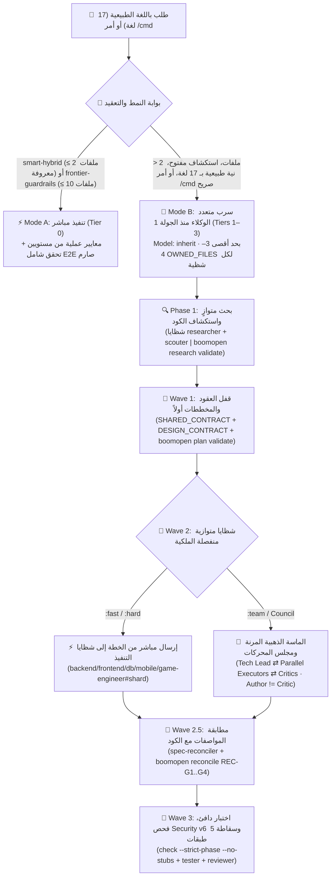

<div align="center">
  <h1>⚡ BoomOpen Workflow Kit Pro v5.5</h1>
  <p><strong>تنسيق سير العمل متعدد الوكلاء وبوابات التحقق الحتمية عبر CLI لبيئات Antigravity وClaude Code وOpenAI Codex وCursor وGitHub Copilot.</strong></p>

  <p>
    <a href="https://boomopen.com"></a>
    <a href="https://github.com/Kennyboom/BoomOpen-Workflow-Kit-Pro/releases"></a>
    <a href="#platforms"></a>
    <a href="#cli"></a>
    <a href="#skills"></a>
    <a href="https://nodejs.org/">= 18.0.0" /></a>
    <a href="../LICENSE"></a>
  </p>

  <p>
    <a href="../README.md">English</a> •
    <a href="./README.vi.md">Tiếng Việt</a> •
    <a href="./README.zh-CN.md">简体中文</a> •
    <a href="./README.zh-TW.md">繁體中文</a> •
    <a href="./README.ja.md">日本語</a> •
    <a href="./README.ko.md">한국어</a> •
    <a href="./README.es.md">Español</a> •
    <a href="./README.fr.md">Français</a> •
    <a href="./README.de.md">Deutsch</a><br/>
    <a href="./README.pt-BR.md">Português (BR)</a> •
    <a href="./README.ru.md">Русский</a> •
    <a href="./README.hi.md">हिन्दी</a> •
    <b>العربية</b> •
    <a href="./README.id.md">Bahasa Indonesia</a> •
    <a href="./README.th.md">ไทย</a> •
    <a href="./README.tr.md">Türkçe</a> •
    <a href="./README.it.md">Italiano</a>
  </p>

  <p>
    <a href="https://boomopen.com"><b>🌐 boomopen.com (15 لغة)</b></a> •
    <a href="#trailer"><b>🎬 عرض الإطلاق</b></a> •
    <a href="#why-boomopen"><b>⚡ لماذا BoomOpen</b></a> •
    <a href="#architecture"><b>🏗️ البنية الهندسية</b></a> •
    <a href="#quickstart"><b>🚀 البدء السريع</b></a> •
    <a href="#cli"><b>🛠️ 14 بوابة CLI</b></a> •
    <a href="#settings"><b>🎛️ الأنماط والإعدادات</b></a> •
    <a href="#commands"><b>🎯 36 أمراً</b></a> •
    <a href="#agents"><b>🤖 22 وكيلاً و18 فريقاً</b></a> •
    <a href="#skills"><b>📚 1,462 مهارة</b></a>
  </p>
</div>

---

<a id="trailer"></a>

## 🎬 عرض الإطلاق الرسمي والمستكشف التفاعلي (`boomopen.com`)

<div align="center">
  <a href="https://github.com/Kennyboom/BoomOpen-Workflow-Kit-Pro/raw/main/assets/media/boomopen_v55_trailer_en.mp4">
    
  </a>
  <p>
    ▶️ <a href="https://github.com/Kennyboom/BoomOpen-Workflow-Kit-Pro/raw/main/assets/media/boomopen_v55_trailer_en.mp4"><b>تشغيل عرض الإطلاق بدقة Full HD 1080p (ملف MP4 بتعليق صوتي احترافي)</b></a> • 🌐 <a href="https://boomopen.com"><b>استكشف ساحة تجربة أوامر CLI الـ 14 والفهارس التفاعلية على boomopen.com (15 لغة)</b></a>
  </p>
</div>

---

<a id="why-boomopen"></a>
<a id="-what-is-boomopen-workflow-kit"></a>

## ⚡ لماذا BoomOpen Workflow Kit؟

**مشكلة مساعدات البرمجة الخام بالذكاء الاصطناعي:** تتراجع كفاءة أدوات البرمجة أحادية الوكيل بمجرد أن يمتد العمل الهندسي عبر عدة ملفات أو مجالات أو جلسات. فالاستكشاف المتسلسل للملفات يلوّث نافذة السياق الرئيسية، والوكلاء الفرعيون غير المنسقين يكتبون فوق الملفات المشتركة أو يتركون وحدات برمجية معزولة ("island modules")، والكود المولَّد يُشحن مع نصوص `TODO` صامتة أو تجاوزات أنواع `any`، والمراجعة أحادية النموذج تغفل عن نقاطها العمياء (`Author == Critic`)، كما تنحرف المشاريع متعددة المراحل عن مواصفاتها الأصلية.

**كيف يحل BoomOpen ذلك:** يثبّت BoomOpen منظومة موحدة للتنسيق والتحقق عبر **Antigravity (Gemini)** و**Claude Code** و**OpenAI Codex** و**Cursor** و**GitHub Copilot** مع **صفر تبعيات تشغيل npm**. ومع تفعيل النمط **`smart-hybrid`** افتراضياً، تُنفَّذ التعديلات على `≤ 2` ملفات مباشرةً دون أي عبء إضافي، بينما تُجزَّأ المهام متعددة الملفات والبحث العميق والتخطيط المعماري و**`36` أمر slash (`93` ملفاً)** تلقائياً منذ الجولة الأولى عبر **22 وكيلاً متخصصاً** و**18 فريقاً تنافسياً ثلاثي الأدوار** — محكومةً بـ **14 بوابة محلية في أداة `boomopen` عبر CLI** ومدعومةً بـ **`1,462` مهارة عند الطلب** (`22` مهارة أساسية + `1,440` مهارة مكتبية موحدة دون تكرار في `~/.agents/skills_library`).

### ⚖️ بدون BoomOpen مقابل مع BoomOpen v5.5

| نمط الفشل الهندسي | بدون BoomOpen (بيئة ذكاء اصطناعي خام) | مع BoomOpen Workflow Kit Pro v5.5 |
|:-------------------------|:------------------------------|:------------------------------------|
| **تضخم نافذة السياق** | يقرأ الوكيل الرئيسي `15–30` ملفاً بالتتابع قبل كتابة سطر كود واحد | **سرب مرن منذ الجولة الأولى (`role#shard`)**: يطلق مستكشفين للقراءة فقط وشظايا متخصصة (`≤ 3–4` ملفات/شظية) مع إعادة استخدام دافئة `0s` عبر `send_message` |
| **التصادم المتوازي وفشل الربط** | يكتب الوكلاء المتوازيون فوق الملفات المشتركة، أو يخترعون مسارات `/api` متعارضة، أو يتركون وحدات ميتة | **أقفال العقود أولاً + مطابقة Wave 2.5**: يقفل `SHARED_CONTRACT` في الموجة 1 وملكية `OWNED_FILES` المنفصلة، ويتحقق عبر `boomopen reconcile` (`REC-G1..G4`) |
| **بحث سطحي وخطط فضفاضة** | إجابات أحادية المنظور ("فكرة رائعة!")، ادعاءات غير موثقة، وخطط إنشائية غير منضبطة | **مواصفات سداسية الكتل محكومة بالأدلة**: مراجعة تنافسية `:team` (محامي الشيطان) + مدققات CLI في `< 50ms` (`boomopen research` و`design` و`plan`) |
| **بقايا `TODO` الصامتة و`any` والتحايل بالاختبارات** | يعلن الوكيل اكتمال المهمة تاركاً `// TODO` أو `any` صريحة أو `console.log` أو اختبارات `.skip` | **بوابة ثابتة عملية من مستويين**: يفرض `boomopen check --strict-phase --no-stubs` صفر `any` وصفر قوالب ناقصة وملفات مترابطة بسقف `400/500` سطر |
| **انجراف الجلسات المتعددة والانحدار** | يمحو ضغط السياق قيود المراحل السابقة فيكسر ميزات كانت تعمل بنجاح | **سقاطة الجودة خماسية الطبقات والتراجع**: سجل `.boomopen/project-ledger.json` بحارس SHA-256، وأوامر `/autopilot` و`/audit`، وتراجع ذري عبر `rollback --yes` |
| **النقاط العمياء للنموذج الواحد** | النموذج نفسه يكتب الكود ويراجعه لنفسه (`Author == Critic`) | **الموجّه العابر للمحركات (`/conduct`)**: مجالس متوازية متعددة المحركات وخطوط أنابيب عابرة للعائلات بين Claude Code وCodex وAntigravity وCursor وCopilot |
| **تباين إعدادات 5 بيئات وتلوث شجرة Git** | ملفات توجيه منفصلة لكل IDE، غيغابايتات من المهارات المكررة، ومسودات مؤقتة تلوث `git status` | **مزامنة موحدة وشجرة Git نظيفة**: مزامنة 14 ملف دخول في `< 10ms`، مكتبة مشتركة واحدة `~/.agents/skills_library` (`0` توكن خامل)، وتوجيه المخرجات المؤقتة إلى Brain Artifacts |

---

<a id="architecture"></a>
<a id="-smart-hybrid-architecture-v55"></a>

## 🏗️ البنية الهجينة الذكية Smart-Hybrid (v5.5)



---

<a id="pillars"></a>

## 🧠 الركائز الهندسية الست الأساسية

1. **🌐 ترجمة أصلية لخمس بيئات IDE وخزينة موحدة دون تكرار (`platforms/*`)**:
   - يترجم **22 وكيلاً متخصصاً** و**93 ملف أوامر ومراجع** إلى الصيغ الأصلية لكل بيئة: **Antigravity** (حزمة إضافة `--as-plugin` + `3` نصوص Python تنفيذية لأداة `run_workflow`: `audit_fanout.py` و`review_fanout.py` و`research_fanout.py`)، و**Claude Code** (شظايا `isolation: worktree` وأوامر النقطتين مثل `/plan:hard` وخطافات `PreToolUse` و`Stop`/`PreCompact` الاختيارية)، و**OpenAI Codex** (`22` دوراً بصيغة TOML مع صناديق عزل `read-only` على مستوى نظام التشغيل للمستكشفين والمراجعين + `87` مهارة `$boomopen-*`)، و**Cursor** (قواعد `.mdc` + خطاف `beforeShellExecution` اختياري)، و**GitHub Copilot** (وكلاء التوجيه `.agent.md`).
   - يربط جميع مهارات المكتبة البالغ عددها `1,440` مرةً واحدة في `~/.agents/skills_library` عبر المنصات الخمس (توفير يقارب `~80%` من مساحة القرص و`0` تضخم في توكنات الجولة الأولى).
2. **🎯 السرب المرن رباعي المستويات (`role#shard`) وإعادة الاستخدام الدافئة الموجهة**:
   - يتدرج تلقائياً من **المستوى 0** (`0` وكلاء فرعيين عند `≤ 2` ملفات معروفة) ← **المستوى 1** (`2–3` شظايا) ← **المستوى 2** (`4–6` شظايا) ← **المستوى 3** (`7–8+` شظايا، قابلة للضبط حتى `16`)، مع حصر العبء المعرفي في **`≤ 3–4 OWNED_FILES` لكل وكيل فرعي** وإعادة استخدام الجلسات النشطة عبر `role#shard → conversationId` (`send_message`).
3. **🤝 التنفيذ القائم على العقود من 3 موجات + مطابقة الموجة Wave 2.5 (`REC-G1..G4`)**:
   - تقفل الموجة 1 عقود `SHARED_CONTRACT` (مخططات API وDTOs) و`DESIGN_CONTRACT` (رموز ألوان OKLCH في `@theme` CSS + خصائص TypeScript) قبل أن تطلق الموجة 2 المهندسين بالتوازي. وفي الموجة Wave 2.5 يشغّل `boomopen reconcile` مع `spec-reconciler` فحوصات ترصد الملفات المعزولة غير المربوطة (`REC-G1`)، وتعارض المسارات بين الواجهة والخلفية (`REC-G2`)، وبنود `[SC-*]` المتخطاة (`REC-G3`)، ومفاتيح `.env.example` الناقصة (`REC-G4`)، مع تعديل موجات التصحيح تلقائياً عبر `boomopen cook amend-plan`.
4. **🏛️ التشغيل الذاتي متعدد الجلسات (`/autopilot`) والتدقيق المرحلي متعدد الجولات (`/audit`)**:
   - يترجم المواصفات متعددة الوثائق إلى `.boomopen/project-ledger.json` مع كشف الانجراف ببصمة SHA-256، ونقاط استعادة Git قبل كل مرحلة (`boomopen ledger rollback --yes`)، و**سقاطة جودة خماسية الطبقات** صارمة (`G1 check --strict-phase --no-stubs` ← `G2` سقاطة الاختبارات التزايدية ← `G3 reconcile --strict` ← `G4` مراجعة `Author != Critic` ← `G5 ledger verify`). وبعد البناء يجري `/audit` جولات تدقيق خاضعة لموافقة المطور تشمل مصفوفة تتبع المتطلبات RTM والتدفق الرأسي وفحص Security v6 (`.boomopen/audit-ledger.json` + `boomopen audit rollback --yes`).
5. **🎼 الموجّه العابر للمحركات ومجلس المحركات المتعددة (`boomopen conduct`)**:
   - ينسّق Claude Code وOpenAI Codex وAntigravity وCursor وCopilot بالتزامن ضمن **مجالس متوازية لست مهام** (`research` و`brainstorm` و`plan` و`design` و`review` و`debug` ← تقرير توافقي رباعي الأجزاء `COUNCIL-SYNTHESIS.md`) أو ضمن **خطوط أنابيب عابرة للعائلات** بحيث لا يقيّم أي نموذج مخرجاته بنفسه (`Author != Critic`).
6. **📏 معايير البرمجة العملية ثنائية المستوى وتشخيص الجذور SPIE v3.0**:
   - **المستوى 1 (عدم التسامح مطلقاً)**: المسؤولية الواحدة، `0` استخدام صريح لنوع `any`، `0` عبارات `console.log` للتصحيح في كود التطبيق، حدود `try/catch` مع أخطاء مُنمَّطة، وثوابت بصيغة `SCREAMING_SNAKE_CASE`. **المستوى 2 (الترابط أولاً)**: استهداف `~200–350` سطراً للملف (`400` حد مرن / `500` حد أقصى للتقسيم؛ مع استثناء الاختبارات والأنواع والوثائق). وتمر الأخطاء عبر 3 فرضيات مرتبة وسلسلة **5-Whys (SPIE v3.0)** السببية مع توجيه المسودات المؤقتة إلى Brain Artifacts للحفاظ على شجرة عمل Git نظيفة بنسبة `100%`.

---

<a id="platforms"></a>
<a id="-supported-ai-platforms"></a>

## 💻 منصات البرمجة الخمس المدعومة بالذكاء الاصطناعي

| المنصة | الدعم | ملفات الدخول المتزامنة | التكامل الأصلي مع المنصة |
|:---------|:-------:|:---------------------|:----------------------------|
| **Antigravity (Gemini)** | ✅ v5.5 | `~/.gemini/GEMINI.md` | استدعاء `invoke_subagent`، تفريع Python عبر `run_workflow`، الحلقة الخارجية `/goal`، حزمة `--as-plugin`، خطافات `--with-hooks` الاختيارية، وBrain Artifacts |
| **Claude Code** | ✅ v5.5 | `~/.claude/CLAUDE.md` | شظايا `Task`/`Agent` متوازية (`isolation: worktree`)، أوامر النقطتين مثل `/plan:hard`، وخطافات `PreToolUse` و`Stop`/`PreCompact` الاختيارية |
| **OpenAI Codex** | ✅ v5.5 | `~/.codex/AGENTS.md` و`CODEX.md` | `22` دوراً بصيغة TOML في `~/.codex/agents/boomopen/` مع عزل نظام التشغيل `sandbox_mode = "read-only"` للمستكشفين والمراجعين + `87` مهارة `$boomopen-*` |
| **Cursor** | ✅ v5.5 | `~/.cursor/rules/boomopen-workflow-kit.mdc` | قواعد `.mdc` نشطة دائماً ببيانات وصفية، ملف `CURSOR.md`، توجيه الوكلاء الفرعيين وملف `.cursor/hooks.json` الاختياري (`beforeShellExecution`) |
| **GitHub Copilot** | ✅ v5.5 | `~/.copilot/copilot-instructions.md` | وكيل التوجيه المترجم `boomopen-workflow-kit.agent.md` في VS Code، تفويض `runSubagent` وملف `COPILOT.md` |

---

<a id="quickstart"></a>
<a id="-quick-start--installation"></a>

## 🚀 البدء السريع والتثبيت (عبر Git فقط — صفر تبعيات تشغيل)

```bash
# 1. استنسخ المستودع (يُوزَّع حصرياً عبر GitHub — غير منشور إطلاقاً على npm)
git clone https://github.com/Kennyboom/BoomOpen-Workflow-Kit-Pro.git
cd BoomOpen-Workflow-Kit-Pro

# 2. ثبّت لبيئة IDE الخاصة بك (النمط الافتراضي: smart-hybrid) أو لجميع البيئات الخمس دفعةً واحدة
npm run install:all                                 # تثبيت ومزامنة البيئات الخمس + مكتبة ~/.agents/skills_library المشتركة
npm run install:antigravity                         # Google Antigravity 2.0 (أو أضف --as-plugin / --with-hooks)
node cli/install.js install claude --with-hooks     # Claude Code + خطافات PreToolUse وStop/PreCompact الاختيارية
npm run install:codex                               # OpenAI Codex CLI + صناديق عزل read-only للمستكشفين والمراجعين
npm run install:cursor                              # Cursor (مرر --with-hooks لتفعيل حارس beforeShellExecution)
npm run install:copilot                             # GitHub Copilot (ملف .agent.md في VS Code + copilot-instructions.md)

# 3. تحقق من سلامة التثبيت واربط أمر `boomopen` اختيارياً في مسار PATH العام
npm run doctor
npm link
boomopen settings status
```

> **تثبيت وإلغاء تثبيت آمن غير تدميري**: يُتتبَّع كل ملف عبر بيانات SHA-256 في `~/.boomopen/manifests/<tool>.json`. وتُحفظ قواعدك الشخصية الموجودة مسبقاً في `GEMINI.md` و`CLAUDE.md` خارج علامات الحزمة مع نسخ احتياطي تلقائي؛ بينما يزيل الأمر `boomopen uninstall <tool|--all>` ملفات الحزمة غير المعدَّلة بنظافة تامة دون المساس بملفاتك الخاصة.

---

<a id="cli"></a>

## 🛠️ الأوامر الفرعية الـ 14 عديمة التبعيات في CLI (`boomopen`)

تعمل محلياً خلال `< 50ms` على Node.js `>= 18` مع **صفر تبعيات تشغيل npm** و**صفر اتصالات شبكية**:

| الأمر الفرعي | أبرز الخيارات والصيغة | البوابات الحتمية والغرض الهندسي |
|:-----------|:-------------------|:------------------------------|
| **`install` / `uninstall` / `list`** | `<tool\|--all> [--with-hooks] [--as-plugin]` | مثبّت ببصمات SHA-256، رابط مكتبة `~/.agents/skills_library` المشتركة، خطافات أمان اختيارية ومزيل تثبيت نظيف |
| **`doctor`** | `[--source-only]` | فحص قراءة فقط من 30 نقطة لحزم البيئات الخمس و`93` ملف أمر و`72` ملف فريق و`1,462` مهارة والإعدادات المتزامنة |
| **`settings`** | `status \| preset <name> \| set <k> <v> \| --ui` | إدارة 5 أنماط جاهزة + `22` مفتاح إعداد (`--project` لملف `./.boomopen.json`) أو تشغيل واجهة ويب محمية بـ CSP (`127.0.0.1:4567`) |
| **`research`** | `<validate\|brief> <file.md> [--mode brainstorm]` | يفرض بوابات **`RES-G1..G4`** (`≥ 4` مصادر مثلثة التحقق، مصفوفة التناقضات، مخاطر ما قبل التنفيذ) ويولّد `HANDOFF_BRIEF` |
| **`design`** | `<validate\|contract> <DESIGN.md> [--json]` | يفرض بوابات **`DESIGN-G1..G4`** (مواصفات 6 كتل، رموز OKLCH، مصفوفة حالات الواجهة الـ 5، معيار WCAG 2.2 AA) ويصدر `DESIGN_CONTRACT` |
| **`plan`** | `<validate\|compile> <PLAN.md> [--sync-ledger]` | يفرض بوابات **`PLAN-G1..G5`** (مخطط DAG خالٍ من الحلقات، ملكية منفصلة `OWNED_FILES ≤ 4`/شظية، `SHARED_CONTRACT`) ويزامن السجل |
| **`cook`** | `<state\|packets\|verify-wave\|preflight\|amend-plan>` | يفرض بوابات **`COOK-G1..G4`**: حالة التقدم من 5 مراحل، حزم التسليم ذات الحقول الـ 5، فحص أقفال كتابة Git وموجات التعديل |
| **`reconcile`** | `<dir> [--plan <PLAN.md>] [--strict]` | بوابات الموجة Wave 2.5 **`REC-G1..G4`**: يرصد الوحدات المعزولة غير المربوطة، انحراف مسارات `/api`، بنود `[SC-*]` المتخطاة وفجوات `.env.example` |
| **`check`** | `[path] --strict-phase --no-stubs [--ignore <dir>]` | بوابة الفحص الثابت ثنائية المستوى: حدود `400/500` سطر، `0` نوع `any` صريح، `0` عبارات `console.log` للتصحيح، `0` قوالب ناقصة/`TODO`/`.skip` |
| **`ledger`** | `<init\|from-plan\|status\|next\|verify\|rollback>` | آلة حالة DAG متعددة الجلسات في `.boomopen/project-ledger.json`، حارس انحراف المواصفات بـ SHA-256، وتراجع ذري عبر `rollback --yes` |
| **`audit`** | `<init\|slice\|record\|approve\|verify-fix\|rollback>` | سجل التدقيق متعدد الجولات بعد الإكمال (`.boomopen/audit-ledger.json`)، سقاطة تقليص العيوب وتراجع ذري `rollback --yes` |
| **`conduct`** | `<probe\|council\|dispatch\|status> [--dry-run]` | موجّه المحركات ومجلس المحركات المتوازي لست مهام (`Author != Critic` عبر 5 بيئات IDE ← `COUNCIL-SYNTHESIS.md`) |

---

<a id="settings"></a>
<a id="-unified-settings--mode-selection-settings"></a>

## 🎛️ مركز التحكم الموحد والأنماط الخمسة الجاهزة (`/settings`)

أدِر **`20` مفتاح تعداد + مفتاحَي حدود أسطر مخصصين** على المستوى العام (`~/.boomopen/settings.json`) أو لكل مستودع (`./.boomopen.json`)، مع مزامنة فورية عبر جميع ملفات الدخول الـ 14 للبيئات في أقل من `< 10ms`:

| النمط الجاهز | وضع التنفيذ (`execution.mode`) | أمر `/cmd` الافتراضي | توجيه اللغة الطبيعية بـ 17 لغة (`naturalLanguageResearchTrigger`) | معايير الكود | الاستخدام الأمثل |
|:---------------|:----------------------------------|:--------------:|:---------------------------------------------------------:|:----------------:|:--------------|
| **⚡ `smart-hybrid`** *(Default)* | **`auto`** (`≤ 2` ملفات مباشرة؛ `> 2` ملفات أو `/cmd` ← سرب Mode B) | `auto` | **`auto_team`** *(يوجه البحث وتوليد الأفكار والمراجعة باللغة الطبيعية إلى `:team` ومسارات العمل بـ 17 لغة)* | `pragmatic` (`400/500`L) | التجربة الافتراضية الجاهزة: توجيه النوايا باللغة الطبيعية + تقسيم متوازٍ تلقائي منذ الجولة الأولى |
| **🛡️ `frontier-guardrails`** *(Slim Opt-In)* | **`mode_a`** (`≤ 10` ملفات مباشرة؛ نقطة دخول رشيقة `< 2.5 KB` / `~600` توكن) | `auto` | **`off`** *(أوامر `/cmd` الصريحة فقط — صفر اعتراض للغة الطبيعية)* | `pragmatic` (`400/500`L) | وضع مباشر يومي فائق الخفة `< 2.5 KB` مع بوابات المستوى الثنائي وE2E الصارمة *(يدعم الاسم البديل `carbon-guardrails`)* |
| **🚀 `solo-fast`** | **`mode_a`** (`≤ 10` ملفات مباشرة؛ حد أقصى متحفظ `3` شظايا) | `fast` | `off` | `relaxed` (`600/800`L) | النماذج الأولية السريعة، النصوص البرمجية الصغيرة، الإصلاحات العاجلة وأقل استهلاك للتوكنات |
| **🧠 `deep-architect`** | **`mode_b`** *(منسق Mode B صارم؛ حد أقصى `12` شظية)* | `hard` | `auto_hard` + بحث `council` / مراجعة `cross_family` | `strict` (`300/400`L) | البنى المعمارية المعقدة، التصميم التأسيسي للمشاريع الجديدة وإعادة الهيكلة عبر الوحدات |
| **🔺 `adversarial-team`** | **`team`** *(الماسة الذهبية المرنة `:team`؛ `hyper_swarm` بحد أقصى `12`)* | `team` | **`auto_team`** + مجلس `council` للبحث والتخطيط والمراجعة | `strict` (`300/400`L) | إصدارات الإنتاج الحرجة، التدقيقات الأمنية والتوافق متعدد المحركات |

```bash
# بدّل الأنماط أو خصّص المفاتيح عبر المحادثة (/settings)، أو واجهة الويب المحلية (--ui)، أو سطر الأوامر CLI:
boomopen settings --ui                                      # تشغيل مركز التحكم المحلي عبر الويب على http://127.0.0.1:4567
boomopen settings preset smart-hybrid                       # الافتراضي: Auto Mode A/B + توجيه مسارات العمل بـ 17 لغة
boomopen settings preset frontier-guardrails                # اختياري: وضع Mode A رشيق بحجم < 2.5 KB (الاسم البديل: carbon-guardrails)
boomopen settings set engines.reviewer cross_family         # فرض مراجع من عائلة نماذج مختلفة (Author != Critic)
cd path/to/your/repo && boomopen settings mode team --project # تخصيص محلي للمستودع في ملف ./.boomopen.json
boomopen settings reset                                     # استعادة إعدادات smart-hybrid الافتراضية
```

---

<a id="commands"></a>
<a id="-slash-commands-reference"></a>

## 🎯 مرجع أوامر Slash الـ 36 الكاملة (`93` ملفاً = `87` مسار عمل + `6` في `_ref/`)

تحدّث بلغة طبيعية بأي من **اللغات الـ 17 المدعومة** ضمن نمط `smart-hybrid` أو استدعِ أياً من **أوامر slash القياسية الـ 36** بشكل صريح:

| الفئة | الأمر | الأنماط الفرعية | الغرض الهندسي والمخرجات الحتمية |
|:---------|:--------|:---------|:-------------------------------------|
| **التنسيق والتشغيل الذاتي** | **`/cook`** | `:fast`, `:hard`, `:team` | بناء ميزات متكامل من البداية للنهاية عند عدم وجود خطة مسبقة (استكشاف ← خطة تعاقدية ← شظايا متوازية ← مطابقة Wave 2.5 ← ضمان جودة) |
| | **`/code`** | `:fast`, `:hard`, `:team` | تنفيذ ملف `PLAN-{task}.md` المعتمد مباشرةً عبر شظايا الموجات 1–3 دون إعادة تشغيل `/plan` |
| | **`/autopilot`** | `:init`, `:run`, `:audit` | منسق متعدد الجلسات من المواصفات إلى الإنتاج عبر `.boomopen/project-ledger.json` و**سقاطة الجودة خماسية الطبقات** |
| | **`/conduct`** | `:council`, `:pipeline` | مجلس متوازٍ متعدد المحركات (`COUNCIL-SYNTHESIS.md`) وخط أنابيب عابر للعائلات عبر 5 بيئات IDE (يدعم `--dry-run`) |
| | **`/orchestrate`** / **`/auto`** | — | تنسيق مخصص لأسراب متعددة المجالات (`/orchestrate`) أو تنفيذ ذاتي شامل من البداية للنهاية (`/auto`) |
| **المعمارية والتصميم والبحث** | **`/plan`** | `:fast`, `:hard`, `:team` | مخطط `PLAN-{task}.md` خماسي البوابات يقفل `SHARED_CONTRACT` وملكية `OWNED_FILES ≤ 4`/شظية ومعايير Given/When/Then |
| | **`/architect`** | — | مخطط معماري تصميمي فقط: مخططات C4، قرارات ADR، مخططات قواعد البيانات، عقود API، مواصفات الشاشات وتدقيق التغطية (لا يكتب أي كود) |
| | **`/design`** / **`/ui-ux-pro-max`** | `:fast`, `:hard`, `:team` | مواصفات UI/UX سداسية الكتل `DESIGN-{task}.md` + عقد `DESIGN_CONTRACT` (رموز OKLCH في `@theme`، مصفوفة 5 حالات، أكثر من 50 نمطاً ومعاينة HTML حية) |
| | **`/research`** | `:fast`, `:hard`, `:team` | بحث عميق خماسي العدسات (`RESEARCH-{topic}.md`، بوابات `RES-G1..G4` بتثليث `≥ 4` مصادر، جدول التناقضات وملخص `HANDOFF_BRIEF`) |
| | **`/brainstorm`** / **`/ask`** | `:fast`, `:hard`, `:team` | توليد أفكار استراتيجي مضاد للمجاملة (`BRAINSTORM-{topic}.md` مع تحليل ما قبل الفشل ومصفوفة MCDA) وأسئلة وأجوبة محكومة بالأدلة (`/ask`) |
| **الجودة والتدقيق والتصحيح والأمان** | **`/review`** | `:fast`, `:hard`, `:team` | مراجعة تنافسية متعددة العدسات للكود والمعمارية والأمان والأداء (`Author != Critic`، متابعة بنقرة واحدة إلى `/fix`) |
| | **`/audit`** / **`/deep-audit`** | `:run`, `:fix`, `:auto` | تدقيق شامل للمشروع بعد البناء عبر جولات متعددة (سجل `/audit`) وتدقيق منطقي للمواصفات من 10 أبعاد قبل كتابة الكود (`/deep-audit`) |
| | **`/security-audit`** | — | فحص OWASP Top 10 + مخاطر LLM/Agentic Top 10 (`security_scan.py` v6)، نمذجة تهديدات STRIDE، وتقرير المصادقة وسلسلة الإمداد |
| | **`/debug`** / **`/fix`** | `:fast`, `:hard`, `:team` | تتبع السبب الجذري بـ 3 فرضيات + سلسلة **5-Whys (SPIE v3.0)** (`DEBUG-{issue}.md`) وإصلاح الأخطاء بمنهجية TDD الاختبار أولاً (`/fix`) |
| | **`/test`** / **`/performance`** / **`/refactor`** | `:fast`, `:hard`, `:team` | شظايا اختبار تمنع التلاعب بالاختبارات (`/test`)، ضبط Core Web Vitals وقواعد البيانات وحجم الحزم (`/performance`)، وإعادة هيكلة موثقة بالقياسات (`/refactor`) |
| **عمليات Git والإصدارات والوثائق والجلسات** | **`/onboard`** / **`/init`** | — | خريطة معمارية `ARCHITECTURE-MAP.md` للقراءة فقط خلال 60 ثانية للمشاريع القائمة (`/onboard` دون تعارض مع `/init`) وتهيئة المشاريع الجديدة (`/init`) |
| | **`/pr`** / **`/release`** | —, `:review` | بوابة الجودة والمطابقة قبل طلب السحب + `gh pr create` / مراجعة الفروق التنافسية (`/pr:review`)، وإصدار دلالي محكوم بالتطابق (`/release`) |
| | **`/deploy`** / **`/rollback`** | `:check`, `:preview`, `:production`, `:rollback` | بوابات جاهزية النشر، الإطلاق لبيئات المعاينة والإنتاج (`/deploy`)، والاسترداد الطارئ المصنَّف حسب الخطورة (`/rollback`) |
| | **`/docs`** / **`/report`** | `:core`, `:business`, `:audit` / `:fast..:team` | حزم توثيق في `./documents/` مستندة إلى الكود المصدري (`/docs`) وتقارير حالة مبنية على قياسات CLI الفعلية دون اختلاق (`/report`) |
| | **`/settings`** / **`/status`** / **`/next`** | — | مركز التحكم الموحد (`/settings`)، لوحة الحالة الحية للسجل والسرب (`/status`)، وموجّه الخطوة التالية الذكي (`/next`) |
| | **`/preview`** / **`/save`** / **`/recap`** | — | إدارة دورة حياة خادم التطوير المحلي (`/preview`)، حفظ حالة الجلسة (`/save`)، واستعادة السياق خلال `< 5s` (`/recap`) |

### 🌙 دليل التشغيل الليلي للمشاريع متعددة المراحل (`/autopilot` و`/goal`)

| مسار العمل | المنصة المستهدفة والمشغّل | استمرارية السياق | ضمانات الجودة والمواصفات |
|:---------|:-------------------------|:-------------------|:--------------------------|
| **`/autopilot` (+ `--with-hooks`)** | جميع بيئات IDE الخمس (اقرنه مع `--with-hooks` على **Claude Code** و**Antigravity** و**Cursor**) | خطافا `Stop` و`PreCompact` (`stop-quality-gate.mjs`) + سجل `.boomopen/project-ledger.json` يحفظان مؤشر التنفيذ عبر عمليات ضغط السياق | يفرض **سقاطة الجودة خماسية الطبقات** (`G1..G5`)، ومطابقة Wave 2.5 `reconcile`، وتراجع `boomopen ledger rollback --yes` |
| **`/goal` + `/autopilot` + `/audit`** | الحلقة الخارجية المستمرة في **Antigravity 2.0** لمواصفات `docs/` الكبيرة | مشغّل **`/goal`** الأصلي في Antigravity يواصل الدوران عبر المراحل حتى تصل كل مرحلة في السجل إلى الحالة `VERIFIED` | يمرر كل مرحلة عبر البوابات الخمس + مطابقة Wave 2.5، ثم ينفذ الجولة الأولى من **`/audit`** |

```text
/goal استخدم /autopilot لقراءة جميع وثائق المشروع في docs/، وتهيئة ملف .boomopen/project-ledger.json، وتنفيذ كل مرحلة بالتتابع وبشكل ذاتي (يجب أن تجتاز كل مرحلة جميع بوابات التحقق الخمس ومطابقة Wave 2.5 reconcile). وفور نجاح 100% من المراحل، شغّل الجولة 1 من /audit وتوقف مع تقرير ملخص لمراجعتي.
```

---

<a id="agents"></a>
<a id="-22-specialist-agents--18-golden-triangle-teams"></a>

## 🤖 22 وكيلاً متخصصاً و18 فريقاً تنافسياً ثلاثي الأدوار

يرث كل وكيل فرعي نموذج جلستك الحالي (`Model: "inherit"` — ويُحظر استخدام `flash_lite` قطعياً) وينتظم ضمن **18 فريق الماسة الذهبية / المثلث الذهبي** (`Tech Lead` ⇄ `Parallel Shard Executors` ⇄ `Independent Reviewers/Critics`):

| المجال | الوكلاء المتخصصون (`agents/*.md`، مترجمون لكل IDE) | فرق المراجعة ثلاثية الأدوار (`agents/teams/*-team/`، `72` ملفاً) |
|:-------|:----------------------------------------------------|:---------------------------------------------------------|
| **الهندسة والتنفيذ** | `backend-engineer`, `frontend-engineer`, `mobile-engineer`, `game-engineer`, `database-architect`, `devops-engineer` | `backend-team`, `frontend-team`, `fullstack-team`, `mobile-team`, `game-team`, `database-team`, `devops-team` |
| **المعمارية والمنتج** | `tech-lead`, `planner`, `brainstormer`, `business-analyst`, `project-manager`, `designer` | `planning-team`, `brainstorm-team`, `project-team`, `design-team` |
| **الجودة والمطابقة والأمان** | `debugger`, `tester`, `reviewer`, `spec-reconciler`, `security-engineer`, `performance-engineer` | `debug-team`, `qa-team`, `security-team`, `performance-team` |
| **البحث والتوثيق** | `researcher`, `scouter`, `docs-manager`, `reporter` | `research-team`, `docs-team`, `report-team` |

---

<a id="skills"></a>
<a id="-1460-skills-vault-22-core--1440-niche-library-skills"></a>

## 📚 خزينة تضم 1,462 مهارة عند الطلب (`22` أساسية + `1,440` مهارة مكتبية)

مفهرسة عبر **19 مجالاً هندسياً** في `matrix-skills/compact-index.json`، وموحدة مرةً واحدة دون تكرار في `~/.agents/skills_library`، وتُحمَّل عبر **الجلب التدريجي ثنائي الخطوات بزمن O(1)** (فحص المهارات الأساسية في `skills/` ← البحث في `compact-index.json` ← تحميل ملف `SKILL.md` المطابق فقط داخل الشظية المكلَّفة، مع `0` توكن خامل):

| الطبقة / المجال الهندسي | المهارات | أبرز القدرات والقوالب التأسيسية | آلية التحميل |
|:--------------------------|:------:|:----------------------------------------|:--------|
| **⚡ سير العمل الأساسي والجودة (`skills/`)** | **22** | `clean-code`, `debugger`, `plan-writing`, `brainstorming`, `deep-research`, `design-spec`, `frontend-design`, `frontend-architecture`, `api-patterns`, `database-design`, `tdd-workflow`, `testing-patterns`, `webapp-testing`, `security-auditor` (`security_scan.py` v6), `app-builder` (**15 قالب مشروع** تشمل **`mcp-server`** و**`ai-agent-worker`** و`nextjs-saas` و`monorepo-turborepo` و`python-fastapi` و`flutter-app`), `skill-seeker` | جاهزة منذ الجولة 1 |
| **🤖 الذكاء الاصطناعي وحزم الوكلاء وMCP والبيانات** | **340+** | FastMCP (`StreamableHTTP`), OpenAI Agents SDK, Claude Agent SDK, Google ADK, Vercel AI SDK, LangGraph, RAG, BigQuery, dbt | عند الطلب (`compact-index.json`) |
| **🌐 الويب والخلفية وواجهات API وقواعد البيانات** | **380+** | React 19, Next.js 15 RSC, Tailwind CSS v4, TanStack Start/Router/Query, Hono RPC + Zod OpenAPI, Rust Axum/SQLx, Drizzle, Postgres/RLS | عند الطلب (`compact-index.json`) |
| **☁️ السحابة وDevOps وضمان الجودة والأمان** | **300+** | Cloudflare Workers/Durable Objects/D1, Docker/K8s, Terraform, Playwright, Vitest + MSW v2, Better Auth (Passkeys), OWASP LLM Top 10 | عند الطلب (`compact-index.json`) |
| **🎨 تصميم UI/UX ومحركات الألعاب والجوال** | **420+** | رموز تصميم OKLCH, WCAG 2.2 AA, Motion, Unity 6 DOTS/ECS, Godot 4, Unreal 5, WebGPU/Three.js, Phaser/PixiJS, Tauri v2, SwiftUI, Flutter, React Native | عند الطلب (`compact-index.json`) |

---

## 📂 هيكل المستودع

```text
BoomOpen-Workflow-Kit-Pro/
├── agents/                  # 22 وكيلاً متخصصاً (مترجمون لكل IDE) + 18 فريقاً ثلاثي الأدوار (72 ملفاً)
├── cli/                     # 14 أمراً فرعياً في Node.js CLI بلا تبعيات + 33 حزمة اختبار node:test
├── commands/                # 36 أمر slash موزعة على 87 ملف مسار عمل + 6 بروتوكولات _ref/ (93 ملفاً)
├── documents/               # وثائق المعمارية والمجالات وقاعدة الكود ومعايير البرمجة العملية ثنائية المستوى
├── i18n/                    # 16 ملف README مترجماً بالكامل (17 لغة إجمالاً مع README.md الجذري)
├── matrix-skills/           # 19 فهرس YAML للمجالات + الفهرس السريع O(1) في compact-index.json (1,462 مهارة)
├── platforms/               # 5 حزم بيئات IDE، خطافات حماية اختيارية، 3 نصوص Antigravity run_workflow/*.py وأدوار Codex TOML
├── rules/                   # 7 وحدات قواعد للوضع Mode B عند الطلب (CORE, PHASES, AGENTS, TEAMS, SKILLS, ERRORS, REFERENCE)
├── scripts/                 # أدوات تحقق وإدارة جلسات متعددة المنصات (checklist.py, verify_all.py, auto_preview.py, session_manager.py)
├── skills/                  # 22 مهارة أساسية + 15 قالب مشروع في app-builder + نصوص فحص Security v6 / UX / Perf
├── skills_library/          # 1,440 مهارة مكتبية مرتبطة مرةً واحدة في المسار المشترك ~/.agents/skills_library
├── web/                     # واجهة العرض التفاعلية بـ 15 لغة بتقنية WebGL والفهارس القابلة للبحث لموقع https://boomopen.com
└── GEMINI.md | CLAUDE.md | CODEX.md | COPILOT.md | CURSOR.md | AGENT.md
```

---

## 📄 الترخيص والأمان

- **الموقع الرسمي**: [https://boomopen.com](https://boomopen.com)
- **الترخيص**: يُنشر الكود المصدري للحزمة وأداة CLI والقواعد والوكلاء والوثائق بموجب [رخصة MIT](../LICENSE) (حقوق النشر © 2026 **BoomOpen Labs**). بينما تحتفظ مهارات الطرف الثالث داخل `skills_library/` بتراخيصها الأصلية — راجع [THIRD_PARTY_NOTICES.md](../THIRD_PARTY_NOTICES.md).
- **سياسة الأمان**: راجع [SECURITY.md](../SECURITY.md) للاطلاع على آليات الحماية ببصمات SHA-256، وعزل الخطافات الاختيارية، وإجراءات الإبلاغ عن الثغرات الأمنية.
