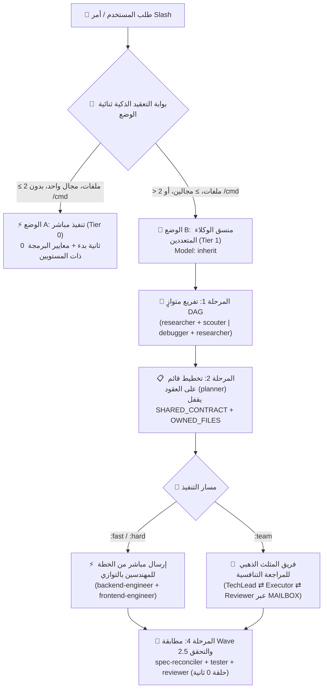

<div align="center">
  <h1>⚡ BoomOpen Workflow Kit v5.5.0</h1>
  <p><strong>نظام تشغيل القوى العاملة الذكية Smart-Hybrid متعدد المنصات — 22 وكيلاً متخصصاً، 18 فريق المثلث الذهبي وخزينة تضم +1,460 مهارة عند الطلب</strong></p>

  <p>
    <a href="https://github.com/Kennyboom/BoomOpen-Workflow-Kit-Pro/releases"></a>
    <a href="#platforms"></a>
    <a href="#agents"></a>
    <a href="#skills"></a>
    <a href="https://nodejs.org/">=18.0.0" /></a>
    <a href="../LICENSE"></a>
  </p>

  <p>
    <a href="../README.md">🇬🇧 English</a> • <a href="./README.vi.md">🇻🇳 Tiếng Việt</a> • <a href="./README.zh-CN.md">🇨🇳 简体中文</a> • <a href="./README.zh-TW.md">🇹🇼 繁體中文</a> • <a href="./README.ja.md">🇯🇵 日本語</a> • <a href="./README.ko.md">🇰🇷 한국어</a> • <a href="./README.es.md">🇪🇸 Español</a> • <a href="./README.fr.md">🇫🇷 Français</a> • <a href="./README.de.md">🇩🇪 Deutsch</a><br/>
    <a href="./README.pt-BR.md">🇧🇷 Português</a> • <a href="./README.ru.md">🇷🇺 Русский</a> • <a href="./README.hi.md">🇮🇳 हिन्दी</a> • <b>🇸🇦 العربية</b> • <a href="./README.id.md">🇮🇩 Bahasa Indonesia</a> • <a href="./README.th.md">🇹🇭 ไทย</a> • <a href="./README.tr.md">🇹🇷 Türkçe</a> • <a href="./README.it.md">🇮🇹 Italiano</a>
  </p>
</div>

---

## 🎬 العرض الرسمي للإطلاق (Full HD 1080p)

<div align="center">
  <a href="https://github.com/Kennyboom/BoomOpen-Workflow-Kit-Pro/raw/main/assets/media/boomopen_v55_trailer_en.mp4">
    
  </a>
  <p>
    ▶️ <a href="https://github.com/Kennyboom/BoomOpen-Workflow-Kit-Pro/raw/main/assets/media/boomopen_v55_trailer_en.mp4"><b>اضغط هنا لمشاهدة / تشغيل العرض الرسمي بدقة Full HD 1080p (ملف MP4 مع تعليق صوتي احترافي)</b></a>
  </p>
</div>

---

## 🌟 ما هو BoomOpen Workflow Kit v5.5؟

**BoomOpen Workflow Kit v5.5 (الإصدار الموحد متعدد المنصات والهجين الذكي)** هو نظام تشغيل مفتوح المصدر متعدد الوكلاء يحوّل مساعد البرمجة الفردي بالذكاء الاصطناعي إلى منظمة هندسية متكاملة تضم **22 وكيلاً متخصصاً**، و**18 فريق المثلث الذهبي (`72` ملف فريق)**، و**33 أمر سلاش (`89` ملف أوامر ومراجع)**، و**14 أمر CLI**، و**22 مهارة أساسية**، و**1,440 مهارة مكتبية متخصصة (`skills_library/`)**.

على عكس القوالب الجامدة التي تسبب تضخماً في السياق، يجمع BoomOpen v5.5 بين **بوابة أولوية الوكلاء الفرعيين منذ الجولة 1**، و**التوجيه الطبيعي بـ 17 لغة**، و**تقسيم الأسراب المرن رباعي المستويات (`role#shard`)**، و**المطابقة التلقائية بين المواصفات والكود في الموجة Wave 2.5 (`boomopen reconcile`)**، و**التدقيق متعدد الجولات بعد الإكمال (`/audit` و`boomopen audit`)**، و**التشغيل الذاتي متعدد الجلسات (`/autopilot`)**، و**موجه المحركات المتعددة (`/conduct`)**:
- **🚀 وكلاء فرعيون متوازيون منذ الجولة 1 وWave 2.5 وتنسيق الوضع B**: استكشاف الكود (`> 2` ملفات)، الميزات متعددة المجالات (`≥ 2` مجالات)، الطلبات الطبيعية بـ **17 لغة**، أو أوامر `/cmd` الصريحة تطلق شظايا متوازية (`role#shard`، بحد أقصى `3–4 OWNED_FILES`) مع **تفريع DAG**، و**إرسال مباشر من الخطة للمنفذ**، و**أقفال العقود (`SHARED_CONTRACT` + `OWNED_FILES`)**، و**المطابقة التلقائية Wave 2.5 (`boomopen reconcile` + `spec-reconciler` + `/cook amend-plan`)**، و**إعادة الاستخدام الدافئ (`role#shard -> conversationId` عبر `send_message`)**.
- **🏛️ التشغيل الذاتي (`/autopilot`)، التدقيق متعدد الجولات (`/audit`) ومجلس المحركات (`/conduct`)**: استيعاب المواصفات في سجل `.boomopen/project-ledger.json` بحماية SHA-256 وبوابة 4 طبقات (`boomopen check --strict-phase --no-stubs`)؛ وتنفيذ تدقيق شامل متعدد الجولات بعد الإكمال (`/audit` ← `/audit:fix` ← `/audit:round2` عبر `.boomopen/audit-ledger.json`) لتغطية RTM وتدفق UI→API→DB ومحرك الحماية من التسريب ثنائي الطبقات (`security_scan.py` v6).
- **⚡ الوضع A — التنفيذ الدقيق للملفات المعروفة (0 ثانية تشغيل بارد)**: الأسئلة والتعديلات الصغيرة عندما تكون **الملفات (`≤ 2`) معروفة مسبقاً منذ الجولة 1** تُنفَّذ مباشرة وفق **معايير البرمجة العملية ذات المستويين** و**الاختبار المستمر**.
- **📚 خزينة تضم 1,462 مهارة بدون تضخم السياق**: **22 مهارة أساسية (`skills/`)** و**1,440 مهارة متخصصة (`skills_library/`)** مفهرسة مسبقاً في `matrix-skills/compact-index.json` لبحث `O(1)` من خطوتين دون إثقال نافذة الأوامر.

---

## 🏗️ البنية الهجينة الذكية (v5.5)



---

<a id="pillars"></a>

## 🧠 الركائز الست الأساسية للإصدار v5.5

1. **🌐 تكافؤ موحد عبر 5 منصات (`platforms/*`)**:
   - تثبيت أصلي متكامل لكل من **Google Antigravity 2.0 (Gemini)** و**Claude Code** و**OpenAI Codex** و**Cursor** و**GitHub Copilot** من بنية موحدة.
2. **📏 معايير البرمجة العملية ذات المستويين (منع التجزئة الميكانيكية)**:
   - **المستوى 1 — عدم تسامح**: المسؤولية الواحدة، **منع `any` الصريح**، **منع ترك `console.log` للتصحيح**، إلزامية `try/catch` عند حدود async/API، ثوابت `SCREAMING_SNAKE_CASE`، مبدأ DRY (`≥ 3`)، وترتيب الاستيراد.
   - **المستوى 2 — إرشادات مرنة**: يستهدف الملف المترابط `~200–350 سطراً` بسقف مرن `400` وتقسيم إلزامي فقط عند `>500 سطر` (تُستثنى الاختبارات والأنواع والوثائق). الدوال المنطقية `~20–40 سطراً` (`~40–80` لواجهة المستخدم/المعالجات).
3. **🎯 تقسيم الأسراب (`role#shard`) والإرسال المباشر وإعادة الاستخدام الدافئ (`send_message`)**:
   - فور جاهزية `PLAN-{feature}.md`، يرسل المنسق المهام **مباشرة** إلى الشظايا (`<= 3–4 OWNED_FILES`) دون وسيط `tech-lead`، ويعيد استخدام الجلسات (`role#shard → conversationId`) بزمن بدء **0 ثانية**.
4. **🤝 التنفيذ القائم على العقود (`SHARED_CONTRACT` + `OWNED_FILES`) ومطابقة Wave 2.5 (`spec-reconciler`)**:
   - تُقفل نقاط API ومخططات DTO وملكية الملفات قبل التوازي؛ وفي **الموجة Wave 2.5** يتحقق `boomopen reconcile` و`spec-reconciler` و`/cook amend-plan` من مطابقة `docs/` مع الكود الفعلي لرصد الوحدات المعزولة وفروق المسارات/البيئة ونواقص `[SC-*]`.
5. **🔍 تشخيص 5-Whys (SPIE v3.0)، التدقيق متعدد الجولات (`/audit`) وشجرة Git نظيفة 100%**:
   - يحلل `debugger` عبر 3 فرضيات + **5-Whys**؛ ويدير `/audit` جولات تدريجية بمحرك الحماية من التسريب ثنائي الطبقات (`security_scan.py` v6). تُحفظ المخرجات المؤقتة في `<appDataDir>\brain\<conversation-id>\`.
6. **🩺 حزمة CLI من 14 أمراً وفهرس مهارات بسرعة O(1)**:
   - يتحقق `npm run doctor` من 5 منصات، و**22 وكيلاً**، و**72 ملف فريق** (18 مجلداً)، و**89 ملف أوامر** (`83` مسار عمل + `6` في `_ref/`)، و`compact-index.json` (`1,462` مهارة). الأوامر الـ 14 (`research`, `design`, `plan`, `cook`, `reconcile`, `audit`, `ledger`, `conduct`, `check`, `doctor`, `settings`, `install`, `uninstall`, `list`) تضمن التحقق الحتمي.

---

## 🔍 المطابقة التلقائية Wave 2.5 والتدقيق متعدد الجولات (`/audit`)

- **🔄 Wave 2.5 — المطابقة التلقائية بين المواصفات والكود (`boomopen reconcile` + `spec-reconciler` + `/cook amend-plan`)**: قبل إغلاق أي مرحلة، يطابق `spec-reconciler` متطلبات `docs/` و`PLAN` مع التنفيذ الفعلي (`REC-G1..G4`) ويكتشف عناصر `[SC-*]` الناقصة والملفات المعزولة وتعارضات المسارات ومتغيرات البيئة، ثم يستكمل النواقص عبر `/cook amend-plan`.
- **🛡️ التدقيق متعدد الجولات بعد الإكمال (`/audit`) ومحرك الحماية من التسريب ثنائي الطبقات v6**:
  1. **الجولة 1 (`/audit` أو `/autopilot:audit`)**: تدقيق شامل للقراءة فقط (تغطية RTM، تدفق UI→API→DB العمودي، وفحص `security_scan.py` v6 لكشف تسريبات الأسرار وPII والحقن).
  2. **مراجعة المستخدم**: تراجع تقرير `AUDIT-{project}-r1.md` وتعتمد قائمة الإصلاحات.
  3. **الإصلاح والجولة 2 (`/audit:fix` ← `/audit:round2`)**: تعالج الشظايا الأعطال المعتمدة مع قفل اختبارات الانحدار وتشغّل `/audit:round2` حتى الوصول إلى **0 ملاحظات** في `.boomopen/audit-ledger.json`.

---

<a id="platforms"></a>

## 💻 منصات الذكاء الاصطناعي المدعومة

| المنصة | مستوى الدعم | نقطة الدخول العامة | مسار تثبيت الإطار |
|----------|:-------------:|-------------------|------------------------|
| **Antigravity (Gemini)** | ✅ أصلي v5.5 | `~/.gemini/GEMINI.md` | `~/.gemini/config/skills/boomopen-workflow-kit/` |
| **Claude Code** | ✅ أصلي v5.5 | `~/.claude/CLAUDE.md` | `~/.claude/skills/boomopen-workflow-kit/` |
| **OpenAI Codex** | ✅ أصلي v5.5 | `~/.codex/CODEX.md` & `AGENTS.md` | `~/.codex/skills/boomopen-workflow-kit/` |
| **Cursor** | ✅ أصلي v5.5 | `~/.cursor/rules/boomopen-workflow-kit.mdc` | `~/.cursor/skills/boomopen-workflow-kit/` |
| **GitHub Copilot** | ✅ أصلي v5.5 | `~/.copilot/COPILOT.md` | `~/.copilot/skills/boomopen-workflow-kit/` |

---

## 🚀 البدء السريع والتثبيت

```bash
# 1. استنساخ المستودع والتثبيت لمساعدك (أو --all للجميع)
git clone https://github.com/Kennyboom/BoomOpen-Workflow-Kit-Pro.git
cd BoomOpen-Workflow-Kit-Pro
npm run install:antigravity   # أو: install:claude | install:codex | install:cursor | install:copilot | install:all

# 2. التحقق من التثبيت واستخدام أوامر CLI الـ 14
npm run doctor
npm link
boomopen research validate path/to/RESEARCH.md
boomopen design validate path/to/DESIGN.md
boomopen plan validate path/to/PLAN.md
boomopen cook preflight path/to/PLAN.md
boomopen reconcile path/to/your/project --plan path/to/PLAN.md
boomopen audit init --docs docs/prd.md,docs/arch.md
boomopen check path/to/your/project --strict-phase --no-stubs
boomopen ledger status
boomopen conduct probe
```

> الحزمة **غير منشورة على npm** — ثبّتها من هذا المستودع فقط (`npm link` يضيف `boomopen` إلى PATH). للإزالة: `boomopen uninstall <tool>`.

---

## 🎛️ الإعدادات الموحدة والملفات الجاهزة الخمسة (`/settings`)

يدير BoomOpen v5.5 **20 مفتاح إعداد + حدَّين للأسطر** عبر **المنصات الخمس** في أقل من `< 10ms` (**بزمن تأخير 0ms في الجولة الأولى**)، مع **5 ملفات جاهزة بنقرة واحدة**:

| الملف الجاهز (`Preset`) | الوضع (`execution.mode`) | النمط الافتراضي | مشغل اللغة الطبيعية (`naturalLanguageResearchTrigger`) | معايير الكود | الاستخدام الأمثل |
|:---|:---|:---:|:---:|:---:|:---|
| **⚡ `smart-hybrid`** *(الافتراضي)* | **`auto`** (`≤ 2 ملفات` ← Mode A؛ `> 2` أو `/cmd` ← Mode B) | `auto` | **`auto_team`** *(توجيه البحث والأفكار تلقائياً إلى `/research:team` / `/brainstorm:team`)* | `pragmatic` (`400/500`) | الهندسة اليومية الشاملة: سريع في المهام الصغيرة وعميق في البنى المعقدة |
| **🛡️ `carbon-guardrails`** | **`mode_a`** *(يتولى Antigravity Carbon القيادة مباشرة حتى `≤ 10 ملفات`)* | `auto` | `off` *(بلا استحواذ على اللغة الطبيعية؛ مسارات BoomOpen بأمر `/cmd` صريح فقط)* | `pragmatic` (`400/500`) | قيادة **Antigravity Orchestrator Carbon** للاستكشاف والتعديلات اليومية مع فرض قواعد `400/500` سطر وتحقق `strict_e2e` وضوابط `/cmd` |
| **🚀 `solo-fast`** | **`mode_a`** *(تنفيذ فردي مباشر بدون وكلاء فرعيين)* | `fast` | `off` *(رد مباشر ما لم يُكتب `/brainstorm`)* | `relaxed` (`600/800`) | الإصلاحات العاجلة، النماذج الأولية السريعة، وتوفير الرموز |
| **🧠 `deep-architect`** | **`mode_b`** *(منسق الوكلاء المتعددين في كل مهمة)* | `hard` | `auto_hard` *(تشغيل `/research:hard` / `/brainstorm:hard` خماسي العدسات)* | `strict` (`300/400`) | تصميم الأنظمة المعقدة والمشاريع الجديدة وإعادة الهيكلة |
| **🔺 `adversarial-team`** | **`team`** *(فريق المثلث الذهبي من 3 وكلاء `:team` دائماً)* | `team` | **`auto_team`** *(مراجعة تنافسية بين 3 وكلاء عبر `MAILBOX`)* | `strict` (`300/400`) | الإنتاج الحرج، التدقيق الأمني، والإصدارات الخالية من العيوب |

```bash
# في المحادثة (/settings) | لوحة الويب (boomopen settings --ui) | طرفية CLI
/settings                                     # القائمة التفاعلية (ask_question UI)
/settings preset carbon-guardrails            # تفعيل قيادة Carbon مع ضوابط BoomOpen
/settings preset smart-hybrid                 # الوضع الافتراضي Smart-Hybrid
/settings mode auto | mode_a | mode_b | team  # تغيير وضع التنفيذ مباشرة
boomopen settings preset carbon-guardrails    # تطبيق عام ومزامنة المنصات الخمس
boomopen settings set execution.mode mode_a --project   # كتابة ./.boomopen.json في المشروع الحالي فقط
```

---

## 🌙 دليل التشغيل الليلي للمشاريع الكبيرة متعددة المراحل (`/autopilot` مقابل `/goal` + `/autopilot` + `/audit`)

| الأسلوب | نطاق الجلسة والسياق | ضبط الخطة والجودة | أنسب حالة |
|:---|:---|:---|:---|
| **`/autopilot` بمفرده** | جلسة واحدة — يتوقف بسلاسة قرب **~70% من السياق** و**يتوقف مؤقتاً لاعتماد `PLAN` الأولي** | يدير `.boomopen/project-ledger.json` والبوابات الخمس ومطابقة Wave 2.5 `reconcile` و`/audit`، لكنه يتطلب استئنافاً يدوياً بين المراحل | المشاريع المتوسطة أو العمل التفاعلي مرحلةً بمرحلة |
| **`/goal` + `/autopilot` + `/audit`** *(موصى به ليلاً)* | **`/goal` يقود التنفيذ تلقائياً عبر مراحل متعددة طوال الليل** متجاوزاً حدود الجلسة الواحدة | يضمن `/autopilot` تتبعاً محكماً عبر `project-ledger.json` والبوابات الخمس ومطابقة Wave 2.5 (`reconcile`) و**الجولة 1 من `/audit`** في النهاية | المشاريع الضخمة متعددة الوثائق للتنفيذ الليلي المستقل حتى تقرير التدقيق الشامل |

**أمر جاهز للنسخ (للتشغيل الليلي):**

```text
/goal ابنِ المشروع بالكامل من المواصفات في docs/ باستخدام /autopilot.
أنشئ وحافظ على .boomopen/project-ledger.json، ونفّذ PLAN عبر جميع المراحل دون إسقاط أي متطلب،
وشغّل مطابقة Wave 2.5 (boomopen reconcile) وبوابات التحقق في نهاية كل مرحلة،
وبعد إكمال جميع المراحل شغّل الجولة 1 من /audit لإعداد تقرير تدقيق كامل لمراجعتي صباحاً.
```

---

## 🎯 مرجع أوامر Slash (33 أمراً / 89 ملفاً)

| الأمر | الأنماط | الغرض الأساسي |
|---------|----------|-----------------|
| **`/cook`** | `:fast`, `:hard`, `:team`, `amend-plan` | تطوير الميزات المتكامل (بحث ← تخطيط ← برمجة متوازية ← Wave 2.5 ← مراجعة) |
| **`/code`** | `:fast`, `:hard`, `:team` | تنفيذ البرمجة مباشرة من ملف `PLAN-{feature}.md` موجود |
| **`/plan`** | `:fast`, `:hard`, `:team` | إنشاء مخططات التنفيذ مع `SHARED_CONTRACT` و`OWNED_FILES` ومعايير Given/When/Then |
| **`/fix`** | `:fast`, `:hard`, `:team` | إصلاح الأخطاء من جذورها مع التحقق الإلزامي باختبارات الانحدار |
| **`/debug`** | `:fast`, `:hard`, `:team` | تحقيق عبر 3 فرضيات + سلسلة **5-Whys (SPIE v3.0)** (`DEBUG-{issue}.md`) |
| **`/test`** | `:fast`, `:hard`, `:team` | تشغيل متوازٍ DAG للاختبارات + اكتشاف الحالات الحدية (`tester` + `scouter`) |
| **`/review`** | `:fast`, `:hard`, `:team` | تدقيق متوازٍ رباعي الأبعاد (البنية، جودة الكود، أمان OWASP، الأداء) |
| **`/audit`** | `:run`, `:fix`, `:round2`, `:auto` | تدقيق شامل متعدد الجولات بعد الإكمال (تغطية RTM، تدفق UI→API→DB، الحماية ثنائية الطبقات v6، إصلاحات `/audit:fix` وإعادة تدقيق `/audit:round2` حتى 0 ملاحظات) |
| **`/design`** | `:fast`, `:hard`, `:team` | بنية النظام ومخطط قاعدة البيانات ومواصفات UI/UX (`DESIGN.md`) |
| **`/docs`** | `:core`, `:business`, `:audit` | توليد أو مزامنة وثائق البنية والأعمال ثنائية المستوى (`./documents/`) |
| **`/deploy`** | `:check`, `:preview`, `:production`, `:rollback` | بوابات الجاهزية، بيئات المعاينة، الإطلاق للإنتاج والتراجع الآمن |
| **`/research`** | `:fast`, `:hard`, `:team` | محرك البحث العميق (تثليث 4 مصادر، 3 موجات ومجلس 3 متجهات) |
| **`/brainstorm`** | `:fast`, `:hard`, `:team` | اكتشاف المتطلبات بالطريقة السقراطية، تحليل المفاضلات وتوليد الأفكار |
| **`/report`** | `:fast`, `:hard`, `:team` | تقارير تنفيذية وتقنية شاملة بالمقاييس والمخططات |
| **`/autopilot`** | `:init`, `:run`, `:audit` | منسق المشاريع المستقل متعدد الجلسات عبر `.boomopen/project-ledger.json` وبوابة 4 طبقات |
| **`/conduct`** | `:council`, `:pipeline` | المنسق عبر المحركات ومجلس النماذج المتوازي (`boomopen conduct`) مع التوافق الرباعي |
| **`/orchestrate`** | — | تنسيق خطوط أنابيب مخصصة متعددة الوكلاء عبر عدة مجالات |
| **`/settings`** | `preset`, `mode`, `set`, `ui` | مركز التحكم الموحد: 20 مفتاحاً + حدان للأسطر، **5 ملفات جاهزة** أو واجهة الويب (`--ui`) |
| **`/save` / `/recap`** | — | حفظ حالة الجلسة (`SESSION-HANDOVER.md`) واستعادة السياق في `< 5 ثوانٍ` |

---

<a id="agents"></a>

## 🤖 22 وكيلاً متخصصاً و18 فريقاً بنموذج المثلث الذهبي (`72` ملفاً)

| الفئة | الوكلاء المتخصصون (`agents/*.md`) | فرق المثلث الذهبي (`agents/teams/*-team/`) |
|----------|-----------------------------------|------------------------------------------------|
| **الهندسة والتنفيذ** | `backend-engineer`, `frontend-engineer`, `mobile-engineer`, `game-engineer`, `database-architect`, `devops-engineer` | `backend-team`, `frontend-team`, `fullstack-team`, `mobile-team`, `game-team`, `database-team`, `devops-team` |
| **البنية والتخطيط** | `tech-lead`, `planner`, `brainstormer`, `business-analyst`, `project-manager`, `designer` | `planning-team`, `brainstorm-team`, `project-team`, `design-team` |
| **الجودة والأمان والتصحيح** | `debugger`, `tester`, `reviewer`, **`spec-reconciler`**, `security-engineer`, `performance-engineer` | `debug-team`, `qa-team`, `security-team`, `performance-team` |
| **البحث والمعرفة** | `researcher`, `scouter`, `docs-manager`, `reporter` | `research-team`, `docs-team`, `report-team` |

---

<a id="skills"></a>

## 📚 خزينة 1,462 مهارة (22 أساسية + 1,440 مكتبية)

مصممة لاستهلاك **0 توكن في الخمول** عبر **الاستعلام التدريجي O(1) من خطوتين** (`<skills>` ← `matrix-skills/compact-index.json` ← `SKILL.md` عند الطلب):

| مجال المهارات | العدد | أبرز القدرات | التحميل |
|:---|:---:|:---|:---|
| **⚡ الطبقة 1: الأساسية (`skills/`)** | **22** | `clean-code`, `debugger`, `plan-writing`, `brainstorming`, `frontend-design`, `design-spec`, `api-patterns`, `database-design`, `testing-patterns`, `skill-seeker` | مفهرسة في `<skills>` |
| **🎨 تصميم UI/UX والحركة** | **42** | Anti-AI-Slop Craft، ألوان OKLCH، Bento Grids، Motion v12، Figma MCP + W3C DTCG، WCAG 2.2 AA/AAA، iOS 18 HIG وMaterial 3 | `compact-index.json` |
| **🌐 الويب والخلفية والحافة** | **390+** | React 19، Next.js 15، Tailwind v4، TanStack، Hono RPC + Zod OpenAPI، Rust Axum، Supabase RLS، Drizzle + Neon/Turso | `skills_library/` |
| **🤖 الذكاء الاصطناعي والبيانات** | **320+** | FastMCP 2025، OpenAI/Claude/Google ADK، Vercel AI SDK v4، RAG، BigQuery، dbt، Spark | `skills_library/` |
| **☁️ السحابة، DevOps والأمان** | **300+** | Cloudflare Workers/D1/R2، Terraform/OpenTofu، Docker/K8s، Vitest + MSW v2، Better Auth، OWASP LLM 2025 | `skills_library/` |
| **📱 الجوال والألعاب و3D Web** | **410+** | Unity 6 DOTS، Godot 4، WebGPU/Three.js TSL، Colyseus، Tauri v2، SwiftUI، Kotlin، React Native، Flutter | `skills_library/` |

---

## 📂 هيكل المستودع

```text
BoomOpen-Workflow-Kit-Pro/
├── agents/                  # 22 وكيلاً متخصصاً (بما فيهم spec-reconciler) + 18 فريقاً (72 ملفاً)
├── cli/                     # 14 أمر CLI: install, doctor, checker, settings, research, design, plan, cook, reconcile, audit, ledger & conductor
├── commands/                # 83 مسار عمل (33 أمراً) + 6 بروتوكولات _ref/ (89 ملفاً)
├── documents/               # وثائق ثنائية المستوى للبنية والمجال وقاعدة الكود والمعايير
├── i18n/                    # 16 ترجمة كاملة لملف README
├── matrix-skills/           # مصفوفات YAML + ملف compact-index.json المجمّع (1,462 مهارة)
├── platforms/               # قوالب موحدة للمنصات الخمس (antigravity/, claude/, codex/, copilot/, cursor/)
├── rules/                   # قواعد الوضع B عند الطلب (CORE, PHASES, AGENTS, TEAMS, SKILLS, ERRORS, REFERENCE)
├── scripts/                 # نصوص Python للأتمتة والتحقق (checklist.py, verify_all.py وغيرها)
├── skills/                  # 22 مهارة أساسية
├── skills_library/          # 1,440 مهارة متخصصة تُحمّل عند الطلب
└── GEMINI.md | CLAUDE.md | CODEX.md | COPILOT.md | CURSOR.md | AGENT.md
```

---

## 📄 الترخيص والأمان

- **الترخيص**: موزّع بموجب [رخصة MIT](../LICENSE). جميع الحقوق محفوظة © 2026 **BoomOpen Labs**. تحتفظ مهارات الجهات الخارجية في `skills_library/` بتراخيصها الأصلية — راجع [THIRD_PARTY_NOTICES.md](../THIRD_PARTY_NOTICES.md).
- **سياسة الأمان**: يرجى مراجعة [SECURITY.md](../SECURITY.md) للاطلاع على ضوابط الحماية المدمجة وإجراءات الإبلاغ عن الثغرات الأمنية.
