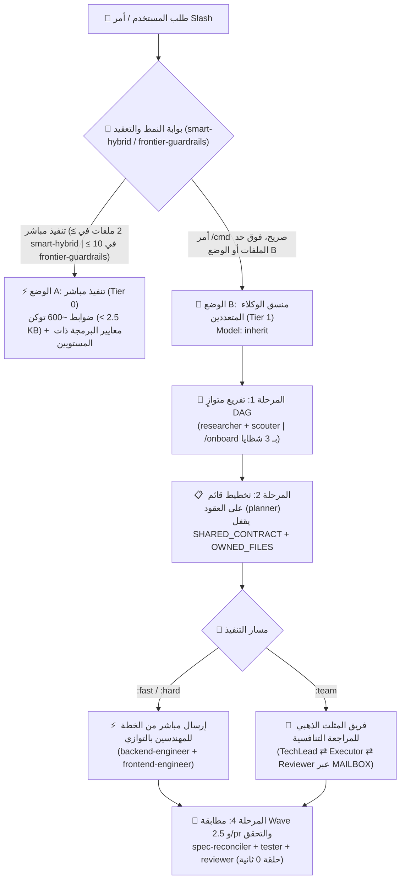

<div align="center">
  <h1>⚡ BoomOpen Workflow Kit v5.5.0</h1>
  <p><strong>نظام تشغيل القوى العاملة الذكية Smart-Hybrid متعدد المنصات — 22 وكيلاً متخصصاً، 18 فريق المثلث الذهبي وخزينة تضم 1,462 مهارة عند الطلب</strong></p>

  <p>
    <a href="https://github.com/Kennyboom/BoomOpen-Workflow-Kit-Pro/releases"></a>
    <a href="#platforms"></a>
    <a href="#agents"></a>
    <a href="#skills"></a>
    <a href="https://nodejs.org/">=18.0.0" /></a>
    <a href="../LICENSE"></a>
  </p>

  <p>
    <a href="../README.md">🇬🇧 English</a> • <a href="./README.vi.md">🇻🇳 Tiếng Việt</a> • <a href="./README.zh-CN.md">🇨🇳 简体中文</a> • <a href="./README.zh-TW.md">🇹🇼 繁體中文</a> • <a href="./README.ja.md">🇯🇵 日本語</a> • <a href="./README.ko.md">🇰🇷 한국어</a> • <a href="./README.es.md">🇪🇸 Español</a> • <a href="./README.fr.md">🇫🇷 Français</a> • <a href="./README.de.md">🇩🇪 Deutsch</a><br/>
    <a href="./README.pt-BR.md">🇧🇷 Português</a> • <a href="./README.ru.md">🇷🇺 Русский</a> • <a href="./README.hi.md">🇮🇳 हिन्दी</a> • <b>🇸🇦 العربية</b> • <a href="./README.id.md">🇮🇩 Bahasa Indonesia</a> • <a href="./README.th.md">🇹🇭 ไทย</a> • <a href="./README.tr.md">🇹🇷 Türkçe</a> • <a href="./README.it.md">🇮🇹 Italiano</a>
  </p>

  <p>
    <a href="https://boomopen.com">🌐 Website</a> •
    <a href="#pillars"><b>🧠 6 ركائز</b></a> •
    <a href="#platforms"><b>💻 5 منصات</b></a> •
    <a href="#settings"><b>🎛️ 5 ملفات جاهزة</b></a> •
    <a href="#commands"><b>🎯 36 أمراً</b></a> •
    <a href="#agents"><b>🤖 22 وكيلاً و18 فريقاً</b></a> •
    <a href="#skills"><b>📚 1,462 مهارة</b></a>
  </p>
</div>

---

## 🎬 العرض الرسمي للإطلاق (Full HD 1080p)

<div align="center">
  <a href="https://github.com/Kennyboom/BoomOpen-Workflow-Kit-Pro/raw/main/assets/media/boomopen_v55_trailer_en.mp4">
    
  </a>
  <p>
    ▶️ <a href="https://github.com/Kennyboom/BoomOpen-Workflow-Kit-Pro/raw/main/assets/media/boomopen_v55_trailer_en.mp4"><b>اضغط هنا لمشاهدة / تشغيل العرض الرسمي بدقة Full HD 1080p (ملف MP4 مع تعليق صوتي احترافي)</b></a>
  </p>
</div>

---

## 🌟 ما هو BoomOpen Workflow Kit v5.5؟

**BoomOpen Workflow Kit v5.5 (إصدار Frontier-Guardrails والهجين الذكي متعدد المنصات)** هو نظام تشغيل مفتوح المصدر متعدد الوكلاء يحوّل مساعد البرمجة الفردي بالذكاء الاصطناعي إلى منظمة هندسية متكاملة تضم **22 وكيلاً متخصصاً**، و**18 فريق المثلث الذهبي (`72` ملف فريق)**، و**36 أمر سلاش (`93` ملف أوامر: `87` مسار عمل + `6` في `_ref/`)**، و**14 أمر CLI**، و**22 مهارة أساسية**، و**1,440 مهارة مكتبية متخصصة (`1,462` مهارة موحدة دون تكرار عبر `~/.agents/skills_library`)**.

على عكس القوالب الجامدة التي تسبب تضخماً في السياق، يأتي BoomOpen v5.5 عند التثبيت الجديد مزوداً افتراضياً بنمط **`⚡ smart-hybrid`** (السرب المرن الاستباقي منذ الجولة الأولى + التوجيه باللغة الطبيعية عبر 17 لغة على جميع المنصات الخمس؛ ويُستعاد عبر `boomopen settings reset`)، مع توفير النمط الرشيق الاختياري للوضع A **`🛡️ frontier-guardrails`** (`< 2.5 KB` / `~600 tokens`، `mode_a <= 10 files`، `naturalLanguageResearchTrigger = off`)، مما يتيح **تقسيم الأسراب المرن رباعي المستويات (`role#shard`)**، و**فهم المشاريع القائمة خلال 60 ثانية (`/onboard`)**، و**بوابات طلبات السحب والإصدارات (`/pr` و`/pr:review` و`/release`)**، و**المطابقة التلقائية بين المواصفات والكود في الموجة Wave 2.5 (`boomopen reconcile`)**، و**التدقيق متعدد الجولات بعد الإكمال (`/audit` و`boomopen audit`)**، و**التشغيل الذاتي متعدد الجلسات (`/autopilot`)**، و**موجه المحركات المتعددة (`/conduct`)**:
- **⚡ النمط الافتراضي `smart-hybrid` — سرب استباقي منذ الجولة الأولى وتوجيه ذكي بـ 17 لغة**: عند التثبيت الجديد تُنفَّذ التعديلات المحدودة (`≤ 2` ملفات) مباشرة في الوضع A، بينما تطلق المهام متعددة الملفات والبحث العميق وتوليد الأفكار والتخطيط وأوامر `/cmd` الصريحة (**`/onboard`** و**`/pr` + `/pr:review`** و**`/release`** وغيرها) شظايا متوازية منذ الجولة الأولى (`role#shard`، بحد أقصى `3–4 OWNED_FILES`) مع **تفريع DAG**، و**إرسال مباشر من الخطة للمنفذ**، و**أقفال العقود (`SHARED_CONTRACT` + `OWNED_FILES`)**، و**المطابقة التلقائية Wave 2.5 (`boomopen reconcile` + `spec-reconciler` + `/cook amend-plan`)**، و**إعادة الاستخدام الدافئ (`send_message`)**.
- **🛡️ النمط الرشيق الاختياري `frontier-guardrails` (`< 2.5 KB` / `~600 tokens` — Slim Mode A)**: هل تفضّل التنفيذ المباشر في الوضع A حتى `≤ 10` ملفات (`mode_a <= 10 files`) دون تفعيل تلقائي للغة الطبيعية (`naturalLanguageResearchTrigger = off`)؟ بدّل خلال `< 10ms` عبر `boomopen settings preset frontier-guardrails` (مع الحفاظ على الاسم البديل `carbon-guardrails` للتوافق العكسي).
- **🏛️ التشغيل الذاتي (`/autopilot`)، التدقيق متعدد الجولات (`/audit`) ومجلس المحركات (`/conduct`)**: استيعاب المواصفات في سجل `.boomopen/project-ledger.json` بحماية SHA-256 وبوابة 4 طبقات (`boomopen check --strict-phase --no-stubs`) مع استرجاع آمن عبر `boomopen ledger rollback`؛ وتنفيذ تدقيق شامل بعد الإكمال (`/audit` و`boomopen audit rollback`) عبر `.boomopen/audit-ledger.json` لتغطية RTM وتدفق UI→API→DB ومحرك الحماية من التسريب ثنائي الطبقات (`security_scan.py` v6).
- **🗺️ دورة هندسية متكاملة (`/onboard` ← `/cook` ← `/pr` ← `/release`)**: استكشف بنية أي مستودع قائم خلال 60 ثانية عبر `/onboard` (`ARCHITECTURE-MAP.md`)، وافحص وأنشئ طلبات السحب عبر `/pr` و`/pr:review`، وجهّز إصدارات SemVer الموثقة عبر `/release`.
- **📚 خزينة موحدة تضم 1,462 مهارة بدون تضخم السياق**: تجمع **22 مهارة أساسية (`skills/`)** و**1,440 مهارة مكتبية** مشتركة دون تكرار في `~/.agents/skills_library` (شاملة قوالب `mcp-server` و`ai-agent-worker`) ومفهرسة في `matrix-skills/compact-index.json` لبحث `O(1)` من خطوتين.

---

## 🏗️ البنية الهجينة الذكية (v5.5)



---

<a id="pillars"></a>

## 🧠 الركائز الست الأساسية للإصدار v5.5

1. **🌐 تكافؤ موحد عبر 5 منصات (`platforms/*`)**:
   - تثبيت أصلي لكل من **Antigravity (Gemini)** و**Claude Code** و**OpenAI Codex** و**Cursor** و**GitHub Copilot** مع نقاط دخول عديمة التأخير (`smart-hybrid` افتراضياً + النمط الرشيق الاختياري `< 2.5 KB` / `~600 tokens` `frontier-guardrails`) وخزينة مشتركة موحدة في `~/.agents/skills_library`.
2. **📏 معايير البرمجة العملية ذات المستويين (منع التجزئة الميكانيكية)**:
   - **المستوى 1 — عدم تسامح**: المسؤولية الواحدة، **منع `any` الصريح**، **منع ترك `console.log` للتصحيح**، إلزامية `try/catch` عند حدود async/API، ثوابت `SCREAMING_SNAKE_CASE`، مبدأ DRY (`≥ 3`)، وترتيب الاستيراد.
   - **المستوى 2 — إرشادات مرنة**: يستهدف الملف المترابط `~200–350 سطراً` بسقف مرن `400` وتقسيم إلزامي فقط عند `>500 سطر` (تُستثنى الاختبارات والأنواع والوثائق). الدوال المنطقية `~20–40 سطراً` (`~40–80` لواجهة المستخدم/المعالجات).
3. **🎯 تقسيم الأسراب (`role#shard`) والإرسال المباشر وإعادة الاستخدام الدافئ (`send_message`)**:
   - فور جاهزية `PLAN-{feature}.md`، يرسل المنسق المهام **مباشرة** إلى الشظايا (`<= 3–4 OWNED_FILES`) دون وسيط `tech-lead`، ويعيد استخدام الجلسات (`role#shard → conversationId`) بزمن بدء **0 ثانية**.
4. **🤝 التنفيذ القائم على العقود (`SHARED_CONTRACT` + `OWNED_FILES`) ومطابقة Wave 2.5 (`spec-reconciler`)**:
   - تُقفل نقاط API ومخططات DTO وملكية الملفات قبل التوازي؛ وفي **الموجة Wave 2.5** يتحقق `boomopen reconcile` و`spec-reconciler` و`/cook amend-plan` من مطابقة `docs/` مع الكود الفعلي (`REC-G1..G4`) لرصد الوحدات المعزولة وفروق المسارات/البيئة ونواقص `[SC-*]`.
5. **🔍 تشخيص 5-Whys (SPIE v3.0)، التدقيق متعدد الجولات (`/audit`) وشجرة Git نظيفة 100%**:
   - يحلل `debugger` عبر 3 فرضيات + **5-Whys**؛ ويدير `/audit` جولات تدريجية بمحرك الحماية من التسريب ثنائي الطبقات (`security_scan.py` v6) مع دعم `boomopen audit rollback`. تُحفظ المخرجات المؤقتة في `<appDataDir>\brain\<conversation-id>\` (أو `./reports/`).
6. **🩺 حزمة CLI من 14 أمراً وفهرس مهارات بسرعة O(1)**:
   - يتحقق `npm run doctor` من 5 منصات، و**22 وكيلاً**، و**72 ملف فريق** (18 مجلداً)، و**93 ملف أوامر** (`87` مسار عمل لـ **36 أمراً** + `6` في `_ref/`)، و`compact-index.json` (`1,462` مهارة). تضمن أوامر CLI الـ **14** (`research`, `design`, `plan`, `cook`, `reconcile`, `audit`, `ledger`, `conduct`, `check`, `doctor`, `settings`, `install`, `uninstall`, `list` — بما فيها `ledger rollback` و`audit rollback` و`install antigravity --as-plugin`) بوابات تحقق حتمية.

---

<a id="platforms"></a>

## 💻 منصات الذكاء الاصطناعي المدعومة ومزايا 2026 الأصلية

| المنصة | مستوى الدعم | نقطة الدخول العامة | أبرز مزايا المنصة الأصلية لعام 2026 في v5.5 |
|----------|:-----------:|-------------------|--------------------------------------------|
| **Antigravity (Gemini)** | ✅ أصلي v5.5 | `~/.gemini/GEMINI.md` | حزمة إضافة أصلية عبر `install antigravity --as-plugin`، تنسيق Python عبر `run_workflow`، الحلقة الخارجية `/goal` وخطافات `--with-hooks` |
| **Claude Code** | ✅ أصلي v5.5 | `~/.claude/CLAUDE.md` | تخطيط `/plan:hard`، خطافات الجودة `PreCompact` + `Stop`، حارس `PreToolUse` (`Bash\|PowerShell`) ووكلاء `Task`/`Explore` |
| **OpenAI Codex** | ✅ أصلي v5.5 | `~/.codex/CODEX.md` & `AGENTS.md` | أدوار TOML في `~/.codex/agents/boomopen/*.toml` مع عزل `read-only` للمستكشفين والمراجعين واستمرارية عبر خطافات `Stop` |
| **Cursor** | ✅ أصلي v5.5 | `~/.cursor/rules/boomopen-workflow-kit.mdc` | ضوابط رشيقة `< 2.5 KB`، خطاف الحماية `beforeShellExecution` (`--with-hooks`) وخزينة مشتركة `~/.agents/skills_library` |
| **GitHub Copilot** | ✅ أصلي v5.5 | `~/.copilot/COPILOT.md` | وكيل `boomopen-workflow-kit.agent.md`، ضوابط `< 2.5 KB` ووصول `O(1)` إلى `1,462` مهارة |

---

## 🚀 البدء السريع والتثبيت

```bash
# 1. استنساخ المستودع والتثبيت لمساعدك (أو --all للمنصات الخمس)
git clone https://github.com/Kennyboom/BoomOpen-Workflow-Kit-Pro.git
cd BoomOpen-Workflow-Kit-Pro
npm run install:antigravity   # أو: install:claude | install:codex | install:cursor | install:copilot | install:all

# خيارات الإضافة الأصلية وخطافات الحماية والجودة لعام 2026:
node cli/install.js install antigravity --as-plugin   # التثبيت كإضافة أصلية في Antigravity
node cli/install.js install claude --with-hooks       # تفعيل حارس Bash|PowerShell + خطافات PreCompact/Stop

# 2. التحقق من التثبيت واستخدام أوامر CLI الـ 14
npm run doctor
npm link
boomopen research validate path/to/RESEARCH.md
boomopen design validate path/to/DESIGN.md
boomopen plan validate path/to/PLAN.md
boomopen cook preflight path/to/PLAN.md
boomopen reconcile path/to/your/project --plan path/to/PLAN.md
boomopen audit init --docs docs/prd.md,docs/arch.md   # استرجاع آمن: boomopen audit rollback
boomopen check path/to/your/project --strict-phase --no-stubs
boomopen ledger status                                # استرجاع المرحلة: boomopen ledger rollback
boomopen conduct probe
```

> الحزمة **غير منشورة على npm** — ثبّتها من هذا المستودع فقط (`npm link` يضيف `boomopen` إلى PATH). للإزالة مع الحفاظ على ملفاتك الخاصة: `boomopen uninstall <tool>`.

---

<a id="settings"></a>

## 🎛️ الإعدادات الموحدة والملفات الجاهزة الخمسة (`/settings`)

يدير BoomOpen v5.5 **20 مفتاح إعداد + حدَّين للأسطر** عبر **المنصات الخمس** في أقل من `< 10ms` (**بزمن تأخير 0ms في الجولة الأولى**). عند التثبيت الجديد يكون **`⚡ smart-hybrid`** هو الملف الافتراضي الموصى به (ويُستعاد عبر `boomopen settings reset`)، بينما يتوفر **`🛡️ frontier-guardrails`** (`< 2.5 KB` / `~600 tokens`، `mode_a <= 10 files`، `naturalLanguageResearchTrigger = off`، مع الاسم البديل المتوافق `carbon-guardrails`) كملف رشيق اختياري للوضع A (`boomopen settings preset frontier-guardrails`):

| الملف الجاهز (`Preset`) | الوضع (`execution.mode`) | النمط الافتراضي | مشغل اللغة الطبيعية (`naturalLanguageResearchTrigger`) | معايير الكود | الاستخدام الأمثل |
|:---|:---|:---:|:---:|:---:|:---|
| **⚡ `smart-hybrid`** *(الافتراضي الموصى به)* | **`auto`** (`≤ 2 ملفات` ← Mode A؛ `> 2` أو `/cmd` ← Mode B) | `auto` | **`auto_team`** *(توجيه البحث والأفكار تلقائياً إلى `/research:team` / `/brainstorm:team`)* | `pragmatic` (`400/500`) | افتراضي عند التثبيت الجديد (`boomopen settings reset`) — توجيه استباقي بـ 17 لغة وسرب تلقائي منذ الجولة الأولى فوق ملفين عبر المنصات الخمس |
| **🛡️ `frontier-guardrails`** *(الوضع A الرشيق الاختياري)* | **`mode_a`** *(تنفيذ مباشر حتى `≤ 10 ملفات`؛ ضوابط رشيقة `< 2.5 KB` / `~600 tokens`؛ يدعم الاسم البديل `carbon-guardrails`)* | `auto` | **`off`** *(بلا استحواذ على اللغة الطبيعية؛ المسارات بأمر `/cmd` صريح فقط)* | `pragmatic` (`400/500`) | وضع A رشيق اختياري (`< 2.5 KB` / `~600 tokens`) حتى 10 ملفات مع فرض حدود `400/500` سطر وتحقق `strict_e2e` |
| **🚀 `solo-fast`** | **`mode_a`** *(تنفيذ فردي مباشر بدون وكلاء فرعيين)* | `fast` | `off` *(رد مباشر ما لم يُكتب `/brainstorm`)* | `relaxed` (`600/800`) | الإصلاحات العاجلة، النماذج الأولية السريعة، وتوفير التوكنات |
| **🧠 `deep-architect`** | **`mode_b`** *(منسق الوكلاء المتعددين في كل مهمة)* | `hard` | `auto_hard` *(تشغيل `/research:hard` / `/brainstorm:hard` خماسي العدسات)* | `strict` (`300/400`) | تصميم الأنظمة المعقدة والمشاريع الجديدة وإعادة الهيكلة |
| **🔺 `adversarial-team`** | **`team`** *(فريق المثلث الذهبي من 3 وكلاء `:team` دائماً)* | `team` | **`auto_team`** *(مراجعة تنافسية بين 3 وكلاء عبر `MAILBOX`)* | `strict` (`300/400`) | الإنتاج الحرج، التدقيق الأمني، والإصدارات الخالية من العيوب |

```bash
# في المحادثة (/settings) | لوحة الويب (boomopen settings --ui) | طرفية CLI
/settings                                     # القائمة التفاعلية (ask_question UI)
/settings preset smart-hybrid                 # الوضع الافتراضي الموصى به (Auto Mode A/B + توجيه بـ 17 لغة)
/settings preset frontier-guardrails          # الوضع A الرشيق الاختياري (< 2.5 KB / ~600 tokens؛ البديل: carbon-guardrails)
/settings mode auto | mode_a | mode_b | team  # تغيير وضع التنفيذ مباشرة
boomopen settings preset smart-hybrid         # تطبيق الملف الافتراضي ومزامنة المنصات الخمس
boomopen settings preset frontier-guardrails  # تفعيل الوضع A الرشيق الاختياري (≤ 10 ملفات)
boomopen settings set execution.mode mode_a --project   # كتابة ./.boomopen.json في المشروع الحالي فقط
boomopen settings reset                       # استعادة إعدادات smart-hybrid الافتراضية الموصى بها
```

---

## 🌙 دليل التشغيل الليلي للمشاريع متعددة المراحل (`/autopilot` مقابل `/goal` + `/autopilot` + `/audit`)

> **استمرارية أصلية حسب المنصة**: يُعد **`/goal`** الحلقة الخارجية الأصلية في **Antigravity (Gemini)** للتنفيذ الليلي عبر تجديدات السياق، بينما يقود **`/autopilot` مع خطافات `Stop` و`PreCompact`** (`--with-hooks`) الاستمرارية متعددة الجلسات على **Claude Code** و**OpenAI Codex** (مع دعم الاسترجاع الآمن عبر `boomopen ledger rollback` و`boomopen audit rollback`).

| الأسلوب | نطاق الجلسة والسياق | ضبط الخطة والجودة | أنسب حالة |
|:---|:---|:---|:---|
| **`/autopilot` (+ خطافات `Stop`/`PreCompact` في Claude Code وCodex)** | على Claude Code وCodex تحفظ الخطافات الحالة قبل ضغط السياق وتفحص البوابات عند التوقف؛ وبدونها يتوقف بسلاسة قرب **~70% من السياق** | يدير `.boomopen/project-ledger.json` والبوابات الخمس ومطابقة Wave 2.5 `reconcile` و`ledger rollback` و`/audit` | التنفيذ المستمر متعدد الجلسات على Claude Code/Codex أو المراجعة التفاعلية مرحلةً بمرحلة |
| **`/goal` + `/autopilot` + `/audit`** *(أصلي في Antigravity)* | **`/goal` يعمل كحلقة خارجية أصلية في Antigravity** لقيادة مراحل متعددة طوال الليل عبر تجديد السياق | يفرض `/autopilot` سجل `project-ledger.json` والبوابات الخمس ومطابقة Wave 2.5 (`reconcile`) و**الجولة 1 من `/audit`** عند اكتمال 100% | المشاريع الضخمة متعددة الوثائق للتشغيل الليلي المستقل في Antigravity حتى تقرير التدقيق |

**أمر جاهز للنسخ (للتشغيل الليلي في Antigravity):**

```text
/goal ابنِ المشروع بالكامل من المواصفات في docs/ باستخدام /autopilot.
أنشئ وحافظ على .boomopen/project-ledger.json، ونفّذ PLAN عبر جميع المراحل دون إسقاط أي متطلب،
وشغّل مطابقة Wave 2.5 (boomopen reconcile) وبوابات التحقق الخمس في نهاية كل مرحلة،
وبعد إكمال 100% من المراحل شغّل الجولة 1 من /audit لإعداد تقرير تدقيق كامل لمراجعتي صباحاً.
```

---

<a id="commands"></a>

## 🎯 مرجع أوامر Slash (36 أمراً / 93 ملفاً)

*(يشمل `87` ملف مسار عمل في `commands/*.md` تغطي **36 أمراً أساسياً** — بالإضافة إلى الجدول الرئيسي أدناه تتوفر أوامر مساندة مثل `/ask` و`/status` و`/next` و`/init` و`/auto` و`/architect` و`/refactor` و`/performance` و`/security-audit` و`/deep-audit` و`/preview` و`/rollback` و`/ui-ux-pro-max` — مع `6` بروتوكولات مرجعية في `commands/_ref/`.)*

| الأمر | الأنماط | الغرض الأساسي |
|---------|----------|-----------------|
| **`/onboard`** | — | استيعاب المشاريع القائمة في 60 ثانية: ينشئ `ARCHITECTURE-MAP.md` (التقنيات، نقاط الدخول، تدفق البيانات، المناطق الحرجة والبوابات دون تعارض مع `/init`) |
| **`/cook`** | `:fast`, `:hard`, `:team`, `amend-plan` | تطوير الميزات المتكامل (بحث ← تخطيط ← برمجة متوازية ← Wave 2.5 ← مراجعة) |
| **`/code`** | `:fast`, `:hard`, `:team` | تنفيذ البرمجة مباشرة من ملف `PLAN-{feature}.md` موجود |
| **`/plan`** | `:fast`, `:hard`, `:team` | إنشاء مخططات التنفيذ مع `SHARED_CONTRACT` و`OWNED_FILES` ومعايير Given/When/Then (بما في ذلك `/plan:hard` على Claude Code) |
| **`/fix`** | `:fast`, `:hard`, `:team` | إصلاح الأخطاء من جذورها مع التحقق الإلزامي باختبارات الانحدار |
| **`/debug`** | `:fast`, `:hard`, `:team` | تحقيق عبر 3 فرضيات + سلسلة **5-Whys (SPIE v3.0)** (`DEBUG-{issue}.md`) |
| **`/test`** | `:fast`, `:hard`, `:team` | تشغيل متوازٍ DAG للاختبارات + اكتشاف الحالات الحدية (`tester` + `scouter`) |
| **`/review`** | `:fast`, `:hard`, `:team` | تدقيق متوازٍ رباعي الأبعاد (البنية، جودة الكود، أمان OWASP، الأداء) |
| **`/pr`** | `/pr`, `/pr:review` | بوابة ما قبل طلب السحب (`boomopen check` + `reconcile` + اختبارات الفروق)، نظافة الفرع، إنشاء `gh pr create` ومراجعة PR |
| **`/release`** | — | تحضير إصدارات SemVer: تدقيق Conventional Commits، تحديث `CHANGELOG.md`، بوابات `doctor`/`check`/`test`/`test:pack` و`gh release create` |
| **`/audit`** | `:run`, `:fix`, `:auto` | تدقيق شامل متعدد الجولات بعد الإكمال (تغطية RTM، تدفق UI→API→DB، الحماية ثنائية الطبقات v6، `/audit:fix` و`boomopen audit rollback`) |
| **`/design`** | `:fast`, `:hard`, `:team` | بنية النظام ومخطط قاعدة البيانات ومواصفات UI/UX سداسية الكتل (`DESIGN.md`) |
| **`/docs`** | `:core`, `:business`, `:audit` | توليد أو مزامنة وثائق البنية والأعمال ثنائية المستوى (`./documents/`) |
| **`/deploy`** | `:check`, `:preview`, `:production`, `:rollback` | بوابات الجاهزية، بيئات المعاينة، الإطلاق للإنتاج والتراجع الآمن |
| **`/research`** | `:fast`, `:hard`, `:team` | محرك البحث العميق (تثليث 4 مصادر، 3 موجات ومجلس 3 متجهات) |
| **`/brainstorm`** | `:fast`, `:hard`, `:team` | اكتشاف المتطلبات بالطريقة السقراطية، تحليل المفاضلات MCDA وتوليد الأفكار |
| **`/report`** | `:fast`, `:hard`, `:team` | تقارير تنفيذية وتقنية شاملة بالمقاييس والمخططات |
| **`/autopilot`** | `:init`, `:run`, `:audit` | منسق المشاريع المستقل متعدد الجلسات عبر `.boomopen/project-ledger.json` وبوابة 4 طبقات و`ledger rollback` |
| **`/conduct`** | `:council`, `:pipeline` | المنسق عبر المحركات ومجلس النماذج المتوازي (`boomopen conduct`) مع التوافق الرباعي |
| **`/orchestrate`** | — | تنسيق خطوط أنابيب مخصصة متعددة الوكلاء عبر عدة مجالات وشظايا |
| **`/settings`** | `preset`, `mode`, `set`, `ui` | مركز التحكم الموحد: 20 مفتاحاً + حدان للأسطر، **5 ملفات جاهزة** (`smart-hybrid` افتراضياً، و`frontier-guardrails` اختيارياً) أو واجهة الويب (`--ui`) |
| **`/save` / `/recap`** | — | حفظ حالة الجلسة (`SESSION-HANDOVER.md`) واستعادة السياق في `< 5 ثوانٍ` |

---

<a id="agents"></a>

## 🤖 22 وكيلاً متخصصاً و18 فريقاً بنموذج المثلث الذهبي (`72` ملفاً)

| الفئة | الوكلاء المتخصصون (`agents/*.md`) | فرق المثلث الذهبي (`agents/teams/*-team/`) |
|----------|-----------------------------------|------------------------------------------------|
| **الهندسة والتنفيذ** | `backend-engineer`, `frontend-engineer`, `mobile-engineer`, `game-engineer`, `database-architect`, `devops-engineer` | `backend-team`, `frontend-team`, `fullstack-team`, `mobile-team`, `game-team`, `database-team`, `devops-team` |
| **البنية والتخطيط** | `tech-lead`, `planner`, `brainstormer`, `business-analyst`, `project-manager`, `designer` | `planning-team`, `brainstorm-team`, `project-team`, `design-team` |
| **الجودة والأمان والتصحيح** | `debugger`, `tester`, `reviewer`, **`spec-reconciler`**, `security-engineer`, `performance-engineer` | `debug-team`, `qa-team`, `security-team`, `performance-team` |
| **البحث والمعرفة** | `researcher`, `scouter`, `docs-manager`, `reporter` | `research-team`, `docs-team`, `report-team` |

---

<a id="skills"></a>

## 📚 خزينة 1,462 مهارة (22 أساسية + 1,440 موحدة في `~/.agents/skills_library`)

مصممة لاستهلاك **0 توكن في الخمول** و**منع تكرار الملفات عبر المنصات** بواسطة `~/.agents/skills_library` + **الاستعلام التدريجي O(1) من خطوتين** (`<skills>` ← `matrix-skills/compact-index.json` ← `SKILL.md` عند الطلب):

| مجال المهارات | العدد | أبرز القدرات وقوالب 2026 | التحميل |
|:---|:---:|:---|:---|
| **⚡ الطبقة 1: الأساسية (`skills/`)** | **22** | `clean-code`, `debugger`, `plan-writing`, `brainstorming`, `frontend-design`, `design-spec`, `api-patterns`, `database-design`, `testing-patterns`, `skill-seeker` | مفهرسة في `<skills>` |
| **🎨 تصميم UI/UX والحركة** | **42** | Anti-AI-Slop Craft، ألوان OKLCH، Bento Grids، Motion v12، Figma MCP + W3C DTCG، WCAG 2.2 AA/AAA، iOS 18 HIG وMaterial 3 | `compact-index.json` |
| **🌐 الويب والخلفية والحافة** | **390+** | React 19، Next.js 15، Tailwind v4، TanStack، Hono RPC + Zod OpenAPI، Rust Axum، Supabase RLS، Drizzle + Neon/Turso | `~/.agents/skills_library` |
| **🤖 الذكاء الاصطناعي وMCP والوكلاء** | **320+** | قوالب **`mcp-server`** و**`ai-agent-worker`**، FastMCP 2025، OpenAI/Claude/Google ADK، Vercel AI SDK v4، RAG، BigQuery، dbt | `~/.agents/skills_library` |
| **☁️ السحابة، DevOps والأمان** | **300+** | Cloudflare Workers/D1/R2، Terraform/OpenTofu، Docker/K8s، Vitest + MSW v2، Better Auth، OWASP LLM 2025 | `~/.agents/skills_library` |
| **📱 الجوال والألعاب و3D Web** | **410+** | Unity 6 DOTS، Godot 4، WebGPU/Three.js TSL، Colyseus، Tauri v2، SwiftUI، Kotlin، React Native، Flutter | `~/.agents/skills_library` |

---

## 📂 هيكل المستودع

```text
BoomOpen-Workflow-Kit-Pro/
├── agents/                  # 22 وكيلاً متخصصاً (بما فيهم spec-reconciler) + 18 فريقاً (72 ملفاً)
├── cli/                     # 14 أمر CLI: install (--as-plugin/--with-hooks), uninstall, list, doctor, check, settings, research, design, plan, cook, reconcile, audit (rollback), ledger (rollback) & conduct
├── commands/                # 87 مسار عمل (36 أمراً: /onboard, /pr, /release, /cook وغيرها) + 6 بروتوكولات _ref/ (93 ملفاً)
├── documents/               # وثائق ثنائية المستوى للبنية والمجال وقاعدة الكود والمعايير
├── i18n/                    # 16 ترجمة كاملة لملف README
├── matrix-skills/           # مصفوفات YAML + ملف compact-index.json المجمّع (1,462 مهارة)
├── platforms/               # قوالب موحدة للمنصات الخمس (antigravity/, claude/, codex/, copilot/, cursor/)
├── rules/                   # قواعد الوضع B عند الطلب (CORE, PHASES, AGENTS, TEAMS, SKILLS, ERRORS, REFERENCE)
├── scripts/                 # نصوص Python للأتمتة والتحقق (checklist.py, security_scan.py وغيرها)
├── skills/                  # 22 مهارة أساسية
├── skills_library/          # 1,440 مهارة موحدة عبر ~/.agents/skills_library (تشمل قوالب mcp-server وai-agent-worker)
└── GEMINI.md | CLAUDE.md | CODEX.md | COPILOT.md | CURSOR.md | AGENT.md
```

---

## 📄 الترخيص والأمان

- **الترخيص**: موزّع بموجب [رخصة MIT](../LICENSE). جميع الحقوق محفوظة © 2026 **BoomOpen Labs**. تحتفظ مهارات الجهات الخارجية في `skills_library/` بتراخيصها الأصلية — راجع [THIRD_PARTY_NOTICES.md](../THIRD_PARTY_NOTICES.md).
- **سياسة الأمان**: يرجى مراجعة [SECURITY.md](../SECURITY.md) للاطلاع على ضوابط الحماية المدمجة وإجراءات الإبلاغ عن الثغرات الأمنية.
