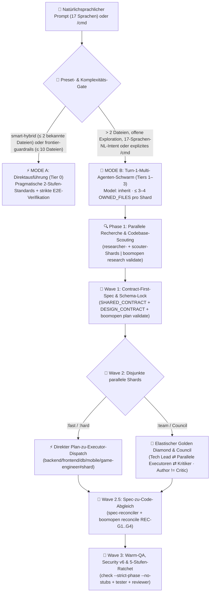

<div align="center">
  <h1>⚡ BoomOpen Workflow Kit Pro v5.5</h1>
  <p><strong>Multi-Agenten-Orchestrierung und deterministische CLI-Prüfgates für Antigravity, Claude Code, OpenAI Codex, Cursor und GitHub Copilot.</strong></p>

  <p>
    <a href="https://boomopen.com"></a>
    <a href="https://github.com/Kennyboom/BoomOpen-Workflow-Kit-Pro/releases"></a>
    <a href="#platforms"></a>
    <a href="#cli"></a>
    <a href="#skills"></a>
    <a href="https://nodejs.org/">= 18.0.0" /></a>
    <a href="../LICENSE"></a>
  </p>

  <p>
    <a href="../README.md">English</a> •
    <a href="./README.vi.md">Tiếng Việt</a> •
    <a href="./README.zh-CN.md">简体中文</a> •
    <a href="./README.zh-TW.md">繁體中文</a> •
    <a href="./README.ja.md">日本語</a> •
    <a href="./README.ko.md">한국어</a> •
    <a href="./README.es.md">Español</a> •
    <a href="./README.fr.md">Français</a> •
    <b>Deutsch</b><br/>
    <a href="./README.pt-BR.md">Português (BR)</a> •
    <a href="./README.ru.md">Русский</a> •
    <a href="./README.hi.md">हिन्दी</a> •
    <a href="./README.ar.md">العربية</a> •
    <a href="./README.id.md">Bahasa Indonesia</a> •
    <a href="./README.th.md">ไทย</a> •
    <a href="./README.tr.md">Türkçe</a> •
    <a href="./README.it.md">Italiano</a>
  </p>

  <p>
    <a href="https://boomopen.com"><b>🌐 boomopen.com (15 Sprachen)</b></a> •
    <a href="#trailer"><b>🎬 Launch-Trailer</b></a> •
    <a href="#why-boomopen"><b>⚡ Warum BoomOpen</b></a> •
    <a href="#architecture"><b>🏗️ Architektur</b></a> •
    <a href="#quickstart"><b>🚀 Schnellstart</b></a> •
    <a href="#cli"><b>🛠️ 14 CLI-Gates</b></a> •
    <a href="#settings"><b>🎛️ Presets &amp; Einstellungen</b></a> •
    <a href="#commands"><b>🎯 36 Befehle</b></a> •
    <a href="#agents"><b>🤖 22 Agenten &amp; 18 Teams</b></a> •
    <a href="#skills"><b>📚 1.462 Skills</b></a>
  </p>
</div>

---

<a id="trailer"></a>

## 🎬 Launch-Trailer & Interaktiver Web-Explorer (`boomopen.com`)

<div align="center">
  <a href="https://github.com/Kennyboom/BoomOpen-Workflow-Kit-Pro/raw/main/assets/media/boomopen_v55_trailer_en.mp4">
    
  </a>
  <p>
    ▶️ <a href="https://github.com/Kennyboom/BoomOpen-Workflow-Kit-Pro/raw/main/assets/media/boomopen_v55_trailer_en.mp4"><b>Full-HD-1080p-Launch-Trailer abspielen (MP4 mit Studio-Voiceover)</b></a> • 🌐 <a href="https://boomopen.com"><b>Interaktiven 14-Befehle-CLI-Playground &amp; durchsuchbare Kataloge auf boomopen.com erkunden (15 Sprachen)</b></a>
  </p>
</div>

---

<a id="why-boomopen"></a>
<a id="-what-is-boomopen-workflow-kit"></a>

## ⚡ Warum BoomOpen Workflow Kit?

**Das Problem reiner KI-Coding-Assistenten:** Ohne Orchestrierungsschicht bauen Einzel-Agenten-Tools spürbar ab, sobald Aufgaben mehrere Dateien, Domänen oder Sessions umfassen. Sequenzielles Dateilesen bläht das primäre Kontextfenster auf, unkoordinierte Sub-Agenten überschreiben gemeinsame Dateien oder hinterlassen unverbundene Insel-Module, generierter Code enthält stille `TODO`-Stubs oder `any`-Typumgehungen, Einzelmodell-Reviews übersehen eigene blinde Flecken (`Author == Critic`), und mehrphasige Implementierungen driften von der Spezifikation ab.

**Die technische Lösung von BoomOpen:** BoomOpen installiert ein einheitliches Orchestrierungs- und Verifikations-Framework für **Antigravity (Gemini)**, **Claude Code**, **OpenAI Codex**, **Cursor** und **GitHub Copilot** mit **null npm-Laufzeitabhängigkeiten**. Im standardmäßig aktiven **`smart-hybrid`**-Profil laufen Änderungen an `≤ 2` bekannten Dateien direkt ohne Overhead, während Multi-Datei-Features, Tiefenrecherche, Architekturplanung und **`36` Slash-Befehle (`93` Dateien)** die Arbeit ab Turn 1 per **Sub-Agenten-Sharding** auf **22 Spezial-Agenten** und **18 kontradiktorische 3-Rollen-Teams** verteilen — abgesichert durch **14 lokale `boomopen`-CLI-Prüfgates** und **`1,462` On-Demand-Skills** (`22` Core + `1,440` einmalig dedupliziert unter `~/.agents/skills_library`).

### ⚖️ Ohne BoomOpen vs. Mit BoomOpen v5.5

| Typisches Engineering-Fehlermuster | Ohne BoomOpen (Standard-KI-IDE) | Mit BoomOpen Workflow Kit Pro v5.5 |
|:-----------------------------------|:--------------------------------|:-----------------------------------|
| **Kontextfenster-Aufblähung** | Primär-Agent liest 15–30 Dateien sequenziell vor der ersten Codezeile | **Elastischer Turn-1-Schwarm (`role#shard`)**: Startet Read-only-Scouts & Domänen-Shards (`≤ 3–4` Dateien/Shard) + `0s` Warm-Reuse (`send_message`) |
| **Parallele Überschreibungen & totes Wiring** | Parallele Agenten überschreiben geteilte Dateien, erfinden abweichende `/api`-Routen oder tote Module | **Contract-First-Sperren + Wave-2.5-Abgleich**: Fixiert Wave-1-`SHARED_CONTRACT` + disjunkte `OWNED_FILES`, geprüft via `boomopen reconcile` (`REC-G1..G4`) |
| **Oberflächliche Recherche & vage Pläne** | Einseitige Zustimmung, ungeprüfte Annahmen und Freitext-Pläne ohne Prüfkriterien | **Evidenzbasierte 6-Block-Spezifikationen**: Kontradiktorischer `:team`-Kritiker + `< 50ms` CLI-Validatoren (`boomopen research`, `design`, `plan`) |
| **Stille Stubs, `any` & Test-Manipulation** | Agent meldet Vollzug trotz offener `// TODO`s, expliziter `any`, `console.log` oder `.skip`-Tests | **Pragmatisches 2-Stufen-Statik-Gate**: `boomopen check --strict-phase --no-stubs` erzwingt `0` `any`, `0` Stubs und kohäsive `400/500`-Zeilen-Dateien |
| **Multi-Session-Drift & Regressionen** | Kontext-Kompaktierung löscht Phasen-Constraints und bricht bereits getestete Features | **5-Stufen-Phasen-Ratchet & Rollback**: `.boomopen/project-ledger.json` mit SHA-256-Drift-Schutz, `/autopilot`, `/audit` und atomarem `rollback --yes` |
| **Blinde Flecken einzelner Modelle** | Dasselbe Modell schreibt und prüft seinen eigenen Code (`Author == Critic`) | **Engine-übergreifender Conductor (`/conduct`)**: Parallele Multi-Engine-Councils & familienübergreifende Pipelines über Claude Code, Codex, Antigravity, Cursor & Copilot |
| **5-IDE-Konfigurationsdrift & unsauberer Git-Baum** | Getrennte Prompt-Dateien je IDE, Gigabyte an Skill-Duplikaten und temporäre Specs in `git status` | **Einheitlicher Sync & sauberer Git-Baum**: 14 Einstiegsdateien in `< 10ms` synchronisiert, 1 geteilte `~/.agents/skills_library` (`0` Idle-Tokens) und Brain-Artifacts-Routing |

---

<a id="architecture"></a>
<a id="-smart-hybrid-architecture-v55"></a>

## 🏗️ Smart-Hybrid-Architektur (v5.5)



---

<a id="pillars"></a>

## 🧠 6 Zentrale Engineering-Säulen

1. **🌐 Native Kompilierung für 5 IDEs & deduplizierter Skill-Vault (`platforms/*`)**:
   - Kompiliert **22 Spezial-Agenten** und **93 Befehls-/Referenzdateien** in die nativen Formate jeder IDE: **Antigravity** (`--as-plugin`-Bundle + `3` ausführbare `run_workflow`-Python-Skripte: `audit_fanout.py`, `review_fanout.py`, `research_fanout.py`), **Claude Code** (`isolation: worktree`-Shards, `/plan:hard`-Befehle, optionale `PreToolUse`- & `Stop`/`PreCompact`-Hooks), **OpenAI Codex** (`22` TOML-Rollen mit OS-weiten `read-only`-Sandboxes für Scouts/Kritiker + `87` `$boomopen-*`-Skills), **Cursor** (`.mdc`-Regeln + optionaler `beforeShellExecution`-Hook) und **GitHub Copilot** (`.agent.md`-Prompt-Agenten).
   - Verlinkt alle `1,440` Library-Skills einmalig nach `~/.agents/skills_library` über alle 5 IDEs hinweg (~80 % weniger Speicherbedarf, `0` Turn-1-Token-Overhead).
2. **🎯 Dynamischer 4-Stufen-Schwarm (`role#shard`) & Scoped Warm-Reuse**:
   - Skaliert automatisch von **Tier 0** (`0` Sub-Agenten bei `≤ 2` bekannten Dateien) → **Tier 1** (`2–3` Shards) → **Tier 2** (`4–6` Shards) → **Tier 3** (`7–8+` Shards, konfigurierbar bis `16`), begrenzt die kognitive Last auf **`≤ 3–4 OWNED_FILES` pro Sub-Agent** und nutzt aktive Sessions über `role#shard → conversationId` (`send_message`) weiter.
3. **🤝 Contract-First-Ausführung in 3 Wellen + Wave-2.5-Spec-zu-Code-Abgleich (`REC-G1..G4`)**:
   - Wave 1 sperrt `SHARED_CONTRACT` (API-Schemata/DTOs) und `DESIGN_CONTRACT` (OKLCH-`@theme`-CSS + TypeScript-Props), bevor Wave 2 parallele Engineers startet. Wave 2.5 prüft per `boomopen reconcile` + `spec-reconciler` auf unverbundene Insel-Dateien (`REC-G1`), Frontend/Backend-Routenabweichungen (`REC-G2`), ausgelassene `[SC-*]`-Klauseln (`REC-G3`) und fehlende `.env.example`-Schlüssel (`REC-G4`) und ergänzt Delta-Wellen via `boomopen cook amend-plan`.
4. **🏛️ Multi-Session-Autopilot (`/autopilot`) & zustandsbehaftetes Multi-Runden-Audit (`/audit`)**:
   - Überführt Multi-Dokument-Specs in `.boomopen/project-ledger.json` mit SHA-256-Drift-Erkennung, Git-Checkpoints vor jeder Phase (`boomopen ledger rollback --yes`) und einem strikten **5-Stufen-Phasen-Qualitäts-Ratchet** (`G1 check --strict-phase --no-stubs` → `G2 monotoner Test-Ratchet` → `G3 reconcile --strict` → `G4 Author != Critic Review` → `G5 ledger verify`). Nach Abschluss steuert `/audit` freigabegestützte RTM-, Vertikalfluss- und Security-v6-Runden (`.boomopen/audit-ledger.json` + `boomopen audit rollback --yes`).
5. **🎼 Engine-übergreifender Conductor & Multi-Engine-Council (`boomopen conduct`)**:
   - Orchestriert Claude Code, OpenAI Codex, Antigravity, Cursor und Copilot parallel in **6-Aufgaben-Councils** (`research`, `brainstorm`, `plan`, `design`, `review`, `debug` → 4-teilige `COUNCIL-SYNTHESIS.md`) oder **familienübergreifenden Rollen-Pipelines**, in denen kein Modell seinen eigenen Output bewertet (`Author != Critic`).
6. **📏 Pragmatische 2-Stufen-Coding-Standards & SPIE-v3.0-Wurzelursachen-Analyse**:
   - **Stufe 1 (Null Toleranz)**: Single Responsibility, `0` explizite `any`, `0` Debug-`console.log` im App-Code, typisierte `try/catch`-Grenzen, `SCREAMING_SNAKE_CASE`-Konstanten. **Stufe 2 (Kohäsion vor starrem Zeilenlimit)**: Zielbereich `~200–350` Zeilen (`400` Soft- / `500` Hard-Limit; Tests/Typen/Docs ausgenommen). Bugs durchlaufen 3 gewichtete Hypothesen und eine **5-Whys-Kausalkette (SPIE v3.0)**, während temporäre Artefakte in Brain Artifacts landen (`100 %` sauberer Git-Arbeitsbaum).

---

<a id="platforms"></a>
<a id="-supported-ai-platforms"></a>

## 💻 5 Unterstützte KI-Coding-Plattformen

| Plattform | Support | Synchronisierte Einstiegsdatei(en) | Native Plattform-Integration |
|:----------|:-------:|:-----------------------------------|:-----------------------------|
| **Antigravity (Gemini)** | ✅ v5.5 | `~/.gemini/GEMINI.md` | `invoke_subagent`, `run_workflow`-Python-Fan-out, `/goal`-Außenloop, `--as-plugin`-Bundle, optionales `--with-hooks`, Brain Artifacts |
| **Claude Code** | ✅ v5.5 | `~/.claude/CLAUDE.md` | Parallele `Task`/`Agent`-Shards (`isolation: worktree`), `/plan:hard`-Befehle, optionale `PreToolUse`- & `Stop`/`PreCompact`-Hooks |
| **OpenAI Codex** | ✅ v5.5 | `~/.codex/AGENTS.md` & `CODEX.md` | `22` TOML-Rollen in `~/.codex/agents/boomopen/` mit OS-`sandbox_mode = "read-only"` für Scouts/Reviewer + `87` `$boomopen-*`-Skills |
| **Cursor** | ✅ v5.5 | `~/.cursor/rules/boomopen-workflow-kit.mdc` | Dauerhafte `.mdc`-Frontmatter-Regeln, `CURSOR.md`, Sub-Agenten-Routing & optionales `.cursor/hooks.json` (`beforeShellExecution`) |
| **GitHub Copilot** | ✅ v5.5 | `~/.copilot/copilot-instructions.md` | Kompilierter VS-Code-Agent `boomopen-workflow-kit.agent.md`, `runSubagent`-Dispatch & `COPILOT.md` |

---

<a id="quickstart"></a>
<a id="-quick-start--installation"></a>

## 🚀 Schnellstart & Installation (Nur via Git — Null Laufzeitabhängigkeiten)

```bash
# 1. Repository klonen (Vertrieb ausschließlich über GitHub — niemals auf npm veröffentlicht)
git clone https://github.com/Kennyboom/BoomOpen-Workflow-Kit-Pro.git
cd BoomOpen-Workflow-Kit-Pro

# 2. Für eine KI-IDE installieren (Standard-Preset: smart-hybrid) oder für alle 5 IDEs gleichzeitig
npm run install:all                                 # Alle 5 IDEs installieren & synchronisieren + ~/.agents/skills_library
npm run install:antigravity                         # Google Antigravity 2.0 (optional mit --as-plugin / --with-hooks)
node cli/install.js install claude --with-hooks     # Claude Code + optionale PreToolUse- & Stop/PreCompact-Hooks
npm run install:codex                               # OpenAI Codex CLI + OS-weite read-only-Sandboxes für Scouts/Reviewer
npm run install:cursor                              # Cursor (--with-hooks aktiviert den beforeShellExecution-Schutz)
npm run install:copilot                             # GitHub Copilot (VS Code .agent.md + copilot-instructions.md)

# 3. Zustand prüfen & `boomopen` optional global im PATH verlinken
npm run doctor
npm link
boomopen settings status
```

> **Sichere, nicht-destruktive Installation & Deinstallation**: Verwaltet über SHA-256-Manifeste (`~/.boomopen/manifests/<tool>.json`). Bestehende eigene Regeln in `GEMINI.md` / `CLAUDE.md` bleiben außerhalb der Kit-Marker erhalten und werden automatisch gesichert; `boomopen uninstall <tool|--all>` entfernt unveränderte Kit-Dateien rückstandsfrei und lässt eigene Dateien unangetastet.

---

<a id="cli"></a>

## 🛠️ 14 Abhängigkeitsfreie CLI-Subbefehle (`boomopen`)

Läuft lokal in `< 50ms` auf Node.js `>= 18` mit **null npm-Laufzeitabhängigkeiten** und **null Netzwerkaufrufen**:

| Subbefehl | Wichtige Flags & Syntax | Deterministische Prüfgates & Zweck |
|:----------|:------------------------|:-----------------------------------|
| **`install` / `uninstall` / `list`** | `<tool\|--all> [--with-hooks] [--as-plugin]` | SHA-256-Manifest-Installer, `~/.agents/skills_library`-Linker, optionale Sicherheits-Hooks & sauberer Uninstaller |
| **`doctor`** | `[--source-only]` | Lese-Audit (30 Prüfpunkte) über alle 5 IDE-Bundles, `93` Befehlsdateien, `72` Teamdateien, `1,462` Skills & Settings |
| **`settings`** | `status \| preset <name> \| set <k> <v> \| --ui` | Verwaltet 5 Presets + `22` Konfigurationsschlüssel (`--project` für `./.boomopen.json`) oder CSP-gehärtete Web-UI (`127.0.0.1:4567`) |
| **`research`** | `<validate\|brief> <file.md> [--mode brainstorm]` | Prüft **`RES-G1..G4`** (`≥ 4` triangulierte Quellen, Widerspruchsmatrix, Pre-Mortem-Risiken) & erstellt `HANDOFF_BRIEF` |
| **`design`** | `<validate\|contract> <DESIGN.md> [--json]` | Prüft **`DESIGN-G1..G4`** (6-Block-Spec, OKLCH-Tokens, 5-Zustands-UI-Matrix, WCAG 2.2 AA) & erzeugt `DESIGN_CONTRACT` |
| **`plan`** | `<validate\|compile> <PLAN.md> [--sync-ledger]` | Prüft **`PLAN-G1..G5`** (azyklischer DAG, disjunkte `OWNED_FILES ≤ 4`/Shard, `SHARED_CONTRACT`) & synchronisiert das Ledger |
| **`cook`** | `<state\|packets\|verify-wave\|preflight\|amend-plan>` | Prüft **`COOK-G1..G4`**: 5-Stufen-Fast-Forward-Status, 5-Feld-Wave-Handoff-Pakete, Git-Schreibsperren & Delta-Wellen |
| **`reconcile`** | `<dir> [--plan <PLAN.md>] [--strict]` | Wave 2.5 **`REC-G1..G4`**: erkennt Insel-Module, `/api`-Routendrift, ausgelassene `[SC-*]`-Klauseln & `.env.example`-Lücken |
| **`check`** | `[path] --strict-phase --no-stubs [--ignore <dir>]` | Pragmatisches 2-Stufen-Gate: `400/500`-Zeilen-Budgets, `0` explizite `any`, `0` Debug-`console.log`, `0` Stubs/`TODO`s/`.skip` |
| **`ledger`** | `<init\|from-plan\|status\|next\|verify\|rollback>` | Multi-Session-DAG-Zustandsautomat (`.boomopen/project-ledger.json`), SHA-256-Drift-Schutz & atomares `rollback --yes` |
| **`audit`** | `<init\|slice\|record\|approve\|verify-fix\|rollback>` | Zustandsbehaftetes Multi-Runden-Audit-Ledger (`.boomopen/audit-ledger.json`), Burn-down-Ratchet & `rollback --yes` |
| **`conduct`** | `<probe\|council\|dispatch\|status> [--dry-run]` | Engine-übergreifender Conductor & paralleles 6-Aufgaben-Council (`Author != Critic` über 5 IDEs → `COUNCIL-SYNTHESIS.md`) |

---

<a id="settings"></a>
<a id="-unified-settings--mode-selection-settings"></a>

## 🎛️ Einheitliches Control Center & 5 Presets (`/settings`)

Steuert **`20` Enum-Schlüssel + `2` konfigurierbare Zeilenlimits** global (`~/.boomopen/settings.json`) oder pro Repository (`./.boomopen.json`), in `< 10ms` über alle 14 IDE-Einstiegsdateien synchronisiert:

| Preset-Profil | Ausführungsmodus (`execution.mode`) | Standard-`/cmd` | 17-Sprachen-NL-Routing (`naturalLanguageResearchTrigger`) | Coding-Standards | Empfohlener Einsatzbereich |
|:--------------|:------------------------------------|:---------------:|:---------------------------------------------------------:|:----------------:|:---------------------------|
| **⚡ `smart-hybrid`** *(Standard)* | **`auto`** (`≤ 2` Dateien direkt; `> 2` Dateien oder `/cmd` → Mode-B-Schwarm) | `auto` | **`auto_team`** *(Routet NL-Recherche/Ideation/Review in 17 Sprachen auf `:team` & Workflows)* | `pragmatic` (`400/500`Z) | Standard ab Werk: natürlichsprachliches Intent-Routing + automatisches Turn-1-Sub-Agenten-Sharding |
| **🛡️ `frontier-guardrails`** *(Schlankes Opt-in)* | **`mode_a`** (`≤ 10` Dateien direkt; `< 2.5 KB` / `~600`-Token-Einstieg) | `auto` | **`off`** *(Nur explizite `/cmd`-Befehle — kein NL-Abfangen)* | `pragmatic` (`400/500`Z) | Ultraschlanker `< 2.5 KB` Direktmodus für den Alltag mit strikten 2-Stufen- & E2E-Gates *(Alias `carbon-guardrails` unterstützt)* |
| **🚀 `solo-fast`** | **`mode_a`** (`≤ 10` Dateien direkt; konservativ max. `3` Shards) | `fast` | `off` | `relaxed` (`600/800`Z) | Schnelles Prototyping, kleine Skripte, dringende Hotfixes & minimaler Token-Verbrauch |
| **🧠 `deep-architect`** | **`mode_b`** *(Strikter Mode-B-Orchestrator; max. `12` Shards)* | `hard` | `auto_hard` + `council`-Recherche / `cross_family`-Review | `strict` (`300/400`Z) | Komplexe Systemarchitektur, Greenfield-Design & modulübergreifende Refactorings |
| **🔺 `adversarial-team`** | **`team`** *(Elastischer Golden Diamond `:team`; `hyper_swarm` max. `12`)* | `team` | **`auto_team`** + `council` für Recherche, Planung & Review | `strict` (`300/400`Z) | Kritische Produktions-Releases, Sicherheitsaudits & Multi-Engine-Konsens |

```bash
# Presets wechseln oder Schlüssel per Chat (/settings), lokaler Web-UI (--ui) oder CLI anpassen:
boomopen settings --ui                                      # Lokales Web Control Center unter http://127.0.0.1:4567 starten
boomopen settings preset smart-hybrid                       # Standard: Auto Mode A/B + 17-Sprachen-NL-Workflow-Routing
boomopen settings preset frontier-guardrails                # Opt-in: < 2.5 KB schlanker Mode A (Alias: carbon-guardrails)
boomopen settings set engines.reviewer cross_family         # Familienfremden Reviewer erzwingen (Author != Critic)
cd path/to/your/repo && boomopen settings mode team --project # Repo-spezifisches Override in ./.boomopen.json
boomopen settings reset                                     # Standardkonfiguration smart-hybrid wiederherstellen
```

---

<a id="commands"></a>
<a id="-slash-commands-reference"></a>

## 🎯 Referenz aller 36 Slash-Befehle (`93` Dateien = `87` Workflows + `6` `_ref/`)

Formulieren Sie Anforderungen natürlich in **einer der 17 unterstützten Sprachen** unter `smart-hybrid` oder rufen Sie einen der **36 kanonischen Slash-Befehle** direkt auf:

| Kategorie | Befehl | Varianten | Zweck & deterministische Ergebnisse |
|:----------|:-------|:----------|:------------------------------------|
| **Orchestrierung & Autonomie** | **`/cook`** | `:fast`, `:hard`, `:team` | End-to-End-Feature-Entwicklung ohne Vorab-Plan (Scout → Contract-Plan → Parallele Shards → Wave-2.5-Abgleich → QA) |
| | **`/code`** | `:fast`, `:hard`, `:team` | Führt einen freigegebenen `PLAN-{task}.md` direkt über Wave-1–3-Shards aus, ohne `/plan` erneut zu starten |
| | **`/autopilot`** | `:init`, `:run`, `:audit` | Multi-Session-Orchestrator von der Spec bis Produktion via `.boomopen/project-ledger.json` & **5-Stufen-Qualitäts-Ratchet** |
| | **`/conduct`** | `:council`, `:pipeline` | Paralleles Multi-Engine-Council (`COUNCIL-SYNTHESIS.md`) & familienübergreifende Pipeline über 5 IDEs (`--dry-run`-fähig) |
| | **`/orchestrate`** / **`/auto`** | — | Maßgeschneiderte Multi-Domänen-Schwarmkoordination (`/orchestrate`) oder vollautonome End-to-End-Ausführung (`/auto`) |
| **Architektur, Design & Recherche** | **`/plan`** | `:fast`, `:hard`, `:team` | 5-Gate-`PLAN-{task}.md`-Blueprint mit `SHARED_CONTRACT`, disjunkten `OWNED_FILES ≤ 4`/Shard & Given/When/Then-Kriterien |
| | **`/architect`** | — | Reiner System-Blueprint: C4-Diagramme, ADRs, DB-Schemata, API-Verträge, Screen-Specs & Abdeckungsaudit (schreibt null Code) |
| | **`/design`** / **`/ui-ux-pro-max`** | `:fast`, `:hard`, `:team` | 6-Block-UI/UX-`DESIGN-{task}.md` + `DESIGN_CONTRACT` (`@theme`-OKLCH-Tokens, 5-Zustands-Matrix, 50+ Stile & HTML-Preview) |
| | **`/research`** | `:fast`, `:hard`, `:team` | 5-Perspektiven-Tiefenrecherche (`RESEARCH-{topic}.md`, `RES-G1..G4`-Triangulation ≥ 4 Quellen, Widersprüche & `HANDOFF_BRIEF`) |
| | **`/brainstorm`** / **`/ask`** | `:fast`, `:hard`, `:team` | Kritische Architektur-Ideation (`BRAINSTORM-{topic}.md` mit Pre-Mortem & MCDA-Matrix) sowie evidenzbasiertes Q&A (`/ask`) |
| **Qualität, Audit, Debug & Security** | **`/review`** | `:fast`, `:hard`, `:team` | Mehrdimensionales kontradiktorisches Code-, Architektur-, Security- & Performance-Review (`Author != Critic`, Übergang zu `/fix`) |
| | **`/audit`** / **`/deep-audit`** | `:run`, `:fix`, `:auto` | Mehrstufiges Gesamtprojekt-Audit nach Build (`/audit`-Ledger) & 10-dimensionales Spec-Logik-Audit vor dem Coden (`/deep-audit`) |
| | **`/security-audit`** | — | OWASP Top 10 + LLM/Agentic Top 10 Scan (`security_scan.py` v6), STRIDE-Bedrohungsmodellierung, Auth- & Supply-Chain-Prüfung |
| | **`/debug`** / **`/fix`** | `:fast`, `:hard`, `:team` | 3-Hypothesen- + **5-Whys-(SPIE v3.0)**-Ursachenanalyse (`DEBUG-{issue}.md`) & Fail-First-TDD-Fehlerbehebung (`/fix`) |
| | **`/test`** / **`/performance`** / **`/refactor`** | `:fast`, `:hard`, `:team` | Manipulationsfreie QA-Shards (`/test`), Core-Web-Vitals- / DB- / Bundle-Optimierung (`/performance`) und metrikgeprüftes `/refactor` |
| **Git, Release, Docs & Session-Ops** | **`/onboard`** / **`/init`** | — | Schreibgeschützte 60s-Brownfield-`ARCHITECTURE-MAP.md` (`/onboard`, ohne `/init`-Kollision) & Greenfield-Bootstrap (`/init`) |
| | **`/pr`** / **`/release`** | —, `:review` | Pre-PR-Qualitäts- & Abgleich-Gate + `gh pr create` / kontradiktorisches Diff-Review (`/pr:review`) sowie semantisches `/release` |
| | **`/deploy`** / **`/rollback`** | `:check`, `:preview`, `:production`, `:rollback` | Deployment-Bereitschafts-Gates, Preview-/Produktions-Rollouts (`/deploy`) und nach Schweregrad gestufte Notfallwiederherstellung (`/rollback`) |
| | **`/docs`** / **`/report`** | `:core`, `:business`, `:audit` / `:fast..:team` | Codebasierte `./documents/`-Suiten (`/docs`) und faktengebundene Statusberichte aus echter CLI-Telemetrie (`/report`) |
| | **`/settings`** / **`/status`** / **`/next`** | — | Einheitliches Control Center (`/settings`), Live-Status für Ledger/Schwarm (`/status`) und Nächster-Schritt-Navigator (`/next`) |
| | **`/preview`** / **`/save`** / **`/recap`** | — | Lokales Dev-Server-Management (`/preview`), Session-Sicherung (`/save`) und Kontextwiederherstellung in `< 5s` (`/recap`) |

### 🌙 Overnight-Playbook für Mehrphasige Projekte (`/autopilot` & `/goal`)

| Workflow | Zielplattform & Runner | Kontext-Kontinuität | Qualitäts- & Spezifikationsgarantien |
|:---------|:-----------------------|:--------------------|:-------------------------------------|
| **`/autopilot` (+ `--with-hooks`)** | Alle 5 IDEs (in **Claude Code**, **Antigravity** & **Cursor** mit `--with-hooks` kombinieren) | `Stop`- & `PreCompact`-Hooks (`stop-quality-gate.mjs`) + `.boomopen/project-ledger.json` bewahren den Fortschritt über Kompaktierungen hinweg | Erzwingt das **5-Stufen-Phasen-Qualitäts-Ratchet** (`G1..G5`), Wave-2.5-`reconcile` und `boomopen ledger rollback --yes` |
| **`/goal` + `/autopilot` + `/audit`** | Persistenter Außenloop in **Antigravity 2.0** für umfangreiche `docs/`-Spezifikationen | Antigravitys nativer **`/goal`**-Runner iteriert über alle Phasen, bis jede Ledger-Phase den Status `VERIFIED` erreicht | Prüft jede Phase gegen alle 5 Gates + Wave-2.5-Abgleich und startet anschließend Runde 1 von **`/audit`** |

```text
/goal Nutze /autopilot, um die gesamte Projektdokumentation in docs/ einzulesen, .boomopen/project-ledger.json zu initialisieren und jede Phase autonom nacheinander umzusetzen (jede Phase muss alle 5 Prüfgates und Wave 2.5 reconcile bestehen). Sobald 100 % der Phasen verifiziert sind, führe Runde 1 von /audit aus und halte mit einem Abschlussbericht zur Freigabe an.
```

---

<a id="agents"></a>
<a id="-22-specialist-agents--18-golden-triangle-teams"></a>

## 🤖 22 Spezial-Agenten & 18 Kontradiktorische 3-Rollen-Teams

Jeder Sub-Agent erbt das aktive Session-Modell (`Model: "inherit"` — `flash_lite` ist strikt untersagt) und arbeitet in **18 Golden-Diamond-/Triangle-Teams** (`Tech Lead` ⇄ `Parallele Shard-Executoren` ⇄ `Unabhängige Reviewer/Kritiker`):

| Domäne | Spezial-Agenten (`agents/*.md`, pro IDE kompiliert) | 3-Rollen-Review-Teams (`agents/teams/*-team/`, `72` Dateien) |
|:-------|:----------------------------------------------------|:-------------------------------------------------------------|
| **Engineering & Umsetzung** | `backend-engineer`, `frontend-engineer`, `mobile-engineer`, `game-engineer`, `database-architect`, `devops-engineer` | `backend-team`, `frontend-team`, `fullstack-team`, `mobile-team`, `game-team`, `database-team`, `devops-team` |
| **Architektur & Produkt** | `tech-lead`, `planner`, `brainstormer`, `business-analyst`, `project-manager`, `designer` | `planning-team`, `brainstorm-team`, `project-team`, `design-team` |
| **Qualität, Abgleich & Security** | `debugger`, `tester`, `reviewer`, `spec-reconciler`, `security-engineer`, `performance-engineer` | `debug-team`, `qa-team`, `security-team`, `performance-team` |
| **Recherche & Dokumentation** | `researcher`, `scouter`, `docs-manager`, `reporter` | `research-team`, `docs-team`, `report-team` |

---

<a id="skills"></a>
<a id="-1460-skills-vault-22-core--1440-niche-library-skills"></a>

## 📚 On-Demand-Vault mit 1.462 Skills (`22` Core + `1,440` Library-Skills)

Indiziert über **19 Engineering-Domänen** in `matrix-skills/compact-index.json`, einmalig dedupliziert unter `~/.agents/skills_library` und geladen per **2-stufiger progressiver O(1)-Auflösung** (`skills/`-Core-Check → `compact-index.json`-Lookup → gezieltes Laden der `SKILL.md` nur im zuständigen Shard, `0` Idle-Tokens):

| Stufe / Engineering-Domäne | Skills | Repräsentative Fähigkeiten & Projekt-Templates | Ladeverhalten |
|:---------------------------|:------:|:-----------------------------------------------|:--------------|
| **⚡ Core-Workflow & Qualität (`skills/`)** | **22** | `clean-code`, `debugger`, `plan-writing`, `brainstorming`, `deep-research`, `design-spec`, `frontend-design`, `frontend-architecture`, `api-patterns`, `database-design`, `tdd-workflow`, `testing-patterns`, `webapp-testing`, `security-auditor` (`security_scan.py` v6), `app-builder` (**15 Projekt-Templates** inkl. **`mcp-server`**, **`ai-agent-worker`**, `nextjs-saas`, `monorepo-turborepo`, `python-fastapi`, `flutter-app`), `skill-seeker` | Sofort ab Turn 1 |
| **🤖 KI, Agentic SDKs, MCP & Data** | **340+** | FastMCP (`StreamableHTTP`), OpenAI Agents SDK, Claude Agent SDK, Google ADK, Vercel AI SDK, LangGraph, RAG, BigQuery, dbt | On-Demand (`compact-index.json`) |
| **🌐 Web, Backend, API & Datenbanken** | **380+** | React 19, Next.js 15 RSC, Tailwind CSS v4, TanStack Start/Router/Query, Hono RPC + Zod OpenAPI, Rust Axum/SQLx, Drizzle, Postgres/RLS | On-Demand (`compact-index.json`) |
| **☁️ Cloud, DevOps, QA & Security** | **300+** | Cloudflare Workers/Durable Objects/D1, Docker/K8s, Terraform, Playwright, Vitest + MSW v2, Better Auth (Passkeys), OWASP LLM Top 10 | On-Demand (`compact-index.json`) |
| **🎨 UI/UX, Game-Engines & Mobile** | **420+** | OKLCH Design Tokens, WCAG 2.2 AA, Motion, Unity 6 DOTS/ECS, Godot 4, Unreal 5, WebGPU/Three.js, Phaser/PixiJS, Tauri v2, SwiftUI, Flutter, React Native | On-Demand (`compact-index.json`) |

---

## 📂 Repository-Struktur

```text
BoomOpen-Workflow-Kit-Pro/
├── agents/                  # 22 Spezial-Agenten (pro IDE kompiliert) + 18 3-Rollen-Teams (72 Dateien)
├── cli/                     # 14 abhängigkeitsfreie Node.js-CLI-Subbefehle + 33 node:test-Suiten
├── commands/                # 36 Slash-Befehle über 87 Workflow-Dateien + 6 _ref/-Protokolle (93 Dateien)
├── documents/               # Architektur-, Domänen-, Codebase- & pragmatische 2-Stufen-Standard-Dokumentation
├── i18n/                    # 16 vollständig lokalisierte READMEs (17 Sprachen insgesamt mit Root-README.md)
├── matrix-skills/           # 19 Domänen-YAML-Kataloge + O(1) compact-index.json (1,462 indizierte Skills)
├── platforms/               # 5 IDE-Bundles, optionale Schutz-Hooks, 3 Antigravity run_workflow/*.py & Codex-TOML-Rollen
├── rules/                   # 7 bei Bedarf geladene Mode-B-Regelmodule (CORE, PHASES, AGENTS, TEAMS, SKILLS, ERRORS, REFERENCE)
├── scripts/                 # Plattformübergreifende Prüf- & Session-Skripte (checklist.py, verify_all.py, auto_preview.py, session_manager.py)
├── skills/                  # 22 Core-Skills + 15 app-builder-Projekt-Templates + Security-v6- / UX- / Perf-Auditskripte
├── skills_library/          # 1,440 Library-Skills, einmalig verlinkt nach ~/.agents/skills_library
├── web/                     # 15-sprachiger WebGL-Showcase & durchsuchbare Kataloge für https://boomopen.com
└── GEMINI.md | CLAUDE.md | CODEX.md | COPILOT.md | CURSOR.md | AGENT.md
```

---

## 📄 Lizenz & Sicherheit

- **Offizielle Website**: [https://boomopen.com](https://boomopen.com)
- **Lizenz**: Quellcode des Kits, CLI, Regeln, Agenten und Dokumentation stehen unter der [MIT-Lizenz](../LICENSE) (Copyright © 2026 **BoomOpen Labs**). Drittanbieter-Skills in `skills_library/` behalten ihre jeweiligen Upstream-Lizenzen — siehe [THIRD_PARTY_NOTICES.md](../THIRD_PARTY_NOTICES.md).
- **Sicherheitsrichtlinie**: Siehe [SECURITY.md](../SECURITY.md) zu SHA-256-Manifestschutz, optionalem Hook-Sandboxing und dem Melden von Sicherheitslücken.
