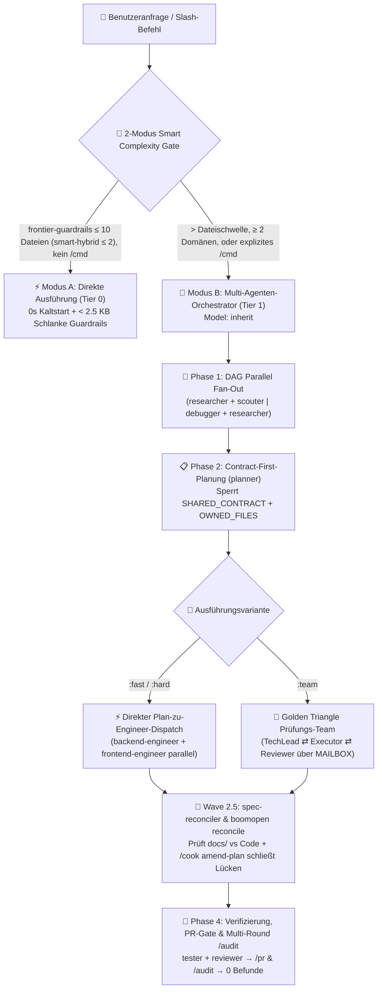

<div align="center">
  <h1>⚡ BoomOpen Workflow Kit v5.5.0</h1>
  <p><strong>Plattformübergreifendes Smart-Hybrid KI-Entwicklungs-OS — 22 Spezial-Agenten, 18 Golden-Triangle-Teams &amp; 1.462 On-Demand-Skills-Tresor</strong></p>

  <p>
    <a href="https://github.com/Kennyboom/BoomOpen-Workflow-Kit-Pro/releases"></a>
    <a href="#platforms"></a>
    <a href="#agents"></a>
    <a href="#skills"></a>
    <a href="https://nodejs.org/">=18.0.0" /></a>
    <a href="../LICENSE"></a>
  </p>

  <p>
    <a href="../README.md">🇬🇧 English</a> • <a href="./README.vi.md">🇻🇳 Tiếng Việt</a> • <a href="./README.zh-CN.md">🇨🇳 简体中文</a> • <a href="./README.zh-TW.md">🇹🇼 繁體中文</a> • <a href="./README.ja.md">🇯🇵 日本語</a> • <a href="./README.ko.md">🇰🇷 한국어</a> • <a href="./README.es.md">🇪🇸 Español</a> • <a href="./README.fr.md">🇫🇷 Français</a> • <b>🇩🇪 Deutsch</b><br/>
    <a href="./README.pt-BR.md">🇧🇷 Português</a> • <a href="./README.ru.md">🇷🇺 Русский</a> • <a href="./README.hi.md">🇮🇳 हिन्दी</a> • <a href="./README.ar.md">🇸🇦 العربية</a> • <a href="./README.id.md">🇮🇩 Bahasa Indonesia</a> • <a href="./README.th.md">🇹🇭 ไทย</a> • <a href="./README.tr.md">🇹🇷 Türkçe</a> • <a href="./README.it.md">🇮🇹 Italiano</a>
  </p>

  <p>
    <a href="https://boomopen.com">🌐 Website</a> • <a href="#overview"><b>🌟 Überblick</b></a> • <a href="#architecture"><b>🏗️ Architektur</b></a> • <a href="#quickstart"><b>🚀 Schnellstart</b></a> • <a href="#settings"><b>🎛️ Presets &amp; Optionen</b></a> • <a href="#commands"><b>🎯 36 Befehle</b></a> • <a href="#agents"><b>🤖 22 Agenten &amp; 18 Teams</b></a> • <a href="#skills"><b>📚 1.462 Skills-Tresor</b></a>
  </p>
</div>

---

## 🎬 Offizieller Launch-Trailer (Full HD 1080p)

<div align="center">
  <a href="https://github.com/Kennyboom/BoomOpen-Workflow-Kit-Pro/raw/main/assets/media/boomopen_v55_trailer_en.mp4">
    
  </a>
  <p>
    ▶️ <a href="https://github.com/Kennyboom/BoomOpen-Workflow-Kit-Pro/raw/main/assets/media/boomopen_v55_trailer_en.mp4"><b>Hier klicken, um den offiziellen Full HD 1080p Launch-Trailer anzusehen / zu streamen (MP4 mit Studio-Voiceover)</b></a>
  </p>
</div>

---

<a id="overview"></a>

## 🌟 Was ist das BoomOpen Workflow Kit v5.5?

**BoomOpen Workflow Kit v5.5 (Multi-Platform Unified & Smart-Hybrid Edition)** ist ein quelloffenes Multi-Agenten-Betriebssystem, das einen einzelnen KI-Coding-Assistenten in eine orchestrierte Engineering-Organisation aus **22 Spezialisten-Agenten**, **18 Golden-Triangle-Teams (72 Team-Dateien)**, **36 Slash-Befehlen (93 Befehlsdateien: 87 Workflows + 6 `_ref/`)**, **14 CLI-Befehlen** und **1.462 On-Demand-Skills (22 Kern-Skills + 1.440 Bibliotheks-Skills, plattformübergreifend dedupliziert über `~/.agents/skills_library`)** verwandelt.

Im Gegensatz zu starren Einzel-Prompts oder trägen Wrappern verbindet BoomOpen v5.5 **schlanke `< 2.5 KB`-Guardrails in allen 5 IDEs (Standard-Empfehlung `frontier-guardrails`)**, ein **Proaktives Turn-1-Sub-Agent-Gate**, **17-sprachiges Natural-Language-Routing**, **4-stufiges elastisches Swarm-Sharding (`role#shard`)**, **Wave 2.5 Spec-to-Code Auto-Reconciliation (`boomopen reconcile` + `spec-reconciler`)**, **mehrstufige Projekt-Audits (`/audit` & `boomopen audit`)**, **60s Brownfield-Architektur-Mapping (`/onboard`)**, **PR- & Release-Gates (`/pr`, `/pr:review`, `/release`)**, **Multi-Session Autopilot (`/autopilot`)** und den **Cross-Engine Conductor (`/conduct`)**:
- **🛡️ `frontier-guardrails` als Standard & Modus A ohne Kaltstart**: Mit `< 2.5 KB` schlanken Einstiegsregeln steuert Ihr Frontier-Modell Alltagsaufgaben bis `≤ 10` Dateien direkt in 0s (`≤ 2` Dateien bei `smart-hybrid`), erzwingt **Pragmatische 2-Stufen-Standards** sowie **strikte E2E-Verifizierung** und verhindert jegliches NL-Hijacking.
- **🚀 Parallele Turn-1-Sub-Agenten, Wave 2.5 Abgleich & Modus-B-Orchestrierung**: Multi-Domänen-Features oder explizite `/cmd`-Befehle starten sofort parallele Shards (`role#shard`, `<= 3–4 OWNED_FILES`/Shard) mit **DAG Parallel Fan-Out**, **Direct Plan-to-Executor Dispatch**, **Contract-First Dateisperren (`SHARED_CONTRACT` + `OWNED_FILES`)**, **Wave 2.5 Abgleich (`boomopen reconcile`, `spec-reconciler` & `/cook amend-plan` schließen Lücken zu `docs/`, isolierte Module, Routen-/Env-Abweichungen und `[SC-*]`-Klauseln)** und **Warm Reuse (`send_message`)**.
- **🏛️ Multi-Session Autopilot (`/autopilot`), Multi-Round `/audit` (inkl. Rollback) & Multi-Engine-Rat (`/conduct`)**: Überführt Spezifikationen in `.boomopen/project-ledger.json` (mit `boomopen ledger rollback`) samt 4-Schichten-Gate (`boomopen check --strict-phase --no-stubs`); prüft nach Abschluss mehrstufig (`/audit` & `boomopen audit`, mit `audit rollback`) über RTM-Abdeckung, vertikale UI→API→DB-Flüsse und die **2-Schichten-Anti-Leakage-Engine `security_scan.py` v6** bis auf 0 Befunde.
- **📚 Deduplizierter Tresor mit 1.462 Skills ohne Kontext-Ballast**: Über `~/.agents/skills_library` gemeinsam genutzt und in `matrix-skills/compact-index.json` für eine `O(1)` 2-Stufen-Suche vorkompiliert — inklusive produktionsreifer **`mcp-server`**- und **`ai-agent-worker`**-Vorlagen.

---

<a id="architecture"></a>

## 🏗️ Smart-Hybrid-Architektur (v5.5)



---

<a id="pillars"></a>

## 🧠 Die 6 Grundpfeiler & Native Plattform-Features 2026

1. **🌐 Einheitliche Parität auf 5 Plattformen & Native 2026-Features (`platforms/*`)**:
   - Native Unterstützung für **Antigravity (Gemini)** (`install antigravity --as-plugin` Plugin-Modus & dynamische Python-Orchestrierung via `run_workflow`), **Claude Code** (`/plan:hard` Architekturplanung + `PreCompact`/`Stop`-Qualitäts- & Kontinuitäts-Hooks + `Bash|PowerShell`-Sicherheits-Guard), **OpenAI Codex** (`read-only`-Sandboxing für Scout-/Review-Rollen & TOML-Profile), **Cursor** und **GitHub Copilot**.
2. **📏 Pragmatische 2-Stufen-Coding-Standards (Anti-Fragmentierung)**:
   - **Stufe 1 — Strikte Qualitäts- & Sicherheitsregeln (Null-Toleranz)**: Single Responsibility, **KEIN explizites `any`**, **KEINE vergessenen Debug-`console.log`**, zwingendes `try/catch` + typisierte Fehlerbehandlung an Async-/API-Grenzen, `SCREAMING_SNAKE_CASE`-Konstanten, DRY (`≥ 3`) und saubere Imports.
   - **Stufe 2 — Flexible Strukturrichtlinien (Kohäsion vor Zerstückelung)**: Kohäsive Dateien `~200–350 Zeilen` (Soft-Limit `400` / Hard-Split `500`; Tests, Typen & Docs ausgenommen); Logikfunktionen `~20–40 Zeilen` (`~40–80` UI/Handler).
3. **🎯 Elastisches Swarm-Sharding (`role#shard`) & Wave 2.5 Abgleich (`spec-reconciler`)**:
   - Nach `PLAN-{feature}.md` verteilt der Orchestrator direkt auf Shards (`<= 3–4 OWNED_FILES`/Shard) und nutzt sie per `send_message` mit **0s Kaltstart** warm weiter. In **Wave 2.5** schließen `spec-reconciler` und `boomopen reconcile` (`REC-G1..G4`) alle Lücken zu `docs/` vor Phasenabschluss.
4. **🤝 Contract-First Dispatch, PR-/Release-Gates & Multi-Round `/audit` (Anti-Leakage v6)**:
   - `SHARED_CONTRACT` + `OWNED_FILES` verhindern Schreibkonflikte; `/onboard` kartiert Bestandsprojekte in 60s; `/pr` (`/pr:review`) und `/release` sichern Pull Requests und semantische Releases ab; und `/audit` prüft mit der 2-Schichten-Anti-Leakage-Engine v6 bis auf 0 Befunde.
5. **🔍 5-Whys (SPIE v3.0) Ursachen-Debugging & 100% Sauberer Git-Baum**:
   - `debugger` analysiert Fehler über 3 Hypothesen und eine **5-Whys-Kausalkette**. Transiente Artefakte (`PLAN`, `DEBUG`, `TEST`, `REVIEW`, `AUDIT`, `ARCHITECTURE-MAP`, `MAILBOX`) landen in `<appDataDir>\brain\<conversation-id>\` (bzw. `./reports/`), sodass der Git-Baum sauber bleibt.
6. **🩺 Integrierte 14-Befehle-CLI-Suite & Deduplizierter O(1) Skill-Index**:
   - `npm run doctor` prüft 5 Plattform-Bundles, **22 Agenten**, **72 Team-Dateien (18 Teams)**, **93 Befehlsdateien (36 Befehle: 87 Workflows + 6 `_ref/`)** und **`1,462` Skills** in `~/.agents/skills_library`. Alle **14 CLI-Befehle** (`research`, `design`, `plan`, `cook`, `reconcile`, `audit` inkl. `audit rollback`, `ledger` inkl. `ledger rollback`, `conduct`, `check`, `doctor`, `settings`, `install` inkl. `--as-plugin`, `uninstall`, `list`) sichern deterministische Qualität.

---

<a id="platforms"></a>

## 💻 Unterstützte KI-Plattformen

| Plattform | Unterstützungsgrad | Globaler Einstiegspunkt & Native 2026-Features | Framework-Installationspfad |
|----------|:-------------:|-------------------|------------------------|
| **Antigravity (Gemini)** | ✅ Nativ v5.5 | `~/.gemini/GEMINI.md` (`--as-plugin`, `run_workflow` & `/goal`) | `~/.gemini/config/skills/boomopen-workflow-kit/` |
| **Claude Code** | ✅ Nativ v5.5 | `~/.claude/CLAUDE.md` (`PreCompact`/`Stop`-Hooks & `Bash\|PowerShell`-Guard) | `~/.claude/skills/boomopen-workflow-kit/` |
| **OpenAI Codex** | ✅ Nativ v5.5 | `~/.codex/CODEX.md` & `AGENTS.md` (`read-only`-Sandboxing & TOML-Rollen) | `~/.codex/skills/boomopen-workflow-kit/` |
| **Cursor** | ✅ Nativ v5.5 | `~/.cursor/rules/boomopen-workflow-kit.mdc` (`< 2.5 KB` schlanke Regel) | `~/.cursor/skills/boomopen-workflow-kit/` |
| **GitHub Copilot** | ✅ Nativ v5.5 | `~/.copilot/COPILOT.md` (Custom Agent & Sub-Agent-Orchestrierung) | `~/.copilot/skills/boomopen-workflow-kit/` |

---

<a id="quickstart"></a>

## 🚀 Schnellstart & Installation

```bash
# 1. Repository klonen
git clone https://github.com/Kennyboom/BoomOpen-Workflow-Kit-Pro.git
cd BoomOpen-Workflow-Kit-Pro

# 2. Für Ihren KI-Assistenten installieren (dedupliziert Skills via ~/.agents/skills_library)
npm run install:antigravity                        # Antigravity (Gemini) Standardinstallation
node cli/install.js install antigravity --as-plugin # Antigravity als natives Plugin installieren
npm run install:claude                             # Claude Code (inkl. PreCompact/Stop-Hooks & Bash|PowerShell-Guard)
npm run install:codex                              # OpenAI Codex (inkl. read-only Sandboxing)
npm run install:cursor                             # Cursor
npm run install:copilot                            # GitHub Copilot
npm run install:all                                # Auf allen 5 Plattformen gleichzeitig installieren

# 3. Installation & zentrale Gates der 14 CLI-Befehle (inkl. Rollback) prüfen
npm run doctor
npm link
boomopen research validate path/to/RESEARCH.md
boomopen design validate path/to/DESIGN.md
boomopen plan validate path/to/PLAN.md
boomopen cook preflight path/to/PLAN.md
boomopen reconcile path/to/your/project --plan path/to/PLAN.md   # Wave 2.5 Spec-Abgleich (REC-G1..G4)
boomopen audit init --docs docs/prd.md,docs/arch.md              # Projekt-Audit (unterstützt audit rollback)
boomopen check path/to/your/project --strict-phase --no-stubs    # Zeilenlimit, any, console.log, keine Stubs
boomopen ledger status                                           # Ledger-Status (unterstützt boomopen ledger rollback)
boomopen conduct probe
```

> Das Kit ist **nicht auf npm veröffentlicht** — installieren Sie es ausschließlich aus diesem Repository (`npm link` verknüpft nur diesen lokalen Klon ohne npm-Download).

---

<a id="settings"></a>

## 🎛️ Einheitliche Einstellungen & 5 Ein-Klick-Presets (`/settings`)

BoomOpen v5.5 bietet ein **Zero-Latency Unified Control Center**, das **5 Ein-Klick-Presets** und 20 Enum-Einstellungen (+ 2 Zeilenlimit-Schlüssel) über alle **5 Plattformen** in `< 10ms` (**0ms Turn-1-Latenz**, `< 2.5 KB` schlanke Guardrails) synchronisiert:

| Preset-Profil (`Preset`) | Modus (`execution.mode`) | Variante | NL-Trigger (`naturalLanguageResearchTrigger`) | Code-Standards (`codingStandards`) | Empfohlener Einsatzbereich |
|:---|:---|:---:|:---:|:---:|:---|
| **🛡️ `frontier-guardrails`** *(Empfohlener Standard)* | **`mode_a`** (`≤ 10` Dateien direkt, `< 2.5 KB` Guardrails in allen 5 IDEs; Alias `carbon-guardrails` unterstützt) | `auto` | **`off`** *(Kein NL-Hijacking — greift nur bei explizitem `/cmd`)* | `pragmatic` (`400/500` Zeilen) | Idealer Standard für alle 5 IDEs: Frontier-Modell führt direkt mit strenger E2E-Prüfung & 400/500L-Schutz |
| **⚡ `smart-hybrid`** | **`auto`** (`≤ 2` Dateien → Modus A; `> 2` oder `/cmd` → Modus B) | `auto` | **`auto_team`** *(Leitet an `/research:team` / `/brainstorm:team`)* | `pragmatic` (`400/500` Zeilen) | Automatische Multi-Agenten-Orchestrierung & 17-sprachiges Natural-Language-Routing |
| **🚀 `solo-fast`** | **`mode_a`** *(Direkte Solo-Ausführung, 0s Sub-Agent-Latenz)* | `fast` | `off` *(Direkte Chat-Antwort außer bei `/brainstorm`)* | `relaxed` (`600/800` Zeilen) | Dringende Hotfixes, schnelles Prototyping, Skripte & minimaler Token-Verbrauch |
| **🧠 `deep-architect`** | **`mode_b`** *(Erzwingt Multi-Agent-Orchestrator bei jeder Aufgabe)* | `hard` | `auto_hard` *(Startet `/research:hard` / `/brainstorm:hard`)* | `strict` (`300/400` Zeilen) | Komplexe Systemarchitektur, Greenfield-Design & Multi-Domain-Refactoring |
| **🔺 `adversarial-team`** | **`team`** *(Erzwingt das 3-Agenten Golden Triangle `:team`)* | `team` | **`auto_team`** *(Adversariale 3-Agenten-Prüfung über `MAILBOX`)* | `strict` (`300/400` Zeilen) | Unternehmenskritischer Produktionscode, Sicherheitsaudits & Zero-Defect-Releases |

> **🛡️ So arbeitet `frontier-guardrails` (Standard)**: Mit unter `< 2.5 KB` schlanken Guardrails in allen 5 IDEs übernimmt das Frontier-Modell die tägliche Erkundung und Bearbeitung (`mode_a`, `≤ 10` Dateien direkt), während BoomOpen `pragmatic`-Standards (`400/500` Zeilen, kein `any`), `strict_e2e`-Verifizierung und explizite `/cmd`-Workflows durchsetzt (der Alias `carbon-guardrails` bleibt voll kompatibel).

### Drei Wege zur Modusauswahl (In-Chat `/settings`, Web-UI & CLI)

```bash
# 1. In-Chat Slash-Befehl
/settings                                     # Interaktives Auswahlmenü öffnen (ask_question UI)
/settings preset frontier-guardrails          # Empfohlener Standard (Alias carbon-guardrails unterstützt)
/settings preset smart-hybrid                 # Automatische Smart-Hybrid-Orchestrierung
/settings preset solo-fast                    # Direkte Solo-Schnellausführung (Mode A)
/settings preset deep-architect               # Multi-Agent-Orchestrator (Mode B)
/settings preset adversarial-team             # Golden Triangle 3-Agenten-Team (:team)
/settings mode auto | mode_a | mode_b | team  # Ausführungsmodus direkt überschreiben

# 2. Lokale Web-Oberfläche (http://127.0.0.1:4567) & Terminal-CLI
boomopen settings --ui
boomopen settings preset frontier-guardrails
cd path/to/your/project && boomopen settings set execution.mode mode_a --project
```

---

<a id="commands"></a>

## 🎯 Slash-Befehlsreferenz (36 Befehle / 93 Dateien: 87 Workflows + 6 `_ref/`)

| Befehl | Varianten / Unterbefehle | Hauptzweck |
|---------|----------|-----------------|
| **`/onboard`** | — | **60s Brownfield-Architektur-Karte**: Erstellt `ARCHITECTURE-MAP.md` (Stack, Entrypoints, Datenflüsse, Risiko-Hotspots & Build-/Test-Gates) ohne `/init`-Kollision oder Repo-Müll |
| **`/cook`** | `:fast`, `:hard`, `:team`, `amend-plan` | End-to-End-Feature-Entwicklung (Research → Plan → Paralleler Code → **Wave 2.5 `reconcile`** → Test → Review) |
| **`/code`** | `:fast`, `:hard`, `:team` | Implementierung direkt anhand eines bestehenden `PLAN-{feature}.md` ausführen |
| **`/plan`** | `:fast`, `:hard`, `:team` | Implementierungs-Blueprints mit `SHARED_CONTRACT`, `OWNED_FILES` & Given/When/Then-Kriterien (inkl. Claude Code `/plan:hard`) |
| **`/fix`** | `:fast`, `:hard`, `:team` | Ursachenbasierte Fehlerbehebung mit obligatorischer Regressionstest-Verifizierung |
| **`/debug`** | `:fast`, `:hard`, `:team` | Ursachenanalyse mit 3 Hypothesen + **5-Whys (SPIE v3.0)**-Kausalkette (`DEBUG-{issue}.md`) |
| **`/test`** | `:fast`, `:hard`, `:team` | DAG Parallel Fan-Out Test-Ausführung + Suche nach ungetesteten Grenzfällen (`tester` + `scouter`) |
| **`/review`** | `:fast`, `:hard`, `:team` | Paralleles 4-Wege-Audit (Architektur, Code-Qualität, OWASP-Sicherheit, Performance) |
| **`/pr`** | `:review` (`/pr:review`) | **Pre-PR-Gate & Adversariales Hunk-Review**: Prüft `check`, `reconcile` & Diff-Tests vor `gh pr create` oder prüft PR-Hunks parallel mit `/pr:review` (`gh pr view` / `gh pr diff`) |
| **`/release`** | — | **Semantische Release-Vorbereitung**: Conventional-Commits-Audit, `CHANGELOG.md`-Synthese, `doctor`/`check`/`test`/`test:pack`-Gates & bestätigtes `gh release create` |
| **`/audit`** | `:run`, `:fix`, `:auto` | **Mehrstufiges Projekt-Audit nach Abschluss**: RTM-Abdeckung, vertikaler Fluss & Anti-Leakage Engine v6 mit Sharded Fixing (`boomopen audit` / `audit rollback`) |
| **`/design`** | `:fast`, `:hard`, `:team` | Systemarchitektur, Datenbankschema und UI/UX-Spezifikation (`DESIGN.md`) |
| **`/docs`** | `:core`, `:business`, `:audit` | Strukturierte 2-stufige Architektur- & Business-Dokumentation generieren/synchronisieren (`./documents/`) |
| **`/deploy`** | `:check`, `:preview`, `:production`, `:rollback` | Pre-Deployment-Gates, Preview-Umgebungen, Produktions-Rollout & sicherer Rollback |
| **`/research`** | `:fast`, `:hard`, `:team` | Autonome Deep-Research-Engine (4-Quellen-Triangulation, 3-Wellen-Suche & 3-Vektor-Rat) |
| **`/brainstorm`** | `:fast`, `:hard`, `:team` | Sokratische Anforderungsanalyse, Trade-off-Bewertung & Ideenfindung |
| **`/report`** | `:fast`, `:hard`, `:team` | Technische & Management-Syntheseberichte mit Metriken und Diagrammen |
| **`/autopilot`** | `:init`, `:run`, `:audit` | Autonomer Multi-Session-Projekt-Orchestrator mit `.boomopen/project-ledger.json` (`ledger rollback`) & 4-Schichten-Ratchet |
| **`/conduct`** | `:council`, `:pipeline` | Cross-Engine-Conductor & paralleler Multi-Engine-Rat (`boomopen conduct`) mit 4-teiliger Konsenssynthese |
| **`/orchestrate`** | — | Benutzerdefinierte Multi-Agenten-Pipeline-Orchestrierung über mehrere Domänen hinweg |
| **`/settings`** | `preset`, `mode`, `set`, `ui` | Unified Control Center: 5 Presets, 20 Enum- + 2 Zeilenlimit-Regeln oder Web-UI (`--ui`) |
| **`/save` / `/recap`** | — | Sitzungsstatus (`SESSION-HANDOVER.md`) sichern und Kontext in `< 5s` wiederherstellen (plus `/ask`, `/status`, `/next` usw. — insgesamt 36 Befehle) |

---

## 🌙 Leitfaden für Große Multi-Phasen-Projekte Über Nacht (`/autopilot` vs `/goal` + `/autopilot` + `/audit`)

- **Plattformspezifische Außenschleife**: **`/goal`** ist die **native Außenschleife von Antigravity (Gemini)**, die Sitzungen bei ~70% Kontext automatisch fortführt, während **`/autopilot` zusammen mit den `Stop`- / `PreCompact`-Hooks** die sitzungsübergreifende Kontinuität in **Claude Code und OpenAI Codex** antreibt.

| Modus | Laufzeit & Plattform-Kontinuität | Ledger-, Gate-, Abgleich- & Audit-Garantien | Einsatzgebiet |
|:---|:---|:---|:---|
| **`/autopilot` (+ Claude/Codex-Hooks)** | Einzelsitzung oder sitzungsübergreifende Fortsetzung über `Stop`-/`PreCompact`-Hooks in Claude Code & Codex | `.boomopen/project-ledger.json` (`ledger rollback`), 5 Verifikations-Gates & Wave 2.5 Abgleich | Phasenweise Tagesarbeit sowie Multi-Session-Läufe auf Claude Code / Codex |
| **`/goal` + `/autopilot` + `/audit`** *(Antigravity)* | **`/goal` fungiert als native Außenschleife in Antigravity** durch alle Phasen über Nacht | `project-ledger.json` + **5 Gates** + **Wave 2.5 `reconcile`** + **Runde 1 `/audit`** (`audit rollback`) bei 100% Abschluss | Vollständiger autonomer Nachtbau aus `docs/`-Spezifikationen in Antigravity |

**📋 Direkt kopierbarer Nachtlauf-Prompt (in Antigravity mit `/goal` starten; in Claude Code / Codex direkt mit `/autopilot`):**

```text
/goal /autopilot Lies alle Spezifikationen in `docs/`, initialisiere .boomopen/project-ledger.json
und implementiere autonom alle Phasen von Anfang bis Ende gemäß dem freigegebenen initialen PLAN.
Jede Phase muss alle 5 Verifikations-Gates, Wave 2.5 boomopen reconcile und boomopen check --strict-phase --no-stubs bestehen.
Führe nach 100% Abschluss aller Phasen Runde 1 von /audit aus und stoppe mit dem Prüfbericht zur Durchsicht.
```

---

<a id="agents"></a>

## 🤖 22 Spezialisten-Agenten & 18 Golden-Triangle-Teams (72 Dateien)

| Kategorie | Spezialisten-Agenten (`agents/*.md`) | Golden-Triangle-Teams (`agents/teams/*-team/`) |
|----------|-----------------------------------|------------------------------------------------|
| **Engineering & Ausführung** | `backend-engineer`, `frontend-engineer`, `mobile-engineer`, `game-engineer`, `database-architect`, `devops-engineer` | `backend-team`, `frontend-team`, `fullstack-team`, `mobile-team`, `game-team`, `database-team`, `devops-team` |
| **Architektur & Planung** | `tech-lead`, `planner`, `brainstormer`, `business-analyst`, `project-manager`, `designer` | `planning-team`, `brainstorm-team`, `project-team`, `design-team` |
| **Qualität, Sicherheit & Debugging** | `debugger`, `tester`, `reviewer`, **`spec-reconciler`**, `security-engineer`, `performance-engineer` | `debug-team`, `qa-team`, `security-team`, `performance-team` |
| **Forschung & Wissen** | `researcher`, `scouter`, `docs-manager`, `reporter` | `research-team`, `docs-team`, `report-team` |

---

<a id="skills"></a>

## 📚 1.462 Skills-Tresor (22 Kern-Skills + 1.440 in `~/.agents/skills_library`)

BoomOpen bietet `1,462` kuratierte und über `~/.agents/skills_library` deduplizierte Engineering-Skills mit **0 Token-Overhead im Leerlauf** durch **2-stufige progressive O(1)-Auflösung** (`<skills>` → `matrix-skills/compact-index.json` → gezieltes Laden von `SKILL.md` bei Bedarf):

| Skill-Ebene / Domäne | Anzahl | Repräsentative 2026-Skills & Vorlagen | Lademechanismus |
|:---|:---:|:---|:---|
| **⚡ Stufe 1: Kern-Skills (`skills/`)** | **22** | `clean-code`, `debugger`, `plan-writing`, `brainstorming`, `frontend-design`, `frontend-architecture`, `design-spec`, `api-patterns`, `database-design`, `testing-patterns`, `skill-seeker` | Vorindiziert in `<skills>` für sofortigen Zugriff in Turn 1 |
| **🎨 UI/UX-Craft, Motion & Design-Systeme** | **42** | Anti-AI-Slop Visual Craft, OKLCH-Farbsystem & Bento-Grids, Motion v12 + CSS View Transitions, Headless-Primitives (`cmdk`/`vaul`/`sonner`), Figma MCP + W3C DTCG Tokens, WCAG 2.2 AA/AAA, iOS 18 HIG & Material 3 Expressive | Bei Bedarf über `compact-index.json` (`matrix-skills/design.yaml`) |
| **🌐 Web, Backend & Edge-Daten-Stack** | **390+** | React 19 & Next.js 15, Tailwind v4, TanStack Start, Hono RPC + Zod OpenAPI, Rust Axum/Tokio/SQLx, Supabase RLS, Drizzle + Neon/Turso | Bei Bedarf über `compact-index.json` (`~/.agents/skills_library`) |
| **🤖 KI, Agenten-SDKs, MCP & Data** | **320+** | **`mcp-server`- & `ai-agent-worker`-Vorlagen**, MCP FastMCP (`StreamableHTTP`), OpenAI/Claude Agents SDK, Google ADK, RAG, BigQuery, dbt | Bei Bedarf über `compact-index.json` (`~/.agents/skills_library`) |
| **☁️ Cloud, DevOps, Testing & Sicherheit** | **300+** | Cloudflare Workers/D1/R2/Durable Objects, Terraform/OpenTofu, Docker/K8s GitOps, Vitest + MSW v2, Better Auth, OWASP LLM 2025 Audit | Bei Bedarf über `compact-index.json` (`~/.agents/skills_library`) |
| **📱 Mobile, Game-Engines & 3D-Web** | **410+** | Unity 6 DOTS/ECS, Godot 4, WebGPU/WGSL & Three.js TSL, Colyseus Netcode, Tauri v2, SwiftUI, Kotlin, React Native, Flutter | Bei Bedarf über `compact-index.json` (`~/.agents/skills_library`) |

---

## 📂 Repository-Struktur

```text
BoomOpen-Workflow-Kit-Pro/
├── agents/                  # 22 Spezialisten-Agenten (inkl. spec-reconciler) + 18 Golden-Triangle-Teams (54 Rollen + 18 _team.md, 72 Dateien)
├── cli/                     # 14-Befehle-CLI: install (--as-plugin), doctor, checker, settings, research, design, plan, cook, reconcile, audit (rollback), ledger (rollback) & conductor
├── commands/                # 87 Workflows (36 Slash-Befehle: /onboard, /pr, /pr:review, /release, /audit, /autopilot usw.) + 6 _ref/ (93 Dateien)
├── documents/               # 2-stufige Architektur-, Domänen-, Quellcode- & Coding-Standards-Dokumentation
├── i18n/                    # Internationalisierte Dokumentation (16 vollständige README-Übersetzungen)
├── matrix-skills/           # Domänen-YAML-Skill-Matrizen + vorkompiliertes compact-index.json (1.462 Skills)
├── platforms/               # Vereinheitlichte Vorlagen & Hooks für alle 5 Plattformen (antigravity/, claude/, codex/, copilot/, cursor/)
├── rules/                   # On-Demand-Regeln für Modus B (CORE, PHASES, AGENTS, TEAMS, SKILLS, ERRORS, REFERENCE)
├── scripts/                 # Python-Verifizierungs- & Sicherheitsskripte (security_scan.py v6, checklist.py, verify_all.py usw.)
├── skills/                  # 22 Kernkompetenzen (clean-code, debugger, plan-writing, frontend-design usw.)
├── skills_library/          # 1.440 über ~/.agents/skills_library deduplizierte Nischen-Skills (inkl. mcp-server & ai-agent-worker)
└── GEMINI.md | CLAUDE.md | CODEX.md | COPILOT.md | CURSOR.md | AGENT.md
```

---

## 📄 Lizenz & Sicherheit

- **Lizenz**: Veröffentlicht unter der [MIT-Lizenz](../LICENSE). Copyright © 2026 **BoomOpen Labs**. Drittanbieter-Skills in `skills_library/` behalten ihre ursprünglichen Lizenzen — siehe [THIRD_PARTY_NOTICES.md](../THIRD_PARTY_NOTICES.md).
- **Sicherheitsrichtlinie**: Informationen zu integrierten Sicherheitsmechanismen und zur Meldung von Schwachstellen finden Sie in [SECURITY.md](../SECURITY.md).
