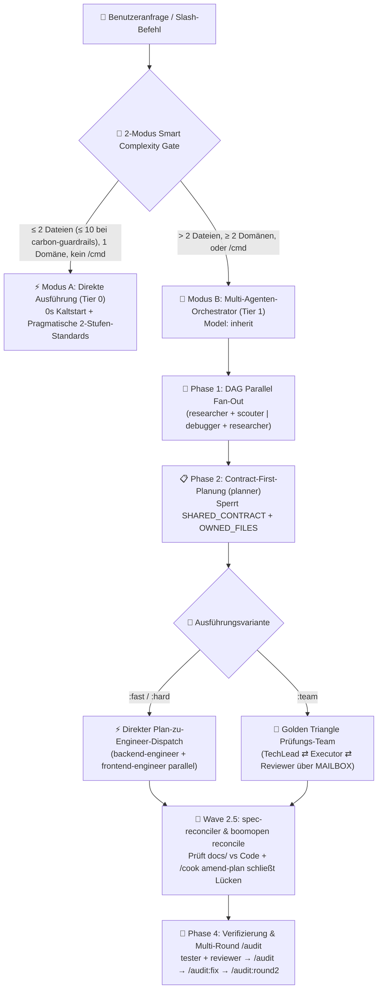

<div align="center">
  <h1>⚡ BoomOpen Workflow Kit v5.5.0</h1>
  <p><strong>Plattformübergreifendes Smart-Hybrid KI-Entwicklungs-OS — 22 Spezial-Agenten, 18 Golden-Triangle-Teams &amp; 1.460+ On-Demand-Skills-Tresor</strong></p>

  <p>
    <a href="https://github.com/Kennyboom/BoomOpen-Workflow-Kit-Pro/releases"></a>
    <a href="#platforms"></a>
    <a href="#agents"></a>
    <a href="#skills"></a>
    <a href="https://nodejs.org/">=18.0.0" /></a>
    <a href="../LICENSE"></a>
  </p>

  <p>
    <a href="../README.md">🇬🇧 English</a> • <a href="./README.vi.md">🇻🇳 Tiếng Việt</a> • <a href="./README.zh-CN.md">🇨🇳 简体中文</a> • <a href="./README.zh-TW.md">🇹🇼 繁體中文</a> • <a href="./README.ja.md">🇯🇵 日本語</a> • <a href="./README.ko.md">🇰🇷 한국어</a> • <a href="./README.es.md">🇪🇸 Español</a> • <a href="./README.fr.md">🇫🇷 Français</a> • <b>🇩🇪 Deutsch</b><br/>
    <a href="./README.pt-BR.md">🇧🇷 Português</a> • <a href="./README.ru.md">🇷🇺 Русский</a> • <a href="./README.hi.md">🇮🇳 हिन्दी</a> • <a href="./README.ar.md">🇸🇦 العربية</a> • <a href="./README.id.md">🇮🇩 Bahasa Indonesia</a> • <a href="./README.th.md">🇹🇭 ไทย</a> • <a href="./README.tr.md">🇹🇷 Türkçe</a> • <a href="./README.it.md">🇮🇹 Italiano</a>
  </p>
</div>

---

## 🎬 Offizieller Launch-Trailer (Full HD 1080p)

<div align="center">
  <a href="https://github.com/Kennyboom/BoomOpen-Workflow-Kit-Pro/raw/main/assets/media/boomopen_v55_trailer_en.mp4">
    
  </a>
  <p>
    ▶️ <a href="https://github.com/Kennyboom/BoomOpen-Workflow-Kit-Pro/raw/main/assets/media/boomopen_v55_trailer_en.mp4"><b>Hier klicken, um den offiziellen Full HD 1080p Launch-Trailer anzusehen / zu streamen (MP4 mit Studio-Voiceover)</b></a>
  </p>
</div>

---

## 🌟 Was ist das BoomOpen Workflow Kit v5.5?

**BoomOpen Workflow Kit v5.5 (Multi-Platform Unified & Smart-Hybrid Edition)** ist ein quelloffenes Multi-Agenten-Betriebssystem, das einen einzelnen KI-Coding-Assistenten in eine orchestrierte Engineering-Organisation aus **22 Spezialisten-Agenten**, **18 Golden-Triangle-Teams (72 Team-Dateien)**, **33 Slash-Befehlen (89 Befehls- & Referenzdateien)**, **22 Kernkompetenzen** und **1.440 Nischen-Skills (insgesamt 1.462 Skills)** verwandelt.

Im Gegensatz zu starren Einzel-Prompts oder trägen Wrappern verbindet BoomOpen v5.5 ein **Proaktives Turn-1-Sub-Agent-Gate**, **17-sprachiges Natural-Language-Routing**, **4-stufiges elastisches Swarm-Sharding (`role#shard`)**, **Wave 2.5 Spec-to-Code Auto-Reconciliation (`boomopen reconcile` + `spec-reconciler`)**, **mehrstufige Projekt-Audits nach Abschluss (`/audit`, `/audit:round2`, `/audit:fix`)**, **Multi-Session Project Autopilot (`/autopilot`, `/autopilot:audit`)** und den **Cross-Engine Conductor (`/conduct`)**:
- **🚀 Parallele Turn-1-Sub-Agenten, Wave 2.5 Abgleich & Modus-B-Orchestrierung**: Ungezielte Exploration (`> 2` Dateien), Multi-Domänen-Features (`≥ 2` Domänen), Anfragen in **allen 17 Sprachen** oder explizite `/cmd`-Befehle starten sofort parallele Shards (`role#shard`, `<= 3–4 OWNED_FILES`/Shard) mit **DAG Parallel Fan-Out**, **Direct Plan-to-Executor Dispatch**, **Contract-First Dateisperren (`SHARED_CONTRACT` + `OWNED_FILES`)**, **Wave 2.5 Abgleich (`boomopen reconcile`, `spec-reconciler` & `/cook amend-plan` schließen Lücken gegenüber `docs/`, isolierte Module, Routen-/Env-Abweichungen und `[SC-*]`-Klauseln)** und **Warm Reuse (`send_message`)**.
- **🏛️ Multi-Session Autopilot (`/autopilot`), Multi-Round `/audit` & 2-Schichten-Anti-Leakage-Engine v6**: Überführt Spezifikationen in das unveränderliche `.boomopen/project-ledger.json` mit SHA-256-Schutz und 4-Schichten-Gate (`boomopen check --strict-phase --no-stubs`); prüft nach Projektabschluss mehrstufig (`/audit` & `/autopilot:audit` → `.boomopen/audit-ledger.json`): Runde 1 Voll-Audit (RTM-Abdeckung, vertikaler UI→API→DB-Fluss & **2-Schichten-Anti-Leakage-Sicherheits-Engine `security_scan.py` v6**) → Nutzerfreigabe → `/audit:fix` → `/audit:round2` bis 0 Befunde.
- **⚡ Modus A — Bekannte Zieldateien Mikro-Direkt (0s Kaltstart)**: Einfache Q&A und Mikro-Edits, bei denen **`≤ 2` Zieldateien bereits in Turn 1 feststehen** (bis `≤ 10` Dateien unter `carbon-guardrails`), werden **direkt** nach den **Pragmatischen 2-Stufen-Standards** ausgeführt und verifiziert.
- **📚 Tresor mit 1.462 Skills ohne Kontext-Aufblähung**: **22 Kern-Skills (`skills/`)** und **1.440 Bibliotheks-Skills (`skills_library/`)**, vorkompiliert in `matrix-skills/compact-index.json` für eine `O(1)` 2-Stufen-Suche ohne Prompt-Überlastung.

---

## 🏗️ Smart-Hybrid-Architektur (v5.5)



---

<a id="pillars"></a>

## 🧠 Die 6 Grundpfeiler von v5.5

1. **🌐 Einheitliche Parität auf 5 Plattformen (`platforms/*`)**:
   - Native Erstklass-Unterstützung für **Antigravity (Gemini)**, **Claude Code**, **OpenAI Codex**, **Cursor** und **GitHub Copilot** aus einer vereinheitlichten Architektur.
2. **📏 Pragmatische 2-Stufen-Coding-Standards (Anti-Fragmentierung)**:
   - **Stufe 1 — Strikte Qualitäts- & Sicherheitsregeln (Null-Toleranz)**: Single Responsibility, **KEIN explizites `any`**, **KEINE vergessenen Debug-`console.log`**, zwingendes `try/catch` + typisierte Fehlerbehandlung an Async-/API-Grenzen, `SCREAMING_SNAKE_CASE`-Konstanten, DRY (`≥ 3`) und saubere Imports.
   - **Stufe 2 — Flexible Strukturrichtlinien (Kohäsion vor Zerstückelung)**: Kohäsive Dateien `~200–350 Zeilen` (Soft-Limit `400` / Hard-Split `500`; Tests, Typen & Docs ausgenommen); Logikfunktionen `~20–40 Zeilen` (`~40–80` UI/Handler).
3. **🎯 Elastisches Swarm-Sharding (`role#shard`) & Wave 2.5 Abgleich (`spec-reconciler`)**:
   - Sobald `PLAN-{feature}.md` vorliegt, verteilt der Orchestrator direkt auf Shards (`<= 3–4 OWNED_FILES`/Shard) und nutzt sie per `send_message` mit **0s Kaltstart** warm weiter.
   - In **Wave 2.5** gleichen `spec-reconciler` und `boomopen reconcile` (`REC-G1..G4`) die Anforderungen aus `docs/` mit dem tatsächlichen Code ab und ergänzen fehlende Funktionen oder unverdrahtete Module per `/cook amend-plan` vor Phasenabschluss.
4. **🤝 Contract-First Paralleler Dispatch & Multi-Round `/audit` (Anti-Leakage v6)**:
   - `SHARED_CONTRACT` + `OWNED_FILES` verhindern Schreibkonflikte. Nach Abschluss startet `/audit` Runde 1 im Nur-Lese-Modus (RTM-Abgleich, vertikale Flows & **2-Schichten-Anti-Leakage-Engine v6**), holt Nutzerfreigabe ein, wendet `/audit:fix` an und prüft mit `/audit:round2` bis auf 0 Befunde.
5. **🔍 5-Whys (SPIE v3.0) Ursachen-Debugging & 100% Sauberer Git-Baum**:
   - `debugger` analysiert Fehler über 3 Hypothesen und eine **5-Whys-Kausalkette**. Transiente Artefakte (`PLAN`, `DEBUG`, `TEST`, `REVIEW`, `AUDIT`, `MAILBOX`) landen in `<appDataDir>\brain\<conversation-id>\`, sodass der Git-Baum sauber bleibt.
6. **🩺 Integrierte 14-Befehle-CLI-Suite & O(1) Skill-Index**:
   - `npm run doctor` prüft 5 Plattform-Bundles, **22 Agenten**, **72 Team-Dateien (18 Teams)**, **89 Befehlsdateien (33 Befehle + 6 `_ref/`)** und `1.462` Skills. Alle **14 CLI-Befehle** (`research`, `design`, `plan`, `cook`, `reconcile`, `audit`, `ledger`, `conduct`, `check`, `doctor`, `settings`, `install`, `uninstall`, `list`) erzwingen deterministische Qualität.

---

<a id="platforms"></a>

## 💻 Unterstützte KI-Plattformen

| Plattform | Unterstützungsgrad | Globaler Einstiegspunkt | Framework-Installationspfad |
|----------|:-------------:|-------------------|------------------------|
| **Antigravity (Gemini)** | ✅ Nativ v5.5 | `~/.gemini/GEMINI.md` | `~/.gemini/config/skills/boomopen-workflow-kit/` |
| **Claude Code** | ✅ Nativ v5.5 | `~/.claude/CLAUDE.md` | `~/.claude/skills/boomopen-workflow-kit/` |
| **OpenAI Codex** | ✅ Nativ v5.5 | `~/.codex/CODEX.md` & `AGENTS.md` | `~/.codex/skills/boomopen-workflow-kit/` |
| **Cursor** | ✅ Nativ v5.5 | `~/.cursor/rules/boomopen-workflow-kit.mdc` | `~/.cursor/skills/boomopen-workflow-kit/` |
| **GitHub Copilot** | ✅ Nativ v5.5 | `~/.copilot/COPILOT.md` | `~/.copilot/skills/boomopen-workflow-kit/` |

---

## 🚀 Schnellstart & Installation

```bash
# 1. Repository klonen
git clone https://github.com/Kennyboom/BoomOpen-Workflow-Kit-Pro.git
cd BoomOpen-Workflow-Kit-Pro

# 2. Für Ihren KI-Assistenten installieren (einzeln wählen oder --all)
npm run install:antigravity   # Antigravity (Gemini)
npm run install:claude        # Claude Code
npm run install:codex         # OpenAI Codex
npm run install:cursor        # Cursor
npm run install:copilot       # GitHub Copilot
npm run install:all           # Auf allen 5 Plattformen gleichzeitig installieren

# 3. Installation & zentrale Gates der 14 CLI-Befehle prüfen
npm run doctor
npm link
boomopen research validate path/to/RESEARCH.md
boomopen design validate path/to/DESIGN.md
boomopen plan validate path/to/PLAN.md
boomopen cook preflight path/to/PLAN.md
boomopen reconcile path/to/your/project --plan path/to/PLAN.md   # Wave 2.5 Spec-Abgleich (REC-G1..G4)
boomopen audit init --docs docs/prd.md,docs/arch.md              # Mehrstufiges Projekt-Audit initialisieren
boomopen check path/to/your/project --strict-phase --no-stubs    # Zeilenlimit, any, console.log, keine Stubs
boomopen ledger status
boomopen conduct probe
```

> Das Kit ist **nicht auf npm veröffentlicht** — installieren Sie es ausschließlich aus diesem Repository (`npm link` verknüpft nur diesen lokalen Klon ohne npm-Download).

---

## 🎛️ Einheitliche Einstellungen & 5 Ein-Klick-Presets (`/settings`)

BoomOpen v5.5 bietet ein **Zero-Latency Unified Control Center**, das **5 Ein-Klick-Presets** und 20 Enum-Einstellungen (+ 2 Zeilenlimit-Schlüssel) über alle **5 Plattformen** in `< 10ms` (**0ms Turn-1-Latenz**) synchronisiert:

| Preset-Profil (`Preset`) | Modus (`execution.mode`) | Variante | NL-Trigger (`naturalLanguageResearchTrigger`) | Code-Standards (`codingStandards`) | Empfohlener Einsatzbereich |
|:---|:---|:---:|:---:|:---:|:---|
| **⚡ `smart-hybrid`** *(Empfohlen)* | **`auto`** (`≤ 2` Dateien → Modus A; `> 2` oder `/cmd` → Modus B) | `auto` | **`auto_team`** *(Leitet an `/research:team` / `/brainstorm:team`)* | `pragmatic` (`400/500` Zeilen) | Tägliches Full-Stack-Engineering: schnell bei kleinen Tasks, tief bei komplexer Architektur |
| **🛡️ `carbon-guardrails`** | **`mode_a`** (`≤ 10` Dateien direkt; Carbon steuert Exploration & tägliche Edits) | `auto` | **`off`** *(Kein NL-Hijacking — greift nur bei explizitem `/cmd`)* | `pragmatic` (`400/500` Zeilen) | Antigravity Orchestrator Carbon im Alltag führen lassen mit strenger E2E-Prüfung & 400/500L-Schutz |
| **🚀 `solo-fast`** | **`mode_a`** *(Direkte Solo-Ausführung, 0s Sub-Agent-Latenz)* | `fast` | `off` *(Direkte Chat-Antwort außer bei `/brainstorm`)* | `relaxed` (`600/800` Zeilen) | Dringende Hotfixes, schnelles Prototyping, Skripte & minimaler Token-Verbrauch |
| **🧠 `deep-architect`** | **`mode_b`** *(Erzwingt Multi-Agent-Orchestrator bei jeder Aufgabe)* | `hard` | `auto_hard` *(Startet `/research:hard` / `/brainstorm:hard`)* | `strict` (`300/400` Zeilen) | Komplexe Systemarchitektur, Greenfield-Design & Multi-Domain-Refactoring |
| **🔺 `adversarial-team`** | **`team`** *(Erzwingt das 3-Agenten Golden Triangle `:team`)* | `team` | **`auto_team`** *(Adversariale 3-Agenten-Prüfung über `MAILBOX`)* | `strict` (`300/400` Zeilen) | Unternehmenskritischer Produktionscode, Sicherheitsaudits & Zero-Defect-Releases |

> **🛡️ So arbeitet `carbon-guardrails`**: Antigravity Orchestrator Carbon übernimmt die tägliche Erkundung und Bearbeitung (`mode_a`, `≤ 10` Dateien direkt), während BoomOpen `pragmatic`-Standards (`400/500` Zeilen, kein `any`), `strict_e2e`-Verifizierung und explizite `/cmd`-Guardrails durchsetzt — ganz ohne unbeabsichtigtes NL-Hijacking.

### Drei Wege zur Modusauswahl (In-Chat `/settings`, Web-UI & CLI)

```bash
# 1. In-Chat Slash-Befehl
/settings                                     # Interaktives Auswahlmenü öffnen (ask_question UI)
/settings preset smart-hybrid                 # Empfohlenes Standard-Preset
/settings preset carbon-guardrails            # Carbon-Führung + Pragmatic/E2E-Guardrails
/settings preset solo-fast                    # Direkte Solo-Schnellausführung (Mode A)
/settings preset deep-architect               # Multi-Agent-Orchestrator (Mode B)
/settings preset adversarial-team             # Golden Triangle 3-Agenten-Team (:team)
/settings mode auto | mode_a | mode_b | team  # Ausführungsmodus direkt überschreiben

# 2. Lokale Web-Oberfläche (http://127.0.0.1:4567) & Terminal-CLI
boomopen settings --ui
boomopen settings preset carbon-guardrails
cd path/to/your/project && boomopen settings set execution.mode mode_a --project
```

---

## 🎯 Slash-Befehlsreferenz (33 Befehle / 89 Dateien)

| Befehl | Varianten / Unterbefehle | Hauptzweck |
|---------|----------|-----------------|
| **`/cook`** | `:fast`, `:hard`, `:team`, `amend-plan` | End-to-End-Feature-Entwicklung (Research → Plan → Paralleler Code → **Wave 2.5 `reconcile`** → Test → Review) |
| **`/code`** | `:fast`, `:hard`, `:team` | Implementierung direkt anhand eines bestehenden `PLAN-{feature}.md` ausführen |
| **`/plan`** | `:fast`, `:hard`, `:team` | Implementierungs-Blueprints mit `SHARED_CONTRACT`, `OWNED_FILES` & Given/When/Then-Kriterien erstellen |
| **`/fix`** | `:fast`, `:hard`, `:team` | Ursachenbasierte Fehlerbehebung mit obligatorischer Regressionstest-Verifizierung |
| **`/debug`** | `:fast`, `:hard`, `:team` | Ursachenanalyse mit 3 Hypothesen + **5-Whys (SPIE v3.0)**-Kausalkette (`DEBUG-{issue}.md`) |
| **`/test`** | `:fast`, `:hard`, `:team` | DAG Parallel Fan-Out Test-Ausführung + Suche nach ungetesteten Grenzfällen (`tester` + `scouter`) |
| **`/review`** | `:fast`, `:hard`, `:team` | Paralleles 4-Wege-Audit (Architektur, Code-Qualität, OWASP-Sicherheit, Performance) |
| **`/audit`** | `:run`, `:fix`, `:round2`, `:auto` | **Mehrstufiges Projekt-Audit nach Abschluss**: Runde 1 Voll-Audit (RTM, vertikaler Fluss & Anti-Leakage Engine v6) → Freigabe → `/audit:fix` → `/audit:round2` bis 0 Befunde |
| **`/design`** | `:fast`, `:hard`, `:team` | Systemarchitektur, Datenbankschema und UI/UX-Spezifikation (`DESIGN.md`) |
| **`/docs`** | `:core`, `:business`, `:audit` | Strukturierte 2-stufige Architektur- & Business-Dokumentation generieren/synchronisieren (`./documents/`) |
| **`/deploy`** | `:check`, `:preview`, `:production`, `:rollback` | Pre-Deployment-Gates, Preview-Umgebungen, Produktions-Rollout & sicherer Rollback |
| **`/research`** | `:fast`, `:hard`, `:team` | Autonome Deep-Research-Engine (4-Quellen-Triangulation, 3-Wellen-Suche & 3-Vektor-Rat) |
| **`/brainstorm`** | `:fast`, `:hard`, `:team` | Sokratische Anforderungsanalyse, Trade-off-Bewertung & Ideenfindung |
| **`/report`** | `:fast`, `:hard`, `:team` | Technische & Management-Syntheseberichte mit Metriken und Diagrammen |
| **`/autopilot`** | `:init`, `:run`, `:audit` | Autonomer Multi-Session-Projekt-Orchestrator mit `.boomopen/project-ledger.json` & 4-Schichten-Ratchet (`/autopilot:audit` für Abschluss-Audit) |
| **`/conduct`** | `:council`, `:pipeline` | Cross-Engine-Conductor & paralleler Multi-Engine-Rat (`boomopen conduct`) mit 4-teiliger Konsenssynthese |
| **`/orchestrate`** | — | Benutzerdefinierte Multi-Agenten-Pipeline-Orchestrierung über mehrere Domänen hinweg |
| **`/settings`** | `preset`, `mode`, `set`, `ui` | Unified Control Center: 5 Presets, 20 Enum- + 2 Zeilenlimit-Regeln oder Web-UI (`--ui`) |
| **`/save` / `/recap`** | — | Sitzungsstatus (`SESSION-HANDOVER.md`) sichern und gesamten Kontext in `< 5s` wiederherstellen |

---

## 🌙 Leitfaden für Große Multi-Phasen-Projekte Über Nacht (`/autopilot` vs `/goal` + `/autopilot` + `/audit`)

Für komplexe Multi-Phasen-Projekte im unbemannten Nachtlauf kombinieren Sie **`/goal` + `/autopilot` + `/audit`** statt eines einzelnen `/autopilot`-Aufrufs:

| Modus | Laufzeit & Verhalten | Ledger-, Gate-, Abgleich- & Audit-Garantien | Einsatzgebiet |
|:---|:---|:---|:---|
| **Einzelnes `/autopilot`** | Läuft in einer Einzelsitzung, stoppt sauber bei ~70% Kontext und pausiert bei der ersten `PLAN`-Freigabe | `.boomopen/project-ledger.json`-Tracking und Standardprüfung pro Phase | Interaktive Tagesarbeit oder einzelne Projektphasen |
| **`/goal` + `/autopilot` + `/audit`** | **`/goal` treibt über Nacht persistent durch alle Phasen**, während `/autopilot` die Ledger-Struktur aufrechterhält | Ledger-Tracking + **5 Gates** (`research`, `design`, `plan`, `cook`, `check`) + **Wave 2.5 `reconcile`** + **Runde 1 `/audit`** (danach `/audit:fix` → `/audit:round2` bei Sichtung) | Vollständiger autonomer Nachtbau aus `docs/`-Spezifikationen |

**📋 Direkt kopierbarer Nachtlauf-Prompt:**

```text
/goal /autopilot Lies alle Spezifikationen in `docs/`, initialisiere .boomopen/project-ledger.json
und baue alle Phasen gemäß dem freigegebenen initialen PLAN durchgängig von Ende zu Ende auf.
Führe in jeder Phase zwingend aus:
1) Contract-First-Parallelentwicklung (SHARED_CONTRACT + OWNED_FILES)
2) Wave 2.5 spec-reconciler via boomopen reconcile (Lücken zu docs/, isolierte Module und Routen-/Env-Parität schließen)
3) boomopen check --strict-phase --no-stubs sowie alle E2E-Tests grün vor Phasenabschluss
Führe nach Abschluss aller Phasen Runde 1 von /audit (/autopilot:audit) aus und erstelle den Prüfbericht für Freigabe und /audit:fix.
```

---

<a id="agents"></a>

## 🤖 22 Spezialisten-Agenten & 18 Golden-Triangle-Teams

| Kategorie | Spezialisten-Agenten (`agents/*.md`) | Golden-Triangle-Teams (`agents/teams/*-team/`) |
|----------|-----------------------------------|------------------------------------------------|
| **Engineering & Ausführung** | `backend-engineer`, `frontend-engineer`, `mobile-engineer`, `game-engineer`, `database-architect`, `devops-engineer` | `backend-team`, `frontend-team`, `fullstack-team`, `mobile-team`, `game-team`, `database-team`, `devops-team` |
| **Architektur & Planung** | `tech-lead`, `planner`, `brainstormer`, `business-analyst`, `project-manager`, `designer` | `planning-team`, `brainstorm-team`, `project-team`, `design-team` |
| **Qualität, Sicherheit & Debugging** | `debugger`, `tester`, `reviewer`, **`spec-reconciler`**, `security-engineer`, `performance-engineer` | `debug-team`, `qa-team`, `security-team`, `performance-team` |
| **Forschung & Wissen** | `researcher`, `scouter`, `docs-manager`, `reporter` | `research-team`, `docs-team`, `report-team` |

---

<a id="skills"></a>

## 📚 1.460+ Skills-Tresor (22 Kern-Skills + 1.440 Bibliotheks-Skills)

BoomOpen bietet `1.462` kuratierte Engineering-Skills mit **0 Token-Overhead im Leerlauf** durch **2-stufige progressive O(1)-Auflösung** (`<skills>` → `matrix-skills/compact-index.json` → gezieltes Laden von `SKILL.md` bei Bedarf):

| Skill-Ebene / Domäne | Anzahl | Repräsentative Skills & Fähigkeiten | Lademechanismus |
|:---|:---:|:---|:---|
| **⚡ Stufe 1: Kern-Skills (`skills/`)** | **22** | `clean-code`, `debugger`, `plan-writing`, `brainstorming`, `frontend-design`, `frontend-architecture`, `design-spec`, `api-patterns`, `database-design`, `testing-patterns`, `skill-seeker` | Vorindiziert in `<skills>` für sofortigen Zugriff in Turn 1 |
| **🎨 UI/UX-Craft, Motion & Design-Systeme** | **42** | Anti-AI-Slop Visual Craft, OKLCH-Farbsystem & Bento-Grids, Motion v12 + CSS View Transitions, Headless-Primitives (`cmdk`/`vaul`/`sonner`), Figma MCP + W3C DTCG Tokens, WCAG 2.2 AA/AAA, iOS 18 HIG & Material 3 Expressive | Bei Bedarf über `compact-index.json` (`matrix-skills/design.yaml`) |
| **🌐 Web, Backend & Verteilte Systeme** | **390+** | Next.js/React 19, FastAPI, NestJS, Go/Rust-Microservices, GraphQL, gRPC, ereignisgesteuerte Redis/Kafka-Architektur, Multi-Tenant-SaaS | Bei Bedarf über `compact-index.json` (`skills_library/`) |
| **🤖 KI, LLM-Agenten & Data Engineering** | **320+** | RAG-Pipelines, LangGraph/MCP-Server, Prompt Engineering, Vertex AI, BigQuery-Analytik, dbt, Spark, Vektordatenbanken | Bei Bedarf über `compact-index.json` (`skills_library/`) |
| **☁️ Cloud, DevOps, Kubernetes & Sicherheit** | **300+** | Terraform/OpenTofu, AWS/GCP/Azure-Architektur, Docker/K8s GitOps, CI/CD-Pipelines, OWASP Top 10 Audit, Zero-Trust-Auth | Bei Bedarf über `compact-index.json` (`skills_library/`) |
| **📱 Mobile, Game-Engines & Spezialdomänen** | **410+** | iOS Swift/SwiftUI, Android Kotlin, React Native, Flutter, Unity 6, Unreal Engine 5, Godot 4, WebGL/Three.js, Quantitative Finance, Web3 | Bei Bedarf über `compact-index.json` (`skills_library/`) |

---

## 📂 Repository-Struktur

```text
BoomOpen-Workflow-Kit-Pro/
├── agents/                  # 22 Spezialisten-Agenten (inkl. spec-reconciler) + 18 Golden-Triangle-Teams (54 Rollen + 18 _team.md, 72 Dateien)
├── cli/                     # 14-Befehle-CLI: install, doctor, checker, settings, research, design, plan, cook, reconcile, audit, ledger & conductor
├── commands/                # 83 Slash-Workflows (33 Befehle: :fast/:hard/:team, :run/:fix/:round2/:auto, :init/:run/:audit usw.) + 6 _ref/ (89 Dateien)
├── documents/               # 2-stufige Architektur-, Domänen-, Quellcode- & Coding-Standards-Dokumentation
├── i18n/                    # Internationalisierte Dokumentation (16 vollständige README-Übersetzungen)
├── matrix-skills/           # Domänen-YAML-Skill-Matrizen + vorkompiliertes compact-index.json (1.462 Skills)
├── platforms/               # Vereinheitlichte Vorlagen für alle 5 Plattformen (antigravity/, claude/, codex/, copilot/, cursor/)
├── rules/                   # On-Demand-Regeln für Modus B (CORE, PHASES, AGENTS, TEAMS, SKILLS, ERRORS, REFERENCE)
├── scripts/                 # Python-Verifizierungs- & Sicherheitsskripte (security_scan.py v6, checklist.py, verify_all.py usw.)
├── skills/                  # 22 Kernkompetenzen (clean-code, debugger, plan-writing, frontend-design usw.)
├── skills_library/          # 1.440 Nischen-Skills, bei Bedarf über 2-Stufen-Suche geladen
└── GEMINI.md | CLAUDE.md | CODEX.md | COPILOT.md | CURSOR.md | AGENT.md
```

---

## 📄 Lizenz & Sicherheit

- **Lizenz**: Veröffentlicht unter der [MIT-Lizenz](../LICENSE). Copyright © 2026 **BoomOpen Labs**. Drittanbieter-Skills in `skills_library/` behalten ihre ursprünglichen Lizenzen — siehe [THIRD_PARTY_NOTICES.md](../THIRD_PARTY_NOTICES.md).
- **Sicherheitsrichtlinie**: Informationen zu integrierten Sicherheitsmechanismen und zur Meldung von Schwachstellen finden Sie in [SECURITY.md](../SECURITY.md).
