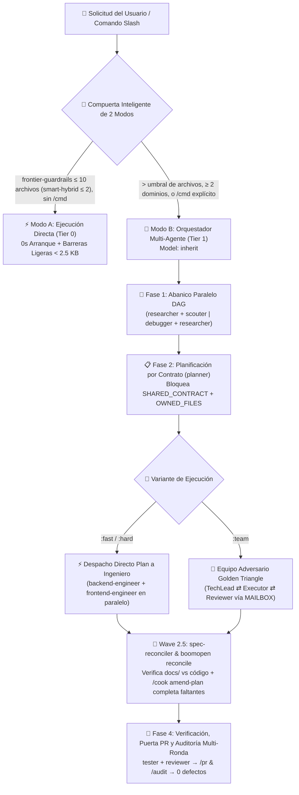

<div align="center">
  <h1>⚡ BoomOpen Workflow Kit v5.5.0</h1>
  <p><strong>Sistema Operativo de Fuerza Laboral IA Smart-Hybrid Multiplataforma — 22 Agentes Especialistas, 18 Equipos Triángulo Dorado y Bóveda de 1,462 Habilidades Bajo Demanda</strong></p>

  <p>
    <a href="https://github.com/Kennyboom/BoomOpen-Workflow-Kit-Pro/releases"></a>
    <a href="#platforms"></a>
    <a href="#agents"></a>
    <a href="#skills"></a>
    <a href="https://nodejs.org/">=18.0.0" /></a>
    <a href="../LICENSE"></a>
  </p>

  <p>
    <a href="../README.md">🇬🇧 English</a> • <a href="./README.vi.md">🇻🇳 Tiếng Việt</a> • <a href="./README.zh-CN.md">🇨🇳 简体中文</a> • <a href="./README.zh-TW.md">🇹🇼 繁體中文</a> • <a href="./README.ja.md">🇯🇵 日本語</a> • <a href="./README.ko.md">🇰🇷 한국어</a> • <b>🇪🇸 Español</b> • <a href="./README.fr.md">🇫🇷 Français</a> • <a href="./README.de.md">🇩🇪 Deutsch</a><br/>
    <a href="./README.pt-BR.md">🇧🇷 Português</a> • <a href="./README.ru.md">🇷🇺 Русский</a> • <a href="./README.hi.md">🇮🇳 हिन्दी</a> • <a href="./README.ar.md">🇸🇦 العربية</a> • <a href="./README.id.md">🇮🇩 Bahasa Indonesia</a> • <a href="./README.th.md">🇹🇭 ไทย</a> • <a href="./README.tr.md">🇹🇷 Türkçe</a> • <a href="./README.it.md">🇮🇹 Italiano</a>
  </p>

  <p>
    <a href="https://boomopen.com">🌐 Website</a> • <a href="#overview"><b>🌟 Resumen</b></a> • <a href="#architecture"><b>🏗️ Arquitectura</b></a> • <a href="#quickstart"><b>🚀 Inicio Rápido</b></a> • <a href="#settings"><b>🎛️ Perfiles y Ajustes</b></a> • <a href="#commands"><b>🎯 36 Comandos</b></a> • <a href="#agents"><b>🤖 22 Agentes y 18 Equipos</b></a> • <a href="#skills"><b>📚 1,462 Habilidades</b></a>
  </p>
</div>

---

## 🎬 Tráiler Oficial de Lanzamiento (Full HD 1080p)

<div align="center">
  <a href="https://github.com/Kennyboom/BoomOpen-Workflow-Kit-Pro/raw/main/assets/media/boomopen_v55_trailer_en.mp4">
    
  </a>
  <p>
    ▶️ <a href="https://github.com/Kennyboom/BoomOpen-Workflow-Kit-Pro/raw/main/assets/media/boomopen_v55_trailer_en.mp4"><b>Haz clic aquí para ver / reproducir el Tráiler Oficial de Lanzamiento en Full HD 1080p (MP4 con narración de estudio)</b></a>
  </p>
</div>

---

<a id="overview"></a>

## 🌟 ¿Qué es BoomOpen Workflow Kit v5.5?

**BoomOpen Workflow Kit v5.5 (Multi-Platform Unified & Smart-Hybrid Edition)** es un sistema operativo multi-agente de código abierto que transforma un asistente de programación IA individual en una organización de ingeniería coordinada compuesta por **22 agentes especialistas**, **18 equipos adversarios Golden Triangle (72 archivos de equipo)**, **36 comandos slash (93 archivos de comandos: 87 flujos de trabajo + 6 `_ref/`)**, **14 comandos CLI** y una bóveda de **1,462 habilidades bajo demanda (22 Core + 1,440 especializadas, deduplicadas entre IDEs mediante `~/.agents/skills_library`)**.

A diferencia de las plantillas rígidas o contenedores pesados que añaden sobrecarga de contexto en cada turno, BoomOpen v5.5 combina **barreras ligeras `< 2.5 KB` en los 5 IDEs (perfil predeterminado `frontier-guardrails`)**, **Compuerta Proactiva de Sub-agentes en el Turno 1**, **Enrutamiento en Lenguaje Natural en 17 Idiomas**, **Fragmentación Elástica de Enjambre de 4 Niveles (`role#shard`)**, **Auto-Reconciliación Especificación-Código Wave 2.5 (`boomopen reconcile` + `spec-reconciler`)**, **Auditoría Multi-Ronda (`/audit` y `boomopen audit`)**, **Mapeo Brownfield en 60s (`/onboard`)**, **Puertas de PR y Lanzamiento (`/pr`, `/pr:review`, `/release`)**, **Autopiloto Multisesión (`/autopilot`)** y **Conductor Multimotor (`/conduct`)**:
- **🛡️ `frontier-guardrails` Predeterminado y Modo A sin Latencia**: Con barreras ultracompactas `< 2.5 KB`, el modelo frontera dirige tareas diarias de hasta `≤ 10` archivos directamente con 0s de arranque (`≤ 2` archivos en `smart-hybrid`), aplicando **Estándares Pragmáticos de 2 Niveles** y **verificación E2E estricta** sin secuestro de lenguaje natural.
- **🚀 Sub-agentes Paralelos en Turno 1, Reconciliación Wave 2.5 y Modo B**: Funcionalidades multidominio o comandos `/cmd` explícitos lanzan al instante fragmentos paralelos (`role#shard`, `<= 3–4 OWNED_FILES`/shard) con **Abanico Paralelo DAG**, **Despacho Directo del Plan al Ejecutor**, **Bloqueos por Contrato (`SHARED_CONTRACT` + `OWNED_FILES`)**, **Reconciliación Wave 2.5 (`boomopen reconcile`, `spec-reconciler` y `/cook amend-plan` corrigiendo módulos aislados, paridad de rutas/env y omisiones `[SC-*]`)** y **Reutilización en Caliente (`send_message`)**.
- **🏛️ Autopiloto Multisesión (`/autopilot`), Auditoría Multi-Ronda (`/audit`, con rollback) y Consejo Multimotor (`/conduct`)**: Registra especificaciones en `.boomopen/project-ledger.json` (con `boomopen ledger rollback`) y trinquete de 4 capas (`boomopen check --strict-phase --no-stubs`); al finalizar ejecuta auditorías integrales (`/audit` y `boomopen audit`, con `audit rollback`) cubriendo RTM, flujo vertical UI→API→DB y **Motor de Seguridad Anti-Fugas de 2 Capas `security_scan.py` v6** hasta lograr 0 hallazgos.
- **📚 Bóveda Deduplicada de 1,462 Habilidades con 0 Coste en Reposo**: Compartida vía `~/.agents/skills_library` e indexada en `matrix-skills/compact-index.json` para resolución `O(1)` en 2 pasos, incluyendo plantillas listas para producción de **`mcp-server`** y **`ai-agent-worker`**.

---

<a id="architecture"></a>

## 🏗️ Arquitectura Híbrida-Inteligente (v5.5)



---

<a id="pillars"></a>

## 🧠 Los 6 Pilares Principales y Funciones Nativas de Plataforma 2026

1. **🌐 Paridad Unificada en 5 Plataformas y Capacidades Nativas 2026 (`platforms/*`)**:
   - Integración nativa para **Antigravity (Gemini)** (empaquetado de plugin nativo `install antigravity --as-plugin` y orquestación Python `run_workflow`), **Claude Code** (`/plan:hard` + hooks de calidad y continuidad `PreCompact`/`Stop` + guardia de seguridad `Bash|PowerShell`), **OpenAI Codex** (aislamiento `read-only` para exploradores/auditores y perfiles TOML), **Cursor** y **GitHub Copilot**.
2. **📏 Estándares de Codificación Pragmáticos de 2 Niveles (Anti-Fragmentación)**:
   - **Nivel 1 — Calidad y Seguridad Estrictas (Tolerancia Cero)**: Responsabilidad Única, **PROHIBIDO `any` explícito**, **PROHIBIDO dejar `console.log` de depuración**, `try/catch` + errores tipados en límites async/API, constantes `SCREAMING_SNAKE_CASE`, DRY (`≥ 3`) e importaciones ordenadas.
   - **Nivel 2 — Guías Estructurales Flexibles (Cohesión Primero)**: Archivos cohesivos de `~200–350 líneas` (techo flexible `400` / división estricta `500`; tests, tipos y docs exentos); funciones de lógica `~20–40 líneas` (`~40–80` UI/Handlers).
3. **🎯 Fragmentación Elástica (`role#shard`) y Auto-Reconciliación Wave 2.5 (`spec-reconciler`)**:
   - Tras `PLAN-{feature}.md`, el Orquestador asigna tareas directamente a fragmentos (`<= 3–4 OWNED_FILES`/shard) y los reutiliza en caliente vía `send_message` con **0s de arranque**. En **Wave 2.5**, `spec-reconciler` y `boomopen reconcile` (`REC-G1..G4`) cierran brechas frente a `docs/` antes de dar por completada la fase.
4. **🤝 Contratos Paralelos, Puertas PR/Release y Auditoría `/audit` (Motor Anti-Fugas v6)**:
   - `SHARED_CONTRACT` + `OWNED_FILES` evitan colisiones; `/onboard` mapea repositorios existentes en 60s; `/pr` (`/pr:review`) y `/release` blindan cada Pull Request y lanzamiento semántico; y `/audit` ejecuta escaneos RTM y Anti-Fugas v6 hasta llegar a 0 hallazgos.
5. **🔍 Depuración 5-Whys (SPIE v3.0) y Árbol Git 100% Limpio**:
   - `debugger` investiga cada error mediante 3 hipótesis y cadena causal **5-Whys**. Los artefactos transitorios (`PLAN`, `DEBUG`, `TEST`, `REVIEW`, `AUDIT`, `ARCHITECTURE-MAP`, `MAILBOX`) se enrutan a `<appDataDir>\brain\<conversation-id>\` (o `./reports/`), manteniendo limpio el árbol Git.
6. **🩺 Suite CLI de 14 Comandos e Índice Deduplicado O(1)**:
   - `npm run doctor` valida los 5 paquetes de plataforma, **22 agentes**, **72 archivos de equipo (18 equipos)**, **93 archivos de comandos (36 comandos: 87 flujos + 6 `_ref/`)** y **`1,462` habilidades** compartidas en `~/.agents/skills_library`. Los **14 comandos CLI** (`research`, `design`, `plan`, `cook`, `reconcile`, `audit` con `audit rollback`, `ledger` con `ledger rollback`, `conduct`, `check`, `doctor`, `settings`, `install` con `--as-plugin`, `uninstall`, `list`) garantizan cumplimiento determinista.

---

<a id="platforms"></a>

## 💻 Plataformas de IA Soportadas

| Plataforma | Nivel de Soporte | Punto de Entrada Global y Funciones Nativas 2026 | Ruta de Instalación del Framework |
|----------|:-------------:|-------------------|------------------------|
| **Antigravity (Gemini)** | ✅ Nativo v5.5 | `~/.gemini/GEMINI.md` (`--as-plugin`, `run_workflow` y `/goal`) | `~/.gemini/config/skills/boomopen-workflow-kit/` |
| **Claude Code** | ✅ Nativo v5.5 | `~/.claude/CLAUDE.md` (hooks `PreCompact`/`Stop` y guardia `Bash\|PowerShell`) | `~/.claude/skills/boomopen-workflow-kit/` |
| **OpenAI Codex** | ✅ Nativo v5.5 | `~/.codex/CODEX.md` & `AGENTS.md` (sandbox `read-only` y roles TOML) | `~/.codex/skills/boomopen-workflow-kit/` |
| **Cursor** | ✅ Nativo v5.5 | `~/.cursor/rules/boomopen-workflow-kit.mdc` (regla ligera `< 2.5 KB`) | `~/.cursor/skills/boomopen-workflow-kit/` |
| **GitHub Copilot** | ✅ Nativo v5.5 | `~/.copilot/COPILOT.md` (agente personalizado y sub-agentes) | `~/.copilot/skills/boomopen-workflow-kit/` |

---

<a id="quickstart"></a>

## 🚀 Inicio Rápido e Instalación

```bash
# 1. Clonar el repositorio
git clone https://github.com/Kennyboom/BoomOpen-Workflow-Kit-Pro.git
cd BoomOpen-Workflow-Kit-Pro

# 2. Instalar para tu asistente de IA (deduplica habilidades en ~/.agents/skills_library)
npm run install:antigravity                        # Antigravity (Gemini) estándar
node cli/install.js install antigravity --as-plugin # Antigravity como plugin nativo empaquetado
npm run install:claude                             # Claude Code (con hooks PreCompact/Stop + guardia Bash|PowerShell)
npm run install:codex                              # OpenAI Codex (con sandboxing read-only)
npm run install:cursor                             # Cursor
npm run install:copilot                            # GitHub Copilot
npm run install:all                                # Instalar en las 5 plataformas simultáneamente

# 3. Verificar la instalación y compuertas de los 14 comandos CLI (incl. rollback)
npm run doctor
npm link
boomopen research validate path/to/RESEARCH.md
boomopen design validate path/to/DESIGN.md
boomopen plan validate path/to/PLAN.md
boomopen cook preflight path/to/PLAN.md
boomopen reconcile path/to/your/project --plan path/to/PLAN.md   # Reconciliación Wave 2.5 (REC-G1..G4)
boomopen audit init --docs docs/prd.md,docs/arch.md              # Auditoría multi-ronda (soporta audit rollback)
boomopen check path/to/your/project --strict-phase --no-stubs    # Longitud, any, console.log, cero stubs
boomopen ledger status                                           # Estado del ledger (soporta boomopen ledger rollback)
boomopen conduct probe
```

> El kit **no está publicado en npm**: instálalo solo desde este repositorio (`npm link` enlaza este clon local sin descargar nada de npm).

---

<a id="settings"></a>

## 🎛️ Configuración Unificada y 5 Perfiles Predefinidos (`/settings`)

BoomOpen v5.5 incluye un **Centro de Control Unificado de Latencia Cero** que sincroniza **5 perfiles predefinidos** y 20 ajustes enumerados (+ 2 límites de líneas) en las **5 plataformas** en `< 10ms` (**0ms en el Turno 1**, inyectando barreras ligeras `< 2.5 KB`):

| Perfil Predefinido (`Preset`) | Modo (`execution.mode`) | Variante `/cmd` | Disparador Lenguaje Natural (`naturalLanguageResearchTrigger`) | Estándares (`codingStandards`) | Uso Recomendado |
|:---|:---|:---:|:---:|:---:|:---|
| **🛡️ `frontier-guardrails`** *(Predeterminado Recomendado)* | **`mode_a`** (`≤ 10` archivos directos, barreras `< 2.5 KB` en los 5 IDEs; alias `carbon-guardrails` soportado) | `auto` | **`off`** *(Sin secuestro NL: solo responde a `/cmd` explícitos)* | `pragmatic` (`400/500` líneas) | Predeterminado ideal en los 5 IDEs: el modelo frontera lidera el día a día con verificación E2E estricta |
| **⚡ `smart-hybrid`** | **`auto`** (`≤ 2` archivos → Modo A; `> 2` o `/cmd` → Modo B) | `auto` | **`auto_team`** *(Enruta a `/research:team` / `/brainstorm:team`)* | `pragmatic` (`400/500` líneas) | Orquestación automática multi-agente y enrutamiento de lenguaje natural en 17 idiomas |
| **🚀 `solo-fast`** | **`mode_a`** *(Fuerza Ejecución Directa Solo, 0s de sub-agentes)* | `fast` | `off` *(Respuesta directa salvo `/brainstorm`)* | `relaxed` (`600/800` líneas) | Hotfixes urgentes, prototipado rápido, scripts y ahorro de tokens |
| **🧠 `deep-architect`** | **`mode_b`** *(Fuerza Orquestador Multi-Agente en cada tarea)* | `hard` | `auto_hard` *(Enruta a `/research:hard` / `/brainstorm:hard`)* | `strict` (`300/400` líneas) | Arquitectura compleja, diseño greenfield y refactorización multidominio |
| **🔺 `adversarial-team`** | **`team`** *(Fuerza equipo adversario de 3 agentes `:team`)* | `team` | **`auto_team`** *(Revisión adversaria de 3 agentes vía `MAILBOX`)* | `strict` (`300/400` líneas) | Producción crítica, auditorías de seguridad y lanzamientos sin defectos |

> **🛡️ ¿Cómo funciona `frontier-guardrails` (Predeterminado)?** Mantiene una huella `< 2.5 KB` en los 5 IDEs para que el modelo frontera ejecute tareas diarias directamente (`mode_a`, `≤ 10` archivos), aplicando los estándares `pragmatic` (`400/500` líneas, cero `any`), verificación `strict_e2e` y flujos `/cmd` solo bajo invocación explícita (`carbon-guardrails` se mantiene como alias totalmente compatible).

### Tres Formas de Cambiar de Modo (Chat `/settings`, Panel Web y CLI)

```bash
# 1. Comando Slash en el Chat
/settings                                     # Abrir menú interactivo (ask_question UI)
/settings preset frontier-guardrails          # Perfil predeterminado recomendado (alias carbon-guardrails soportado)
/settings preset smart-hybrid                 # Orquestación automática Smart-Hybrid
/settings preset solo-fast                    # Ejecución Directa Rápida (Mode A)
/settings preset deep-architect               # Orquestador Multi-Agente (Mode B)
/settings preset adversarial-team             # Equipo Golden Triangle (:team)
/settings mode auto | mode_a | mode_b | team  # Cambiar modo de ejecución directamente

# 2. Panel Web Local (http://127.0.0.1:4567) y Terminal CLI
boomopen settings --ui
boomopen settings preset frontier-guardrails
cd path/to/your/project && boomopen settings set execution.mode mode_a --project
```

---

<a id="commands"></a>

## 🎯 Referencia de Comandos Slash (36 Comandos / 93 Archivos: 87 Flujos + 6 `_ref/`)

| Comando | Variantes / Subcomandos | Propósito Principal |
|---------|----------|-----------------|
| **`/onboard`** | — | **Mapa de Arquitectura Brownfield en 60s**: Sintetiza stack, puntos de entrada, flujos de datos, focos de riesgo y comandos de test/build en `ARCHITECTURE-MAP.md` (cero colisión con `/init`, cero basura en el repo) |
| **`/cook`** | `:fast`, `:hard`, `:team`, `amend-plan` | Desarrollo de extremo a extremo (Investigación → Plan → Código Paralelo → **Wave 2.5 `reconcile`** → Test → Revisión) |
| **`/code`** | `:fast`, `:hard`, `:team` | Ejecutar implementación directamente desde un `PLAN-{feature}.md` existente |
| **`/plan`** | `:fast`, `:hard`, `:team` | Crear planos con `SHARED_CONTRACT`, `OWNED_FILES` y criterios Given/When/Then (incluye `/plan:hard` en Claude Code) |
| **`/fix`** | `:fast`, `:hard`, `:team` | Resolución de errores de causa raíz con pruebas de regresión obligatorias |
| **`/debug`** | `:fast`, `:hard`, `:team` | Investigación con 3 hipótesis + **5-Whys (SPIE v3.0)** (`DEBUG-{issue}.md`) |
| **`/test`** | `:fast`, `:hard`, `:team` | Ejecución paralela DAG de suites de pruebas + exploración de casos límite (`tester` + `scouter`) |
| **`/review`** | `:fast`, `:hard`, `:team` | Auditoría paralela en 4 dimensiones (Arquitectura, Calidad, Seguridad OWASP, Rendimiento) |
| **`/pr`** | `:review` (`/pr:review`) | **Puerta Pre-PR y Revisión Adversaria**: Ejecuta `check`, `reconcile` y tests antes de `gh pr create`, o audita hunks en paralelo con `/pr:review` (`gh pr view` / `gh pr diff`) |
| **`/release`** | — | **Preparación de Lanzamiento Semántico**: Audita Conventional Commits, genera `CHANGELOG.md`, valida `doctor`/`check`/`test`/`test:pack` y prepara `gh release create` con confirmación humana |
| **`/audit`** | `:run`, `:fix`, `:auto` | **Auditoría Multi-Ronda Post-Completado**: Cobertura RTM, flujo vertical y Motor Anti-Fugas v6 con corrección por fragmentos (`boomopen audit` / `audit rollback`) |
| **`/design`** | `:fast`, `:hard`, `:team` | Arquitectura del sistema, esquema de base de datos y especificación UI/UX (`DESIGN.md`) |
| **`/docs`** | `:core`, `:business`, `:audit` | Generar o sincronizar documentación estructurada de 2 niveles (`./documents/`) |
| **`/deploy`** | `:check`, `:preview`, `:production`, `:rollback` | Puertas pre-despliegue, entornos preview, rollout a producción y rollback seguro |
| **`/research`** | `:fast`, `:hard`, `:team` | Motor de investigación profunda (triangulación de 4 fuentes, 3 olas y consejo de 3 vectores) |
| **`/brainstorm`** | `:fast`, `:hard`, `:team` | Descubrimiento socrático de requisitos, análisis de compensaciones e ideación |
| **`/report`** | `:fast`, `:hard`, `:team` | Informes ejecutivos y técnicos de síntesis con métricas y diagramas |
| **`/autopilot`** | `:init`, `:run`, `:audit` | Orquestador autónomo multi-sesión con `.boomopen/project-ledger.json` (`ledger rollback`) y trinquete de 4 capas |
| **`/conduct`** | `:council`, `:pipeline` | Conductor multi-motor y consejo paralelo (`boomopen conduct`) con consenso en 4 partes |
| **`/orchestrate`** | — | Orquestación personalizada de tuberías multi-agente en múltiples dominios |
| **`/settings`** | `preset`, `mode`, `set`, `ui` | Centro de Control Unificado: 5 perfiles, 20 ajustes + 2 límites de líneas o Web UI (`--ui`) |
| **`/save` / `/recap`** | — | Persistir estado de sesión (`SESSION-HANDOVER.md`) y restaurar contexto en `< 5s` (más `/ask`, `/status`, `/next`, etc. hasta 36 comandos) |

---

## 🌙 Guía Nocturna para Proyectos Multifase (`/autopilot` vs `/goal` + `/autopilot` + `/audit`)

- **Continuidad Externa según Plataforma**: **`/goal`** es el **bucle externo nativo de Antigravity (Gemini)** que continúa automáticamente entre sesiones al alcanzar ~70% de contexto, mientras que **`/autopilot` + los hooks `Stop` / `PreCompact`** impulsan la continuidad multisesión en **Claude Code y OpenAI Codex**.

| Modo | Alcance y Comportamiento por Plataforma | Garantías de Libro Mayor, Puertas y Auditoría | Cuándo Usarlo |
|:---|:---|:---|:---|
| **`/autopilot` (+ hooks Claude/Codex)** | Ejecución en una sesión o continuidad multisesión automática mediante hooks `Stop`/`PreCompact` en Claude Code y Codex | `.boomopen/project-ledger.json` (`ledger rollback`), 5 puertas de verificación y reconciliación Wave 2.5 | Desarrollo por fases de día y ejecución autónoma multisesión en Claude Code / Codex |
| **`/goal` + `/autopilot` + `/audit`** *(Antigravity)* | **`/goal` actúa como bucle externo nativo en Antigravity** impulsando todas las fases durante la noche | `project-ledger.json` + **5 puertas** + **Wave 2.5 `reconcile`** + **Ronda 1 `/audit`** (`audit rollback`) al llegar al 100% | Construcción nocturna autónoma de extremo a extremo desde `docs/` en Antigravity |

**📋 Prompt nocturno listo para copiar (añade `/goal` al inicio en Antigravity; inicia con `/autopilot` en Claude Code / Codex):**

```text
/goal /autopilot Lee todas las especificaciones en `docs/`, inicializa .boomopen/project-ledger.json
y construye autónomamente todas las fases de principio a fin siguiendo el PLAN inicial aprobado.
Cada fase debe superar las 5 puertas de verificación, Wave 2.5 boomopen reconcile y boomopen check --strict-phase --no-stubs.
Al completar el 100% de las fases, ejecuta la Ronda 1 de /audit y detente con el informe para revisión.
```

---

<a id="agents"></a>

## 🤖 22 Agentes Especialistas y 18 Equipos Golden Triangle (72 Archivos)

| Categoría | Agentes Especialistas (`agents/*.md`) | Equipos Golden Triangle (`agents/teams/*-team/`) |
|----------|-----------------------------------|------------------------------------------------|
| **Ingeniería y Ejecución** | `backend-engineer`, `frontend-engineer`, `mobile-engineer`, `game-engineer`, `database-architect`, `devops-engineer` | `backend-team`, `frontend-team`, `fullstack-team`, `mobile-team`, `game-team`, `database-team`, `devops-team` |
| **Arquitectura y Planificación** | `tech-lead`, `planner`, `brainstormer`, `business-analyst`, `project-manager`, `designer` | `planning-team`, `brainstorm-team`, `project-team`, `design-team` |
| **Calidad, Seguridad y Depuración** | `debugger`, `tester`, `reviewer`, **`spec-reconciler`**, `security-engineer`, `performance-engineer` | `debug-team`, `qa-team`, `security-team`, `performance-team` |
| **Investigación y Conocimiento** | `researcher`, `scouter`, `docs-manager`, `reporter` | `research-team`, `docs-team`, `report-team` |

---

<a id="skills"></a>

## 📚 Bóveda de 1,462 Habilidades (22 Principales + 1,440 en `~/.agents/skills_library`)

BoomOpen reúne `1,462` habilidades curadas deduplicadas en `~/.agents/skills_library` con **0 consumo de tokens en reposo** mediante **Resolución Progresiva O(1) en 2 Pasos** (`<skills>` → `matrix-skills/compact-index.json` → carga exacta de `SKILL.md` bajo demanda):

| Nivel / Dominio de Habilidad | Cantidad | Habilidades y Plantillas 2026 Representativas | Mecanismo de Carga |
|:---|:---:|:---|:---|
| **⚡ Nivel 1: Habilidades Principales (`skills/`)** | **22** | `clean-code`, `debugger`, `plan-writing`, `brainstorming`, `frontend-design`, `frontend-architecture`, `design-spec`, `api-patterns`, `database-design`, `testing-patterns`, `skill-seeker` | Preindexado en `<skills>` para acceso instantáneo en Turno 1 |
| **🎨 Diseño UI/UX, Motion y Sistemas de Diseño** | **42** | Anti-AI-Slop Visual Craft, paletas OKLCH y Bento Grids, Motion v12 + CSS View Transitions, primitivas headless (`cmdk`/`vaul`/`sonner`), Figma MCP + W3C DTCG Tokens, WCAG 2.2 AA/AAA, iOS 18 HIG y Material 3 Expressive | Bajo demanda vía `compact-index.json` (`matrix-skills/design.yaml`) |
| **🌐 Web, Backend y Datos en el Edge** | **390+** | React 19 y Next.js 15, Tailwind v4, TanStack Start, Hono RPC + Zod OpenAPI, Rust Axum/Tokio/SQLx, Supabase RLS, Drizzle + Neon/Turso | Bajo demanda vía `compact-index.json` (`~/.agents/skills_library`) |
| **🤖 IA, SDKs de Agentes, MCP y Datos** | **320+** | **Plantillas `mcp-server` y `ai-agent-worker`**, MCP FastMCP (`StreamableHTTP`), OpenAI/Claude Agents SDK, Google ADK, RAG, BigQuery, dbt | Bajo demanda vía `compact-index.json` (`~/.agents/skills_library`) |
| **☁️ Cloud, DevOps, Testing y Seguridad** | **300+** | Cloudflare Workers/D1/R2/Durable Objects, Terraform/OpenTofu, Docker/K8s GitOps, Vitest + MSW v2, Better Auth, auditoría OWASP LLM 2025 | Bajo demanda vía `compact-index.json` (`~/.agents/skills_library`) |
| **📱 Móvil, Motores de Juegos y Web 3D** | **410+** | Unity 6 DOTS/ECS, Godot 4, WebGPU/WGSL y Three.js TSL, Colyseus Netcode, Tauri v2, SwiftUI, Kotlin, React Native, Flutter | Bajo demanda vía `compact-index.json` (`~/.agents/skills_library`) |

---

## 📂 Estructura del Repositorio

```text
BoomOpen-Workflow-Kit-Pro/
├── agents/                  # 22 Agentes Especialistas (incl. spec-reconciler) + 18 Equipos Golden Triangle (54 roles + 18 _team.md, 72 archivos)
├── cli/                     # Suite CLI de 14 comandos: install (--as-plugin), doctor, checker, settings, research, design, plan, cook, reconcile, audit (rollback), ledger (rollback) & conductor
├── commands/                # 87 flujos de trabajo (36 comandos Slash: /onboard, /pr, /pr:review, /release, /audit, /autopilot, etc.) + 6 _ref/ (93 archivos)
├── documents/               # Documentación de 2 niveles de Arquitectura, Dominio, Código Base y Estándares
├── i18n/                    # Documentación internacionalizada (16 traducciones completas de README)
├── matrix-skills/           # Matrices YAML de habilidades por dominio + compact-index.json precompilado (1,462 habilidades)
├── platforms/               # Plantillas unificadas y hooks para las 5 plataformas (antigravity/, claude/, codex/, copilot/, cursor/)
├── rules/                   # Reglas bajo demanda del Modo B (CORE, PHASES, AGENTS, TEAMS, SKILLS, ERRORS, REFERENCE)
├── scripts/                 # Scripts Python de verificación y seguridad (security_scan.py v6, checklist.py, verify_all.py, etc.)
├── skills/                  # 22 Habilidades Principales (clean-code, debugger, plan-writing, frontend-design, etc.)
├── skills_library/          # 1,440 habilidades deduplicadas vía ~/.agents/skills_library (incl. mcp-server y ai-agent-worker)
└── GEMINI.md | CLAUDE.md | CODEX.md | COPILOT.md | CURSOR.md | AGENT.md
```

---

## 📄 Licencia y Seguridad

- **Licencia**: Distribuido bajo la [Licencia MIT](../LICENSE). Copyright © 2026 **BoomOpen Labs**. Las skills de terceros en `skills_library/` conservan sus licencias originales; consulta [THIRD_PARTY_NOTICES.md](../THIRD_PARTY_NOTICES.md).
- **Política de Seguridad**: Consulta [SECURITY.md](../SECURITY.md) para conocer las protecciones integradas y el procedimiento de reporte de vulnerabilidades.
