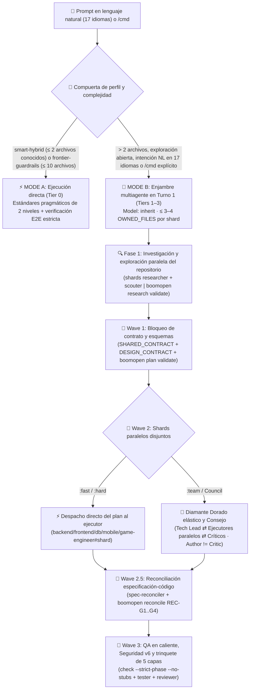

<div align="center">
  <h1>⚡ BoomOpen Workflow Kit Pro v5.5</h1>
  <p><strong>Orquestación multiagente y compuertas deterministas de verificación CLI en Antigravity, Claude Code, OpenAI Codex, Cursor y GitHub Copilot.</strong></p>

  <p>
    <a href="https://boomopen.com"></a>
    <a href="https://github.com/Kennyboom/BoomOpen-Workflow-Kit-Pro/releases"></a>
    <a href="#platforms"></a>
    <a href="#cli"></a>
    <a href="#skills"></a>
    <a href="https://nodejs.org/">= 18.0.0" /></a>
    <a href="../LICENSE"></a>
  </p>

  <p>
    <a href="../README.md">English</a> •
    <a href="./README.vi.md">Tiếng Việt</a> •
    <a href="./README.zh-CN.md">简体中文</a> •
    <a href="./README.zh-TW.md">繁體中文</a> •
    <a href="./README.ja.md">日本語</a> •
    <a href="./README.ko.md">한국어</a> •
    <b>Español</b> •
    <a href="./README.fr.md">Français</a> •
    <a href="./README.de.md">Deutsch</a><br/>
    <a href="./README.pt-BR.md">Português (BR)</a> •
    <a href="./README.ru.md">Русский</a> •
    <a href="./README.hi.md">हिन्दी</a> •
    <a href="./README.ar.md">العربية</a> •
    <a href="./README.id.md">Bahasa Indonesia</a> •
    <a href="./README.th.md">ไทย</a> •
    <a href="./README.tr.md">Türkçe</a> •
    <a href="./README.it.md">Italiano</a>
  </p>

  <p>
    <a href="https://boomopen.com"><b>🌐 boomopen.com (15 idiomas)</b></a> •
    <a href="#trailer"><b>🎬 Tráiler</b></a> •
    <a href="#why-boomopen"><b>⚡ Por qué BoomOpen</b></a> •
    <a href="#architecture"><b>🏗️ Arquitectura</b></a> •
    <a href="#quickstart"><b>🚀 Inicio rápido</b></a> •
    <a href="#cli"><b>🛠️ 14 compuertas CLI</b></a> •
    <a href="#settings"><b>🎛️ Perfiles y ajustes</b></a> •
    <a href="#commands"><b>🎯 36 comandos</b></a> •
    <a href="#agents"><b>🤖 22 agentes y 18 equipos</b></a> •
    <a href="#skills"><b>📚 1,462 skills</b></a>
  </p>
</div>

---

<a id="trailer"></a>

## 🎬 Tráiler de Lanzamiento y Explorador Web Interactivo (`boomopen.com`)

<div align="center">
  <a href="https://github.com/Kennyboom/BoomOpen-Workflow-Kit-Pro/raw/main/assets/media/boomopen_v55_trailer_en.mp4">
    
  </a>
  <p>
    ▶️ <a href="https://github.com/Kennyboom/BoomOpen-Workflow-Kit-Pro/raw/main/assets/media/boomopen_v55_trailer_en.mp4"><b>Reproducir tráiler en Full HD 1080p (MP4 con locución de estudio)</b></a> • 🌐 <a href="https://boomopen.com"><b>Explorar el Playground CLI de 14 comandos y los catálogos interactivos en boomopen.com (15 idiomas)</b></a>
  </p>
</div>

---

<a id="why-boomopen"></a>
<a id="-what-is-boomopen-workflow-kit"></a>

## ⚡ ¿Por qué BoomOpen Workflow Kit?

**El problema de los asistentes de programación sin orquestación:** Por defecto, las herramientas de un solo agente se degradan en cuanto el trabajo abarca múltiples archivos, dominios o sesiones. La lectura secuencial de archivos satura la ventana de contexto principal, los subagentes sin coordinación sobrescriben archivos compartidos o dejan módulos aislados sin conectar, el código entregado incluye `TODO`s silenciosos o escapes de tipos `any`, las revisiones de un único modelo ignoran sus propios puntos ciegos (`Author == Critic`), y los desarrollos multifase se desvían de la especificación original.

**Cómo lo resuelve BoomOpen:** BoomOpen instala un arnés unificado de orquestación y verificación en **Antigravity (Gemini)**, **Claude Code**, **OpenAI Codex**, **Cursor** y **GitHub Copilot** con **cero dependencias npm en tiempo de ejecución**. Con **`smart-hybrid`** activo por defecto, los cambios en `≤ 2` archivos conocidos se ejecutan directamente sin sobrecarga, mientras que los desarrollos multiarchivo, la investigación profunda, la planificación de arquitectura y los **`36` comandos slash (`93` archivos)** particionan el trabajo en el Turno 1 entre **22 agentes especialistas** y **18 equipos adversarios de 3 roles** — validados por **14 compuertas CLI locales de `boomopen`** y respaldados por **`1,462` skills bajo demanda** (`22` Core + `1,440` deduplicadas una sola vez en `~/.agents/skills_library`).

### ⚖️ Sin BoomOpen vs. Con BoomOpen v5.5

| Modo de fallo en ingeniería | Sin BoomOpen (IDE de IA estándar) | Con BoomOpen Workflow Kit Pro v5.5 |
|:----------------------------|:----------------------------------|:-----------------------------------|
| **Saturación de la ventana de contexto** | El agente principal lee 15–30 archivos en serie antes de escribir código | **Enjambre elástico en Turno 1 (`role#shard`)**: Despacha exploradores de solo lectura y shards de dominio (`≤ 3–4` archivos/shard) + reutilización en caliente (`0s`, `send_message`) |
| **Colisiones paralelas y cableado roto** | Agentes en paralelo pisan archivos comunes, inventan rutas `/api` incompatibles o dejan módulos muertos | **Bloqueos por contrato + Reconciliación Wave 2.5**: Fija `SHARED_CONTRACT` en Wave 1 + `OWNED_FILES` disjuntos, verificado con `boomopen reconcile` (`REC-G1..G4`) |
| **Investigación superficial y planes vagos** | Respuestas complacientes de una sola vista, afirmaciones sin verificar y planes en prosa libre | **Especificaciones de 6 bloques con evidencia**: Crítico adversario `:team` + validadores CLI en `< 50ms` (`boomopen research`, `design`, `plan`) |
| **Stubs silenciosos, `any` y tests trucados** | El agente da la tarea por terminada dejando `// TODO`, `any` explícitos, `console.log` o tests `.skip` | **Compuerta estática pragmática de 2 niveles**: `boomopen check --strict-phase --no-stubs` exige `0` `any`, `0` stubs y archivos cohesivos de `400/500` líneas |
| **Deriva multisesión y regresiones** | La compactación de contexto borra restricciones previas y rompe funcionalidades ya validadas | **Trinquete de calidad de 5 capas y rollback**: `.boomopen/project-ledger.json` con guardia SHA-256 contra deriva, `/autopilot`, `/audit` y `rollback --yes` atómico |
| **Puntos ciegos de un solo modelo** | El mismo modelo escribe y revisa su propio código (`Author == Critic`) | **Conductor multimotor (`/conduct`)**: Consejos paralelos multimotor y pipelines entre familias de modelos en Claude Code, Codex, Antigravity, Cursor y Copilot |
| **Deriva entre 5 IDEs y árbol Git sucio** | Reglas separadas por IDE, gigabytes de skills duplicadas y especificaciones temporales ensuciando `git status` | **Sincronización unificada y Git limpio**: 14 archivos de entrada sincronizados en `< 10ms`, 1 `~/.agents/skills_library` compartida (`0` tokens inactivos) y enrutamiento a Brain Artifacts |

---

<a id="architecture"></a>
<a id="-smart-hybrid-architecture-v55"></a>

## 🏗️ Arquitectura Smart-Hybrid (v5.5)



---

<a id="pillars"></a>

## 🧠 6 Pilares Técnicos Fundamentales

1. **🌐 Compilación nativa en 5 IDEs y bóveda deduplicada (`platforms/*`)**:
   - Compila **22 agentes especialistas** y **93 archivos de comandos/referencia** a los formatos nativos de cada IDE: **Antigravity** (bundle `--as-plugin` + `3` scripts ejecutables de Python para `run_workflow`: `audit_fanout.py`, `review_fanout.py`, `research_fanout.py`), **Claude Code** (shards `isolation: worktree`, comandos `/plan:hard` y hooks opcionales `PreToolUse` y `Stop`/`PreCompact`), **OpenAI Codex** (`22` roles TOML con sandboxes de SO `read-only` para exploradores/críticos + `87` skills `$boomopen-*`), **Cursor** (reglas `.mdc` + hook opcional `beforeShellExecution`) y **GitHub Copilot** (agentes `.agent.md`).
   - Enlaza las `1,440` skills de biblioteca una única vez en `~/.agents/skills_library` para los 5 IDEs (~80% de ahorro en disco, `0` sobrecarga de tokens en el Turno 1).
2. **🎯 Enjambre elástico dinámico de 4 niveles (`role#shard`) y reutilización en caliente**:
   - Escala automáticamente desde **Tier 0** (`0` subagentes para `≤ 2` archivos conocidos) → **Tier 1** (`2–3` shards) → **Tier 2** (`4–6` shards) → **Tier 3** (`7–8+` shards, configurable hasta `16`), limitando la carga cognitiva a **`≤ 3–4 OWNED_FILES` por subagente** y reutilizando sesiones activas mediante `role#shard → conversationId` (`send_message`).
3. **🤝 Ejecución por contratos en 3 olas + Reconciliación Wave 2.5 (`REC-G1..G4`)**:
   - Wave 1 bloquea `SHARED_CONTRACT` (esquemas API/DTOs) y `DESIGN_CONTRACT` (CSS `@theme` OKLCH + props TypeScript) antes de que Wave 2 despache ingenieros en paralelo. Wave 2.5 ejecuta `boomopen reconcile` + `spec-reconciler` para detectar archivos isla sin conectar (`REC-G1`), discrepancias de rutas frontend/backend (`REC-G2`), subcláusulas `[SC-*]` omitidas (`REC-G3`) y claves faltantes en `.env.example` (`REC-G4`), enmendando olas delta con `boomopen cook amend-plan`.
4. **🏛️ Autopiloto multisesión (`/autopilot`) y auditoría multironda con estado (`/audit`)**:
   - Compila especificaciones multidocumento en `.boomopen/project-ledger.json` con detección de deriva SHA-256, puntos de control Git previos a cada fase (`boomopen ledger rollback --yes`) y un **trinquete de calidad de fase de 5 capas** (`G1 check --strict-phase --no-stubs` → `G2 trinquete monótono de tests` → `G3 reconcile --strict` → `G4 revisión Author != Critic` → `G5 ledger verify`). Al terminar, `/audit` ejecuta rondas supervisadas de RTM, flujo vertical y Seguridad v6 (`.boomopen/audit-ledger.json` + `boomopen audit rollback --yes`).
5. **🎼 Conductor multimotor y Consejo paralelo (`boomopen conduct`)**:
   - Coordina simultáneamente Claude Code, OpenAI Codex, Antigravity, Cursor y Copilot en **Consejos paralelos de 6 tareas** (`research`, `brainstorm`, `plan`, `design`, `review`, `debug` → `COUNCIL-SYNTHESIS.md` en 4 bloques) o **Pipelines de roles entre familias**, donde ningún modelo califica su propio trabajo (`Author != Critic`).
6. **📏 Estándares de código pragmáticos de 2 niveles y depuración de causa raíz SPIE v3.0**:
   - **Nivel 1 (Tolerancia cero)**: Responsabilidad única, `0` `any` explícitos, `0` `console.log` de depuración en código de aplicación, fronteras tipadas con `try/catch` y constantes `SCREAMING_SNAKE_CASE`. **Nivel 2 (Cohesión primero)**: Objetivo de `~200–350` líneas (`400` flexible / `500` límite duro; tests/tipos/docs exentos). Los fallos se investigan mediante 3 hipótesis priorizadas y traza causal **5-Whys (SPIE v3.0)**, enrutando artefactos transitorios a Brain Artifacts (`100%` árbol Git limpio).

---

<a id="platforms"></a>
<a id="-supported-ai-platforms"></a>

## 💻 5 Plataformas de Programación con IA Soportadas

| Plataforma | Soporte | Punto(s) de entrada sincronizados | Integración nativa de plataforma |
|:-----------|:-------:|:----------------------------------|:---------------------------------|
| **Antigravity (Gemini)** | ✅ v5.5 | `~/.gemini/GEMINI.md` | `invoke_subagent`, abanico Python `run_workflow`, bucle externo `/goal`, bundle `--as-plugin`, `--with-hooks` opcional, Brain Artifacts |
| **Claude Code** | ✅ v5.5 | `~/.claude/CLAUDE.md` | Shards paralelos `Task`/`Agent` (`isolation: worktree`), comandos `/plan:hard`, hooks opcionales `PreToolUse` y `Stop`/`PreCompact` |
| **OpenAI Codex** | ✅ v5.5 | `~/.codex/AGENTS.md` y `CODEX.md` | `22` roles TOML en `~/.codex/agents/boomopen/` con `sandbox_mode = "read-only"` de SO para exploradores/revisores + `87` skills `$boomopen-*` |
| **Cursor** | ✅ v5.5 | `~/.cursor/rules/boomopen-workflow-kit.mdc` | Reglas frontmatter `.mdc` permanentes, `CURSOR.md`, enrutamiento de subagentes y `.cursor/hooks.json` opcional (`beforeShellExecution`) |
| **GitHub Copilot** | ✅ v5.5 | `~/.copilot/copilot-instructions.md` | Agente compilado `boomopen-workflow-kit.agent.md` en VS Code, despacho con `runSubagent` y `COPILOT.md` |

---

<a id="quickstart"></a>
<a id="-quick-start--installation"></a>

## 🚀 Inicio Rápido e Instalación (Solo vía Git — Cero Dependencias en Runtime)

```bash
# 1. Clonar el repositorio (distribuido únicamente vía GitHub — nunca publicado en npm)
git clone https://github.com/Kennyboom/BoomOpen-Workflow-Kit-Pro.git
cd BoomOpen-Workflow-Kit-Pro

# 2. Instalar en tu IDE de IA (perfil por defecto: smart-hybrid) o en los 5 IDEs a la vez
npm run install:all                                 # Instala y sincroniza los 5 IDEs + ~/.agents/skills_library compartida
npm run install:antigravity                         # Google Antigravity 2.0 (añade --as-plugin o --with-hooks si lo deseas)
node cli/install.js install claude --with-hooks     # Claude Code + hooks opcionales PreToolUse y Stop/PreCompact
npm run install:codex                               # OpenAI Codex CLI + sandboxes de SO read-only para scouts/reviewers
npm run install:cursor                              # Cursor (pasa --with-hooks para la guardia beforeShellExecution)
npm run install:copilot                             # GitHub Copilot (VS Code .agent.md + copilot-instructions.md)

# 3. Verificar integridad y enlazar opcionalmente `boomopen` en el PATH global
npm run doctor
npm link
boomopen settings status
```

> **Instalación y desinstalación seguras no destructivas**: Controladas mediante manifiestos SHA-256 (`~/.boomopen/manifests/<tool>.json`). Las reglas personales existentes en `GEMINI.md` / `CLAUDE.md` se conservan fuera de los marcadores del kit con respaldo automático; `boomopen uninstall <tool|--all>` elimina limpiamente los archivos no modificados del kit dejando intactos tus archivos propios.

---

<a id="cli"></a>

## 🛠️ 14 Subcomandos CLI sin Dependencias (`boomopen`)

Se ejecuta localmente en `< 50ms` sobre Node.js `>= 18` con **cero dependencias npm en runtime** y **cero llamadas de red**:

| Subcomando | Flags y sintaxis clave | Compuertas deterministas y propósito |
|:-----------|:-----------------------|:-------------------------------------|
| **`install` / `uninstall` / `list`** | `<tool\|--all> [--with-hooks] [--as-plugin]` | Instalador con manifiesto SHA-256, enlace a `~/.agents/skills_library`, hooks de seguridad opcionales y desinstalador limpio |
| **`doctor`** | `[--source-only]` | Auditoría de solo lectura de 30 puntos sobre los 5 bundles de IDE, `93` archivos de comandos, `72` de equipos, `1,462` skills y ajustes |
| **`settings`** | `status \| preset <name> \| set <k> <v> \| --ui` | Gestiona 5 perfiles + `22` claves (`--project` para `./.boomopen.json`) o abre el panel web con CSP reforzada (`127.0.0.1:4567`) |
| **`research`** | `<validate\|brief> <file.md> [--mode brainstorm]` | Exige **`RES-G1..G4`** (`≥ 4` fuentes trianguladas, matriz de contradicciones, riesgos pre-mortem) y compila `HANDOFF_BRIEF` |
| **`design`** | `<validate\|contract> <DESIGN.md> [--json]` | Exige **`DESIGN-G1..G4`** (especificación de 6 bloques, tokens OKLCH, matriz UI de 5 estados, WCAG 2.2 AA) y emite `DESIGN_CONTRACT` |
| **`plan`** | `<validate\|compile> <PLAN.md> [--sync-ledger]` | Exige **`PLAN-G1..G5`** (DAG acíclico, `OWNED_FILES ≤ 4`/shard disjuntos, `SHARED_CONTRACT`) y sincroniza el ledger |
| **`cook`** | `<state\|packets\|verify-wave\|preflight\|amend-plan>` | Exige **`COOK-G1..G4`**: estado fast-forward de 5 etapas, paquetes Wave de 5 campos, verificación de bloqueos Git y olas delta |
| **`reconcile`** | `<dir> [--plan <PLAN.md>] [--strict]` | Wave 2.5 **`REC-G1..G4`**: detecta módulos isla desconectados, deriva de rutas `/api`, cláusulas `[SC-*]` omitidas y huecos en `.env.example` |
| **`check`** | `[path] --strict-phase --no-stubs [--ignore <dir>]` | Compuerta estática de 2 niveles: límites `400/500` líneas, `0` `any` explícitos, `0` `console.log` de debug, `0` stubs/`TODO`s/`.skip` |
| **`ledger`** | `<init\|from-plan\|status\|next\|verify\|rollback>` | Máquina de estados DAG multisesión en `.boomopen/project-ledger.json`, guardia SHA-256 contra deriva y `rollback --yes` atómico |
| **`audit`** | `<init\|slice\|record\|approve\|verify-fix\|rollback>` | Ledger de auditoría multironda post-entrega (`.boomopen/audit-ledger.json`), trinquete de reducción de hallazgos y `rollback --yes` |
| **`conduct`** | `<probe\|council\|dispatch\|status> [--dry-run]` | Conductor multimotor y Consejo paralelo de 6 tareas (`Author != Critic` en los 5 IDEs → `COUNCIL-SYNTHESIS.md`) |

---

<a id="settings"></a>
<a id="-unified-settings--mode-selection-settings"></a>

## 🎛️ Centro de Control Unificado y 5 Perfiles (`/settings`)

Gestiona **`20` claves enumeradas + `2` límites de líneas personalizables** a nivel global (`~/.boomopen/settings.json`) o por repositorio (`./.boomopen.json`), sincronizados en caliente en los 14 archivos de entrada de IDE en `< 10ms`:

| Perfil (`Preset`) | Modo de ejecución (`execution.mode`) | `/cmd` base | Enrutamiento NL en 17 idiomas (`naturalLanguageResearchTrigger`) | Estándares de código | Caso de uso ideal |
|:------------------|:-------------------------------------|:-----------:|:----------------------------------------------------------------:|:--------------------:|:------------------|
| **⚡ `smart-hybrid`** *(Por defecto)* | **`auto`** (`≤ 2` archivos directo; `> 2` archivos o `/cmd` → Enjambre Modo B) | `auto` | **`auto_team`** *(Enruta investigación/ideación/revisión NL a `:team` y workflows en 17 idiomas)* | `pragmatic` (`400/500`L) | Experiencia predeterminada: detección de intención en lenguaje natural + particionado paralelo en Turno 1 |
| **🛡️ `frontier-guardrails`** *(Ligero opcional)* | **`mode_a`** (`≤ 10` archivos directo; punto de entrada `< 2.5 KB` / `~600` tokens) | `auto` | **`off`** *(Solo `/cmd` explícitos — cero intercepción NL)* | `pragmatic` (`400/500`L) | Modo directo diario ultraligero `< 2.5 KB` con compuertas estrictas de 2 niveles y E2E *(alias `carbon-guardrails` soportado)* |
| **🚀 `solo-fast`** | **`mode_a`** (`≤ 10` archivos directo; máximo conservador de `3` shards) | `fast` | `off` | `relaxed` (`600/800`L) | Prototipado rápido, scripts pequeños, hotfixes urgentes y consumo mínimo de tokens |
| **🧠 `deep-architect`** | **`mode_b`** *(Orquestador estricto en Modo B; máx. `12` shards)* | `hard` | `auto_hard` + investigación `council` / revisión `cross_family` | `strict` (`300/400`L) | Arquitectura de sistemas complejos, diseño greenfield y refactorizaciones entre módulos |
| **🔺 `adversarial-team`** | **`team`** *(Diamante Dorado elástico `:team`; `hyper_swarm` máx. `12`)* | `team` | **`auto_team`** + investigación, plan y revisión en `council` | `strict` (`300/400`L) | Lanzamientos críticos a producción, auditorías de seguridad y consenso multimotor |

```bash
# Cambiar perfiles o ajustar claves desde el chat (/settings), la Web UI local (--ui) o la CLI:
boomopen settings --ui                                      # Abrir Centro de Control Web local en http://127.0.0.1:4567
boomopen settings preset smart-hybrid                       # Por defecto: Modo A/B automático + enrutamiento NL en 17 idiomas
boomopen settings preset frontier-guardrails                # Opcional: Modo A ligero < 2.5 KB (alias: carbon-guardrails)
boomopen settings set engines.reviewer cross_family         # Exigir revisor de otra familia de modelos (Author != Critic)
cd path/to/your/repo && boomopen settings mode team --project # Ajuste local por repositorio en ./.boomopen.json
boomopen settings reset                                     # Restaurar la configuración predeterminada smart-hybrid
```

---

<a id="commands"></a>
<a id="-slash-commands-reference"></a>

## 🎯 Referencia de los 36 Comandos Slash (`93` Archivos = `87` Workflows + `6` `_ref/`)

Habla con naturalidad en **cualquiera de los 17 idiomas soportados** bajo `smart-hybrid` o invoca explícitamente cualquiera de los **36 comandos slash canónicos**:

| Categoría | Comando | Variantes | Propósito y entregables deterministas |
|:----------|:--------|:----------|:--------------------------------------|
| **Orquestación y autonomía** | **`/cook`** | `:fast`, `:hard`, `:team` | Construcción de funcionalidades de extremo a extremo sin plan previo (Scout → Plan con contrato → Shards paralelos → Reconciliación Wave 2.5 → QA) |
| | **`/code`** | `:fast`, `:hard`, `:team` | Ejecuta un `PLAN-{task}.md` aprobado directamente en shards Wave 1–3 sin volver a correr `/plan` |
| | **`/autopilot`** | `:init`, `:run`, `:audit` | Orquestador multisesión de especificación a producción vía `.boomopen/project-ledger.json` y **trinquete de calidad de 5 capas** |
| | **`/conduct`** | `:council`, `:pipeline` | Consejo paralelo multimotor (`COUNCIL-SYNTHESIS.md`) y pipeline de roles entre familias en 5 IDEs (soporta `--dry-run`) |
| | **`/orchestrate`** / **`/auto`** | — | Coordinación personalizada de enjambres multidominio (`/orchestrate`) o ejecución autónoma integral (`/auto`) |
| **Arquitectura, diseño e investigación** | **`/plan`** | `:fast`, `:hard`, `:team` | Plano `PLAN-{task}.md` de 5 compuertas que fija `SHARED_CONTRACT`, `OWNED_FILES ≤ 4`/shard disjuntos y criterios Given/When/Then |
| | **`/architect`** | — | Plano puro de sistema: diagramas C4, ADRs, esquemas de BD, contratos API, pantallas y auditoría de cobertura (cero código escrito) |
| | **`/design`** / **`/ui-ux-pro-max`** | `:fast`, `:hard`, `:team` | `DESIGN-{task}.md` de 6 bloques + `DESIGN_CONTRACT` (tokens OKLCH `@theme`, matriz UI de 5 estados, 50+ estilos y vista previa HTML) |
| | **`/research`** | `:fast`, `:hard`, `:team` | Investigación profunda de 5 lentes (`RESEARCH-{topic}.md`, triangulación `RES-G1..G4` de ≥ 4 fuentes, contradicciones y `HANDOFF_BRIEF`) |
| | **`/brainstorm`** / **`/ask`** | `:fast`, `:hard`, `:team` | Ideación estratégica sin complacencia (`BRAINSTORM-{topic}.md` con pre-mortem y matriz MCDA) y Q&A con evidencia (`/ask`) |
| **Calidad, auditoría, debug y seguridad** | **`/review`** | `:fast`, `:hard`, `:team` | Revisión adversaria multilente de código, arquitectura, seguridad y rendimiento (`Author != Critic`, paso directo a `/fix`) |
| | **`/audit`** / **`/deep-audit`** | `:run`, `:fix`, `:auto` | Auditoría integral multironda post-entrega (`/audit` con ledger) y auditoría lógica previa de especificaciones en 10 dimensiones (`/deep-audit`) |
| | **`/security-audit`** | — | Escaneo OWASP Top 10 + LLM/Agentic Top 10 (`security_scan.py` v6), modelado STRIDE, autenticación y cadena de suministro |
| | **`/debug`** / **`/fix`** | `:fast`, `:hard`, `:team` | Traza de causa raíz con 3 hipótesis + **5-Whys (SPIE v3.0)** (`DEBUG-{issue}.md`) y corrección TDD fail-first (`/fix`) |
| | **`/test`** / **`/performance`** / **`/refactor`** | `:fast`, `:hard`, `:team` | Shards QA sin trucaje de tests (`/test`), optimización de Core Web Vitals / BD / bundles (`/performance`) y `/refactor` medido |
| **Git, releases, docs y sesión** | **`/onboard`** / **`/init`** | — | Mapa brownfield `ARCHITECTURE-MAP.md` de solo lectura en 60s (`/onboard`, sin colisión con `/init`) e inicialización greenfield (`/init`) |
| | **`/pr`** / **`/release`** | —, `:review` | Compuerta de calidad y reconciliación pre-PR + `gh pr create` / revisión adversaria de diffs (`/pr:review`), y `/release` semántico |
| | **`/deploy`** / **`/rollback`** | `:check`, `:preview`, `:production`, `:rollback` | Compuertas pre-despliegue, rollouts a preview/producción (`/deploy`) y recuperación de emergencia graduada por severidad (`/rollback`) |
| | **`/docs`** / **`/report`** | `:core`, `:business`, `:audit` / `:fast..:team` | Documentación `./documents/` anclada al código (`/docs`) e informes de estado basados en telemetría CLI real (`/report`) |
| | **`/settings`** / **`/status`** / **`/next`** | — | Centro de Control Unificado (`/settings`), tablero en vivo de ledger/enjambre (`/status`) y navegador del siguiente paso (`/next`) |
| | **`/preview`** / **`/save`** / **`/recap`** | — | Gestor de servidor de desarrollo local (`/preview`), persistencia de sesión (`/save`) y restauración de contexto en `< 5s` (`/recap`) |

### 🌙 Playbook Nocturno para Proyectos Multifase (`/autopilot` y `/goal`)

| Workflow | Plataforma y ejecutor | Continuidad de contexto | Garantías de calidad y especificación |
|:---------|:----------------------|:------------------------|:--------------------------------------|
| **`/autopilot` (+ `--with-hooks`)** | Los 5 IDEs (combinar con `--with-hooks` en **Claude Code**, **Antigravity** y **Cursor**) | Los hooks `Stop` y `PreCompact` (`stop-quality-gate.mjs`) + `.boomopen/project-ledger.json` preservan el cursor tras compactaciones | Exige el **trinquete de calidad de 5 capas** (`G1..G5`), `reconcile` en Wave 2.5 y `boomopen ledger rollback --yes` |
| **`/goal` + `/autopilot` + `/audit`** | Bucle externo persistente de **Antigravity 2.0** para especificaciones amplias en `docs/` | El ejecutor nativo **`/goal`** de Antigravity itera fase por fase hasta que todo el ledger queda `VERIFIED` | Pasa cada fase por las 5 compuertas + reconciliación Wave 2.5 y ejecuta la Ronda 1 de **`/audit`** |

```text
/goal Usa /autopilot para leer toda la documentación del proyecto en docs/, inicializar .boomopen/project-ledger.json e implementar de forma autónoma cada fase en orden (cada fase debe superar las 5 compuertas de verificación y Wave 2.5 reconcile). Cuando el 100% de las fases esté verificado, ejecuta la Ronda 1 de /audit y detente con un informe resumido para mi revisión.
```

---

<a id="agents"></a>
<a id="-22-specialist-agents--18-golden-triangle-teams"></a>

## 🤖 22 Agentes Especialistas y 18 Equipos Adversarios de 3 Roles

Cada subagente hereda el modelo de tu sesión (`Model: "inherit"` — `flash_lite` está estrictamente prohibido) y se agrupa en **18 equipos Golden Diamond / Triangle** (`Tech Lead` ⇄ `Ejecutores paralelos por shard` ⇄ `Revisores/Críticos independientes`):

| Dominio | Agentes especialistas (`agents/*.md`, compilados por IDE) | Equipos de revisión de 3 roles (`agents/teams/*-team/`, `72` archivos) |
|:--------|:----------------------------------------------------------|:-----------------------------------------------------------------------|
| **Ingeniería y ejecución** | `backend-engineer`, `frontend-engineer`, `mobile-engineer`, `game-engineer`, `database-architect`, `devops-engineer` | `backend-team`, `frontend-team`, `fullstack-team`, `mobile-team`, `game-team`, `database-team`, `devops-team` |
| **Arquitectura y producto** | `tech-lead`, `planner`, `brainstormer`, `business-analyst`, `project-manager`, `designer` | `planning-team`, `brainstorm-team`, `project-team`, `design-team` |
| **Calidad, reconciliación y seguridad** | `debugger`, `tester`, `reviewer`, `spec-reconciler`, `security-engineer`, `performance-engineer` | `debug-team`, `qa-team`, `security-team`, `performance-team` |
| **Investigación y documentación** | `researcher`, `scouter`, `docs-manager`, `reporter` | `research-team`, `docs-team`, `report-team` |

---

<a id="skills"></a>
<a id="-1460-skills-vault-22-core--1440-niche-library-skills"></a>

## 📚 Bóveda Bajo Demanda de 1,462 Skills (`22` Core + `1,440` de Biblioteca)

Indexadas en **19 dominios de ingeniería** dentro de `matrix-skills/compact-index.json`, deduplicadas una sola vez en `~/.agents/skills_library` y cargadas mediante **resolución progresiva O(1) en 2 pasos** (comprobación Core en `skills/` → búsqueda en `compact-index.json` → carga del `SKILL.md` correspondiente solo en el shard asignado, `0` tokens en reposo):

| Nivel / Dominio de ingeniería | Skills | Capacidades y plantillas representativas | Carga |
|:------------------------------|:------:|:-----------------------------------------|:------|
| **⚡ Workflow y calidad Core (`skills/`)** | **22** | `clean-code`, `debugger`, `plan-writing`, `brainstorming`, `deep-research`, `design-spec`, `frontend-design`, `frontend-architecture`, `api-patterns`, `database-design`, `tdd-workflow`, `testing-patterns`, `webapp-testing`, `security-auditor` (`security_scan.py` v6), `app-builder` (**15 plantillas de proyecto** incl. **`mcp-server`**, **`ai-agent-worker`**, `nextjs-saas`, `monorepo-turborepo`, `python-fastapi`, `flutter-app`), `skill-seeker` | Lista en Turno 1 |
| **🤖 IA, SDKs agénticos, MCP y datos** | **340+** | FastMCP (`StreamableHTTP`), OpenAI Agents SDK, Claude Agent SDK, Google ADK, Vercel AI SDK, LangGraph, RAG, BigQuery, dbt | Bajo demanda (`compact-index.json`) |
| **🌐 Web, Backend, API y bases de datos** | **380+** | React 19, Next.js 15 RSC, Tailwind CSS v4, TanStack Start/Router/Query, Hono RPC + Zod OpenAPI, Rust Axum/SQLx, Drizzle, Postgres/RLS | Bajo demanda (`compact-index.json`) |
| **☁️ Cloud, DevOps, QA y seguridad** | **300+** | Cloudflare Workers/Durable Objects/D1, Docker/K8s, Terraform, Playwright, Vitest + MSW v2, Better Auth (Passkeys), OWASP LLM Top 10 | Bajo demanda (`compact-index.json`) |
| **🎨 UI/UX, motores de juegos y móvil** | **420+** | Tokens OKLCH, WCAG 2.2 AA, Motion, Unity 6 DOTS/ECS, Godot 4, Unreal 5, WebGPU/Three.js, Phaser/PixiJS, Tauri v2, SwiftUI, Flutter, React Native | Bajo demanda (`compact-index.json`) |

---

## 📂 Estructura del Repositorio

```text
BoomOpen-Workflow-Kit-Pro/
├── agents/                  # 22 agentes especialistas (compilados por IDE) + 18 equipos de 3 roles (72 archivos)
├── cli/                     # 14 subcomandos CLI en Node.js sin dependencias + 33 suites de pruebas node:test
├── commands/                # 36 comandos slash en 87 archivos de workflow + 6 protocolos _ref/ (93 archivos)
├── documents/               # Documentación de arquitectura, dominio, código fuente y estándares pragmáticos de 2 niveles
├── i18n/                    # 16 READMEs localizados completos (17 idiomas en total junto con README.md raíz)
├── matrix-skills/           # 19 catálogos YAML por dominio + compact-index.json O(1) (1,462 skills indexadas)
├── platforms/               # 5 bundles de IDE, hooks de guardia opcionales, 3 run_workflow/*.py de Antigravity y roles TOML de Codex
├── rules/                   # 7 módulos de reglas bajo demanda de Modo B (CORE, PHASES, AGENTS, TEAMS, SKILLS, ERRORS, REFERENCE)
├── scripts/                 # Utilidades multiplataforma de verificación y sesión (checklist.py, verify_all.py, auto_preview.py, session_manager.py)
├── skills/                  # 22 skills Core + 15 plantillas app-builder + scripts de auditoría Security v6 / UX / Perf
├── skills_library/          # 1,440 skills de biblioteca enlazadas una sola vez en ~/.agents/skills_library
├── web/                     # Showcase WebGL en 15 idiomas y catálogos interactivos de https://boomopen.com
└── GEMINI.md | CLAUDE.md | CODEX.md | COPILOT.md | CURSOR.md | AGENT.md
```

---

## 📄 Licencia y Seguridad

- **Sitio web oficial**: [https://boomopen.com](https://boomopen.com)
- **Licencia**: El código fuente del kit, CLI, reglas, agentes y documentación se distribuyen bajo la [Licencia MIT](../LICENSE) (Copyright © 2026 **BoomOpen Labs**). Las skills de terceros en `skills_library/` conservan sus licencias originales — consulta [THIRD_PARTY_NOTICES.md](../THIRD_PARTY_NOTICES.md).
- **Política de seguridad**: Consulta [SECURITY.md](../SECURITY.md) para detalles sobre la protección de manifiestos SHA-256, el sandboxing de hooks opcionales y el reporte de vulnerabilidades.
