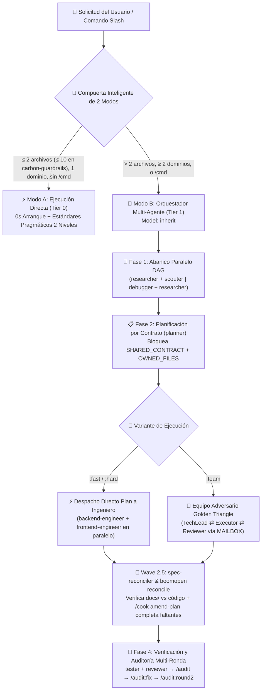

<div align="center">
  <h1>⚡ BoomOpen Workflow Kit v5.5.0</h1>
  <p><strong>Sistema Operativo de Fuerza Laboral IA Smart-Hybrid Multiplataforma — 22 Agentes Especialistas, 18 Equipos Triángulo Dorado y Bóveda de 1,460+ Habilidades Bajo Demanda</strong></p>

  <p>
    <a href="https://github.com/Kennyboom/BoomOpen-Workflow-Kit-Pro/releases"></a>
    <a href="#platforms"></a>
    <a href="#agents"></a>
    <a href="#skills"></a>
    <a href="https://nodejs.org/">=18.0.0" /></a>
    <a href="../LICENSE"></a>
  </p>

  <p>
    <a href="../README.md">🇬🇧 English</a> • <a href="./README.vi.md">🇻🇳 Tiếng Việt</a> • <a href="./README.zh-CN.md">🇨🇳 简体中文</a> • <a href="./README.zh-TW.md">🇹🇼 繁體中文</a> • <a href="./README.ja.md">🇯🇵 日本語</a> • <a href="./README.ko.md">🇰🇷 한국어</a> • <b>🇪🇸 Español</b> • <a href="./README.fr.md">🇫🇷 Français</a> • <a href="./README.de.md">🇩🇪 Deutsch</a><br/>
    <a href="./README.pt-BR.md">🇧🇷 Português</a> • <a href="./README.ru.md">🇷🇺 Русский</a> • <a href="./README.hi.md">🇮🇳 हिन्दी</a> • <a href="./README.ar.md">🇸🇦 العربية</a> • <a href="./README.id.md">🇮🇩 Bahasa Indonesia</a> • <a href="./README.th.md">🇹🇭 ไทย</a> • <a href="./README.tr.md">🇹🇷 Türkçe</a> • <a href="./README.it.md">🇮🇹 Italiano</a>
  </p>
</div>

---

## 🎬 Tráiler Oficial de Lanzamiento (Full HD 1080p)

<div align="center">
  <a href="https://github.com/Kennyboom/BoomOpen-Workflow-Kit-Pro/raw/main/assets/media/boomopen_v55_trailer_en.mp4">
    
  </a>
  <p>
    ▶️ <a href="https://github.com/Kennyboom/BoomOpen-Workflow-Kit-Pro/raw/main/assets/media/boomopen_v55_trailer_en.mp4"><b>Haz clic aquí para ver / reproducir el Tráiler Oficial de Lanzamiento en Full HD 1080p (MP4 con narración de estudio)</b></a>
  </p>
</div>

---

## 🌟 ¿Qué es BoomOpen Workflow Kit v5.5?

**BoomOpen Workflow Kit v5.5 (Multi-Platform Unified & Smart-Hybrid Edition)** es un sistema operativo multi-agente de código abierto que transforma un asistente de programación IA individual en una organización de ingeniería coordinada compuesta por **22 agentes especialistas**, **18 equipos adversarios Golden Triangle (72 archivos de equipo)**, **33 comandos slash (89 archivos de comandos y referencia)**, **22 habilidades principales (Core Skills)** y **1,440 habilidades especializadas (1,462 habilidades en total)**.

A diferencia de las plantillas rígidas o contenedores pesados que añaden sobrecarga de contexto en cada turno, BoomOpen v5.5 combina una **Compuerta Proactiva de Sub-agentes en el Turno 1**, **Enrutamiento en Lenguaje Natural en 17 Idiomas**, **Fragmentación Elástica de Enjambre de 4 Niveles (`role#shard`)**, **Auto-Reconciliación Especificación-Código Wave 2.5 (`boomopen reconcile` + `spec-reconciler`)**, **Auditoría Multi-Ronda Post-Completado (`/audit`, `/audit:round2`, `/audit:fix`)**, **Autopiloto Multisesión (`/autopilot`, `/autopilot:audit`)** y **Conductor Multimotor (`/conduct`)**:
- **🚀 Sub-agentes Paralelos en Turno 1, Reconciliación Wave 2.5 y Modo B**: La exploración abierta (`> 2` archivos), funcionalidades multidominio (`≥ 2` dominios), solicitudes en **los 17 idiomas soportados** o comandos `/cmd` explícitos lanzan al instante fragmentos paralelos (`role#shard`, `<= 3–4 OWNED_FILES`/shard) con **Abanico Paralelo DAG**, **Despacho Directo del Plan al Ejecutor**, **Bloqueos por Contrato (`SHARED_CONTRACT` + `OWNED_FILES`)**, **Reconciliación Wave 2.5 (`boomopen reconcile`, `spec-reconciler` y `/cook amend-plan` detectando módulos aislados, paridad de rutas/variables env y omisiones `[SC-*]` frente a `docs/`)** y **Reutilización en Caliente (`send_message`)**.
- **🏛️ Autopiloto Multisesión (`/autopilot`), Auditoría Multi-Ronda (`/audit`) y Motor de Seguridad Anti-Fugas 2 Capas v6**: Ingiere especificaciones multi-documento en un libro mayor inmutable `.boomopen/project-ledger.json` con protección SHA-256 y trinquete de 4 capas (`boomopen check --strict-phase --no-stubs`); al finalizar ejecuta auditorías integrales multi-ronda (`/audit` y `/autopilot:audit` → `.boomopen/audit-ledger.json`): Ronda 1 integral (cobertura RTM, flujo vertical UI→API→DB y **Motor de Seguridad Anti-Fugas de 2 Capas `security_scan.py` v6**) → revisión del usuario → `/audit:fix` → `/audit:round2` hasta lograr 0 hallazgos.
- **⚡ Modo A — Ejecución Micro-Directa de Objetivos Conocidos (0s en Frío)**: Preguntas simples y microediciones con **`≤ 2` archivos objetivo ya conocidos** en el Turno 1 (hasta `≤ 10` archivos en el perfil `carbon-guardrails`) se ejecutan y verifican **directamente** bajo los **Estándares Pragmáticos de 2 Niveles**.
- **📚 Bóveda de 1,462 Habilidades sin Inflar el Contexto**: **22 Habilidades Principales (`skills/`)** y **1,440 Habilidades Especializadas (`skills_library/`)** precompiladas en `matrix-skills/compact-index.json` para búsqueda `O(1)` en 2 pasos sin saturar el prompt.

---

## 🏗️ Arquitectura Híbrida-Inteligente (v5.5)



---

<a id="pillars"></a>

## 🧠 Los 6 Pilares Principales de v5.5

1. **🌐 Paridad Unificada en 5 Plataformas (`platforms/*`)**:
   - Instalación nativa de primera clase para **Antigravity (Gemini)**, **Claude Code**, **OpenAI Codex**, **Cursor** y **GitHub Copilot** desde una arquitectura única.
2. **📏 Estándares de Codificación Pragmáticos de 2 Niveles (Anti-Fragmentación)**:
   - **Nivel 1 — Calidad y Seguridad Estrictas (Tolerancia Cero)**: Responsabilidad Única, **PROHIBIDO `any` explícito**, **PROHIBIDO dejar `console.log` de depuración**, `try/catch` + manejo de errores tipado en límites async/API, constantes `SCREAMING_SNAKE_CASE`, DRY (`≥ 3`) e importaciones ordenadas.
   - **Nivel 2 — Guías Estructurales Flexibles (Cohesión Primero)**: Archivos cohesivos de `~200–350 líneas` (techo flexible `400` / división estricta `500`; tests, tipos y docs exentos); funciones de lógica `~20–40 líneas` (`~40–80` UI/Handlers).
3. **🎯 Fragmentación Elástica (`role#shard`) y Auto-Reconciliación Wave 2.5 (`spec-reconciler`)**:
   - Tras `PLAN-{feature}.md`, el Orquestador asigna tareas directamente a fragmentos (`<= 3–4 OWNED_FILES`/shard) y los reutiliza en caliente vía `send_message` con **0s de arranque en frío**.
   - En **Wave 2.5**, `spec-reconciler` y `boomopen reconcile` (`REC-G1..G4`) cotejan los requisitos de `docs/` frente al código real y corrigen módulos aislados, rutas o cláusulas omitidas con `/cook amend-plan` antes de cerrar la fase.
4. **🤝 Contratos Paralelos y Auditoría Multi-Ronda `/audit` (Motor Anti-Fugas v6)**:
   - `SHARED_CONTRACT` + `OWNED_FILES` evitan colisiones de escritura. Al concluir, `/audit` ejecuta la Ronda 1 de solo lectura (cobertura RTM, flujo vertical y **Motor de Seguridad Anti-Fugas 2 Capas v6**), solicita aprobación humana, aplica `/audit:fix` y vuelve a auditar en `/audit:round2` hasta llegar a 0 hallazgos.
5. **🔍 Depuración 5-Whys (SPIE v3.0) y Árbol Git 100% Limpio**:
   - `debugger` investiga cada error mediante 3 hipótesis y cadena causal **5-Whys**. Los artefactos transitorios (`PLAN`, `DEBUG`, `TEST`, `REVIEW`, `AUDIT`, `MAILBOX`) van a `<appDataDir>\brain\<conversation-id>\` manteniendo limpio el árbol Git.
6. **🩺 Suite CLI de 14 Comandos e Índice de Habilidades O(1)**:
   - `npm run doctor` valida los 5 paquetes de plataforma, **22 agentes**, **72 archivos de equipo (18 equipos)**, **89 archivos de comandos (33 comandos + 6 `_ref/`)** y `1,462` habilidades. Los **14 comandos CLI** (`research`, `design`, `plan`, `cook`, `reconcile`, `audit`, `ledger`, `conduct`, `check`, `doctor`, `settings`, `install`, `uninstall`, `list`) garantizan cumplimiento determinista.

---

<a id="platforms"></a>

## 💻 Plataformas de IA Soportadas

| Plataforma | Nivel de Soporte | Punto de Entrada Global | Ruta de Instalación del Framework |
|----------|:-------------:|-------------------|------------------------|
| **Antigravity (Gemini)** | ✅ Nativo v5.5 | `~/.gemini/GEMINI.md` | `~/.gemini/config/skills/boomopen-workflow-kit/` |
| **Claude Code** | ✅ Nativo v5.5 | `~/.claude/CLAUDE.md` | `~/.claude/skills/boomopen-workflow-kit/` |
| **OpenAI Codex** | ✅ Nativo v5.5 | `~/.codex/CODEX.md` & `AGENTS.md` | `~/.codex/skills/boomopen-workflow-kit/` |
| **Cursor** | ✅ Nativo v5.5 | `~/.cursor/rules/boomopen-workflow-kit.mdc` | `~/.cursor/skills/boomopen-workflow-kit/` |
| **GitHub Copilot** | ✅ Nativo v5.5 | `~/.copilot/COPILOT.md` | `~/.copilot/skills/boomopen-workflow-kit/` |

---

## 🚀 Inicio Rápido e Instalación

```bash
# 1. Clonar el repositorio
git clone https://github.com/Kennyboom/BoomOpen-Workflow-Kit-Pro.git
cd BoomOpen-Workflow-Kit-Pro

# 2. Instalar para tu asistente de IA (elige uno o --all para todos)
npm run install:antigravity   # Antigravity (Gemini)
npm run install:claude        # Claude Code
npm run install:codex         # OpenAI Codex
npm run install:cursor        # Cursor
npm run install:copilot       # GitHub Copilot
npm run install:all           # Instalar en las 5 plataformas simultáneamente

# 3. Verificar la instalación y compuertas de los 14 comandos CLI
npm run doctor
npm link
boomopen research validate path/to/RESEARCH.md
boomopen design validate path/to/DESIGN.md
boomopen plan validate path/to/PLAN.md
boomopen cook preflight path/to/PLAN.md
boomopen reconcile path/to/your/project --plan path/to/PLAN.md   # Reconciliación Wave 2.5 (REC-G1..G4)
boomopen audit init --docs docs/prd.md,docs/arch.md              # Iniciar auditoría multi-ronda
boomopen check path/to/your/project --strict-phase --no-stubs    # Longitud, any, console.log, cero stubs
boomopen ledger status
boomopen conduct probe
```

> El kit **no está publicado en npm**: instálalo solo desde este repositorio (`npm link` enlaza este clon local sin descargar nada de npm).

---

## 🎛️ Configuración Unificada y 5 Perfiles Predefinidos (`/settings`)

BoomOpen v5.5 incluye un **Centro de Control Unificado de Latencia Cero** que sincroniza **5 perfiles predefinidos** y 20 ajustes enumerados (+ 2 límites de líneas) en las **5 plataformas** en `< 10ms` (**0ms de latencia en el Turno 1**):

| Perfil Predefinido (`Preset`) | Modo (`execution.mode`) | Variante `/cmd` | Disparador Lenguaje Natural (`naturalLanguageResearchTrigger`) | Estándares (`codingStandards`) | Uso Recomendado |
|:---|:---|:---:|:---:|:---:|:---|
| **⚡ `smart-hybrid`** *(Recomendado)* | **`auto`** (`≤ 2` archivos → Modo A; `> 2` o `/cmd` → Modo B) | `auto` | **`auto_team`** *(Enruta a `/research:team` / `/brainstorm:team`)* | `pragmatic` (`400/500` líneas) | Ingeniería full-stack diaria: rápido en tareas pequeñas, profundo en arquitectura |
| **🛡️ `carbon-guardrails`** | **`mode_a`** (`≤ 10` archivos directos; Carbon lidera exploración y edición diaria) | `auto` | **`off`** *(Sin secuestro NL: solo responde a `/cmd` explícitos)* | `pragmatic` (`400/500` líneas) | Dejar que Antigravity Orchestrator Carbon lidere el día a día con barreras E2E estrictas y 400/500L |
| **🚀 `solo-fast`** | **`mode_a`** *(Fuerza Ejecución Directa Solo, 0s de sub-agentes)* | `fast` | `off` *(Respuesta directa salvo `/brainstorm`)* | `relaxed` (`600/800` líneas) | Hotfixes urgentes, prototipado rápido, scripts y ahorro de tokens |
| **🧠 `deep-architect`** | **`mode_b`** *(Fuerza Orquestador Multi-Agente en cada tarea)* | `hard` | `auto_hard` *(Enruta a `/research:hard` / `/brainstorm:hard`)* | `strict` (`300/400` líneas) | Arquitectura compleja, diseño greenfield y refactorización multidominio |
| **🔺 `adversarial-team`** | **`team`** *(Fuerza equipo adversario de 3 agentes `:team`)* | `team` | **`auto_team`** *(Revisión adversaria de 3 agentes vía `MAILBOX`)* | `strict` (`300/400` líneas) | Producción crítica, auditorías de seguridad y lanzamientos sin defectos |

> **🛡️ ¿Cómo funciona `carbon-guardrails`?** Antigravity Orchestrator Carbon dirige la exploración y las ediciones diarias (`mode_a`, `≤ 10` archivos directos), mientras BoomOpen aplica los estándares `pragmatic` (`400/500` líneas, cero `any`), verificación `strict_e2e` y barreras explícitas solo cuando invocas `/cmd`, evitando cualquier secuestro por lenguaje natural.

### Tres Formas de Cambiar de Modo (Chat `/settings`, Panel Web y CLI)

```bash
# 1. Comando Slash en el Chat
/settings                                     # Abrir menú interactivo (ask_question UI)
/settings preset smart-hybrid                 # Perfil recomendado por defecto
/settings preset carbon-guardrails            # Carbon al mando + barreras pragmáticas y E2E
/settings preset solo-fast                    # Ejecución Directa Rápida (Mode A)
/settings preset deep-architect               # Orquestador Multi-Agente (Mode B)
/settings preset adversarial-team             # Equipo Golden Triangle (:team)
/settings mode auto | mode_a | mode_b | team  # Cambiar modo de ejecución directamente

# 2. Panel Web Local (http://127.0.0.1:4567) y Terminal CLI
boomopen settings --ui
boomopen settings preset carbon-guardrails
cd path/to/your/project && boomopen settings set execution.mode mode_a --project
```

---

## 🎯 Referencia de Comandos Slash (33 Comandos / 89 Archivos)

| Comando | Variantes / Subcomandos | Propósito Principal |
|---------|----------|-----------------|
| **`/cook`** | `:fast`, `:hard`, `:team`, `amend-plan` | Desarrollo de extremo a extremo (Investigación → Plan → Código Paralelo → **Wave 2.5 `reconcile`** → Test → Revisión) |
| **`/code`** | `:fast`, `:hard`, `:team` | Ejecutar implementación directamente desde un `PLAN-{feature}.md` existente |
| **`/plan`** | `:fast`, `:hard`, `:team` | Crear planos con `SHARED_CONTRACT`, `OWNED_FILES` y criterios Given/When/Then |
| **`/fix`** | `:fast`, `:hard`, `:team` | Resolución de errores de causa raíz con pruebas de regresión obligatorias |
| **`/debug`** | `:fast`, `:hard`, `:team` | Investigación con 3 hipótesis + **5-Whys (SPIE v3.0)** (`DEBUG-{issue}.md`) |
| **`/test`** | `:fast`, `:hard`, `:team` | Ejecución paralela DAG de suites de pruebas + exploración de casos límite (`tester` + `scouter`) |
| **`/review`** | `:fast`, `:hard`, `:team` | Auditoría paralela en 4 dimensiones (Arquitectura, Calidad, Seguridad OWASP, Rendimiento) |
| **`/audit`** | `:run`, `:fix`, `:round2`, `:auto` | **Auditoría Multi-Ronda Post-Completado**: Ronda 1 integral (RTM, flujo vertical y Motor Anti-Fugas v6) → revisión → `/audit:fix` → `/audit:round2` hasta 0 hallazgos |
| **`/design`** | `:fast`, `:hard`, `:team` | Arquitectura del sistema, esquema de base de datos y especificación UI/UX (`DESIGN.md`) |
| **`/docs`** | `:core`, `:business`, `:audit` | Generar o sincronizar documentación estructurada de 2 niveles (`./documents/`) |
| **`/deploy`** | `:check`, `:preview`, `:production`, `:rollback` | Puertas pre-despliegue, entornos preview, rollout a producción y rollback seguro |
| **`/research`** | `:fast`, `:hard`, `:team` | Motor de investigación profunda (triangulación de 4 fuentes, 3 olas y consejo de 3 vectores) |
| **`/brainstorm`** | `:fast`, `:hard`, `:team` | Descubrimiento socrático de requisitos, análisis de compensaciones e ideación |
| **`/report`** | `:fast`, `:hard`, `:team` | Informes ejecutivos y técnicos de síntesis con métricas y diagramas |
| **`/autopilot`** | `:init`, `:run`, `:audit` | Orquestador autónomo multi-sesión con `.boomopen/project-ledger.json` y trinquete de 4 capas (`/autopilot:audit` para auditoría final) |
| **`/conduct`** | `:council`, `:pipeline` | Conductor multi-motor y consejo paralelo (`boomopen conduct`) con consenso en 4 partes |
| **`/orchestrate`** | — | Orquestación personalizada de tuberías multi-agente en múltiples dominios |
| **`/settings`** | `preset`, `mode`, `set`, `ui` | Centro de Control Unificado: 5 perfiles, 20 ajustes + 2 límites de líneas o Web UI (`--ui`) |
| **`/save` / `/recap`** | — | Persistir estado de sesión (`SESSION-HANDOVER.md`) y restaurar contexto en `< 5s` |

---

## 🌙 Guía Nocturna para Proyectos Multifase (`/autopilot` vs `/goal` + `/autopilot` + `/audit`)

Para construir proyectos grandes de múltiples fases durante la noche, combina **`/goal` + `/autopilot` + `/audit`** en lugar de usar un `/autopilot` aislado:

| Modo | Alcance y Comportamiento | Garantías de Libro Mayor, Puertas y Auditoría | Cuándo Usarlo |
|:---|:---|:---|:---|
| **`/autopilot` individual** | Se ejecuta en una sola sesión; se detiene limpiamente al ~70% de contexto y pausa en la aprobación inicial del `PLAN` | Seguimiento en `.boomopen/project-ledger.json` y verificación estándar por fase | Trabajo interactivo de día o fases acotadas |
| **`/goal` + `/autopilot` + `/audit`** | **`/goal` impulsa de forma persistente todas las fases durante la noche** mientras `/autopilot` conserva la disciplina del libro mayor | Seguimiento en `project-ledger.json` + **5 puertas** (`research`, `design`, `plan`, `cook`, `check`) + **Wave 2.5 `reconcile`** + **Ronda 1 `/audit`** (seguido de `/audit:fix` → `/audit:round2` al revisar) | Construcción nocturna autónoma de extremo a extremo desde `docs/` |

**📋 Prompt nocturno listo para copiar y usar:**

```text
/goal /autopilot Lee todas las especificaciones en `docs/`, inicializa .boomopen/project-ledger.json
y construye todas las fases de principio a fin siguiendo el PLAN inicial aprobado.
En cada fase ejecuta obligatoriamente:
1) Implementación paralela por contrato (SHARED_CONTRACT + OWNED_FILES)
2) Wave 2.5 spec-reconciler con boomopen reconcile (completando brechas respecto a docs/, módulos aislados y paridad de rutas/env)
3) boomopen check --strict-phase --no-stubs y suite E2E completa en verde antes de cerrar la fase
Al completar todas las fases, ejecuta la Ronda 1 de /audit (/autopilot:audit) y entrega el reporte listo para revisión y /audit:fix.
```

---

<a id="agents"></a>

## 🤖 22 Agentes Especialistas y 18 Equipos Golden Triangle

| Categoría | Agentes Especialistas (`agents/*.md`) | Equipos Golden Triangle (`agents/teams/*-team/`) |
|----------|-----------------------------------|------------------------------------------------|
| **Ingeniería y Ejecución** | `backend-engineer`, `frontend-engineer`, `mobile-engineer`, `game-engineer`, `database-architect`, `devops-engineer` | `backend-team`, `frontend-team`, `fullstack-team`, `mobile-team`, `game-team`, `database-team`, `devops-team` |
| **Arquitectura y Planificación** | `tech-lead`, `planner`, `brainstormer`, `business-analyst`, `project-manager`, `designer` | `planning-team`, `brainstorm-team`, `project-team`, `design-team` |
| **Calidad, Seguridad y Depuración** | `debugger`, `tester`, `reviewer`, **`spec-reconciler`**, `security-engineer`, `performance-engineer` | `debug-team`, `qa-team`, `security-team`, `performance-team` |
| **Investigación y Conocimiento** | `researcher`, `scouter`, `docs-manager`, `reporter` | `research-team`, `docs-team`, `report-team` |

---

<a id="skills"></a>

## 📚 Bóveda de 1,460+ Habilidades (22 Principales + 1,440 de Biblioteca)

BoomOpen reúne `1,462` habilidades curadas con **0 consumo de tokens en reposo** mediante **Resolución Progresiva O(1) en 2 Pasos** (`<skills>` → `matrix-skills/compact-index.json` → carga exacta de `SKILL.md` bajo demanda):

| Nivel / Dominio de Habilidad | Cantidad | Habilidades y Capacidades Representativas | Mecanismo de Carga |
|:---|:---:|:---|:---|
| **⚡ Nivel 1: Habilidades Principales (`skills/`)** | **22** | `clean-code`, `debugger`, `plan-writing`, `brainstorming`, `frontend-design`, `frontend-architecture`, `design-spec`, `api-patterns`, `database-design`, `testing-patterns`, `skill-seeker` | Preindexado en `<skills>` para acceso instantáneo en Turno 1 |
| **🎨 Diseño UI/UX, Motion y Sistemas de Diseño** | **42** | Anti-AI-Slop Visual Craft, paletas OKLCH y Bento Grids, Motion v12 + CSS View Transitions, primitivas headless (`cmdk`/`vaul`/`sonner`), Figma MCP + W3C DTCG Tokens, WCAG 2.2 AA/AAA, iOS 18 HIG y Material 3 Expressive | Bajo demanda vía `compact-index.json` (`matrix-skills/design.yaml`) |
| **🌐 Web, Backend y Sistemas Distribuidos** | **390+** | Next.js/React 19, FastAPI, NestJS, microservicios Go/Rust, GraphQL, gRPC, arquitectura orientada a eventos Redis/Kafka, SaaS multi-tenant | Bajo demanda vía `compact-index.json` (`skills_library/`) |
| **🤖 IA, Agentes LLM e Ingeniería de Datos** | **320+** | Pipelines RAG, servidores LangGraph/MCP, ingeniería de prompts, Vertex AI, analítica BigQuery, dbt, Spark, bases de datos vectoriales | Bajo demanda vía `compact-index.json` (`skills_library/`) |
| **☁️ Cloud, DevOps, Kubernetes y Seguridad** | **300+** | Terraform/OpenTofu, AWS/GCP/Azure, Docker/K8s GitOps, CI/CD, auditoría OWASP Top 10, autenticación Zero-Trust | Bajo demanda vía `compact-index.json` (`skills_library/`) |
| **📱 Móvil, Motores de Juegos y Dominios Especializados** | **410+** | iOS Swift/SwiftUI, Android Kotlin, React Native, Flutter, Unity 6, Unreal Engine 5, Godot 4, WebGL/Three.js, Finanzas Cuantitativas, Web3 | Bajo demanda vía `compact-index.json` (`skills_library/`) |

---

## 📂 Estructura del Repositorio

```text
BoomOpen-Workflow-Kit-Pro/
├── agents/                  # 22 Agentes Especialistas (incl. spec-reconciler) + 18 Equipos Golden Triangle (54 roles + 18 _team.md, 72 archivos)
├── cli/                     # Suite CLI de 14 comandos: install, doctor, checker, settings, research, design, plan, cook, reconcile, audit, ledger & conductor
├── commands/                # 83 flujos de comandos Slash (33 comandos: :fast/:hard/:team, :run/:fix/:round2/:auto, :init/:run/:audit, etc.) + 6 _ref/ (89 archivos)
├── documents/               # Documentación de 2 niveles de Arquitectura, Dominio, Código Base y Estándares
├── i18n/                    # Documentación internacionalizada (16 traducciones completas de README)
├── matrix-skills/           # Matrices YAML de habilidades por dominio + compact-index.json precompilado (1,462 habilidades)
├── platforms/               # Plantillas unificadas para las 5 plataformas (antigravity/, claude/, codex/, copilot/, cursor/)
├── rules/                   # Reglas bajo demanda del Modo B (CORE, PHASES, AGENTS, TEAMS, SKILLS, ERRORS, REFERENCE)
├── scripts/                 # Scripts Python de verificación y seguridad (security_scan.py v6, checklist.py, verify_all.py, etc.)
├── skills/                  # 22 Habilidades Principales (clean-code, debugger, plan-writing, frontend-design, etc.)
├── skills_library/          # 1,440 habilidades especializadas cargadas bajo demanda mediante búsqueda en 2 pasos
└── GEMINI.md | CLAUDE.md | CODEX.md | COPILOT.md | CURSOR.md | AGENT.md
```

---

## 📄 Licencia y Seguridad

- **Licencia**: Distribuido bajo la [Licencia MIT](../LICENSE). Copyright © 2026 **BoomOpen Labs**. Las skills de terceros en `skills_library/` conservan sus licencias originales; consulta [THIRD_PARTY_NOTICES.md](../THIRD_PARTY_NOTICES.md).
- **Política de Seguridad**: Consulta [SECURITY.md](../SECURITY.md) para conocer las protecciones integradas y el procedimiento de reporte de vulnerabilidades.
